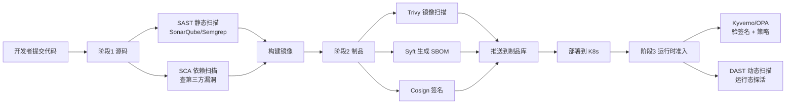

# DevSecOps 与软件供应链安全

::: tip 本篇定位
安全不能再等上线前"临时抱佛脚"。这篇讲**安全左移**：在 CI/CD 流水线每个节点自动插哪些检查（SAST/DAST/SCA/镜像扫描/SBOM/签名/准入），用什么开源工具（Trivy、Syft、Cosign、SonarQube、Kyverno），以及 SLSA 供应链等级是什么。适合要把"安全检查"自动化进流水线、堵住软件供应链攻击的 SRE。
本篇版本：Trivy v0.74.0、SonarQube Community Build 26.9.0.129388、Syft v1.43.0、Cosign v3.0.6、Kyverno（开源准入策略引擎）。所有版本以官网当前稳定版为准。
:::

## 一、背景与基础

### 1.1 小白类比：把安检门装进流水线

传统安全像**机场只在登机口查一次证**：临上线前安全同学手扫一遍，问题多、慢、还容易漏。

**DevSecOps = 把安检门搬到传送带的每一道工序上**：代码刚提交就查代码质量，依赖一下载就查有没有已知漏洞，镜像一构建就扫漏洞+生成物料清单，镜像推送时**签名**，部署到 K8s 时准入控制器再验一遍签名。哪道工序不合格，传送带直接停，坏东西流不到生产。

> 核心理念：**Security as Code / 安全左移**——把安全做成流水线里自动跑的检查，而不是上线前的人工审批。

### 1.2 流水线安全检查点全景



### 1.3 各类扫描一表分清

| 缩写 | 全称 | 扫什么 | 类比 | 工具 |
|---|---|---|---|---|
| **SAST** | 静态应用安全测试 | 源码本身的漏洞/坏味道（不运行程序） | 对着菜谱找错别字 | SonarQube、Semgrep |
| **SCA** | 软件成分分析 | 第三方依赖里的已知 CVE、许可证 | 检查食材是不是过期 | Trivy（fs/repo）、Dependabot |
| **DAST** | 动态应用安全测试 | 运行中的服务探活找漏洞 | 点菜试吃看会不会拉肚子 | OWASP ZAP |
| **镜像扫描** | —— | 镜像里的系统包/应用依赖漏洞 | 开箱前扫整箱货 | Trivy |
| **IaC 扫描** | —— | Terraform/K8s YAML 配置错误 | 检查消防设计图 | Trivy tf |

## 二、SAST：SonarQube 与 Semgrep

### 2.1 SonarQube Community Build 26.9

SonarQube 是最主流的代码质量与安全扫描平台，开箱看 Bug、漏洞、坏味道、测试覆盖率。社区版免费，支持 20+ 语言。

```bash
# 用 Docker 起社区版（固定版本号）
docker run -d --name sonarqube \
  -p 9000:9000 \
  -v sonarqube_data:/opt/sonarqube/data \
  sonarqube:26.9.0.129388-community
# 首次访问 http://服务器:9000，默认 admin/admin，立即改密码
```

CI 里用 scanner 扫（在仓库根目录）：

```bash
docker run \
  -e SONAR_HOST_URL="http://sonarqube:9000" \
  -e SONAR_TOKEN="$SONAR_TOKEN" \
  -v "$PWD:/usr/src" \
  sonarsource/sonar-scanner-cli:6 \
  sonar-scanner \
  -Dsonar.projectKey=order-service \
  -Dsonar.sources=.
```

### 2.2 Semgrep（轻量、规则即代码）

Semgrep 适合在 PR 上快速跑自定义规则，比 SonarQube 更轻、规则可自定义。

```bash
# 跑 Semgrep（容器）
docker run --rm -v "${PWD}:/src" semgrep/semgrep:1.112.0 \
  semgrep --config=auto /src --error
# --config=auto 自动选适合该语言的规则集；--error 有高危就退出非 0 阻断
```

## 三、Trivy：一把瑞士军刀

Trivy 一个二进制搞定**镜像 / 文件系统 / Git 仓库 / IaC / 配置**扫描，是 DevSecOps 的主力。

### 3.1 常用命令（v0.74.0）

```bash
# 1) 扫镜像（最常用），只报 HIGH/CRITICAL，发现就退出码 1
trivy image --severity HIGH,CRITICAL --exit-code 1 \
  harbor.example.com/team/order:v1.4.0

# 2) 扫本地源码/依赖目录（SCA：查第三方依赖 CVE）
trivy fs --scanners vuln,secret,misconfig ./

# 3) 扫 IaC（Terraform / K8s YAML 的配置错误）
trivy config ./terraform/

# 4) 扫 Git 仓库历史里有没有硬编码密钥
trivy repo --scanners secret https://github.com/your-org/order-service.git

# 输出格式：SARIF（接 GitHub 代码扫描）/ CycloneDX SBOM
trivy image --format sarif --output result.sarif myapp:v1
trivy image --format cyclonedx --output sbom.json myapp:v1
```

### 3.2 在 GitHub Actions 里集成

```yaml
- name: Trivy 镜像扫描
  uses: aquasecurity/trivy-action@0.35.0      # 固定 tag，注意供应链版本
  with:
    image-ref: harbor.example.com/team/order:v1.4.0
    format: 'sarif'
    output: 'trivy-results.sarif'
    severity: 'CRITICAL,HIGH'
    exit-code: '1'          # 有高危就让流水线失败
- name: 上传 SARIF 到 GitHub 代码扫描
  uses: github/codeql-action/upload-sarif@v3
  with: { sarif_file: 'trivy-results.sarif' }
```

::: warning Trivy Action 供应链事件提醒
历史上 `aquasecurity/trivy-action` / `setup-trivy` 曾被投毒。生产中引用第三方 Action 务必**固定到具体 tag 或 commit SHA**，关注官方安全公告，及时升级到安全版本。
:::

## 四、SBOM：软件物料清单

### 4.1 小白类比

SBOM（Software Bill of Materials）就是**这碗菜的食材清单**：镜像里到底打包了哪些开源库、什么版本。一旦某个开源库（如 Log4j）爆了 CVE，你拿着 SBOM 一查就知道"我哪些服务中招了"，不用挨个问。

### 4.2 用 Syft 生成（v1.43.0）

```bash
# 生成 SPDX 格式 SBOM
syft harbor.example.com/team/order:v1.4.0 -o spdx-json=sbom.spdx.json

# 生成 CycloneDX 格式
syft harbor.example.com/team/order:v1.4.0 -o cyclonedx-json=sbom.cdx.json
```

把 SBOM 随镜像一起存进制品库（附件），便于事后应急响应时快速定位受影响资产。

## 五、Cosign 镜像签名与验签

光扫描还不够，还要保证"部署到生产的镜像确实是我们 CI 构建出来的、没被人偷偷换过包"。**Cosign（Sigstore 项目）**给镜像签名。

### 5.1 keyless（无密钥，CI 里最省事）与密钥两种模式

| 模式 | 原理 | 适合 |
|---|---|---|
| **keyless（临时证书）** | CI 里用 OIDC 身份拿短时证书签名，私钥不落盘 | GitHub Actions 等 CI 自动签名，最推荐 |
| **密钥对** | 自己生成/管理 cosign key pair | 离线环境、需要长期验签密钥 |

### 5.2 CI 里签名 + 集群里验签

```bash
# CI 里 keyless 签名（GitHub Actions 中需 id-token: write 权限）
cosign sign --yes harbor.example.com/team/order:v1.4.0

# 集群侧准入前验签：只允许带我们签名的镜像运行
COSIGN_EXPERIMENTAL=1 cosign verify \
  --certificate-identity-regexp "https://github.com/your-org/*" \
  --certificate-oidc-issuer "https://token.actions.githubusercontent.com" \
  harbor.example.com/team/order:v1.4.0
```

## 六、准入控制：Kyverno / OPA Gatekeeper

镜像推上去、签好了，部署到 K8s 时还要**准入控制器**在 API Server 拦截：只允许"已签名 + 无 Critical 漏洞 + 不以 root 跑 + 必须设 requests/limits"的 Pod 进集群。

| 工具 | 特点 |
|---|---|
| **Kyverno** | 策略就是 Kubernetes YAML，对 K8s 原生、学习曲线低 |
| **OPA Gatekeeper** | 策略用 Rego 语言表达，灵活但陡峭 |

Kyverno 校验镜像签名的策略片段：

```yaml
apiVersion: kyverno.io/v1
kind: ClusterPolicy
metadata:
  name: verify-image-signatures
spec:
  validationFailureAction: Enforce     # 不合规直接拒绝
  rules:
    - name: verify-cosign-signature
      match:
        any:
          - resources: { kinds: ["Pod"] }
      verifyImages:
        - imageReferences:
            - "harbor.example.com/team/*"
          attestors:
            - entries:
                - keyless:
                    issuer: "https://token.actions.githubusercontent.com"
                    subject: "https://github.com/your-org/*"
```

## 七、SLSA 供应链等级

SLSA（Supply-chain Levels for Software Artifacts）给软件供应链的"成熟度"分级：

| 等级 | 含义 |
|---|---|
| **SLSA 1** | 构建过程有文档、产出构建说明 |
| **SLSA 2** | 构建在托管平台上、有版本控制、产生签名 provenance |
| **SLSA 3** | 构建平台 hardened、隔离、源码受保护、 provenance 被签名 |
| **SLSA 4** | 双人评审 + 隔离构建 + 可验证的签名来源 |

> 目标不是一步到位 SLSA 4，而是**逐级提升**：有 SBOM、有签名、有 provenance，就已经甩开大部分团队。

## 八、完整流水线安全阶段示例

```yaml
# .github/workflows/secure-pipeline.yml
name: secure-ci
on: [pull_request]
jobs:
  security:
    runs-on: ubuntu-24.04
    permissions:
      contents: read
      id-token: write          # Cosign keyless 需要
    steps:
      - uses: actions/checkout@v4
      - name: SAST (Semgrep)
        uses: semgrep/semgrep-action@v1
      - name: SCA + 扫密钥 (Trivy fs)
        run: trivy fs --scanners vuln,secret --exit-code 1 .
      - name: 构建并推 staging 镜像
        run: |
          echo "${{ secrets.HARBOR_TOKEN }}" | docker login harbor.example.com -u ci --password-stdin
          docker build -t harbor.example.com/staging/order:${GITHUB_SHA::12} .
          docker push harbor.example.com/staging/order:${GITHUB_SHA::12}
      - name: 镜像漏洞扫描
        run: trivy image --severity CRITICAL --exit-code 1 harbor.example.com/staging/order:${GITHUB_SHA::12}
      - name: 生成 SBOM (Syft)
        run: syft harbor.example.com/staging/order:${GITHUB_SHA::12} -o cyclonedx-json=sbom.json
      - name: 签名 (Cosign keyless)
        uses: sigstore/cosign-installer@v4.0.0
      - run: cosign sign --yes harbor.example.com/staging/order:${GITHUB_SHA::12}
```

## 九、常见问题排错

| 现象 | 原因 | 解决 |
|---|---|---|
| Trivy 一直报某个旧镜像有 Critical | 基础镜像没更新 | 升级基础镜像重新构建，别只修应用层 |
| Cosign keyless 签名在 CI 失败 | 没开 `id-token: write` | workflow 里加 `permissions: id-token: write` |
| Kyverno 把正常 Pod 全拦了 | 策略 `Enforce` 但规则写错 | 先把 `validationFailureAction` 设 `Audit` 观察，确认无误再切 `Enforce` |
| SonarQube 覆盖率为 0 | 没传覆盖率报告文件 | 跑测试时生成 cobertura/xml 并 `sonar.coverageReportPaths` |
| 扫出硬编码密钥但还在 Git 历史里 | 只在当前文件挡了 | 轮换该密钥（已泄露），用 `git filter-repo` 清历史 |
| SBOM 找不到新引入的依赖 | 锁文件没提交 | 确保 package-lock/go.sum 进仓库再扫 |

::: warning 生产红线
- 高危（CRITICAL）漏洞镜像**禁止晋升生产**；准入策略 `Enforce` 后要先 `Audit` 灰度。
- 所有镜像**必须签名**，集群侧只允许验签通过的镜像运行（防止供应链替换）。
- 第三方 Action / 扫描器 Action **固定 commit SHA**，定期关注投毒公告升级。
- 一旦发现真硬编码密钥：**立即轮换密钥**，光删代码没用，Git 历史里还在。
- 扫描规则别一上来就 `exit-code 1` 卡死所有团队，先设基线、再逐步收紧。
:::

## 相关速查

- 扫出来的镜像放哪、怎么晋升：[制品库 Harbor 与 Nexus](./devops-artifacts)
- 签名后密钥/证书怎么管：[密钥与证书管理](./devops-secrets)
- 部署到 K8s 与 GitOps：[GitOps（ArgoCD）](./automation-gitops)
- 运行时出问题怎么定位：[OpenTelemetry 可观测](./monitor-opentelemetry)
- K8s 命令：[kubectl 命令速查](/reference/kubectl-commands)

### 官方文档

- Trivy 文档：https://trivy.dev/
- Trivy releases：https://github.com/aquasecurity/trivy/releases
- SonarQube Community Build 下载：https://www.sonarsource.com/products/sonarqube/downloads/
- SonarQube Community Build 文档：https://docs.sonarsource.com/sonarqube-community-build/
- Semgrep 文档：https://semgrep.dev/docs/
- Syft 文档：https://anchore.com/opensource/
- Syft releases：https://github.com/anchore/syft/releases
- Cosign 文档：https://docs.sigstore.dev/cosign/
- Cosign releases：https://github.com/sigstore/cosign/releases
- Kyverno 文档：https://kyverno.io/
- SLSA 官方：https://slsa.dev/
