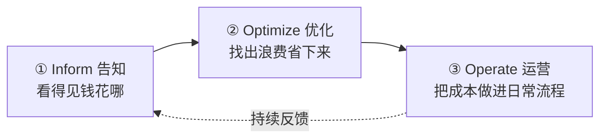
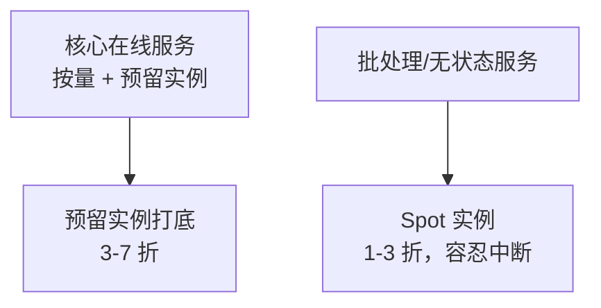

# FinOps 云成本治理

::: tip 本篇定位
云上账单月底一看吓一跳，但说不清"钱花哪了、哪个业务超支、谁该背这个钱"。这篇讲 **FinOps**：怎么让成本**可见、可分摊、可优化、可告警**，重点在 Kubernetes 上用 **OpenCost / Kubecost** 按 namespace/label 算账，怎么 right-sizing、用 Spot、买预留实例。适合背云预算、想把"乱花钱"变成"按业务算账"的 SRE/平台团队。
本篇版本：OpenCost 1.121.0（CNCF）、Kubecost v3.1（IBM/Apptio）。所有版本以官网当前稳定版为准。
:::

## 一、背景与基础

### 1.1 小白类比：从"全家共用一张卡"到"各自记账 AA"

以前物理机房，钱是年初一次性花的，买完服务器就放那，没人天天算成本。上云后资源随用随开，**像手机流量不设套餐随便跑**——开发随手开个大规格机器忘了关，月底账单就爆炸。

FinOps 就是给云开支**装一套"家庭记账 + AA 分摊"系统**：
- **看得见**：每一笔花在哪、哪个业务、哪个团队；
- **分得清**：公共底座成本怎么摊到各业务；
- **省得下**：找出浪费、用更便宜的方式买；
- **管得住**：超预算报警、异常波动告警。

> 关键认知：**FinOps 不是财务一个部门的事**，是工程、财务、业务一起对成本负责。

### 1.2 FinOps 三阶段



| 阶段 | 干什么 | 产出 |
|---|---|---|
| **Inform（告知）** | 成本可视化、按标签分摊、出账单报表 | "谁花了多少"一目了然 |
| **Optimize（优化）** | right-sizing、关停闲置、用 Spot、买预留 | 把浪费挤掉 |
| **Operate（运营）** | 预算、告警、把成本指标纳入团队 KPI | 长期可持续 |

### 1.3 协作角色

| 角色 | 在 FinOps 里的责任 |
|---|---|
| **平台/SRE** | 搭成本工具、做标签规范、优化集群利用率 |
| **开发/业务团队** | 对自己服务的成本负责、按建议 right-size |
| **财务** | 定预算、做分摊口径、出账单 |
| **管理层** | 定成本目标、推动跨团队协作 |

## 二、成本可视化与分摊

### 2.1 标签规范（一切分摊的基础）

**没有标签，就没有分摊。** 云上每个资源都要打标签，否则账单是一笔糊涂账。

```yaml
# 强制标签规范（示例，写进 IaC / 准入策略）
team: order            # 哪个团队
app: order-service      # 哪个应用
environment: prod       # 环境
business-unit: trade    # 哪个业务线
cost-center: CC-1001    # 成本中心
```

> 类比：标签就是快递单上的"收件人"。没写收件人的包裹（资源），最后只能大家平摊，没人会主动省。

### 2.2 共享成本怎么分摊

集群控制面、公共数据库、Ingress 网关这类"大家共用"的成本，不能算在某一个团队头上。常见分摊方式：

| 分摊方式 | 做法 | 适合 |
|---|---|---|
| 按用量分摊 | 谁用的 CPU/内存多谁多付 | 计算资源 |
| 按人头/收入 | 按团队人数或业务收入比例摊 | 公共底座 |
| 固定比例 | 事先约定好比例 | 稳定的公共服务 |

## 三、Kubernetes 成本：OpenCost 与 Kubecost

K8s 里你申请的是 `requests`，不是实际用量。**成本要按 requests 占整集群的比例来分摊**。

### 3.1 OpenCost vs Kubecost

| 维度 | OpenCost | Kubecost |
|---|---|---|
| 定位 | CNCF 开源、轻量成本模型 | 商业产品（有免费层），功能全 |
| 强项 | 按 namespace/label 算 K8s 成本、API | 预算、异常告警、right-size 建议、多集群 |
| 适合 | 想自己搭、轻量、可控 | 想要开箱即用的全套成本治理 |

### 3.2 安装 OpenCost（1.121.0）

```bash
# 安装 OpenCost（固定 chart/镜像版本）
helm repo add opencost https://opencost.io/helm
helm install opencost opencost/opencost \
  --namespace opencost --create-namespace \
  --set image.tag=prod-1.121.0
# 访问 NodePort/Ingress，默认 UI 在 9003 端口
```

```bash
# 按 namespace 看成本（API）
curl http://opencost.opencost.svc:9003/allocation/compute \
  | jq '.[] | {namespace, totalCost}'
```

### 3.3 Kubecost 看分摊（v3.1）

```bash
# 安装 Kubecost（Helm，固定版本）
helm repo add kubecost https://kubecost.github.io/cost-analyzer/
helm install kubecost kubecost/cost-analyzer \
  --namespace kubecost --create-namespace \
  --set kubecostImage="kubecost/cost-analyzer:v3.1.0"
```

进去后重点看：
- **Allocation**：按 namespace / label 拆每个服务花了多少钱；
- **Right Sizing Recommendations**：哪些 Pod requests 设太大了；
- **Efficiency**：集群整体资源利用率。

## 四、优化手段

### 4.1 requests/limits right-sizing（最直接省钱）

很多人图省事把 requests 设得很大，导致**大量资源申请了却没用**，集群被占满又得加机器。

```yaml
# ❌ 反面：requests 远大于实际用量，浪费
resources:
  requests: { cpu: "2", memory: "8Gi" }
  limits:   { cpu: "4", memory: "16Gi" }
```

做法：用监控看**实际 P95 用量**，把 requests 调到略高于实际峰值（留 ~20% 余量）。Kubecost/OpenCost 会直接给建议值。

### 4.2 弹性伸缩

| 手段 | 干什么 | 省在哪 |
|---|---|---|
| **HPA** | 按 CPU/自定义指标自动增减 Pod 副本 | 波谷少跑副本 |
| **Cluster Autoscaler** | 按 Pod 需求自动增减节点 | 波谷少开节点 |
| **VPA** | 自动调 requests | 避免手设过大 |

### 4.3 Spot / 抢占式实例

| 实例类型 | 折扣 | 风险 | 适合 |
|---|---|---|---|
| 按量 On-Demand | 原价 | 无 | 有状态、核心在线 |
| **Spot/抢占式** | 1~3 折 | 云厂商可能随时（提前几分钟）回收 | 无状态、可中断、批处理 |
| **预留实例/储蓄计划 RI/Savings** | 买 1~3 年承诺，3~7 折 | 提前承诺 | 长期稳定负载 |



> 组合拳：**稳定基线用预留实例打折，波动部分用 Spot 省钱，两者之间用 On-Demand 兜底**。

### 4.4 别忽视的隐形账单

| 类别 | 容易浪费的点 |
|---|---|
| **存储** | 旧快照没删、闲置云盘、对象存储冷热不分层 |
| **网络** | 跨区流量、公网出向流量（egress）很贵 |
| **IP/负载均衡** | 闲置的 EIP、没删的 LB |
| **日志/监控** | 日志无限保留、高基数指标打爆存储 |

## 五、预算与成本异常告警

```yaml
# Kubecost 预算示例：order 团队月预算 $5000，超 80% 告警
apiVersion: kustomize.toolkit.fluxcd.io/v1
kind: Kustomization
# （概念示意）在 Kubecost 里配置 budget：
#  scope: namespace:order
#  amount: 5000
#  window: monthly
#  threshold: 0.8        # 用到 80% 就告警
#  notifications: [slack/钉钉 webhook]
```

成本异常告警比预算更灵敏：**昨天还花 $100，今天突然 $500，立刻告警**——通常是有人开了大机器忘了关、或测试环境没销毁。

## 六、落地步骤

1. **先打通可见性**：装 OpenCost/Kubecost，先能按 namespace 看到钱花哪。
2. **立标签规范**：准入策略强制每个资源带 `team/app/environment` 标签。
3. **出第一份账单报表**：按团队/业务线出月度成本报告，让大家有感知。
4. **做 right-sizing 专项**：按建议把 requests 过大的 Pod 调小，回收节点。
5. **引入弹性 + Spot**：无状态服务上 HPA + Cluster Autoscaler，批处理上 Spot。
6. **买预留实例**：把稳定基线用 RI/储蓄计划覆盖。
7. **设预算与异常告警**：接入 Slack/钉钉，长期运营。
8. **联动容量规划**：成本趋势反推未来 3~6 月的容量与采购。

## 七、常见问题排错

| 现象 | 原因 | 解决 |
|---|---|---|
| OpenCost 显示成本为 0 | 没配云厂商价格 / 没接 metrics | 配置云厂商 API key 或自定义 pricing，确认 Prometheus 在采集 |
| 某个 namespace 成本特别高 | 大 requests / 闲置 Pod | 看 right-size 建议，下调 requests，删闲置工作负载 |
| 账单和 K8s 成本对不上 | 云账单含网络/存储/控制面，K8s 只算计算 | OpenCost/Kubecost 补接 Cloud Costs 模块 |
| Spot 实例被频繁回收 | 选的机型现货余量少 | 多可用区多机型混合调度，配中断优雅终止 |
| 标签打不齐 | 没准入强制 | 用 Kyverno/OPA 校验：缺标签的资源不让建 |
| 预留实例买多了浪费 | 没看清长期基线就买 | 先按量跑 1~3 个月看清稳态，再买 RI |

::: warning 生产红线
- **标签是 FinOps 的地基**：准入策略强制关键标签，缺标签资源不让创建。
- right-sizing 要**先观测再调整**，别拍脑袋砍 requests，小心砍到 OOM。
- Spot 只用于**可中断的无状态/批处理**，有状态核心数据库别上 Spot。
- 预留实例**先有稳定用量再买**，别为了折扣过度承诺。
- 成本异常告警要接入值班通道，发现"谁开了大机器忘了关"立刻追。
:::

## 相关速查

- 成本数据来自这些指标：[OpenTelemetry 统一可观测](./monitor-opentelemetry)
- 容量与灾备：[容量规划、高可用与灾备](./sre-capacity-dr)
- 集群伸缩：[K8s 架构与集群](./container-k8s-01-architecture-cluster)
- 基础设施即代码里打标签：[Terraform](./automation-terraform)
- K8s 命令：[kubectl 命令速查](/reference/kubectl-commands)

### 官方文档

- OpenCost 官网：https://opencost.io/
- OpenCost 文档：https://opencost.io/docs/
- OpenCost releases：https://github.com/opencost/opencost/releases
- Kubecost 文档：https://docs.kubecost.com/
- Kubecost releases：https://github.com/kubecost/kubecost/releases
- FinOps 基金会：https://www.finops.org/
