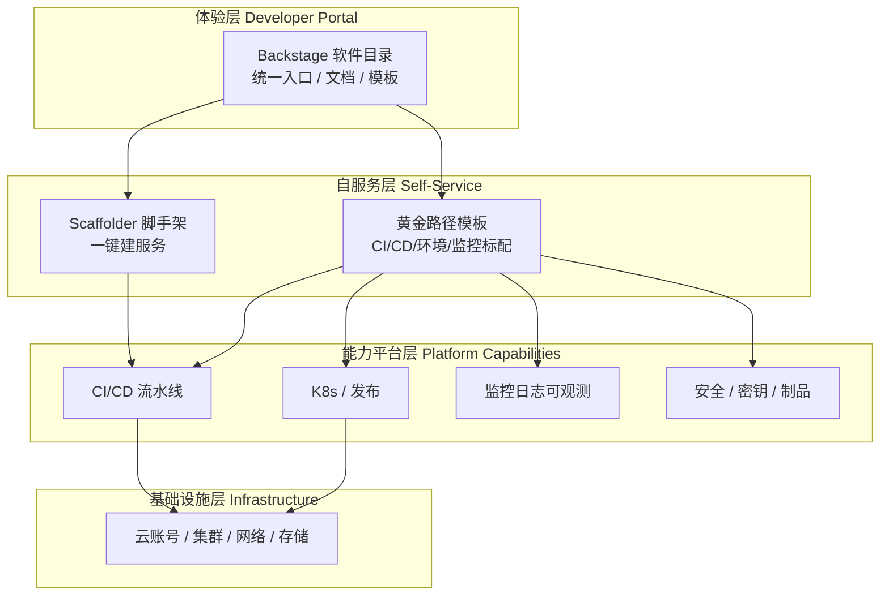
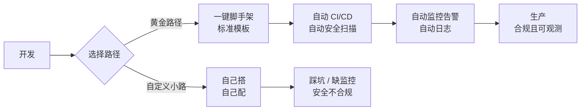
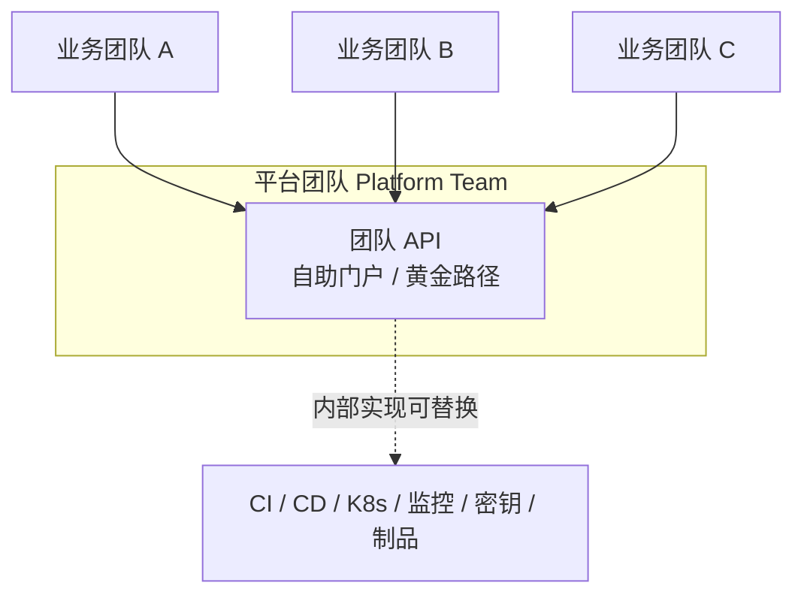

# 平台工程与内部开发者平台（IDP）

::: tip 本篇定位
当团队从几个人涨到几十上百人，"每个人都要会 K8s、会 Terraform、会配监控和告警"会变成灾难。这篇讲清楚**平台工程（Platform Engineering）**到底要解决什么问题、内部开发者平台（IDP）长什么样、Backstage 怎么搭、什么是黄金路径与 DevEx，适合已经在用 DevOps 但开始被"重复造轮子、环境申请慢、踩坑没人兜底"折磨的 SRE/平台团队。
本篇版本：Backstage v1.54.6（CNCF Incubating，Yarn 3 + Node.js 20+）、Spotify 开源并贡献给 CNCF。所有版本以官网当前稳定版为准。
:::

## 一、背景与基础

### 1.1 小白类比：从"农家乐"到"连锁中央厨房"

早期 DevOps 像**农家乐**：每个厨师（开发）自己买菜、自己生火、自己刷锅，菜好吃但全靠师傅个人经验，人一走味道就变。团队一大，问题来了：

- 每个新项目都要重新搭一遍"代码仓库 + CI + 环境 + 监控 + 日志 + 权限"，重复劳动；
- 新人入职第一周还在问"测试环境怎么申请""数据库连串写哪"；
- 每个团队各搞各的，监控告警风格五花八门，半夜出事没人知道该看哪个面板；
- SRE 被各种"帮我开个权限""帮我建个 namespace"的工单淹没。

**平台工程就是把农家乐升级成连锁中央厨房**：菜品（服务）怎么做由厨师（开发）定，但灶台、调料、出餐流程、安检（安全合规）、洗碗（日志监控）全部由后厨平台团队统一备好、封装好。开发点菜一样自助就能拿到"标准套餐"，不用每次自己砌灶。

> 一句话：**DevOps 强调"开发自己对生产负责"，平台工程强调"给开发铺好一条好走的路，让他们能又快又稳地自己负责"。**

### 1.2 DevOps 落地的现实困境

很多公司喊了多年 DevOps，最后发现交付速度并没有质的提升，反而摩擦越来越大。常见困境：

| 困境 | 表现 | 后果 |
|---|---|---|
| 认知负载过重 | 一个开发要懂 Git、CI、K8s、Istio、监控、证书、密钥 | 学习曲线陡，新人上手慢，犯错率高 |
| 重复造轮子 | 每个团队各自写 Helm values、各自接告警 | 标准不统一，SRE 救火成本高 |
| 环境不一致 | 本地、测试、生产配置漂移 | "我本地是好的"经典事故 |
| 自助化不足 | 一切找运维工单排队 | 交付卡在等审批，速度上不去 |
| 看不见全貌 | 一个服务散落在 Git、CI、云控制台、监控里 | 出事找不到负责人、看不到依赖关系 |

平台工程不是否定 DevOps，而是**把 DevOps 中重复、通用、高门槛的那部分沉淀成自助平台**，让开发专注写业务代码。

### 1.3 平台工程 vs DevOps 关系（不是取代）

| 维度 | DevOps | 平台工程 |
|---|---|---|
| 目标 | 打通开发与运维，打破部门墙 | 用产品化的平台，放大 DevOps 的效率 |
| 谁来做 | 开发 + 运维协作 | 专门的平台团队，把平台当产品做 |
| 交付物 | 流程、文化、工具链 | 自助式内部开发者平台（IDP） |
| 开发体验 | 自己动手，丰衣足食 | 平台给"黄金路径"，开发自助点单 |
| 关系 | 理念与文化 | DevOps 成熟后的**工程化落地手段**，是对 DevOps 的补充而非替代 |

> 业界常说："You cannot build a Platform for DevOps, you build it with DevOps." 平台团队不是新的审批衙门，而是**内部服务团队**。

## 二、内部开发者平台（IDP）的能力分层

内部开发者平台（Internal Developer Platform, IDP）是一整套**给开发用的自助工具与自服务能力**的集合。它不是某个软件，而是一组工具 + 规范 + 门户的组合。

### 2.1 能力分层（用图看全局）



> 类比：体验层是**手机桌面**，自服务层是**一键换装 App**，能力平台层是**安卓系统 API**，基础设施层是**芯片和电池**。开发通常只碰前两层。

### 2.2 各层职责

| 层 | 解决什么 | 典型工具 |
|---|---|---|
| 体验层（门户） | 一个入口看清所有服务、负责人、文档、依赖 | Backstage |
| 自服务层 | 不用提工单，自助创建服务/环境/权限 | Backstage Scaffolder、模板 |
| 能力平台层 | 把 CI、部署、监控、安全封装成标准能力 | GitHub Actions/GitLab CI、Argo CD、Prometheus、Vault、Harbor |
| 基础设施层 | 底层云资源，用 IaC 管理 | Terraform、K8s 集群 |

## 三、Backstage：最主流的开源 IDP 门户

Backstage 由 Spotify 开源（现在是 CNCF 孵化项目），是一个**构建内部开发者门户的框架**——注意它本身不是"装好就完事"的成品软件，而是一个"脚手架 + 插件生态"，你要在它之上搭自己公司的门户。

### 3.1 四大核心概念

| 概念 | 作用 | 小白类比 |
|---|---|---|
| **Software Catalog（软件目录）** | 登记所有服务/网站/库及其 owner、依赖、生命周期 | 公司的"通讯录 + 组织架构图"，只不过记录的是软件 |
| **Scaffolder（模板脚手架）** | 点一下按钮，按公司标准模板生成新服务仓库（含 CI、Dockerfile、监控） | 装修公司的"样板间"，选一套直接拎包入住 |
| **TechDocs（技术文档）** | 在代码仓库里写 Markdown，自动渲染到门户，文档跟代码在一起 | 文档不再散落各处，服务页直接挂着它的说明书 |
| **插件生态（Plugins）** | 把 CI 状态、监控面板、部署、成本等外部系统嵌进服务页 | 给浏览器装扩展，想要什么功能就插一个 |

### 3.2 快速创建一个 Backstage 应用

```bash
# 前置：Node.js 20+、Yarn 3（Backstage 官方推荐）
npx --version
node --version

# 用官方创建器生成一个新的 Backstage 应用（版本以创建器当前模板为准）
npx @backstage/createer@latest create my-idp
# 交互式回答：应用名、组织名，等待安装依赖（较久）

cd my-idp
yarn install
yarn dev          # 启动，默认 http://localhost:3000
```

::: tip 版本说明
上面 `npx @backstage/createer@latest` 是滚动脚手架，它每次会拉取当时最新的 Backstage 版本（当前 v1.54.x 线）。装完后看实际版本：

```bash
# 查看后端 / 前端实际安装的 backstage 包版本
cat packages/backend/package.json | grep -E '"@backstage/core-app-api"|"@backstage/plugin-catalog"'
# 例如 "@backstage/core-app-api": "^1.x.x"
```

生产部署不要用 `yarn dev`，用打包后的静态资源 + 后端服务（见官方部署文档）。
:::

### 3.3 注册一个软件组件到 Catalog

在你的服务仓库里放一个 `catalog-info.yaml`，Backstage 就能"认识"它：

```yaml
# catalog-info.yaml（放在业务服务仓库根目录，随代码一起演进）
apiVersion: backstage.io/v1alpha1
kind: Component
metadata:
  name: order-service
  title: 订单服务
  description: 处理下单、支付回调的核心微服务
  labels:
    tier: "critical"
  annotations:
    # 指向该服务的 TechDocs 目录
    backstage.io/techdocs-ref: dir:.
    # 指向外部 CI/监控（用对应插件解析）
    github.com/project-slug: your-org/order-service
    grafana/dashboard-selector: "order-service"
spec:
  type: service
  lifecycle: production
  owner: team-order          # 必须指向 Catalog 里的一个 Group/User
  system: trade-platform
  providesApis:
    - order-api
```

在 Backstage 里注册这个仓库位置（`app-config.yaml`）：

```yaml
catalog:
  locations:
    - type: url
      target: https://github.com/your-org/order-service/blob/main/catalog-info.yaml
      rules:
        - allow: [Component, API, Resource, System]
```

### 3.4 Scaffolder 模板（黄金路径的载体）

`templates/service/template.yaml` 定义"一键新建服务"：

```yaml
apiVersion: scaffolder.backstage.io/v1beta3
kind: Template
metadata:
  name: spring-service-template
  title: 标准 Spring Boot 微服务
  description: 内置 CI、Dockerfile、监控、Helm 部署的标准服务模板
spec:
  owner: team-platform
  type: service
  parameters:
    - title: 服务信息
      required: [name, owner]
      properties:
        name:
          title: 服务名
          type: string
          pattern: '^[a-z0-9-]+$'
        owner:
          title: 负责人团队
          type: string
          ui:field: OwnerPicker
  steps:
    - id: fetch
      name: 取模板
      action: fetch:template
      input:
        url: ./skeleton
        values:
          name: "${{ parameters.name }}"
    - id: publish
      name: 建仓库
      action: publish:github
      input:
        repoUrl: "github.com?owner=your-org&repo=${{ parameters.name }}"
    - id: register
      name: 注册到目录
      action: catalog:register
      input:
        repoContentsUrl: "${{ steps.publish.output.repoContentsUrl }}"
        catalogInfoPath: "/catalog-info.yaml"
```

### 3.5 部署要点

| 事项 | 建议 |
|---|---|
| 数据库 | 生产用 PostgreSQL（默认 sqlite 只适合本地） |
| 认证 | 接公司 OIDC / LDAP / GitHub OAuth，不要裸奔 |
| 部署形态 | 容器化部署（Backend 一个进程 + 前端静态资源），后面挂 K8s Ingress |
| 插件 | 按需安装（CI、K8s、Grafana、Jenkins），别一次装太多拖慢首屏 |
| 配置 | 环境相关配置放 `app-config.production.yaml`，不进 Git |

## 四、黄金路径 Golden Path 与开发者体验 DevEx

### 4.1 什么是黄金路径

> **黄金路径（Golden Path）= 平台团队官方认证的"标准做法"。** 它把"如何新建一个合规、可观测、能上生产的服务"封装成一条默认路径，开发只要顺着走，就能自动获得 CI、扫描、监控、日志、告警、证书、密钥——全都配好。

类比：高速公路。你可以自己走小路（自定义一切），但平台团队修好一条**有路灯、有护栏、有应急车道**的高速，默认带你直达生产。走高速默认安全、快；要下道自己折腾，风险自担。



### 4.2 DevEx 的三个核心维度（DX 框架）

开发者体验（Developer Experience）衡量"开发干活得爽不爽"，常从三个维度看：

| 维度 | 含义 | 反面信号 |
|---|---|---|
| **反馈循环（Feedback Loop）** | 从写代码到看到结果有多快（本地启动、CI 跑完、部署上线） | 本地启动 20 分钟、CI 排队半小时 |
| **认知负载（Cognitive Load）** | 开发需要记住/学习多少东西才能完成任务 | 每加个功能要翻 5 个内部 Wiki |
| **心理安全（Psychological Safety）** | 开发敢不敢上线、出问题能不能快速回滚不背锅 | 怕上线、不敢动老服务 |

> 衡量指标可以看：**DORA 四指标**（部署频率、变更前置时间、变更失败率、 MTTR），平台做得好不好，最终落在这四个数字上。

## 五、平台团队拓扑（Team Topologies）

平台工程怎么和其他团队协作？参考《Team Topologies》：

| 团队类型 | 职责 | 与平台团队关系 |
|---|---|---|
| **平台团队（Platform Team）** | 建 IDP、维护黄金路径、不直接写业务 | 提供"内部产品"，有 roadmap、有用户（开发） |
| ** Stream-aligned 业务团队** | 直接面向业务交付 | 平台的"客户"，自助用平台能力 |
| **Enabling 赋能团队** | 帮业务团队补能力（如安全、数据） | 临时介入，知识转移后撤离 |
| **Complicated-subsystem 子系统团队** | 负责极复杂的部分（如高性能计算） | 被平台包裹，对业务屏蔽复杂度 |

> 关键原则：平台团队对外暴露的是**薄而稳定的"团队 API"（Team API）**——也就是自助门户上的那几个动作（建服务、申请环境、看成本）。内部实现可以随便换（ArgoCD 换 Flux、Prometheus 换别的），但对开发暴露的入口和体验要稳定。



## 六、常见问题排错

| 现象 | 原因 | 解决 |
|---|---|---|
| `yarn dev` 启动报 Node 版本不对 | Backstage 要求 Node.js 20+ | `node -v` 检查，用 nvm 切到 20 LTS |
| 服务注册后 Catalog 里不显示 | `catalog-info.yaml` 路径写错或 owner 不存在 | 确认 target URL 指向原始 raw 文件；确认 `owner` 在 Catalog 中已登记 |
| 前端插件装太多首屏极慢 | 一次性引入大量重型插件 | 按需懒加载，先上 Catalog + Scaffolder + 一个监控插件 |
| Scaffolder 建仓库失败 | GitHub token 权限不足 | 给 Backstage 用的 GitHub App 授予 repo 写权限与 workflow 权限 |
| TechDocs 渲染空白 | 文档旁未配 `techdocs-ref` 或未跑 docs 生成器 | 检查 annotation，确保 Markdown 在仓库内并配置 TechDocs publisher |
| 生产用 sqlite 崩了 | 默认 sqlite 不支持多实例/并发 | 生产切换 PostgreSQL，按官方部署文档配置 |

::: warning 生产红线
- Backstage 是**内部系统，不要暴露公网**：前面必须接 SSO/OIDC 认证，禁止无鉴权裸奔。
- 生产数据库用 **PostgreSQL**，sqlite 只用于本地开发；定时备份数据库。
- 不要把平台团队做成"新审批衙门"：平台是**服务团队**，要衡量开发自助成功率，而不是审批了多少工单。
- 黄金路径要"默认安全"：把安全扫描、密钥管理、镜像签名**预置进模板**，而不是让开发自己记得加。
- 插件接入第三方系统时用**最小权限 token**，并定期轮换。
:::

## 相关速查

- 平台上铺的自动化底座：[Jenkins 与 Git](./automation-jenkins)、[GitOps（ArgoCD）](./automation-gitops)、[Terraform](./automation-terraform)
- 服务模板里默认打包的部署能力：[Helm 包管理](./container-helm)
- 可观测层：[OpenTelemetry 统一可观测](./monitor-opentelemetry)
- Git 协作：[Git 命令与协作工作流速查](/reference/git-commands)

### 官方文档

- Backstage 官网：https://backstage.io/
- Backstage 文档：https://backstage.io/docs/
- Software Catalog 文档：https://backstage.io/docs/features/software-catalog/
- Scaffolder 文档：https://backstage.io/docs/features/software-templates/
- TechDocs 文档：https://backstage.io/docs/features/techdocs/
- Backstage 插件库：https://backstage.io/plugins/
- Backstage 源码与 releases：https://github.com/backstage/backstage/releases
