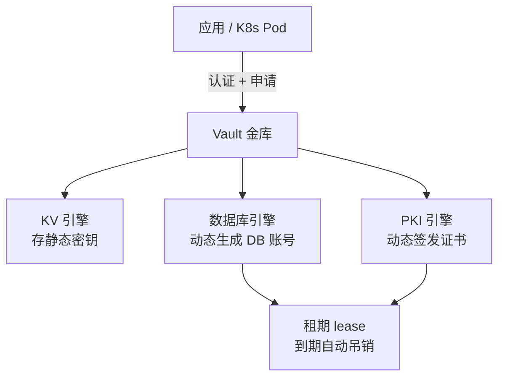
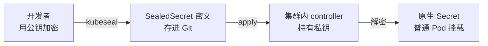
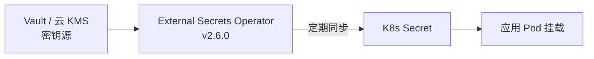

# 密钥与证书管理

::: tip 本篇定位
数据库密码、API Token、TLS 证书这些"东西"到底放哪、怎么不硬编码进 Git、怎么自动轮换？这篇讲 **HashiCorp Vault**（动态密钥/PKI）、**Sealed Secrets**（把 K8s Secret 加密进 Git）、**External Secrets Operator**（把外部密钥同步进集群）、**cert-manager**（证书自动签发轮换），以及密钥轮换策略。适合被"密钥散落各处、轮换靠手工、证书过期半夜告警"折磨的 SRE。
本篇版本：HashiCorp Vault Community Edition 2.1.1、Sealed Secrets controller v0.38.4、External Secrets Operator v2.6.0、cert-manager v1.21.0。所有版本以官网当前稳定版为准。
:::

## 一、背景与基础

### 1.1 小白类比：硬编码密钥的痛

最常见的错误做法：把数据库密码直接写在代码配置里、提交进 Git 仓库。

```python
# ❌ 反面教材
DB_PASSWORD = "P@ssw0rd123"   # 就这么裸奔进了 Git
```

问题在哪？
- **Git 历史永远留痕**，删了也能翻出来；仓库一开源/一离职带走，全完；
- **改密码要改代码、重新发版**，慢且高危；
- **谁有密码不知道**，没法审计、没法按人吊销；
- **证书忘了续期**，半夜业务突然挂。

> 正确思路：**密码不写代码、不进 Git、自动生成、自动过期、自动轮换**。下面的工具就是干这个的。

### 1.2 工具各管一段

| 工具 | 解决什么 | 一句话定位 |
|---|---|---|
| **Vault** | 密钥的"金库+出纳"：集中存放、动态生成、自动过期 | 真正的密钥源（source of truth） |
| **Sealed Secrets** | 想把 Secret 也进 GitOps？用它加密 | Git 里存"密文"，只有集群能解密 |
| **External Secrets Operator** | 把 Vault/云 KMS 里的密钥同步成 K8s Secret | 桥：外部金库 → 集群 |
| **cert-manager** | K8s 里 TLS 证书自动签发/续期 | 证书不手工 renew |

## 二、HashiCorp Vault

### 2.1 它是什么 / 核心能力

Vault 是一个**专门管密钥的中心化服务**。它不只是个加密保险柜，最大杀招是**动态密钥**——密码不是你预先设好存进去的，而是应用**用的时候临时申请一个、用完自动过期回收**。



### 2.2 部署与 unseal（vault 2.1.1）

```bash
# 容器起 Vault（开发模式，仅实验用！）
docker run -d --name vault -p 8200:8200 \
  -e 'VAULT_DEV_ROOT_TOKEN_ID=root' \
  hashicorp/vault:2.1.1

export VAULT_ADDR='http://127.0.0.1:8200'
vault status
```

::: danger 生产不要用 dev 模式
上面 `VAULT_DEV_ROOT_TOKEN_ID` 是**开发模式**，数据一重启就没。生产要 `vault server` 正式模式 + 初始化（`vault operator init`）+ **Shamir 分片 unseal** + 高可用集群。
:::

### 2.3 KV 引擎：存静态密钥

```bash
# 开启 KV v2 引擎
vault secrets enable -path=secret kv-v2

# 写入一个密钥
vault kv put secret/order/db username=orderapp password=强密码

# 读取
vault kv get secret/order/db
```

### 2.4 动态数据库账号与 lease（杀手锏）

不要把一个固定的 DB 密码给所有服务。让 Vault 代你**临时开账号**：

```bash
# 1) 配 Vault 连数据库（用一个高权限账号去管理）
vault secrets enable database
vault write database/config/my-pg \
  plugin_name=postgresql-database-plugin \
  connection_url="postgresql://{{username}}:{{password}}@pg:5432/" \
  allowed_roles="order-role" \
  username="vaultadmin" password="管理密码"

# 2) 定义一个角色：申请出来的账号有什么权限、活多久
vault write database/roles/order-role \
  db_name=my-pg \
  creation_statements="CREATE ROLE \"{{name}}\" WITH LOGIN PASSWORD '{{password}}' VALID UNTIL '{{expiration}}'; GRANT SELECT ON ALL TABLES IN SCHEMA public TO \"{{name}}\";" \
  default_ttl="1h" max_ttl="24h"

# 3) 应用每次要连库，临时申请一个（1 小时后自动吊销）
vault read database/creds/order-role
# Key                Value
# lease_id           database/creds/order-role/abcd1234
# username           v-root-order-role-abcd
# password           A1b2...
# lease_duration     1h
```

> 好处：即使这个临时账号泄露，**1 小时后自动失效**；而且每个实例拿到的账号都不一样，可按 lease 精确吊销。

### 2.5 PKI 引擎：当内部 CA

Vault 还能当**内部证书颁发机构（私域 CA）**，给内部服务自动签 TLS 证书：

```bash
vault secrets enable pki
vault write pki/root/generate/internal common_name="internal-ca.example.com" ttl=87600h
# 建角色允许签发 *.svc.cluster.local 的证书
vault write pki/roles/k8s allowed_domains="svc.cluster.local" allow_subdomains=true max_ttl=720h
# 签一张证书
vault write pki/issue/k8s common_name="order.svc.cluster.local"
```

### 2.6 Kubernetes 集成与高可用

- **K8s auth 方法**：应用用自己的 ServiceAccount Token 向 Vault 换密钥，不用人工发 token。
- **HA**：Vault 生产跑 3 节点 Raft 集群，共享存储自动选主；每节点都要 **unseal**（或用 auto-unseal / HSM）。

## 三、Sealed Secrets

### 3.1 原理（小白类比）

K8s 原生 Secret 只是 Base64 编码（**不是加密**），谁 `kubectl get secret -o yaml` 都能解码。但 GitOps 又希望所有配置进 Git。矛盾怎么解？

**Sealed Secrets**：集群里跑一个 controller，持有一把**私钥**。开发用对应的**公钥**把普通 Secret 加密成 `SealedSecret` 这个 CRD 存进 Git。这个密文**只有本集群的 controller 能解开**——哪怕 Git 仓库公开，别人拿着密文也解不出原文。



### 3.2 使用（controller v0.38.4）

```bash
# 安装 controller（固定 v0.38.4）
kubectl apply -f https://github.com/bitnami-labs/sealed-secrets/releases/download/v0.38.4/controller.yaml

# 准备一个普通 Secret，加密成 SealedSecret
kubectl create secret generic db-creds \
  --from-literal=password=强密码 -o yaml --dry-run=client > secret.yaml
kubeseal --format yaml < secret.yaml > sealedsecret.yaml
# sealedsecret.yaml 可以安全提交进 Git；secret.yaml 立刻删掉
```

> 注意：SealedSecret 是**和 namespace+name 绑定**加密的，改了名字/命名空间要重新 seal。

## 四、External Secrets Operator（ESO）

Sealed Secrets 把密钥"烤进 Git"，但密钥轮换时你得重新 seal。**ESO 反过来：Vault/云 KMS 才是源头，ESO 自动把最新值同步成 K8s Secret**。



### 4.1 对接 Vault 的完整示例

```yaml
# 1) SecretStore：声明"密钥从哪来"（指向 Vault）
apiVersion: external-secrets.io/v1
kind: SecretStore
metadata:
  name: vault-backend
  namespace: order
spec:
  provider:
    vault:
      server: "http://vault.vault.svc:8200"
      path: "secret"           # KV v2 引擎路径
      version: "v2"
      auth:
        kubernetes:           # 用 K8s ServiceAccount 认证
          role: "order-role"
          serviceAccountRef:
            name: "eso-order"
---
# 2) ExternalSecret：声明"要同步哪些 key 成一个 Secret"
apiVersion: external-secrets.io/v1
kind: ExternalSecret
metadata:
  name: db-creds
  namespace: order
spec:
  refreshInterval: 1h          # 每小时同步一次（Vault 里改了会自动跟上）
  secretStoreRef:
    name: vault-backend
    kind: SecretStore
  target:
    name: db-creds             # 生成的 K8s Secret 名字
  data:
    - secretKey: password      # K8s Secret 里的 key
      remoteRef:
        key: order/db          # Vault KV 路径
        property: password     # 该路径下的字段
```

```bash
# 安装 ESO v2.6.0（Helm）
helm repo add external-secrets https://charts.external-secrets.io
helm install external-secrets external-secrets/external-secrets \
  --version 0.26.0 --namespace external-secrets --create-namespace
```

## 五、cert-manager：证书自动签发与轮换

### 5.1 它解决什么

TLS 证书会过期。手工 `certbot` 申请、到期前手工 renew，迟早忘。**cert-manager** 在 K8s 里自动：申请证书 → 验证域名所有权 → 存成 Secret → **到期前自动续期**。

### 5.2 内部 PKI + 公开证书两种用法

| 用法 | Issuer 类型 | 场景 |
|---|---|---|
| 公开可信证书 | Let's Encrypt（ACME） | 对外的 https 网站 |
| 内部私有 CA | SelfSigned / Vault / 自己的 CA | 集群内部 mTLS |

### 5.3 安装与示例（v1.21.0）

```bash
# 安装 cert-manager（固定 v1.21.0）
kubectl apply -f https://github.com/cert-manager/cert-manager/releases/download/v1.21.0/cert-manager.yaml
kubectl wait --namespace cert-manager \
  --for=condition=ready pod --selector=app=cert-manager --timeout=120s
```

用 Let's Encrypt 签一张公开证书：

```yaml
# 1) ClusterIssuer：Let's Encrypt
apiVersion: cert-manager.io/v1
kind: ClusterIssuer
metadata:
  name: letsencrypt-prod
spec:
  acme:
    server: https://acme-v02.api.letsencrypt.org/directory
    email: ops@example.com
    privateKeySecretRef:
      name: letsencrypt-prod
    solvers:
      - http01:
          ingress:
            class: nginx
---
# 2) Certificate：申请 example.com 的证书，自动存成 Secret
apiVersion: cert-manager.io/v1
kind: Certificate
metadata:
  name: example-tls
  namespace: order
spec:
  secretName: example-tls        # 证书会写到这个 Secret
  issuerRef:
    name: letsencrypt-prod
    kind: ClusterIssuer
  commonName: www.example.com
  dnsNames: [www.example.com, example.com]
  duration: 2160h                # 90 天，到期前自动续
  renewBefore: 360h             # 到期前 15 天开始续
```

Ingress 里直接引用：

```yaml
apiVersion: networking.k8s.io/v1
kind: Ingress
metadata:
  name: order
  annotations:
    cert-manager.io/cluster-issuer: letsencrypt-prod
spec:
  tls:
    - hosts: [www.example.com]
      secretName: example-tls
  rules:
    - host: www.example.com
      http: { paths: [] }
```

## 六、密钥轮换策略

| 策略 | 怎么做 | 目标 |
|---|---|---|
| **动态密钥（Vault）** | 租期 1h，用完自动吊销 | 几乎不用"轮换"，因为每把都短命 |
| **静态密钥定期轮换** | Vault 改值 → ESO 每小时同步 → Pod 滚动重启 | 凭证不长期有效 |
| **数据库账号** | Vault 动态账号天然短命 | 泄露窗口小 |
| **证书** | cert-manager 到期自动续 | 永不过期告警 |

> 黄金法则：**能动态就别静态，能短命就别长命**。静态长期密码是事故之源。

## 七、常见问题排错

| 现象 | 原因 | 解决 |
|---|---|---|
| Vault 重启后读写报 sealed | 没 unseal | `vault operator unseal` 输入 Shamir 分片（生产需多人分片） |
| ESO 创建的 Secret 是空的 | Vault 路径/字段写错、ServiceAccount 无权限 | 看 ExternalSecret 事件：`kubectl describe es`；核对 path 与 role |
| SealedSecret 解密失败 | namespace/name 被改，或换了集群私钥 | 用目标集群公钥重新 `kubeseal`；迁移要备份 controller 私钥 |
| cert-manager 证书一直 Ready=False | DNS/HTTP01 校验没过 | 查 CertificateRequest/Order 事件；确认 Ingress/ DNS 解析通 |
| 证书快过期还没续 | renewBefore 设太近 | 调大 `renewBefore`（如到期前 15 天） |
| 应用读不到 Vault 动态凭证 | K8s auth role 没授权该 ServiceAccount | 在 Vault 里给 role 绑定对应 SA 的 policy |

::: warning 生产红线
- **永远不要把真实密钥提交进 Git**；K8s Secret 默认只 Base64，敏感场景开启 etcd 加密。
- Vault 生产必须：正式模式 + Shamir 分片 unseal + 多节点 HA + **备份**（Raft 快照）。
- 备份好 Sealed Secrets controller 私钥 / Vault 的 unseal key——**丢了就全集群密钥都解不开**。
- 用最小权限：ESO/Vault 给每个应用单独的 role/SA，不要一个 token 走天下。
- 证书与密钥纳入到期监控，提前告警；动态密钥缩短租期以降低泄露影响。
:::

## 相关速查

- 密钥在流水线里怎么用：[DevSecOps 与软件供应链安全](./devops-devsecops)
- K8s 部署底座：[GitOps（ArgoCD）](./automation-gitops)、[Helm 包管理](./container-helm)
- 加密存储 etcd：[K8s 安全篇](./container-k8s-04-statefulset-security)
- K8s 命令：[kubectl 命令速查](/reference/kubectl-commands)

### 官方文档

- HashiCorp Vault 文档：https://developer.hashicorp.com/vault/docs
- Vault releases：https://releases.hashicorp.com/vault/
- Sealed Secrets：https://github.com/bitnami-labs/sealed-secrets
- Sealed Secrets releases：https://github.com/bitnami-labs/sealed-secrets/releases
- External Secrets Operator 文档：https://external-secrets.io/
- ESO releases：https://github.com/external-secrets/external-secrets/releases
- cert-manager 文档：https://cert-manager.io/docs/
- cert-manager releases：https://cert-manager.io/docs/releases/
- cert-manager GitHub：https://github.com/cert-manager/cert-manager/releases
