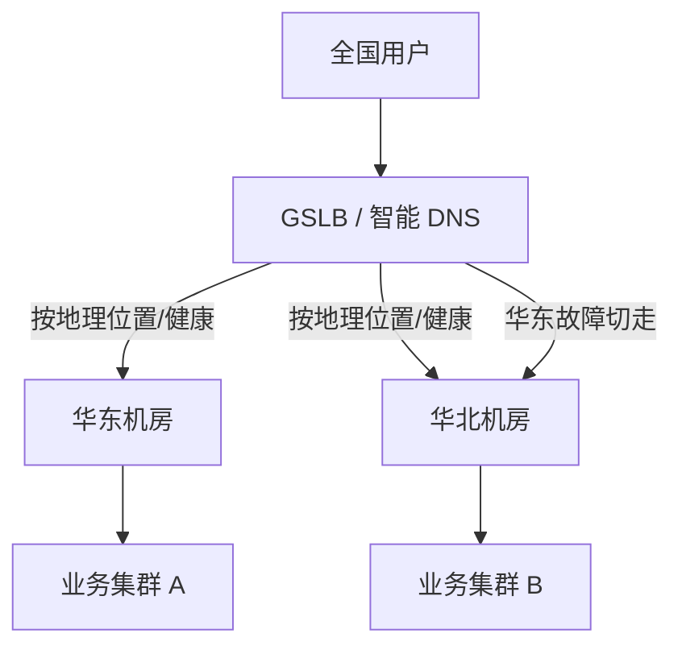

# 高并发 / 高可用 / 多活：限流降级与流量调度

::: tip 本篇定位
面向中高级 SRE/架构：从容量评估（Little's Law）讲起，给到限流三种算法的可运行代码、Nginx `limit_req`、Sentinel 1.8.6 配置、熔断降级、权重/灰度/GSLB 流量调度，最后落到多活容量与一致性取舍。不重复 [sre-capacity-dr](./sre-capacity-dr) 的灾备概念，这里给**算法、参数和配置**。
本篇版本：Nginx 1.30.5（stable）、Alibaba Sentinel 1.8.6、Redis 8.x、JDK 21/25 LTS。限流算法代码为 Go 与 Java 伪实现，便于移植。
:::

## 一、容量评估：先算清楚再扩容

### 1.1 小白类比：Little's Law 是"餐厅排队公式"

餐厅同时能坐下的人数（并发）= 每桌每分钟进来几人（到达率）× 每桌吃多久（停留时间）。运维里一模一样：

> **并发数 = QPS × 平均响应时间（RT，秒）**

这就是 **Little's Law** 在 Web 场景的落地形式。它是一切容量估算的地基。

举个例子：接口 RT = 50ms（0.05s），要扛 2000 QPS，需要同时在飞的请求数 = `2000 × 0.05 = 100` 个并发。如果 RT 劣化到 500ms，同样 2000 QPS 就要 1000 个并发——**RT 一涨，并发需求十倍涨，系统就是这样被压垮的。**

### 1.2 QPS / 并发 / RT 的换算与冗余

| 已知 | 求 | 公式 |
|---|---|---|
| QPS、RT | 并发数 | `并发 = QPS × RT` |
| 并发、RT | 极限 QPS | `QPS = 并发 / RT` |
| 单机 QPS、机器数 | 集群容量 | `集群 QPS = 单机 × 机器数` |

压测水位与冗余系数（经验，不是教条）：

- **日常水位**：单机 CPU 不超过 60%~70%，留突发余量。
- **峰值冗余系数**：按"预测峰值 × 1.5~2"备货。例如预估大促峰值 10000 QPS，单机压出来极限 3000 QPS，则至少 `ceil(10000×1.5 / 3000) = 5` 台，实际上 6 台留一台做故障冗余。
- **故障冗余**：N+1（挂一台不影响服务）是底线；金融/核心链路 N+2 或跨可用区。

::: tip 压测水位的"拐点"
压测不是压到机器冒烟，而是找到**吞吐拐点**：QPS 还在涨，但 P99 开始陡增、CPU 不涨反降（说明在排队/丢弃）。拐点的 70% 作为单机安全水位。
:::

## 二、限流：三种算法与代码

### 2.1 算法对比

| 算法 | 思路 | 优点 | 缺点 | 适用 |
|---|---|---|---|---|
| **固定窗口计数器** | 每秒计数，到点清零 | 简单 | 窗口边界突发（1s 末+下 1s 初打两倍） | 粗粒度、低频 |
| **漏桶（Leaky Bucket）** | 请求进桶，固定速率漏出 | 输出绝对平滑 | 无法应对合理突发 | 保护下游、消息队列消费 |
| **令牌桶（Token Bucket）** | 按速率往桶里放令牌，有令牌才放行 | 允许一定突发（桶里攒的令牌） | 桶大小要调好 | API 限流、网关 |
| **滑动窗口** | 把窗口切成小格滑动统计 | 平滑、精确 | 内存/计算略高 | 登录/接口精细化限流 |

### 2.2 可运行代码

令牌桶（Go，单机内存版，生产可换 Redis + Lua 做分布式）：

```go
// 令牌桶：r 个/秒，桶容量 b
type TokenBucket struct {
    rate       float64 // 每秒补充令牌数
    capacity   float64 // 桶容量
    tokens     float64
    lastTime   time.Time
}

func (b *TokenBucket) Allow() bool {
    now := time.Now()
    elapsed := now.Sub(b.lastTime).Seconds()
    // 按时间补充令牌，最多到容量
    b.tokens = math.Min(b.capacity, b.tokens+elapsed*b.rate)
    b.lastTime = now
    if b.tokens >= 1 {
        b.tokens--
        return true
    }
    return false
}
```

漏桶（极简思想）：入口来多少都行，出口永远按固定速率处理，多余的排队或拒绝。

### 2.3 Nginx limit_req（网关层限流）

```nginx
# 定义限流区：按 IP 维度，共享内存 10m，平均速率 10r/s
limit_req_zone $binary_remote_addr zone=perip:10m rate=10r/s;
# 按服务维度（不限 IP，限整体）
limit_req_zone $server_name zone=perserver:10m rate=100r/s;

server {
    location /api/ {
        # burst=20 允许突发 20 个排队；nodelay 表示排队里的请求立即处理不延时
        limit_req zone=perip burst=20 nodelay;
        limit_req_status 429;          # 被限流返回 429，别用 503
        proxy_pass http://backend;
    }
    # 连接数限流（防并发占满）
    limit_conn_zone $binary_remote_addr zone=connperip:10m;
    location /upload/ {
        limit_conn connperip 10;        # 单 IP 最多 10 个并发连接
    }
}
```

要点：`rate=10r/s` 是平均放行速率；`burst` 是允许排队的突发量；`nodelay` 让 burst 内请求不额外等一个周期。**被限流要返回 429**，让上游客户端退避重试，而不是 503。

### 2.4 Sentinel 1.8.6（应用层流控熔断）

Sentinel 在 Java 应用内做细粒度资源级流控与熔断。核心规则（可由控制台推送，也可代码/配置写死）：

```java
// 代码方式定义一条流控规则：资源 /order，QPS 超过 20 就限流
List<FlowRule> rules = new ArrayList<>();
FlowRule rule = new FlowRule();
rule.setResource("createOrder");
rule.setGrade(RuleConstant.FLOW_GRADE_QPS);   // 按 QPS 限流
rule.setCount(20);                            // 阈值 20 QPS
rule.setControlBehavior(RuleConstant.CONTROL_BEHAVIOR_DEFAULT); // 直接拒绝
// 想匀速排队用 CONTROL_BEHAVIOR_RATE_LIMITER（漏桶思想）
rules.add(rule);
FlowRuleManager.loadRules(rules);
```

熔断降级规则：

```java
DegradeRule degradeRule = new DegradeRule();
degradeRule.setResource("callPayment");
degradeRule.setGrade(RuleConstant.DEGRADE_GRADE_EXCEPTION_RATIO); // 按异常比例
degradeRule.setCount(0.5);        // 异常比例超过 50%
degradeRule.setTimeWindow(10);    // 熔断 10 秒，之后进入半开探测
degradeRule.setMinRequestAmount(20); // 最少 20 个请求才统计，避免偶发误判
DegradeRuleManager.loadRules(Collections.singletonList(degradeRule));
```

资源埋点：

```java
try (Entry entry = SphU.entry("createOrder")) {
    // 正常业务逻辑
} catch (BlockException ex) {
    // 被限流/熔断：走降级逻辑，返回兜底数据
    return fallbackResult();
}
```

::: warning Sentinel 版本
Sentinel 最新版本为 **1.8.6**（sentinelguard.io 官网与 GitHub Releases）。控制台 dashboard 需单独部署；规则持久化到 Nacos/Apollo，否则重启丢失。别和"Redis Sentinel（Redis 高可用哨兵）"混淆——两者同名但完全是两个东西。
:::

## 三、熔断降级与排队

```mermaid
flowchart LR
    A["请求进入"] --> B["限流判断"]
    B -->|放行| C["调用下游服务"]
    B -->|被限流| D["快速失败<br>返回兜底/429"]
    C --> E{"熔断器状态"}
    E -->|闭合正常| F["返回结果"]
    E -->["打开熔断"] --> D
    E -->["半开探测"] --> G["放少量请求试"]
    G -->|成功| E
    G -->|失败| E
```

降级的三层策略（按代价从小到大）：

1. **读降级**：下游挂了，返回缓存里的旧数据 / 默认值。
2. **功能降级**：非核心功能（推荐、积分）先关，保核心交易。
3. **写降级**：写请求先进队列/本地表，下游恢复后补写（最终一致）。

## 四、流量调度：权重、灰度、GSLB

### 4.1 Nginx 权重与灰度

```nginx
upstream backend {
    # 权重：v2 新版本只接 10% 流量，观察
    server 10.0.0.11:8080 weight=9;   # 稳定版
    server 10.0.0.12:8080 weight=1;   # 灰度版
    # 被动健康检查：失败 3 次摘除，30s 后恢复
    server 10.0.0.13:8080 max_fails=3 fail_timeout=30s;
    keepalive 32;                     # 到上游的长连接池
}
```

按 Header / Cookie 灰度（金丝雀）：

```nginx
location / {
    if ($http_x_canary = "true") { proxy_pass http://canary_upstream; }
    proxy_pass http://stable_upstream;
}
```

### 4.2 GSLB 全局负载均衡（多机房）



GSLB 决策维度：用户就近解析（DNS 按运营商/地域返回不同 IP）、机房健康探测（某机房连续失败就把其权重降到 0）、权重调度。它不是强一致性的"自动切流"，而是**基于 DNS TTL 的软切流**，故障切换有 TTL 延迟（通常几十秒到几分钟）。

## 五、多活容量与一致性取舍

| 模式 | 容量 | 一致性 | RTO/RPO | 成本 | 适用 |
|---|---|---|---|---|---|
| 主备（冷备） | 备机不接流量 | 强一致 | RTO 小时级 | 低 | 传统企业 |
| 同城双活 | 两机房都接流量 | 强/最终一致 | RTO 分钟级 | 中 | 一般互联网 |
| 异地多活 | 多机房都接流量 | 最终一致为主 | RTO 秒~分钟 | 高 | 大厂核心 |

取舍要点：

- **单元化**：按用户 ID 分片，一个用户的请求固定落到某个单元，单元间不强同步，跨单元才需要同步。这样多活不用全局强一致。
- **数据归属**：每片数据有唯一写入点（master），避免双写冲突；必须双写时用仲裁/fencing（见 [expert-tough-cases](./expert-tough-cases) 的脑裂章节）。
- **一致性成本**：跨城同步延迟（同城 1~2ms，异地 20~50ms）决定了异地多活只能做"最终一致 + 允许秒级延迟"。金融账务走同城强一致，日志/ feed 可异地最终一致。

::: warning 生产红线
- 限流阈值要和下游容量匹配：你限 1000 QPS，但数据库只能扛 500，限流就是空转。**按最薄弱环节定阈值。**
- 限流一定要有"被拒绝后的客户端行为"：429 + 指数退避重试，别让客户端疯狂重试把刚恢复的系统再打死（重试风暴）。
- 熔断半开探测流量要小，且探测成功才闭合，避免"刚打开又打满"。
- 多活不是两个机房简单复制：先想清楚数据归属和单元划分，再谈流量调度。
- 灰度发布一定先小流量观察指标（错误率、P99），再逐步放量，配自动回滚。
:::

## 相关速查

- 容量、灾备 RTO/RPO 详解：[容量规划与灾备](./sre-capacity-dr)
- 服务发现与 K8s Service：[K8s Pod 与服务发现](./container-k8s-02-pod-service-discovery)
- 有状态服务与安全（多活 StatefulSet）：[StatefulSet 与安全](./container-k8s-04-statefulset-security)
- 四层负载高可用：[LVS 与 Keepalived](./services-lvs-keepalived)
- Nginx 配置详解：[Nginx Web 服务](./services-web-nginx)
- 故障演练（主动制造熔断）：[混沌工程](./sre-chaos)
- 云原生排障命令：[/reference/cloudnative-commands](/reference/cloudnative-commands)

### 官方文档

- Nginx limit_req：https://nginx.org/en/docs/http/ngx_http_limit_req_module.html
- Sentinel 官网：https://sentinelguard.io/
- Sentinel GitHub Releases（1.8.6）：https://github.com/alibaba/Sentinel/releases
- Redis 文档（Redis Sentinel 高可用，注意区分）：https://redis.io/docs/latest/
