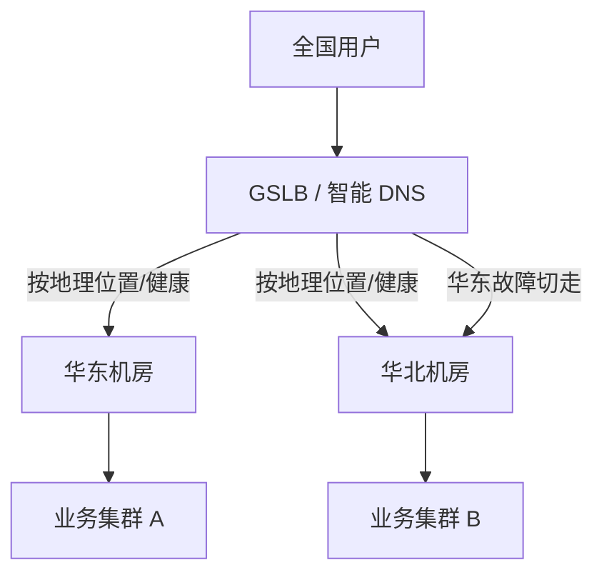

# 疑难杂症专题：从现象到根因的定位手册

::: tip 本篇定位
面向中高级 SRE：把生产上最折腾人的七类疑难杂症，按统一结构「现象 → 定位命令 → 根因 → 处置 → 预防」写死。命令可直接复制，判据给数值。不重复 [linux-performance](/guide/linux#合并资料) 的命令科普，这里是**组合拳和判据**。
本篇版本：JDK 21/25 LTS（jmap/jstack/jstat）、内核 4.18~7.0（dmesg/ss/slabtop）、MySQL 8.4 LTS、Redis 8.x。
:::

> 统一心法：**先看现象再猜，别上来就重启。** 重启会把现场（崩溃前的堆栈、连接、内存映射）蒸发掉。能保留现场就先 dump。

## 一、内存泄漏（Java 堆 / native）

### 现象
- 进程 RSS 只涨不降，重启后缓解、几周后复现；JVM 老年代 FGC 后回收不下来；系统 `available` 持续走低直到 OOM。

### 定位命令
```bash
# 1) 先确认是 Java 堆泄漏还是 native/堆外泄漏
jstat -gcutil <pid> 1000     # O（老年代）FGC 后是否回落
# 若 FGC 后老年代仍 >90% 不降 → 堆内泄漏
# 若老年代正常但 RSS 一直涨 → native/堆外泄漏（DirectBuffer、metaspace、堆外库）

# 2) 堆内：dump 后用 MAT / JProfiler 分析大对象
jmap -dump:live,format=b,file=/tmp/heap.hprof <pid>   # live 会触发一次 FGC
# 注意：dump 会 STW，大堆线上慎在高峰做

# 3) native：看进程内存映射分布
pmap -x <pid> | sort -k3 -n | tail -20     # 哪块 RSS 最大
# 关注 [anon] 持续增长、libxxx.so 映射、堆外 mmap

# 4) 内核 slab 缓存泄漏（非进程）
slabtop -o -s:c               # 看 dentry/inode/sock 等 slab 是否异常巨大
```

### 根因与处置
- **堆内**：MAT 看 Dominator Tree，找"被静态集合/缓存持有不释放"的对象。临时处置：扩容/重启；根治：修代码、给缓存加过期上限。
- **堆外**：Netty DirectByteBuffer 没释放、JNI 库泄漏。加 `-XX:MaxDirectMemorySize` 限住堆外，配 `-Dio.netty.leakDetectionLevel=ADVANCED`。
- **slab 泄漏**：`dentry`/`inode` 暴涨常是大量小文件/频繁创建删除，或内核已知 bug；升级内核或 `echo 2 > /proc/sys/vm/drop_caches` 临时回收（不治本）。

### 预防
加 `-XX:+HeapDumpOnOutOfMemoryError`；容器设 `--memory` 并监控 RSS 增长率；缓存一律设容量上限与 TTL。

## 二、fd / 连接耗尽

### 现象
- 业务报 `Too many open files` / `Cannot assign requested address` / 新建连接失败；`ss` 看到大量 TIME_WAIT 或 CLOSE_WAIT。

### 定位命令
```bash
ulimit -n                          # 当前进程 fd 软限制（默认常 1024）
cat /proc/<pid>/limits | grep "open files"   # 进程实际限制
ls /proc/<pid>/fd | wc -l          # 进程已用 fd 数
lsof -p <pid> | awk '{print $5}' | sort | uniq -c | sort -rn   # fd 都分给谁了
ss -s                              # 汇总：TIME_WAIT/CLOSE_WAIT 各多少
ss -tan state time-wait | wc -l    # TIME_WAIT 数量
ss -tan state close-wait | wc -l    # CLOSE_WAIT 数量
```

### 根因与处置
- **fd 数撞到 `ulimit -n`**：提高限制。systemd 里设 `LimitNOFILE=65535`（别只改 limits.conf，systemd 服务不读 PAM）。
- **CLOSE_WAIT 堆积**：对端关了连接，**自己应用没调用 close()**——是代码 bug（没正确关闭 socket/连接池），不是内核参数问题。
- **TIME_WAIT 过多**：高并发短连接，压测/出口调 `net.ipv4.tcp_tw_reuse=1` 与 `ip_local_port_range`（见 [config-best-practices](/reference/ops-templates#合并资料)）。

### 预防
所有对外连接池化；监控 fd 使用率 >70% 告警；部署时在 unit 文件固化 LimitNOFILE。

## 三、OOM（系统 OOM Killer / JVM 堆溢出）

### 现象
- 进程突然消失、日志没了；`dmesg` 里有 `Out of memory: Killed process`；或 Java 报 `java.lang.OutOfMemoryError: Java heap space`。

### 定位命令
```bash
dmesg -T | grep -i -A5 -B5 "out of memory"   # 看 OOM Killer 杀了谁、当时内存
# 关键行：Killed process <pid> (<comm>)、以及进程内存占比
free -h
# JVM 侧
jmap -heap <pid> 2>/dev/null | head -20       # 堆配置与使用
# 容器场景：看是不是 cgroup OOMKilled
kubectl describe pod <pod> | grep -i oomkilled
```

### 根因与处置
- **系统 OOM Killer**：物理内存耗尽，内核挑"坏孩子"（oom_score 最高）杀。处置：加内存/限 `-Xmx`/加交换；找到吃内存的元凶（dmesg 里 oom_score 高的进程）。
- **JVM 堆溢出**：堆内泄漏（见专题一）或 `-Xmx` 给小了。处置：调大堆或修泄漏。
- **容器 OOMKilled**：JVM `-Xmx` 没算堆外，`--memory` 限得比 JVM 总占用小。处置：让 `Xmx + 堆外 + 元空间 < 容器 limit`，或用 `-XX:MaxRAMPercentage`。

### 预防
监控 `memory.usage` 与 RSS 增长曲线；JVM 开 HeapDumpOnOutOfMemoryError；容器内用 MaxRAMPercentage 而非写死 Xmx。

## 四、系统卡顿（load 高、D 状态、iowait）

### 现象
- SSH 上去输入命令半天没反应，`top` 里 load average 很高，但 CPU `%us` 不高。

### 定位命令
```bash
uptime                          # load average：1/5/15 分钟
# load > CPU 核数就是排队；但要看是"CPU 排队"还是"D 状态（IO 等待）排队"
top                             # 按 w 看进程状态列
ps -eo stat,pid,comm | grep '^D'    # 所有 D 状态（不可中断睡眠，多在等 IO）
vmstat 1                        # 看 r（运行队列）、b（阻塞）、wa（iowait）
iostat -xz 1                    # %util、await
```

### 根因与判据
- **load 高但 `%us` 低、`wa` 高、大量 D 状态** → 磁盘 IO 瓶颈，不是 CPU。查慢查询、大量随机写、swap。
- **load 高、`r` 队列长、`%us` 高** → CPU 真不够。
- **load 高但空闲** → 可能是大量 D 状态进程等 NFS/网络存储超时，存储挂了。

### 处置
- IO：定位是哪个进程（`iotop -o`），优化查询/批量写、换 SSD、加缓存。
- D 状态等 NFS：恢复存储或卸载卡死的 NFS 挂载。
- 临时别 kill D 状态进程（杀不动），先解决它等的资源。

## 五、丢包与重传

### 现象
- 偶发超时、RT 抖动、业务说"有时慢"，但 CPU/内存正常。

### 定位命令
```bash
ss -ti dst <目标IP>             # 看 TCP 连接细节：重传 rto、cwnd、ssthresh
nstat -az | grep -iE "retrans|drop|listen"
# 关注：TcpRetransSegs（重传段数）、TcpExtListenOverflows（全连接队列溢出）
netstat -s | grep -i retrans    # 累计重传
ethtool -S eth0 | grep -iE "drop|miss|error"   # 网卡丢包
ethtool eth0                     # 协商速率是否被降速
sar -n ETCP,ETCP6 1              # 重传率趋势
```

### 判据与处置
- **重传率 = 重传段 / 发送段 > 0.5%** → 网络问题：查链路、路由器、网卡半双工/降速、缓冲区。
- **`ListenOverflows` / `ListenDrops` 增长** → 全连接队列（somaxconn）小于应用 backlog，调高 `net.core.somaxconn` 和应用 backlog。
- **`rx_dropped`/`rx_missed_errors` 增长** → 网卡软中断处理不过来：开多队列（RPS/RSS）、调高网卡 ring buffer（`ethtool -G`）。
- **本机到本机重传** → 排查 conntrack 表满（`nf_conntrack: table full`）。

### 预防
监控重传率、队列溢出、网卡丢包；高并发前调 somaxconn；网卡多队列与 ring buffer 按机器调。

## 六、时钟跳变

### 现象
- 日志时间戳前后跳变、定时任务（cron/延迟队列）时间错乱、证书校验失败、分布式 token（JWT exp）判断异常。

### 定位命令
```bash
timedatectl                     # 看 System clock synchronized、NTP service
chronyc tracking                # chrony：最后同步、system time 漂移
chronyc sources
dmesg -T | grep -i clock        # 内核时钟调整日志
date; sleep 1; date             # 肉眼看是否跳
```

### 根因与处置
- 机器没跑 NTP/NTP 服务挂了，硬件时钟漂移；或虚拟化环境时钟不稳。处置：启用 chrony/systemd-timesyncd，保证所有节点时钟同步。
- 大跨度跳变（step）会让基于时间的逻辑出错；`slew`（慢慢校准）比 `step`（大步跳）友好。

### 预防
所有节点强制配 NTP/chrony；监控 `chronyc tracking` 的偏移量；K8s 节点时钟必须同步否则证书/etcd 出问题。

## 七、脏数据与脑裂（仲裁与 fencing）

### 现象
- 双主/主从切换后数据两边都在写、互相冲突；同一数据出现两个值；HA 集群两台都认为自己是主（脑裂）。

### 定位命令
```bash
# MySQL 主从
mysql> SHOW REPLICA STATUS\G     # 看 Seconds_Behind_Source、Seconds_Behind_Master、是否 SQL 线程报错
# 看当前谁是可写主
mysql> SHOW VARIABLES LIKE 'read_only';
# 哨兵/集群
redis-cli -p 26379 sentinel masters       # Redis Sentinel 视角谁是主
# Keepalived
ip a | grep virtual_ip                     # VIP 飘在哪台
```

### 根因与处置
- **脑裂**：两台都认为自己是主，因为脑裂期间仲裁通道也断了。处置：
  1. **先停一个主**（fencing，隔离），避免双写继续污染。
  2. 选数据新的一侧做主，另一侧重建从库。
  3. 人工核对冲突数据（按业务主键合并）。
- **脏数据**：切换瞬间未同步完的写入丢失或重复。

### 预防（关键机制）
- **法定仲裁（quorum）**：奇数节点（3/5），少数派自动降级为只读，避免"两个都活"。
- **fencing（隔离）**：主挂了切换前，先把旧主隔离（STOMITH：断电/拒写），保证旧主不可能再写。
- **VIP + 健康检查**：Keepalived/云 LB 配真实健康检查，别只 ping。
- 切换流程演练：平时就切，别等真故障第一次切。

## 排错速查表

| 现象 | 第一反应命令 | 大概率根因 |
|---|---|---|
| RSS 只涨不降 | `jstat -gcutil` / `pmap -x` | 堆/堆外泄漏 |
| Too many open files | `ls /proc/<pid>/fd \| wc -l` | ulimit 太低/连接泄漏 |
| 进程消失无日志 | `dmesg -T \| grep -i "killed"` | OOM Killer |
| load 高但 CPU 闲 | `ps -eo stat,pid,comm \| grep '^D'` | IO/存储等待 |
| 偶发超时抖动 | `ss -ti` / `nstat \| grep retrans` | 网络重传/队列溢出 |
| 日志时间跳 | `timedatectl` / `chronyc tracking` | 时钟未同步 |
| 双主都在写 | `SHOW REPLICA STATUS` / `sentinel masters` | 脑裂 |

::: warning 生产红线
- `jmap -dump:live`、`kill -9`、重启都会丢现场——**先取证再处置**，能 dump 就 dump。
- 别在高峰期对大堆 JVM 做 full GC 的 dump；选低峰或先摘流量。
- 脑裂处置第一步永远是**先隔离旧主**，不要两边同时写着谈"谁对谁错"。
- D 状态进程 kill 不动，要解决它等待的 IO/存储，而不是反复 kill。
:::

## 相关速查

- 单命令详解：[Linux 性能基础](/guide/linux#合并资料)、[网络排障](./linux-network)
- 内核参数与 slab：[Linux 内核与 sysctl](/guide/linux#合并资料)
- 低损耗定位（perf/ftrace 替代）：[Linux eBPF](/guide/linux#合并资料)
- 入侵导致的异常进程/外连：[安全应急响应](./expert-security-incident)
- MySQL 主从：[MySQL 数据](/services/database/mysql/01-理论)、Redis 高可用：[Redis](/services/database/redis/01-理论)
- 运维 Checklist：[/reference/ops-templates#运维检查清单](/reference/ops-templates#运维检查清单)

### 官方文档

- Java 工具（jmap/jstack/jstat）：https://docs.oracle.com/en/java/javase/25/docs/specs/man/
- ss/nstat 手册：https://man7.org/linux/man-pages/man8/ss.8.html
- MySQL Replication：https://dev.mysql.com/doc/refman/8.4/en/replication.html
- Redis Sentinel：https://redis.io/docs/latest/operate/oss_and_stack/management/sentinel/
- chrony：https://chrony-project.org/documentation.html

<!-- merged-guide-material:start -->
## 合并资料

> 原先单独成页的同主题内容已收进本页；默认折叠，点开看原页全文。

<details>
<summary><strong>小公司 / 传统企业从零落地监控、自动化与 SRE — 面向人少、预算紧、历史包袱重的团队：怎么从&#x27;出了事才知道&#x27;一步步走到有监控、有自动化、有 SRE 稳定性思维。不堆大厂架构图，讲优先级、取舍和怎么争取老板支持。可结合家庭实验室练手。</strong></summary>

::: tip 本篇定位
面向人少、预算紧、历史包袱重的团队：怎么从"出了事才知道"一步步走到有监控、有自动化、有 SRE 稳定性思维。不堆大厂架构图，讲**优先级、取舍和怎么争取老板支持**。可结合家庭实验室练手。
本篇版本：Prometheus + Grafana 栈、Grafana Agent/OTel、Ansible、开源选型（2026-09 现状）。
:::

#### 一、现实约束：先认清你手里的牌

小公司/传统企业做 SRE，和大厂最大的区别不是技术，是**约束条件**：

| 约束 | 具体表现 | 对落地的影响 |
|---|---|---|
| 人少 | 1~3 个运维兼开发，7×24 值班不现实 | 别上需要专职维护的重平台 |
| 预算有限 | 没有买商业监控的钱 | 选开源、单机就能跑的 |
| 历史包袱 | 老系统没人敢动、没文档 | 先观测再优化，别上来重构 |
| 变更风险 | 业务一停老板就找你 | 先做"只读"监控，不碰业务逻辑 |
| 认知差距 | 老板觉得"服务器不挂就行" | 用事故和钱说话，别讲术语 |

> 心法：**先止血，再治病，最后强身。** 不要一上来就想搞 K8s 多活微服务——你连监控告警都没有，那是给自己挖坑。

#### 二、分阶段路线（四步走）


##### 阶段 1：监控止血（0~3 个月，优先级最高）

目标：**出事先知道，而不是用户打电话告诉你。**

- 第一步：装一个能跑的监控。单机起步用 **Prometheus + Grafana**（一条 docker compose 起来），node_exporter 采机器指标。
- 先盯最关键的几个黄金指标：CPU、内存、磁盘、负载、关键进程存活、网站/接口探活。
- 告警先接**企微/钉钉机器人**（Webhook），别搞邮件——邮件没人看。
- 告警分级：只有"磁盘快满、服务挂了、CPU 爆了"才打电话/强提醒；其他发群里。

```bash
# 最小可用：docker compose 起 Prometheus + Grafana + node_exporter
# 这一步只花半天，换来"半夜不用靠用户报障"
docker compose up -d
# 然后 Grafana 导入 node_exporter 仪表盘（ID 1860 等社区模板）
```

##### 阶段 2：标准化与文档（3~6 个月）

目标：**新机器能半小时配好，配置不再靠记忆。**

- 服务器清单（CMDB 极简版）：一张表/一个 markdown，记录每台机器跑什么、谁负责。
- 配置标准化：Nginx/MySQL/SSH 的配置抽成模板（参考 [config-best-practices](/reference/ops-templates#合并资料)），新机器套模板。
- 文档：每个关键服务"怎么部署、怎么重启、日志在哪、出问题找谁"。文档不在多，在**能照着做**。

##### 阶段 3：自动化（6~12 个月）

目标：**把你每周重复做的事脚本化。**

- 先 Ansible 批量操作：批量改配置、批量装 agent、批量重启。
- 再自动化重复运维：日志清理、备份校验、证书续期、巡检脚本（参考脚本集思路）。
- CI/CD 先从"自动部署测试环境"开始，别一步到位全自动化发布。

##### 阶段 4：SRE 稳定性（12 个月以后）

目标：**从被动救火到主动管理稳定性。**

- 开始定 SLO：核心接口可用性 99.9%，错误率 P99 延迟。
- 容量规划：大促/月底结算前提前评估资源（见 [sre-capacity-dr](./sre-capacity-dr)）。
- 小范围做故障演练：先演练"挂一台机器怎么办"。

#### 三、最小可用监控：半天跑起来（可复制）

别被"监控体系"四个字吓到。第一版只要能看到机器指标 + 收到告警就行：

```bash
# docker compose 起 Prometheus + Grafana + node_exporter
mkdir -p /opt/monitor && cd /opt/monitor
cat > compose.yaml <<'EOF'
services:
  prometheus:
    image: prom/prometheus:v3.4.0
    volumes: ["./prometheus.yml:/etc/prometheus/prometheus.yml"]
    ports: ["9090:9090"]
  node_exporter:
    image: prom/node-exporter:v1.9.0
    ports: ["9100:9100"]
  grafana:
    image: grafana/grafana:12.2.0
    ports: ["3000:3000"]
EOF
docker compose up -d
```

```yaml
# prometheus.yml：抓本机 node_exporter，别上来就抓几十台
scrape_configs:
  - job_name: node
    static_configs:
      - targets: ["host.docker.internal:9100"]
```

Grafana 里导入社区 Node Exporter 仪表盘（ID 1860），就能看到 CPU/内存/磁盘。告警先用 Alertmanager 接企微 Webhook：

```yaml
# 两条最关键的告警：服务挂了、磁盘快满
groups:
  - name: basic
    rules:
      - alert: DiskAlmostFull
        expr: (node_filesystem_avail_bytes / node_filesystem_size_bytes) < 0.15
        for: 5m
        labels: { severity: critical }
        annotations: { summary: "磁盘剩余不足 15%" }
      - alert: TargetDown
        expr: up == 0
        for: 2m
        labels: { severity: critical }
```

#### 四、开源选型（小团队务实版）

| 场景 | 推荐 | 为什么（小团队视角） |
|---|---|---|
| 监控 | Prometheus + Grafana | 生态最大、单机能跑、文档多 |
| 告警 | Alertmanager + 企微/钉钉 Webhook | 不花钱、即时触达 |
| 日志 | 初期用 grep+journald，量大再 ELK/Loki | 别一开始就上重型 ELK |
| 自动化 | Ansible | 无 agent、YAML、上手快 |
| 部署 | 先 docker compose，量大再 K8s | 小机器 K8s 是负担 |
| 密钥/配置 | 初始用加密配置文件，别上 Vault | 人少维护不动重型方案 |

::: tip 家庭实验室练手
用一台旧机/虚拟机（或你自己的 E5 单路 PVE 主机）搭一套 Prometheus+Grafana+Ansible，就是阶段 1~3 的完整演练。练熟了再搬到公司，比在生产上边做边学稳得多。
:::

#### 五、90 天落地清单（照表执行）

| 时间 | 做什么 | 交付物 | 谁受益 |
|---|---|---|---|
| 第 1 周 | 装 Prometheus+Grafana，接入所有机器 | 监控大屏、CPU/磁盘告警 | 运维自己 |
| 第 2 周 | 加业务探活（HTTP 200 探测核心接口）、告警接企微 | "服务挂了 2 分钟内手机响" | 运维+业务 |
| 第 3~4 周 | 建服务器清单（一张表）、关键服务 runbook | CMDB 表 + 每个服务一页文档 | 团队/新人 |
| 第 2 月 | 配备份并**演练一次恢复**（数据库+配置） | 可恢复的备份，不是只会备份 | 老板（数据安全） |
| 第 2 月 | Ansible 批量装 agent、批量改配置 | 一次操作 10 台机器 | 运维效率 |
| 第 3 月 | 日志清理/证书续期/巡检脚本自动化 | 定时任务，不用人工记 | 运维 |
| 第 3 月 | 定第一个 SLO（核心接口可用性）、写一页给老板 | SLO + 上月可用性数据 | 老板/业务对齐 |

> 关键：**第 2 月一定要做"备份恢复演练"**。很多团队备份天天跑，但从没恢复过——真出事才发现备份是坏的。

##### 备份优先级（钱少先保数据）

| 优先级 | 对象 | 做法 | 成本 |
|---|---|---|---|
| P0 | 数据库 | 每日 mysqldump/binlog + 异机存一份 | 低 |
| P0 | 配置文件 | nginx/mysql/redis 配置进 git | 极低 |
| P1 | 用户上传文件 | 定时同步到另一块盘/对象存储 | 低 |
| P2 | 系统镜像 | 整机快照（云平台） | 中 |

原则：**备份不在多，在"确定能恢复"**。每月随机挑一个备份做恢复演练，比每天备份却从不验证强。

#### 六、怎么争取老板与业务支持

这是小团队最现实的难点。技术人常犯的错是"我觉得好就闷头做"，结果没人买单。

- **用事故说话**：上次宕机损失多少（人时、客户投诉、营业额），监控能避免多少——把它折算成钱。
- **用对比说话**："别的公司半夜告警自动打电话，我们靠用户第二天早上打电话"。
- **先给甜头再要资源**：先花半天做出监控大屏和告警，让老板亲眼看到"出了事手机就响"，比 PPT 管用。
- **要小步预算**：别说"给我十万搞平台"，说"先买一台备用服务器，把磁盘/数据库备份做了"。
- **和业务对齐目标**：SLO 不是运维自嗨，是和业务一起定"核心系统一年能停多久"。

一个可直接套用的汇报话术：

> "上次系统停了 2 小时，客服接了 200 个投诉、影响当天营业额。现在花半天搭监控，以后类似问题 2 分钟就能发现、平均 10 分钟恢复。先从这一台机器、一个核心接口开始，不影响现有业务。"

不说术语，只说"多久发现、多久恢复、上次损失多少"——老板听得懂。

#### 七、常见反模式（别踩）

| 反模式 | 后果 | 正解 |
|---|---|---|
| 一上来上 K8s/微服务 | 人少维护不动，比单机更乱 | 先把单机监控和自动化做好 |
| 告警风暴（什么都告） | 告警太多没人看，真问题被淹没 | 先只告关键项，分级 |
| 只监控机器不监控业务 | 服务器绿的，但接口挂了 | 加业务探活（HTTP 状态码） |
| 文档全靠"我知道" | 人一走系统就没人会管 | 关键服务必须有 runbook |
| 不敢动老系统 | 越拖越脆，最后一次大事故 | 先观测、再灰度、保留回滚 |
| 自动化没测试就上生产 | 脚本写错全公司服务重启 | 先在测试机跑、加白名单 |
| 追求工具数量 | 装了十个工具，一个没用熟 | 一个 Prometheus 用熟胜过十个半成品 |

::: warning 生产红线
- 监控先做"只读"，不要上来就改生产配置/重启业务。
- 自动化脚本先在非生产验证， Ansible 先 `--check` 干跑。
- 告警通道要测试：上线前故意触发一次，确认手机真能收到。
- 备份比监控更优先：磁盘监控到了再告不如天天自动备份+定期校验可恢复。
- 小团队的 SRE 是"够用就好"，不是"和大厂对齐"。
:::

#### 相关速查

- SLO/错误预算怎么定：[SLO 与可观测](./monitor-slo)
- 容量与灾备：[容量规划与灾备](./sre-capacity-dr)
- Ansible 自动化：[Ansible 配置管理](/services/cicd/ansible)
- CI/CD 渐进落地：[CI/CD 进阶](./devops-cicd-advanced)
- 故障演练入门：[混沌工程](/guide/sre-incident#合并资料)
- 配置模板：[生产配置最佳实践](/reference/ops-templates#合并资料)
- 巡检/应急 Checklist：[/reference/ops-templates#运维检查清单](/reference/ops-templates#运维检查清单)

##### 官方文档

- Prometheus：https://prometheus.io/docs/
- Grafana：https://grafana.com/docs/
- Ansible：https://docs.ansible.com/
- Loki 日志：https://grafana.com/docs/loki/

</details>

<details>
<summary><strong>高并发 / 高可用 / 多活：限流降级与流量调度 — 面向中高级 SRE/架构：从容量评估（Little&#x27;s Law）讲起，给到限流三种算法的可运行代码、Nginx limit_req、Sentinel 1.8.6 配置、熔断降级、权重/灰度/GSLB 流量调度，最后落到多活容量与一致性取舍。</strong></summary>

::: tip 本篇定位
面向中高级 SRE/架构：从容量评估（Little's Law）讲起，给到限流三种算法的可运行代码、Nginx `limit_req`、Sentinel 1.8.6 配置、熔断降级、权重/灰度/GSLB 流量调度，最后落到多活容量与一致性取舍。不重复 [sre-capacity-dr](./sre-capacity-dr) 的灾备概念，这里给**算法、参数和配置**。
本篇版本：Nginx 1.30.5（stable）、Alibaba Sentinel 1.8.6、Redis 8.x、JDK 21/25 LTS。限流算法代码为 Go 与 Java 伪实现，便于移植。
:::

#### 一、容量评估：先算清楚再扩容

##### 1.1 小白类比：Little's Law 是"餐厅排队公式"

餐厅同时能坐下的人数（并发）= 每桌每分钟进来几人（到达率）× 每桌吃多久（停留时间）。运维里一模一样：

> **并发数 = QPS × 平均响应时间（RT，秒）**

这就是 **Little's Law** 在 Web 场景的落地形式。它是一切容量估算的地基。

举个例子：接口 RT = 50ms（0.05s），要扛 2000 QPS，需要同时在飞的请求数 = `2000 × 0.05 = 100` 个并发。如果 RT 劣化到 500ms，同样 2000 QPS 就要 1000 个并发——**RT 一涨，并发需求十倍涨，系统就是这样被压垮的。**

##### 1.2 QPS / 并发 / RT 的换算与冗余

| 已知 | 求 | 公式 |
|---|---|---|
| QPS、RT | 并发数 | `并发 = QPS × RT` |
| 并发、RT | 极限 QPS | `QPS = 并发 / RT` |
| 单机 QPS、机器数 | 集群容量 | `集群 QPS = 单机 × 机器数` |

压测水位与冗余系数（经验，不是教条）：

- **日常水位**：单机 CPU 不超过 60%~70%，留突发余量。
- **峰值冗余系数**：按"预测峰值 × 1.5~2"备货。例如预估大促峰值 10000 QPS，单机压出来极限 3000 QPS，则至少 `ceil(10000×1.5 / 3000) = 5` 台，实际上 6 台留一台做故障冗余。
- **故障冗余**：N+1（挂一台不影响服务）是底线；金融/核心链路 N+2 或跨可用区。

::: tip 压测水位的"拐点"
压测不是压到机器冒烟，而是找到**吞吐拐点**：QPS 还在涨，但 P99 开始陡增、CPU 不涨反降（说明在排队/丢弃）。拐点的 70% 作为单机安全水位。
:::

#### 二、限流：三种算法与代码

##### 2.1 算法对比

| 算法 | 思路 | 优点 | 缺点 | 适用 |
|---|---|---|---|---|
| **固定窗口计数器** | 每秒计数，到点清零 | 简单 | 窗口边界突发（1s 末+下 1s 初打两倍） | 粗粒度、低频 |
| **漏桶（Leaky Bucket）** | 请求进桶，固定速率漏出 | 输出绝对平滑 | 无法应对合理突发 | 保护下游、消息队列消费 |
| **令牌桶（Token Bucket）** | 按速率往桶里放令牌，有令牌才放行 | 允许一定突发（桶里攒的令牌） | 桶大小要调好 | API 限流、网关 |
| **滑动窗口** | 把窗口切成小格滑动统计 | 平滑、精确 | 内存/计算略高 | 登录/接口精细化限流 |

##### 2.2 可运行代码

令牌桶（Go，单机内存版，生产可换 Redis + Lua 做分布式）：

```go
// 令牌桶：r 个/秒，桶容量 b
type TokenBucket struct {
    rate       float64 // 每秒补充令牌数
    capacity   float64 // 桶容量
    tokens     float64
    lastTime   time.Time
}

func (b *TokenBucket) Allow() bool {
    now := time.Now()
    elapsed := now.Sub(b.lastTime).Seconds()
    // 按时间补充令牌，最多到容量
    b.tokens = math.Min(b.capacity, b.tokens+elapsed*b.rate)
    b.lastTime = now
    if b.tokens >= 1 {
        b.tokens--
        return true
    }
    return false
}
```

漏桶（极简思想）：入口来多少都行，出口永远按固定速率处理，多余的排队或拒绝。

##### 2.3 Nginx limit_req（网关层限流）

```nginx
# 定义限流区：按 IP 维度，共享内存 10m，平均速率 10r/s
limit_req_zone $binary_remote_addr zone=perip:10m rate=10r/s;
# 按服务维度（不限 IP，限整体）
limit_req_zone $server_name zone=perserver:10m rate=100r/s;

server {
    location /api/ {
        # burst=20 允许突发 20 个排队；nodelay 表示排队里的请求立即处理不延时
        limit_req zone=perip burst=20 nodelay;
        limit_req_status 429;          # 被限流返回 429，别用 503
        proxy_pass http://backend;
    }
    # 连接数限流（防并发占满）
    limit_conn_zone $binary_remote_addr zone=connperip:10m;
    location /upload/ {
        limit_conn connperip 10;        # 单 IP 最多 10 个并发连接
    }
}
```

要点：`rate=10r/s` 是平均放行速率；`burst` 是允许排队的突发量；`nodelay` 让 burst 内请求不额外等一个周期。**被限流要返回 429**，让上游客户端退避重试，而不是 503。

##### 2.4 Sentinel 1.8.6（应用层流控熔断）

Sentinel 在 Java 应用内做细粒度资源级流控与熔断。核心规则（可由控制台推送，也可代码/配置写死）：

```java
// 代码方式定义一条流控规则：资源 /order，QPS 超过 20 就限流
List<FlowRule> rules = new ArrayList<>();
FlowRule rule = new FlowRule();
rule.setResource("createOrder");
rule.setGrade(RuleConstant.FLOW_GRADE_QPS);   // 按 QPS 限流
rule.setCount(20);                            // 阈值 20 QPS
rule.setControlBehavior(RuleConstant.CONTROL_BEHAVIOR_DEFAULT); // 直接拒绝
// 想匀速排队用 CONTROL_BEHAVIOR_RATE_LIMITER（漏桶思想）
rules.add(rule);
FlowRuleManager.loadRules(rules);
```

熔断降级规则：

```java
DegradeRule degradeRule = new DegradeRule();
degradeRule.setResource("callPayment");
degradeRule.setGrade(RuleConstant.DEGRADE_GRADE_EXCEPTION_RATIO); // 按异常比例
degradeRule.setCount(0.5);        // 异常比例超过 50%
degradeRule.setTimeWindow(10);    // 熔断 10 秒，之后进入半开探测
degradeRule.setMinRequestAmount(20); // 最少 20 个请求才统计，避免偶发误判
DegradeRuleManager.loadRules(Collections.singletonList(degradeRule));
```

资源埋点：

```java
try (Entry entry = SphU.entry("createOrder")) {
    // 正常业务逻辑
} catch (BlockException ex) {
    // 被限流/熔断：走降级逻辑，返回兜底数据
    return fallbackResult();
}
```

::: warning Sentinel 版本
Sentinel 最新版本为 **1.8.6**（sentinelguard.io 官网与 GitHub Releases）。控制台 dashboard 需单独部署；规则持久化到 Nacos/Apollo，否则重启丢失。别和"Redis Sentinel（Redis 高可用哨兵）"混淆——两者同名但完全是两个东西。
:::

#### 三、熔断降级与排队

```mermaid
flowchart LR
    A["请求进入"] --> B["限流判断"]
    B -->|放行| C["调用下游服务"]
    B -->|被限流| D["快速失败<br>返回兜底/429"]
    C --> E{"熔断器状态"}
    E -->|闭合正常| F["返回结果"]
    E -->["打开熔断"] --> D
    E -->["半开探测"] --> G["放少量请求试"]
    G -->|成功| E
    G -->|失败| E
```

降级的三层策略（按代价从小到大）：

1. **读降级**：下游挂了，返回缓存里的旧数据 / 默认值。
2. **功能降级**：非核心功能（推荐、积分）先关，保核心交易。
3. **写降级**：写请求先进队列/本地表，下游恢复后补写（最终一致）。

#### 四、流量调度：权重、灰度、GSLB

##### 4.1 Nginx 权重与灰度

```nginx
upstream backend {
    # 权重：v2 新版本只接 10% 流量，观察
    server 10.0.0.11:8080 weight=9;   # 稳定版
    server 10.0.0.12:8080 weight=1;   # 灰度版
    # 被动健康检查：失败 3 次摘除，30s 后恢复
    server 10.0.0.13:8080 max_fails=3 fail_timeout=30s;
    keepalive 32;                     # 到上游的长连接池
}
```

按 Header / Cookie 灰度（金丝雀）：

```nginx
location / {
    if ($http_x_canary = "true") { proxy_pass http://canary_upstream; }
    proxy_pass http://stable_upstream;
}
```

##### 4.2 GSLB 全局负载均衡（多机房）



GSLB 决策维度：用户就近解析（DNS 按运营商/地域返回不同 IP）、机房健康探测（某机房连续失败就把其权重降到 0）、权重调度。它不是强一致性的"自动切流"，而是**基于 DNS TTL 的软切流**，故障切换有 TTL 延迟（通常几十秒到几分钟）。

#### 五、多活容量与一致性取舍

| 模式 | 容量 | 一致性 | RTO/RPO | 成本 | 适用 |
|---|---|---|---|---|---|
| 主备（冷备） | 备机不接流量 | 强一致 | RTO 小时级 | 低 | 传统企业 |
| 同城双活 | 两机房都接流量 | 强/最终一致 | RTO 分钟级 | 中 | 一般互联网 |
| 异地多活 | 多机房都接流量 | 最终一致为主 | RTO 秒~分钟 | 高 | 大厂核心 |

取舍要点：

- **单元化**：按用户 ID 分片，一个用户的请求固定落到某个单元，单元间不强同步，跨单元才需要同步。这样多活不用全局强一致。
- **数据归属**：每片数据有唯一写入点（master），避免双写冲突；必须双写时用仲裁/fencing（见 [expert-tough-cases](./expert-tough-cases) 的脑裂章节）。
- **一致性成本**：跨城同步延迟（同城 1~2ms，异地 20~50ms）决定了异地多活只能做"最终一致 + 允许秒级延迟"。金融账务走同城强一致，日志/ feed 可异地最终一致。

::: warning 生产红线
- 限流阈值要和下游容量匹配：你限 1000 QPS，但数据库只能扛 500，限流就是空转。**按最薄弱环节定阈值。**
- 限流一定要有"被拒绝后的客户端行为"：429 + 指数退避重试，别让客户端疯狂重试把刚恢复的系统再打死（重试风暴）。
- 熔断半开探测流量要小，且探测成功才闭合，避免"刚打开又打满"。
- 多活不是两个机房简单复制：先想清楚数据归属和单元划分，再谈流量调度。
- 灰度发布一定先小流量观察指标（错误率、P99），再逐步放量，配自动回滚。
:::

#### 相关速查

- 容量、灾备 RTO/RPO 详解：[容量规划与灾备](./sre-capacity-dr)
- 服务发现与 K8s Service：[K8s Pod 与服务发现](/services/container/kubernetes/01-理论)
- 有状态服务与安全（多活 StatefulSet）：[StatefulSet 与安全](/services/container/kubernetes/01-理论)
- 四层负载高可用：[LVS 与 Keepalived](/services/web/lvs-keepalived)
- Nginx 配置详解：[Nginx Web 服务](/services/web/nginx/01-理论)
- 故障演练（主动制造熔断）：[混沌工程](/guide/sre-incident#合并资料)
- 云原生排障命令：[/reference/cloudnative-commands](/reference/cloudnative-commands)

##### 官方文档

- Nginx limit_req：https://nginx.org/en/docs/http/ngx_http_limit_req_module.html
- Sentinel 官网：https://sentinelguard.io/
- Sentinel GitHub Releases（1.8.6）：https://github.com/alibaba/Sentinel/releases
- Redis 文档（Redis Sentinel 高可用，注意区分）：https://redis.io/docs/latest/

</details>

<details>
<summary><strong>性能调优实战全流程 — 面向中高级 SRE/后端：把&#x27;感觉慢、压不上去&#x27;变成一套可复制的闭环——定目标、压测建基线、按 USE/RED 定位 CPU/内存/IO/网络四类瓶颈、改参数、用前后对比数据证明有效。不重复 linux-performance 的单命令科普，这里给的是流程、判据和能落地的参数。</strong></summary>

::: tip 本篇定位
面向中高级 SRE/后端：把"感觉慢、压不上去"变成一套可复制的闭环——定目标、压测建基线、按 USE/RED 定位 CPU/内存/IO/网络四类瓶颈、改参数、用前后对比数据证明有效。不重复 [linux-performance](/guide/linux#合并资料) 的单命令科普，这里给的是**流程、判据和能落地的参数**。
本篇版本：wrk 4.2.0、Vegeta v12.13.0、k6 2.0、Nginx 1.30.5（stable）、MySQL 8.4 LTS（8.4.11）、Redis 8.x、JDK 25 LTS（JDK 21 为上一 LTS）。sysctl 参数适用内核 4.18（RHEL 8）~ 7.0（Ubuntu 26.04）。
:::

#### 一、先定目标：别上来就调

##### 1.1 小白类比：调优不是"把机器榨干"

调优像给一辆车做改装。你不能拿着扳手一通乱拧——先得知道是"想跑得更快（吞吐）"还是"想刹车更短（延迟）"，还是"拉更多货（并发）"。**这三个目标经常互相打架**：把缓存堆满能提吞吐，但冷启动时延迟尖刺会变大。

所以第一步不是敲命令，是回答两个问题：

1. **对齐 SLO**：业务要的是 P99 < 200ms，还是峰值 5000 QPS？两者都要时，以哪个为硬约束？（SLO 原理见 [monitor-slo](./monitor-slo)，本篇只讲怎么把它翻译成压测目标。）
2. **明确谁是约束资源**：一次只能调一个瓶颈，否则改了 A 又冒出 B，永远说不清是谁起的作用。

##### 1.2 两套方法论：USE 与 RED

| 方法 | 适用对象 | 看什么 | 通俗记法 |
|---|---|---|---|
| **USE**（Utilization / Saturation / Errors） | **资源**（CPU、内存、磁盘、网卡、fd） | 利用率、饱和度（队列/等待）、错误数 | 资源角度："它累不累？排不排队？报错没？" |
| **RED**（Rate / Errors / Duration） | **服务**（每个接口） | 请求速率、错误率、响应时长 | 用户角度："多快？错多少？等多久？" |

> 经验法则：**用 RED 发现"哪个接口慢了"，用 USE 定位"是哪种资源扛不住"。** 先 RED 后 USE，顺序反了会满机器瞎找。

判据速记（不是绝对值，是"出现就该查"的信号）：

- CPU：`%user` 高 = 业务代码；`%system` 高 = 内核/系统调用；`%iowait` 高 = 磁盘堵；`%st`（虚拟化偷时间）高 = 宿主机超卖。
- 内存：`available` 而非 `free` 才是真实可用；swap in/out 持续发生 = 真不够。
- 磁盘：`await`（毫秒）远大于 `svctm`，或 `%util` 长期 90%+ = 瓶颈。
- 网卡：`ethtool -S` 里 `rx_dropped`/`rx_missed_errors` 增长 = 软中断/队列跟不上。

#### 二、压测：三个工具怎么选

##### 2.1 选型对比

| 工具 | 语言/形态 | 强项 | 弱项 | 典型场景 |
|---|---|---|---|---|
| **wrk 4.2.0** | C，单二进制 | 单机极高吞吐、Lua 脚本、报告简洁 | 不适合分布式压、不适合复杂业务流 | 快速摸一个 HTTP 接口的极限 QPS |
| **Vegeta v12.13.0** | Go，命令+库 | 恒定速率（`-rate`）精确、可画延迟分布图、可做长期 soak | 默认报告不如 wrk 直观 | 按目标速率匀速打、看分位数 |
| **k6 2.0** | JS 脚本 | 贴近业务场景、VU 模型、threshold 断言、可接 Grafana | 单机吞吐不如 wrk | 带登录/造数据/断言的端到端压测 |

##### 2.2 可直接复制的用法

```bash
# wrk：12 线程、400 并发、持续 30s，打一个 GET 接口
wrk -t12 -c400 -d30s --latency http://127.0.0.1:8080/api/hello

# 带 header / Lua 脚本（POST、造 token）
wrk -t12 -c400 -d30s -s post.lua --latency http://127.0.0.1:8080/api/order
```

`post.lua`（wrk 官方 Lua 接口，可直接用）：

```lua
-- wrk Lua 脚本：每个请求带 JSON body
wrk.method = "POST"
wrk.headers["Content-Type"] = "application/json"
wrk.body   = '{"item_id": 1001, "qty": 1}'
```

```bash
# Vegeta：恒定 500 请求/秒、持续 60s，输出二进制报告再转 text/histogram
echo "GET http://127.0.0.1:8080/api/hello" | \
  vegeta attack -rate=500 -duration=60s -connections=100 | \
  tee results.bin | vegeta report

# 看延迟分布（P50/P95/P99/P999）
cat results.bin | vegeta report -type=histogram
```

```javascript
// k6 2.0 脚本（test.js）：100 VU 跑 2 分钟，断言 P95 < 300ms、错误率 < 1%
import http from 'k6/http';
import { check, sleep } from 'k6';

export const options = {
  vus: 100,
  duration: '2m',
  thresholds: {
    http_req_duration: ['p(95)<300'],   // P95 必须小于 300ms
    http_req_failed: ['rate<0.01'],     // 错误率必须小于 1%
  },
};

export default function () {
  const res = http.get('http://127.0.0.1:8080/api/hello');
  check(res, { 'status is 200': (r) => r.status === 200 });
  sleep(0.1);
}
```

```bash
# k6 运行（固定版本二进制，不用 latest）
k6 run test.js
```

##### 2.3 报告怎么读（以 wrk 输出为例）

```text
Running 30s test @ http://127.0.0.1:8080/api/hello
  12 threads and 400 connections
  Thread Stats   Avg      Stdev     Max   +/- Stdev
    Latency     8.21ms    4.10ms  80.30ms   85.20%
    Req/Sec     4.02k   321.00     5.10k    70.10%
  Latency Distribution
     50%    7.90ms
     75%   10.10ms
     99%   18.40ms
  1442000 requests in 30.10s, 180.2MB read
Requests/sec:  47906.67          ← 吞吐 QPS
Transfer/sec:      5.99MB
```

要点：

- **Requests/sec** 是吞吐；**P99**（不是 Avg）才是用户体感。Avg 8ms 但 P99 18ms、Max 80ms，说明有长尾。
- 关注 **Stdev（标准差）**：越大越不稳定。
- 压测时**被测机和压测机分开**，压测机自己别成瓶颈（压测机先看 `sar -n DEV`、`ulimit -n`、本地端口耗尽）。

::: warning 压测红线
- **绝不在生产高峰直接打真实用户流量**。压测环境数据量、缓存命中率要尽量贴近生产；空库压出来的 QPS 没有意义。
- 压测机也要调 ulimit（`nofile`）和本地端口范围，否则"被测机没问题"其实是压测机先顶不住。
- 从低并发**阶梯加压**（如 50→100→200→400），找到拐点（吞吐不再涨、P99 开始陡增），而不是一上来就 1000 并发。
:::

#### 三、建立基线与四类瓶颈定位

##### 3.1 基线是什么

基线 = 在"正常配置、正常数据量"下，把 CPU/内存/IO/网络/RT/QPS 全部记一遍，存成文档。**后面每改一个参数，都和基线比**，没有基线的调优都是玄学。

```bash
# 一条命令收集压测期间的系统画像（后台跑，压测结束后看）
sar -u 1 30 > cpu.txt &          # CPU
sar -r 1 30 > mem.txt &         # 内存
sar -n DEV 1 30 > net.txt &      # 网络
iostat -xz 1 30 > io.txt &      # 磁盘 IO
pidstat -u -d -p ALL 1 30 > proc.txt &  # 按进程
```

##### 3.2 CPU 瓶颈

```bash
top -H -p <pid>                 # 看进程内线程谁在吃 CPU（按 H）
mpstat -P ALL 1                 # 看是不是单核打满、其他核闲
pidstat -u 1                    # 按进程看 %CPU
# Java：看具体哪段代码
top -H -p <java_pid>            # 拿到忙线程 nid（十六进制）
printf "%x\n" <nid>             # 转十六进制
jstack <java_pid> | grep -A20 <nid_hex>   # 定位到代码行
```

判据：`%user` 持续 > 70% 且伴随 P99 升高 = 业务计算瓶颈，考虑加机器/加缓存/优化算法；`%system` 高 = 频繁系统调用/上下文切换，查是否每秒百万次小连接。

##### 3.3 内存瓶颈

```bash
free -h                         # 看 available，不是 free
vmstat 1                        # si/so（swap 换入换出）非 0 = 内存紧张
# Java 堆
jstat -gcutil <pid> 1000        # 看各代占用、YGC/FGC 次数与耗时
# native 泄漏（非堆）
pmap -x <pid> | sort -k3 -n | tail    # 看哪块映射最大
```

判据：`available` 持续走低且 swap in/out 增长 = 真内存不足；JVM `FGC` 频繁、每次回收后老年代不降 = 堆泄漏，用 `jmap -dump` 后 MAT 分析。

##### 3.4 IO 瓶颈

```bash
iostat -xz 1                    # 重点看 await、%util、aqu-sz
iotop -o                        # 哪个进程在写盘
dstat -tdrn                     # 综合
```

判据：`%util` 长期接近 100% 且 `await` 远高于正常 = 磁盘带宽/IOPS 打满。数据库常见：redo/undo 落盘、慢查询全表扫描产生大量随机读。

##### 3.5 网络瓶颈

```bash
sar -n DEV 1                    # 看网卡带宽有没有打满（rxkB/txkB）
ss -s                           # 看当前各状态连接数汇总
nstat -az | grep -i retrans     # 看重传（TcpRetransSegs）
ethtool eth0                    # 看协商速率是不是被降到 100Mb
ethtool -S eth0 | grep -i drop  # 看网卡丢包
```

判据：带宽打满 = 压缩/CDN/垂直扩展网卡；重传率 > 0.5% = 网络质量或缓冲区问题；`rx_dropped` 增长 = 软中断/多队列没开。

#### 四、具体调优参数（带"为什么"）

##### 4.1 JVM（JDK 25 LTS，G1 为默认）

```bash
# 堆给到物理内存的 50%~70%（留够堆外/元空间/直接内存/操作系统）
# 不要把 -Xmx 设成和物理内存一样大
java -server \
  -Xms4g -Xmx4g \                       # Xms=Xmx 避免运行时扩缩抖动
  -XX:+UseG1GC \                        # JDK 9+ 默认 G1，这里显式写清楚
  -XX:MaxGCPauseMillis=200 \            # 目标停顿，不是承诺
  -XX:+ParallelRefProcEnabled \
  -XX:+HeapDumpOnOutOfMemoryError \     # OOM 自动 dump，事后能查
  -XX:HeapDumpPath=/var/log/app/heapdump.hprof \
  -jar app.jar
```

要点：**堆外内存（Netty DirectBuffer、线程栈、元空间）也要算进去**，容器里尤其要 `--memory` 留足，否则 JVM 堆没满但容器被 OOMKill。

##### 4.2 连接池（HikariCP 经验值）

| 参数 | 建议 | 为什么 |
|---|---|---|
| `maximumPoolSize` | 不是越大越好，经验公式 `核数*2 + 有效磁盘数`，通常 10~30 | 连接多了数据库上下文切换反而慢，见 HikariCP 作者"pool sizing"论述 |
| `minimumIdle` | 与 max 相同（固定池） | 避免临时建连抖动 |
| `connectionTimeout` | 3000~5000ms | 快速失败，别让请求无限等连接 |

##### 4.3 Nginx（1.30.5）

```nginx
worker_processes auto;              # 等于 CPU 核数，别写死 1
events {
    worker_connections 65535;        # 配合 ulimit nofile
    multi_accept on;
    use epoll;
}
http {
    keepalive_timeout 65;
    keepalive_requests 1000;         # 单连接复用次数，高并发下调大
    sendfile on;
    tcp_nopush on;
    tcp_nodelay on;
    gzip on;                         # 压缩响应降带宽
}
```

##### 4.4 MySQL（8.4 LTS）

```ini
[mysqld]
innodb_buffer_pool_size = 12G        # 专用库给物理内存 50%~70%，最重要的一个参数
innodb_log_file_size    = 2G         # redo 日志大小，影响刷盘频率
max_connections         = 500        # 按连接池总和留，别盲目 1000+
innodb_flush_log_at_trx_commit = 1   # 1=最安全，性能敏感可评估 2（有丢数据风险）
slow_query_log          = ON
long_query_time         = 1          # 超过 1s 记慢查询
```

完整模板见 [config-best-practices](/reference/ops-templates#合并资料)。

##### 4.5 内核 sysctl（适用 4.18 ~ 7.0）

```ini
# /etc/sysctl.d/99-perf.conf —— 高并发短连接 Web 场景
net.core.somaxconn = 65535                 # 全连接队列，默认 128 太小
net.ipv4.tcp_max_syn_backlog = 65535        # 半连接队列
net.ipv4.tcp_tw_reuse = 1                   # TIME_WAIT 复用给新 outbound 连接
net.ipv4.ip_local_port_range = 1024 65535   # 本地出口端口范围，压测机必调
fs.file-max = 1048576                      # 系统级文件句柄上限
```

```bash
sysctl -p /etc/sysctl.d/99-perf.conf       # 生效
# 配合 ulimit（在 systemd unit 里设 LimitNOFILE，或 /etc/security/limits.conf）
```

> ⚠️ `tcp_tw_recycle` 在 NAT/多机场景会坑人，**新内核已废弃，不要开**；`tw_reuse=1` 安全可用。

#### 五、调优前后对比表（必须留档）

改完任何参数，按下表记录——这是向团队证明"调优有效"的唯一证据：

| 指标 | 基线（默认配置） | 调优后 | 变化 | 说明 |
|---|---|---|---|---|
| 峰值 QPS | 18,000 | 47,900 | +166% | wrk -t12 -c400 |
| P99 延迟 | 95ms | 18ms | -81% | 压测同负载 |
| CPU %user | 92%（单核打满） | 63%（多核均衡） | -29% | worker_processes auto |
| 网卡带宽 | 110MB/s（打满） | 48MB/s | -56% | 开 gzip |
| 数据库连接等待 | 偶发超时 | 0 | — | HikariCP 池调优 |
| OOM/FGC | 每周 1 次 | 0 | — | 堆与堆外内存重配 |

::: danger 常见误区
- **一次改多个参数**：无法归因。一次只改一类，跑基线对比。
- **盲目加 `-Xmx` / 加连接池**：堆过大 GC 停顿更长，连接过多 DB 更慢。
- **用 Avg 看性能**：用户体感是 P99/P999，不是平均。
- **压测空库/冷缓存**：结果虚高，上线后崩盘。
- **只调应用不调压测机**：瓶颈在压测机的 ulimit/端口，误判成应用不行。
- **把 `tcp_tw_recycle` 当银弹**：NAT 环境丢连接，务必避开。
:::

#### 相关速查

- 单命令用法与更多指标：[Linux 性能基础](/guide/linux#合并资料)、[网络排障](./linux-network)
- 内核参数详解：[Linux 内核与 sysctl](/guide/linux#合并资料)
- eBPF 观测（无采样、低损耗定位）：[Linux eBPF](/guide/linux#合并资料)
- SLO/错误预算怎么定：[SLO 与可观测](./monitor-slo)
- 容量与冗余系数：[容量规划与灾备](./sre-capacity-dr)
- 云原生排障命令：[/reference/cloudnative-commands](/reference/cloudnative-commands)
- 上线前压测 Checklist：[/reference/ops-templates#运维检查清单](/reference/ops-templates#运维检查清单)

##### 官方文档

- wrk（GitHub）：https://github.com/wg/wrk
- Vegeta（GitHub Releases）：https://github.com/tsenart/vegeta/releases
- k6 文档：https://grafana.com/docs/k6/
- Nginx 开始页（版本公告）：https://nginx.org/en/
- MySQL 8.4 Reference Manual：https://dev.mysql.com/doc/refman/8.4/en/
- OpenJDK 版本：https://www.java.com/en/releases/

</details>

<!-- merged-guide-material:end -->
