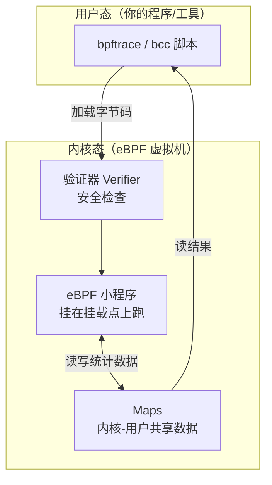
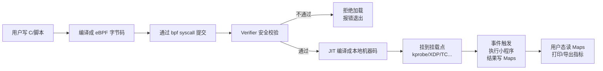
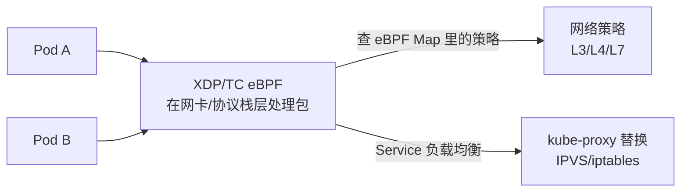

# eBPF 原理与可观测/网络/安全应用

::: tip 本篇定位
以前想在 Linux 内核里"插桩"观测系统（看每个进程什么时候打开文件、每个包在哪一层慢了），要么装一堆笨重工具，要么干脆改内核代码重编译。**eBPF** 让你在不修改内核源码、不重启、不崩内核的前提下，往内核里注入一小段"沙箱小程序"实时观测和处理网络包/系统调用。这篇讲清 eBPF 是什么、怎么用 bcc/bpftrace 现场抓数据，以及 Cilium/Falco 这些明星项目背后的原理。
本篇版本：bpftrace 0.27、bcc（BCC Tools）0.37.0、Cilium v1.20.2（基于 eBPF 的 K8s 网络与负载均衡）、Falco 0.45.0（eBPF 运行时安全）。要求内核 5.x 以上（CO-RE 场景建议 5.8+）。所有版本以官网当前稳定版为准。
:::

## 一、背景与基础

### 1.1 小白类比：内核里的"安全沙箱小程序"

Linux 内核是系统的"心脏"，直接乱动会整机死机。传统上想观测内核，有两条苦路：

- 改内核源码，重新编译，重启服务器——线上根本不敢动。
- 用 `strace`/`tcpdump`——慢、信息有限、高并发扛不住。

eBPF 就像在内核里开了一个**受严格监管的安全沙箱**：你写一段小程序提交进去，内核里有个"安检员（验证器）"先检查它：会不会死循环？会不会越界访问内存？会不会跑飞？检查通过，才让它挂到某个"观测点"上跑。

> 类比：eBPF 像给心脏手术装的"微型内窥镜 + 记录仪"——不用开膛破肚（改内核），就能实时看到心脏（内核）内部每个阀门（函数/网络包）什么时候动了、动了多久。而且录完就撤，不留后遗症。

### 1.2 用户态 vs 内核态



- **用户态程序**：写脚本、发指令、最后把统计结果打印出来。
- **内核态 eBPF 程序**：真正跑在挂载点上，事件触发时执行，把结果写进 Maps。
- **Maps**：一块"共享白板"，内核态写、用户态读，是两边传数据的通道。

## 二、核心概念

### 2.1 验证器、Helper、Maps、Program 类型

| 概念 | 作用 |
|---|---|
| **Verifier（验证器）** | 程序入内核前的安全检查：必须能在有限步内结束、不能越界、不能崩溃内核。这是 eBPF 敢在生产内核跑的根本保证 |
| **Maps** | 键值存储（哈希表、数组、柱状图等），内核态与用户态共享数据 |
| **Helper（辅助函数）** | eBPF 程序能调用的受限内核函数，如 `bpf_ktime_get_ns()` 取时间、`bpf_get_current_comm()` 取进程名 |
| **Program 类型** | 决定程序挂在哪、干什么 |

常见 Program 类型与挂载点：

| 类型 | 挂在哪 | 能干什么 |
|---|---|---|
| **kprobe** | 动态挂到任意内核函数入口/返回 | 观测任意内核函数被调用 |
| **tracepoint** | 挂到内核预定义的稳定 tracepoint 点 | 比 kprobe 稳定，内核升级不轻易变 |
| **uprobe** | 挂到用户态函数（如某二进制内部） | 观测某个应用内部函数 |
| **XDP** | 网络驱动最早期收包处（比协议栈还靠前） | 高性能过滤/DDoS 防护/负载均衡 |
| **TC** | 内核流量控制 hooks（ingress/egress） | 容器网络、包修改/转发 |
| **perf_event** | CPU 性能计数器 | 持续剖析（profiling） |

### 2.2 一次 eBPF 程序的加载执行流程



## 三、上手：bcc 与 bpftrace

### 3.1 安装

```bash
# RHEL/Rocky 10：bcc-tools 与 bpftrace 已在仓库（示例为仓库打包版本）
sudo dnf install -y bcc-tools bpftrace
# Ubuntu/Debian：
# sudo apt install -y bpfcc-tools linux-headers-$(uname -r) bpftrace
sudo bpftrace --version     # 应输出 v0.27.x
```

> bpftrace 脚本常需要 `root`（或 CAP_BPF/CAP_PERFMON 等能力）。下面示例都用 `sudo` 跑，`Ctrl+C` 结束。

### 3.2 可直接运行的 bpftrace 示例

**1) 看哪些进程在执行新程序（exec 系统调用）：**

```bash
sudo bpftrace -e 'tracepoint:syscalls:sys_enter_execve {
    printf("%-6s %s\n", comm, args->argv[0]);
}'
```

**2) 统计每个进程打开了多少文件（openat）：**

```bash
sudo bpftrace -e 'tracepoint:syscalls:sys_enter_openat {
    @[comm] = count();
} END { printf("打开文件最多的进程：\n"); print(@); }'
```

**3) 统计读系统调用的延迟分布（直方图）：**

```bash
sudo bpftrace -e 'tracepoint:syscalls:sys_enter_read {
    @start[tid] = nsecs;
}
tracepoint:syscalls:sys_exit_read /@start[tid]/ {
    @us = hist((nsecs - @start[tid]) / 1000);
    delete(@start[tid]);
}'
```

**4) XDP 收包计数（网卡驱动层，最高性能位置）：**

```bash
# 先看网卡名，如 eth0
sudo bpftrace -e 'tracepoint:xdp:xdp_exception { @[comm] = count(); }'
# 或用 XDP 程序统计收包（绑定到 eth0）：
sudo bpftrace -e 'kprobe:eth0_xdp { @rx = count(); }'
```

::: details bcc 工具集（开箱即用的现成脚本）
bcc 自带一堆现成小工具，不用自己写：`opensnoop`（谁在打开文件）、`execsnoop`（谁在执行新程序）、`biosnoop`（磁盘 IO 延迟）、`tcpconnect`（谁在发起 TCP 连接）、`bashreadline`（看 shell 历史）。直接 `sudo opensnoop-bpfcc` 就能跑，排障时极快定位问题。
:::

## 四、三大应用场景

### 4.1 可观测与持续剖析（Continuous Profiling）

传统监控（Prometheus 指标）告诉你"慢了"，但不知道"慢在哪一行代码"。eBPF 可以对线上服务做**低开销持续剖析**：不用改代码、不用重启，就采到每个函数占了多少 CPU、慢在哪。代表：Pyroscope/Parca（与 [OpenTelemetry](./monitor-opentelemetry) 生态打通）。

### 4.2 网络：Cilium 与 XDP

**Cilium** 把 K8s 的容器网络、网络策略、服务负载均衡全部搬到 eBPF 数据面：



- 相比传统 kube-proxy iptables 模式，规则多时 iptables 链遍历是 O(n)，eBPF Map 查询是 O(1)，规模越大优势越明显。
- **XDP** 在网卡驱动刚收到包时就能丢包，是高性能 DDoS 防护和负载均衡的利器——恶意包在还没进协议栈、没消耗 CPU 内存前就被丢弃。

```bash
# Cilium 在 K8s 上安装（固定版本 v1.20.2，Helm 仓库方式）
helm repo add cilium https://helm.cilium.io/
helm install cilium cilium/cilium --version 1.20.2 -n kube-system
cilium status          # 检查数据面是否就绪
cilium monitor         # 实时看跨 Pod 的包（eBPF 抓包）
```

### 4.3 安全：Falco 运行时威胁检测

**Falco** 用 eBPF 跟踪系统调用，按规则检测"异常行为"：比如容器里突然开了 shell、有人读了 `/etc/shadow`、出现可疑的反向 shell。它不猜漏洞，而是在**运行时**发现行为异常。

```bash
# Falco 容器化跑（固定 tag）
docker run --rm -i --privileged \
  -v /var/run/docker.sock:/host/var/run/docker.sock \
  -v /dev:/host/dev -v /proc:/host/proc:ro \
  falcosecurity/falco:0.45.0
```

一条典型规则（检测容器内 openssl 被调用）：

```yaml
- rule: Shell Spawned in Container
  desc: A shell was spawned in a container
  condition: >
    spawned_process and container and shell_procs and proc.tty != 0
  output: "Shell spawned in container (user=%user container=%container.name)"
  priority: WARNING
```

## 五、CO-RE、BTF 与内核要求

| 概念 | 通俗解释 |
|---|---|
| **CO-RE（Compile Once – Run Everywhere）** | 一次编译出的 eBPF 程序，能跑在不同内核版本上，不用每个内核都重编译 |
| **BTF（BPF Type Format）** | 内核里的"类型元数据"，CO-RE 靠它在不同内核上正确偏移字段 |
| **内核要求** | 基础 eBPF 能力 4.x 后期逐步加入；**生产建议 5.8+**，BTF 开箱自启用 CONFIG_DEBUG_INFO_BTF=y |

```bash
# 检查内核是否带 BTF（CO-RE 前提）
ls /sys/kernel/btf/vmmlinux && echo "BTF 可用"
uname -r                       # 看内核版本
zcat /proc/config.gz | grep BPF
```

::: warning eBPF 的能力边界
- eBPF 程序**不能随便改内核状态**，只能在挂载点观测/过滤；验证器保证它不会死循环、不会越界。
- 需要 root 或 CAP_BPF/CAP_PERFMON 等能力；容器里跑要 `--privileged` 或显式挂能力。
- 不是"万能加速"：挂载点选得不对、Maps 用得不合理，反而拖慢系统；高吞吐场景先小流量验证。
:::

## 六、常见问题排错

| 现象 | 原因 | 解决 |
|---|---|---|
| `bpftrace` 报 `failed to load program: Operation not permitted` | 权限不够 / LSM（如 SELinux）拦 | 加 `sudo`；临时 `setenforce 0` 测试；容器要 `--privileged` |
| 加载报 `invalid kprobe: unknown address` | 内核函数名在当前内核不存在 | 用 `tracepoint`（更稳定）替代 kprobe；先 `bpftrace -l 'kprobe:*'` 列可用点 |
| CO-RE 程序在别的内核上跑崩 | 目标内核没有 BTF | 确认 `/sys/kernel/btf/vmmlinux` 存在；升级到 5.8+ 且编译带 BTF |
| 统计结果为 0 / 一直不打印 | 脚本没事件触发 / 过滤条件太严 | 先去掉 `/filter/` 试；`Ctrl+C` 后 END 才打印汇总 |
| Cilium 装完 Pod 不通 | kube-proxy 冲突 / 内核版本太低 | 确认内核 ≥ 推荐版本；按官方文档禁用 kube-proxy 或共存模式 |
| XDP 程序加载后网卡断流 | 驱动不支持通用 XDP / 挂错接口 | 先在测试网卡试；用 `ldpd` 驱动模式（generic XDP）兜底 |
| 高并发下 bpftrace 丢事件 | 环形缓冲区不够 | 调大 buffer；用更粗粒度的聚合（按 comm 聚合而不是每个事件打印） |

::: warning 生产红线
- eBPF 工具本身要 root 权限，只在可信场景用；不要把来路不明的 .bpf.o 直接加载到生产内核。
- XDP/TC 类"会丢包/改包"的程序先在测试网卡灰度，写错了会直接断业务网络。
- Cilium 替换 kube-proxy 前先在测试集群跑通，确认 NetworkPolicy、Service、Ingress 都符合预期再上生产。
- Falco 规则上线前先观察模式（不告警只记录）跑一周，避免误报轰炸。
- 镜像/版本固定（Cilium 1.20.2、Falco 0.45.0），跟随内核升级时一起验证 eBPF 程序兼容性。
:::

## 相关速查

- 内核与性能：[Linux 内核](./linux-kernel)、[性能调优](./linux-performance)、[Linux 网络](./linux-network)
- K8s 网络与入口：[Operator/CRD 与 Gateway API](./container-operator)、[Pod 与服务发现](./container-k8s-02-pod-service-discovery)
- 可观测生态：[OpenTelemetry 统一可观测](./monitor-opentelemetry)、[Prometheus 监控](./monitor-prometheus-01-intro)
- 命令速查：[云原生命令速查](/reference/cloudnative-commands)、[Linux 命令速查](/reference/linux-commands)

### 官方文档

- eBPF 官网：https://ebpf.io/
- bpftrace 官网与文档：https://bpftrace.org/
- bpftrace 版本发布：https://github.com/bpftrace/bpftrace/releases
- BCC 工具集（IO Visor）：https://github.com/iovisor/bcc
- Cilium 官网与文档：https://cilium.io/ 、https://docs.cilium.io/
- Cilium 版本发布（选 tag）：https://github.com/cilium/cilium/releases
- Falco 官网：https://falco.org/
- Falco 版本发布（选镜像 tag）：https://github.com/falcosecurity/falco/releases
- Linux 内核 BPF 文档：https://docs.kernel.org/bpf/
