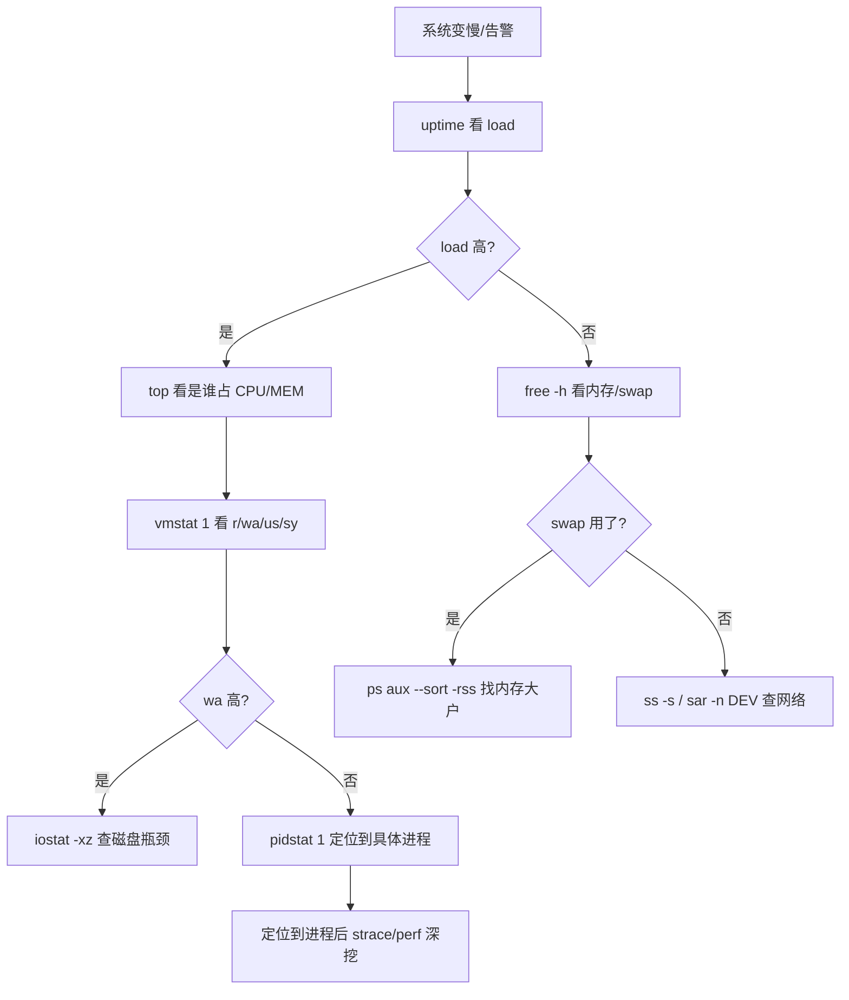

# Linux 性能排查指南

::: tip 本篇定位
服务器变慢了、CPU 跑满了、内存被吃了、磁盘 IO 打满了、网络拥塞了——这套指南告诉你**先看什么、再看什么、每个数字什么意思**。不是命令堆砌，而是一套经过实战检验的排查路径。命令以 RHEL/CentOS/Rocky 为主线，Debian/Ubuntu 差异单独标注。
:::

## 一、性能指标全局认识

排查性能问题，本质就是盯四类资源：**CPU、内存、磁盘 IO、网络**。再加上一个综合指标——**负载（load average）**。

| 资源 | 关心什么 | 出问题的典型表现 |
|---|---|---|
| CPU | 使用率、队列、上下文切换 | 命令卡顿、请求排队、负载飙高 |
| 内存 | 已用/空闲、swap、cache/buffer | 程序 OOM、系统开始用 swap 变慢 |
| 磁盘 IO | 利用率、await、IOPS | 程序卡在等磁盘（D 状态进程） |
| 网络 | 带宽、重传、丢包、连接数 | 接口超时、跨机调用慢 |

### 什么是 load average（小白类比）

`uptime` 命令最后三个数就是 load average，分别是 **1 分钟、5 分钟、15 分钟**的平均负载。

**类比**：把 CPU 核心数想象成银行窗口数量。load average 就是"排队等候 + 正在办理"的总人数。

- 窗口数 = 8 核；
- load = 2：大厅里一共 2 个人（都在办业务，还有 6 个窗口空着），轻松；
- load = 8：8 个人，正好每个窗口一个，不排队；
- load = 16：8 个窗口办业务，门口还排着 8 个队——这就过载了。

**判定标准**：

- load 持续 **小于 CPU 核心数**：健康；
- load 持续 **等于核心数**：满载但还能扛；
- load 持续 **大于核心数（如 2 倍以上）**：过载，要查谁在抢 CPU/IO。

注意：load 高**不一定是 CPU 忙**——大量进程在等磁盘 IO（D 状态）也会把 load 顶上去，这是新手最容易误判的地方。

## 二、排查方法论

### USE 方法

Brendan Gregg 提出的 **USE 方法**：对每一种资源（CPU/内存/磁盘/网络），依次检查三件事：

1. **Utilization（利用率）**：这个资源忙了百分之多少？
2. **Saturation（饱和度）**：排队长不长？有没有队列堆积？
3. **Errors（错误）**：有没有报错、重传、EIO？

任何一项异常，就顺着它往下钻。

### 标准排查路径

不要一上来就 `top` 里瞎看。按这个顺序：



一句话路径：**`uptime` 看大盘 → `top` 找大户 → `vmstat` 看整体 CPU/IO 分布 → `iostat`/`pidstat` 钻到具体盘/进程**。

## 三、逐工具详解

### uptime：先看大盘

```bash
uptime
# 输出：
# 14:22:01 up 35 days,  2:11,  2 users,  load average: 0.50, 0.80, 1.20
```

- `up 35 days`：系统已稳定运行 35 天（没意外重启过）；
- 最后三个 load：看趋势——1 分钟 < 5 分钟 < 15 分钟说明负载在下降，反之在上升。

### top / htop：找大户

```bash
top
# 或装 htop（更好看）
htop
```

top 界面上半部分关键行：

| 行 | 字段含义 |
|---|---|
| `Cpu(s)` | `us` 用户态 CPU（你的程序）、`sy` 内核态、`id` 空闲、`wa` 等磁盘 IO、`st` 被偷走的（虚拟机被宿主机超卖） |
| `MiB Mem` | total / free / used / **buff/cache** |
| `MiB Swap` | swap 用了多少 |

下半部分每个进程：`%CPU`、`%MEM`、`COMMAND`。按 `P` 按 CPU 排序，按 `M` 按内存排序。

::: tip 看 top 的诀窍
先看 `wa`（iowait）——如果 wa 很高（>20%），说明瓶颈在磁盘不在 CPU，再去 iostat；us 高才说明是程序本身吃 CPU。
:::

### ps / pstree：看进程

```bash
ps aux --sort=-%cpu | head        # CPU 占用前 10
ps aux --sort=-%mem | head        # 内存占用前 10
pstree -p                          # 树状看进程父子关系
ps -efL | wc -l                    # 线程总数（异常多也要警惕）
```

### vmstat：整体一秒一看

```bash
vmstat 1        # 每秒刷一次
```

典型输出：

```
r  b   swpd   free   buff  cache   si  so    bi   bo  in  cs  us sy id wa st
2  0      0  180000  40000 800000   0   0    1    2 120 300 10  3 85  2  0
```

各列：

| 列 | 含义 | 异常信号 |
|---|---|---|
| `r` | 等待运行的进程数 | 长期 > CPU 核数说明 CPU 不够 |
| `b` | 处于不可中断睡眠（等 IO）的进程 | 长期 > 0 说明磁盘 IO 堵 |
| `si`/`so` | swap 换入/换出 | 持续非零 = 内存吃紧，在用 swap |
| `wa` | iowait % | 高 = 磁盘瓶颈 |
| `us`+`sy` | 非 idle CPU | 加起来接近 100 = CPU 饱和 |

### free：内存到底够不够

```bash
free -h
#               total        used        free      shared  buff/cache   available
# Mem:            15Gi       4.2Gi       1.1Gi       200Mi        10Gi        10Gi
# Swap:          4.0Gi          0B       4.0Gi
```

**新手最大误区**：盯着 `free` 那列看——只剩 1.1G 就慌了。其实 `buff/cache`（10G）是 Linux 拿空闲内存当磁盘缓存用的，**要用随时能让出来**。真正看够不够用 `available` 那一列（这里 10G，很健康）。

- `buff/cache`：内核为了加速磁盘读写主动占的内存，不算"真被用掉"；
- `available`：估算出来的、程序现在真能用的内存，这才是准的。

### iostat：磁盘 IO 瓶颈

```bash
iostat -xz 1
```

关键列：

| 列 | 含义 | 阈值参考 |
|---|---|---|
| `%util` | 磁盘利用率 | 接近 100% = 磁盘忙不过来 |
| `r_await`/`w_await` | 读写平均延迟（毫秒） | 机械盘 >20ms、SSD >2ms 就要注意 |
| `rkB/s`/`wkB/s` | 读写吞吐 | 对照磁盘标称带宽看打满没 |

`%util` 长期 100% + await 高 = 磁盘是瓶颈，要么换 SSD、要么把 IO 大户拆走。

### mpstat：每个 CPU 核心

```bash
mpstat -P ALL 1      # 每个核心的 us/sy/wa/id 分布
```

偶尔会发现"总 CPU 不高，但某一个核心 100%"——那是单线程程序跑满了一个核，全局平均看不出来，mpstat 才能抓到。

### pidstat：按进程拆 CPU/IO

```bash
pidstat 1                # 每个进程的 CPU
pidstat -d 1             # 每个进程的磁盘 IO（哪个进程在狂写盘）
pidstat -u -p <PID> 1    # 盯单个进程
```

### sar：历史数据

`sar` 最大的价值是**能看历史**——现在系统好好的，但昨晚 3 点卡过？sar 数据还在。

```bash
sar -u 1 3               # CPU
sar -r                    # 内存（看昨天：sar -r -f /var/log/sa/sa29）
sar -n DEV 1             # 网络网卡吞吐
sar -b                   # 磁盘 IO 历史
```

RHEL 默认装 sysstat，数据在 `/var/log/sa/`。

### ss：网络连接

```bash
ss -s                     # 摘要：各状态连接数
ss -tnp | grep :80       # 看 80 端口的连接和进程
ss -tn state established | wc -l   # ESTABLISHED 总数
```

老的 `netstat` 已被 `ss` 取代，更快更全。

### /proc 关键文件

工具不够用时，直接读内核：

```bash
cat /proc/cpuinfo | grep "model name" | head -1   # CPU 型号
nproc                                              # 逻辑核数
cat /proc/meminfo | head -5                        # 内存明细
cat /proc/loadavg                                  # load
cat /proc/<PID>/status | grep -E 'VmRSS|State'     # 某进程内存
```

## 四、四类实战场景

### 场景 1：CPU 飙高

1. `uptime` 确认 load 真的高；
2. `top`（按 P）找到 `%CPU` 最高的进程；
3. `pidstat 1` 确认是不是它持续吃 CPU；
4. 进去看它在干嘛：
   ```bash
   # Java 应用：jstack <PID> | head -100，看哪个线程在跑
   # 通用：strace -p <PID> -c      统计系统调用
   # perf top -p <PID>             看函数级热点
   ```
5. 常见原因：死循环、频繁 Full GC、正则回溯、日志打太多。

### 场景 2：内存泄漏 / OOM

1. `free -h`：看 `available` 是不是真见底、`swap` 是不是开始用了（si/so 非零）；
2. `ps aux --sort=-%mem | head` 找内存大户；
3. `dmesg | grep -i oom` 看内核是不是杀过进程；
4. Java 应用 dump 堆：`jmap -dump:live,format=b,file=heap.hprof <PID>`，用 MAT 分析；
5. 临时应急：`systemctl restart <服务>`，根治要改代码。

### 场景 3：磁盘 IO 瓶颈

1. `vmstat 1` 看到 `wa` 高、`b` 列有进程堵着；
2. `iostat -xz 1` 确认哪块盘 `%util` 接近 100%；
3. `pidstat -d 1` 找出是哪个进程在读/写；
4. 常见元凶：日志写太猛、MySQL 大查询、临时文件没清理、大文件 scp。

### 场景 4：网络打满

1. `sar -n DEV 1` 看哪块网卡 `rxkB/s`/`txkB/s` 接近网卡带宽；
2. `ss -s` 看连接数、TIME-WAIT 多不多、`Recv-Q` 堆积没；
3. `nethogs`（如装了）按进程看谁吃带宽；
4. `ethtool <网卡名>` 确认网卡协商的速率是不是被降到 100M 了。

## 五、工具安装差异

::: code-group

```bash [RHEL / Rocky]
# sysstat 自带 sar/iostat/mpstat/pidstat
dnf install -y sysstat
systemctl enable --now sysstat
# htop / dstat / nethogs
dnf install -y htop dstat nethogs
```

```bash [Debian / Ubuntu]
apt update
apt install -y sysstat
# Debian/Ubuntu 默认不开 sar 历史采集，要打开：
sed -i 's/ENABLED="false"/ENABLED="true"/' /etc/default/sysstat
systemctl enable --now sysstat
apt install -y htop dstat nethogs
```

:::

::: warning Ubuntu 下 sar 没数据？
Debian/Ubuntu 的 sysstat 默认 `ENABLED="false"`，装完必须改 `/etc/default/sysstat` 再重启服务，否则 `/var/log/sa/` 里没有历史数据，`sar -f` 查不到历史。RHEL 系默认就是开的。
:::

## 六、注意事项

- **先看监控历史，再上服务器**：有 Prometheus/Grafana 就先看图，别一上来在生产机上 `top` 蹲半天。
- **生产上避免重命令**：`tar`、`gzip`、`scp`、大 `dd` 本身就吃 IO；磁盘已经堵了就别再雪上加霜。
- **`strace`/`perf` 会拖慢目标进程**，生产上短时间采样即可，别长期挂着。
- **区分"现象"和"病根"**：CPU 高可能是 Java GC 引起的，GC 频繁可能是内存不够引起的——一路 USE 往下钻，别停在第一层。
- **保存现场**：发现问题后赶紧 `top -b -n1 > /tmp/top.txt`、`pidstat 1 5` 存几份快照，方便事后复盘。

## 相关速查

- [Linux 命令速查](/reference/linux-commands)

### 权威文档

- Brendan Gregg（性能分析大牛）主页：https://www.brendangregg.com/
- Brendan Gregg 的 USE 方法：https://www.brendangregg.com/usemethod.html
- Brendan Gregg 的 Linux 观测工具地图：https://www.brendangregg.com/linuxperf.html
- Red Hat 企业版性能调优指南：https://access.redhat.com/documentation/en-us/red_hat_enterprise_linux/9/html/performance_tuning_guide/index
- sysstat 官方仓库：https://github.com/sysstat/sysstat
