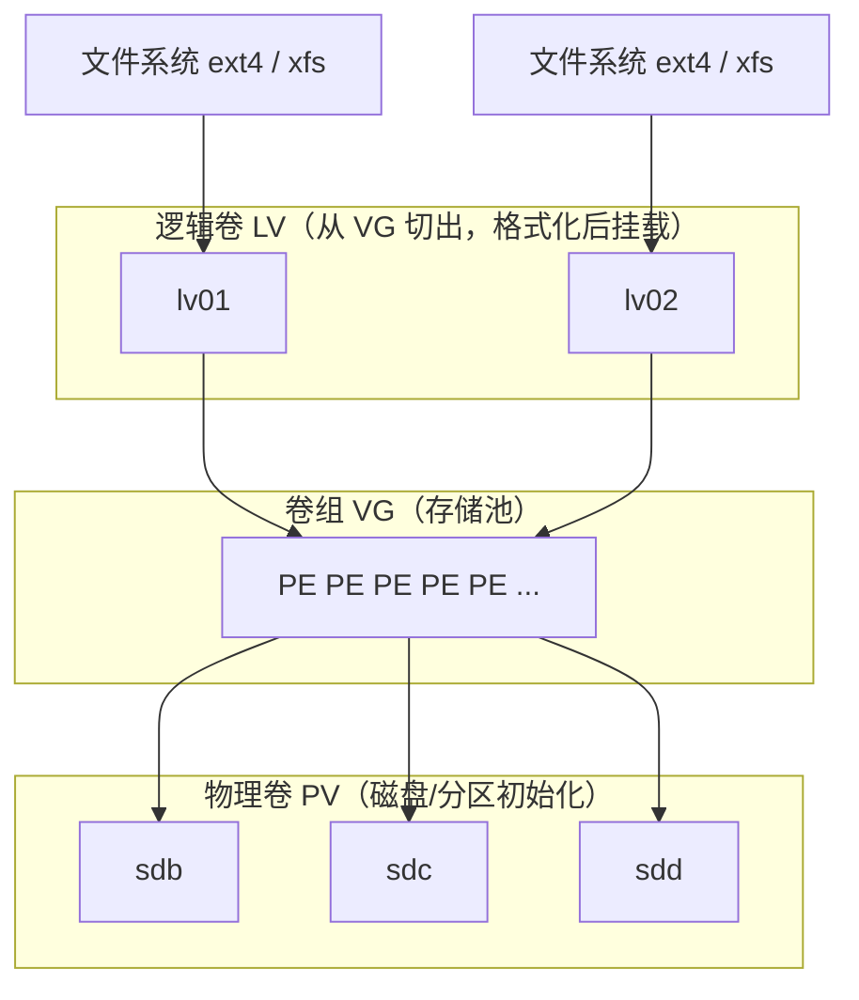

# 磁盘存储（详细指南）

::: tip 本篇定位
这是一篇**从零讲透**的文档：不只是给命令，而是讲清楚"一块磁盘在 Linux 里经历了什么、为什么要分区/格式化/LVM"。
学过忘了，顺着读一段就能接上；没学过，跟着做一遍就能上手。
命令以 **Rocky / RHEL 系**为主线演示，Debian/Ubuntu 的差异单独标注。
:::

## 〇、先建立全局认识

一块全新的磁盘，从"插进去"到"能存文件"，要经过四步：

```
   物理磁盘                分区              文件系统            挂载
┌──────────┐      ┌──────────────┐      ┌──────────┐      ┌──────────┐
│ /dev/sdb │ ───► │ sdb1 / sdb2  │ ───► │ mkfs.xfs │ ───► │ /data    │
│ 一整块盘 │      │ 切成若干小块 │      │ 组织文件  │      │ 访问入口 │
└──────────┘      └──────────────┘      └──────────┘      └──────────┘
```

- **分区**：把盘切成几块，便于隔离和管理。
- **文件系统（格式化）**：规定文件"怎么存、怎么找"，如 xfs、ext4。
- **挂载**：把格式化好的分区"挂"到一个目录上，访问目录就是访问磁盘。

后面每一步都会展开。你在工作中遇到的"加盘、扩容、磁盘满、数据冗余"，都对应这张图。

## 一、Linux 怎么看待一块磁盘

### 1. "一切皆文件"，磁盘也是文件

Linux 把硬件设备也抽象成文件，叫**设备文件**，统一放在 `/dev/` 目录。磁盘是其中的**块设备**（按数据块随机读写）。

```bash
[root@rocky ~]# ls -l /dev/sda
brw-rw----. 1 root disk 8, 0  9月 10 09:00 /dev/sda
```

第一位是 `b`，表示 block 块设备（对比：键盘、终端是 `c` 字符设备）。
后面的 `8, 0` 是**主设备号, 次设备号**：主设备号标识设备类型（8 = SCSI 磁盘），次设备号区分同类型的不同盘（sda=0、sdb=16、分区 sda1=1……）。日常基本不用管，了解即可。

### 2. 设备命名规律

| 磁盘类型 | 设备名 | 分区名 |
|---|---|---|
| SATA / SCSI / 普通虚拟盘 | `/dev/sda`、`/dev/sdb`…… | `/dev/sdb1` |
| NVMe 固态盘 | `/dev/nvme0n1` | `/dev/nvme0n1p1` |
| 云主机 virtio 盘（阿里云等） | `/dev/vda`、`/dev/vdb` | `/dev/vdb1` |

> `sda` 通常是系统盘，新增的盘依次是 `sdb`、`sdc`。**操作前务必用下面的命令确认盘符，别误操作系统盘。**

## 二、识别磁盘：新磁盘在哪

### 1. 两个查看命令

```bash
lsblk              # 树状显示：盘 → 分区 → 挂载点，最直观
fdisk -l           # 显示每块盘的容量、分区表详情
```

`lsblk` 典型输出：

```
NAME   MAJ:MIN RM  SIZE RO TYPE MOUNTPOINTS
sda      8:0    0   60G  0 disk
├─sda1   8:1    0    1G  0 part /boot
└─sda2   8:2    0   59G  0 part
  └─rl-root 253:0 0  57G  0 lvm  /
sdb      8:16   0  200G  0 disk          ← 新加入的空盘，还没有分区
```

### 2. 新磁盘识别不到怎么办

虚拟机/云主机热添加磁盘后，系统可能没立刻发现，不用重启，让 SCSI 层重新扫描：

```bash
ls /sys/class/scsi_host/                      # 有 host0、host1 ...
echo "- - -" > /sys/class/scsi_host/host0/scan
lsblk                                        # 再看是否出现
```

::: details Ubuntu 下的扫描方式
Ubuntu 可先找到使用 mptspi 驱动的 host，再扫描：
```bash
grep mptspi /sys/class/scsi_host/*/proc_name
echo '- - -' > /sys/class/scsi_host/host27/scan
```
原则上重启最省事，热扫描是为了不中断业务。
:::

## 三、分区：把磁盘切成小块

### 1. MBR 和 GPT 两种分区表

分区前要先确定用哪种分区表（分区表记录"这块盘被怎么切的"）：

| 对比 | MBR | GPT（推荐） |
|---|---|---|
| 主分区数量 | 最多 4 个（更多要用扩展分区） | 最多 128 个 |
| 单盘容量 | 最大约 2 TB | 无此限制 |
| 可靠性 | 分区表无备份 | 头尾双备份、带校验 |
| 配套引导 | Legacy BIOS | UEFI（也兼容 BIOS） |

**新盘、大于 2TB、或 UEFI 机器，一律用 GPT。**

### 2. fdisk 分区（适合 MBR，交互式）

`fdisk` 通过单字母命令交互，下面完整走一遍"在 sdb 上建一个 10G 主分区"：

```bash
[root@rocky ~]# fdisk /dev/sdb
欢迎使用 fdisk。
命令(输入 m 获取帮助)：n                 ← n = new 新建
分区类型
   p   主分区
   e   扩展分区
选择（默认 p）：p                          ← 回车，建主分区
分区号 (1-4, 默认 1)：1                    ← 分区编号
第一个扇区 (2048-..., 默认 2048)：         ← 回车，用默认起点
最后一个扇区 ...：+10G                     ← 用 +10G 指定大小
命令(输入 m 获取帮助)：p                   ← p 查看结果
   设备        起点    扇区  大小 类型
   /dev/sdb1   2048  ...       10G  83 Linux
命令(输入 m 获取帮助)：w                   ← w = write 保存（q 是不保存退出）
分区表已调整，正在同步磁盘。
```

**常用单字母命令**：`n` 新建、`d` 删除、`t` 改类型、`p` 查看、`w` 保存、`q` 退出。

::: details 疑问：最多能建几个主分区？
MBR 只能直接建 **4 个主分区**。如果还想要更多分区，需要先建一个**扩展分区**（占一个主分区名额），再在扩展分区里建若干**逻辑分区**（sdb5、sdb6……）。
GPT 没有这个烦恼，所以新方案都用 GPT。
:::

### 3. parted 分区（适合 GPT，可一条命令完成）

`parted` 支持 GPT 和大磁盘，也可以交互式用。最常用的是直接给命令：

```bash
parted /dev/sdb mklabel gpt                  # 1. 创建 GPT 分区表
parted /dev/sdb mkpart primary xfs 0% 100%   # 2. 建一个占满全盘的分区
partprobe                                    # 3. 通知内核重读分区表
lsblk
```

交互式下输入 `parted /dev/sdb`，常用子命令：`mklabel`、`mkpart`、`print`（查看）、`rm 编号`（删除）、`quit`。

::: warning
分区操作会改变磁盘，**务必确认盘符是数据盘（如 sdb）而非系统盘（sda）**。切错盘会丢数据。
:::

## 四、文件系统与挂载

### 1. 格式化（创建文件系统）

分区只是"切块"，还得格式化才能存文件：

::: code-group
```bash [XFS（RHEL 系默认）]
mkfs.xfs -f /dev/sdb1
# -f 强制（当分区已有文件系统时需要）
```
```bash [ext4（Debian 系默认）]
mkfs.ext4 /dev/sdb1
```
:::

> 为什么一条 `ls` 能同时列出 xfs、ext4？因为内核有一层 **VFS（虚拟文件系统）** 做中间层，用户和 VFS 打交道，VFS 再对接具体文件系统。了解即可，不影响操作。

### 2. 挂载与卸载

```bash
mkdir -p /data                       # 建挂载点目录
mount /dev/sdb1 /data                # 挂载，之后 /data 就是这块盘
df -h /data                          # 确认
umount /data                         # 卸载
```

**卸载报错 `target is busy`（设备正被占用）**——这是最常见的错误，原因是你正处在挂载目录里、或有进程在用它：

```bash
lsof /data              # 查看哪些进程占用
fuser -mv /data         # 或用 fuser 查看
# 退出该目录、结束进程后再 umount
```

### 3. 开机自动挂载 /etc/fstab

`mount` 挂载**重启就失效**，要开机自动挂载，得写进 `/etc/fstab`。

先用 UUID（稳定，推荐）拿到分区标识：

```bash
blkid /dev/sdb1
# /dev/sdb1: UUID="abcd-1234" TYPE="xfs"
```

编辑 `/etc/fstab`，一行 6 个字段：

```fstab
# 设备/UUID                 挂载点   类型  挂载选项   是否备份  开机检查顺序
UUID=abcd-1234              /data    xfs   defaults   0         0
```

| 字段 | 含义 |
|---|---|
| 设备 | UUID 或 `/dev/sdb1`，UUID 更稳定 |
| 挂载点 | 如 `/data` |
| 类型 | `xfs` / `ext4` |
| 选项 | `defaults` 即可 |
| dump | `0` 不备份 |
| 检查顺序 | `0` 不检查（根分区才用 1） |

**写完务必执行 `mount -a` 测试**，它会按 fstab 挂载所有条目，不报错才是正确：

```bash
mount -a          # 无任何输出 = 配置正确
df -h /data
```

::: danger fstab 写错可能导致开机卡住
fstab 写错（UUID 错误、挂载点不存在），系统开机可能卡在挂载阶段。**改完一定 `mount -a` 验证，确认无误再重启。**
:::

## 五、LVM 逻辑卷（重点）

### 1. 痛点：为什么需要 LVM

普通分区有个大麻烦：分区大小在建盘时就定死了。`/data` 当初分了 20G，现在不够用，而同一盘上的分区没法随意扩大，只能"加新盘 → 手动迁移数据"，非常痛苦。

**LVM 在磁盘和文件系统之间加了一层"逻辑层"**，把多块盘（或分区）合并成一个大存储池，可以随时从池子里切卷、**在线扩容、跨盘加空间**，不用迁移数据。

### 2. 核心概念（对照层次图理解）



> 从上往下读：**文件系统建在 LV 上 → LV 从 VG 池里切出（VG 由一个个 PE 组成）→ VG 由多块 PV（物理磁盘）合并而成**。

| 缩写 | 全称 | 通俗理解 |
|---|---|---|
| **PV** | Physical Volume 物理卷 | 把磁盘/分区加入 LVM 后的形态 |
| **VG** | Volume Group 卷组 | 多个 PV 拼成的存储池 |
| **LV** | Logical Volume 逻辑卷 | 从池里切出的卷，相当于"灵活的分区" |
| **PE** | Physical Extent | VG 内最小分配单元，默认 4 MB |

### 3. 安装 LVM

::: code-group
```bash [RHEL 系]
yum install -y lvm2
```
```bash [Debian/Ubuntu]
apt install -y lvm2
```
:::

### 4. 创建 LVM 完整流程

```bash
# ① 建物理卷 PV（可以用整块盘）
pvcreate /dev/sdb /dev/sdc
# Physical volume "/dev/sdb" successfully created.

# ② 建卷组 VG（把两个 PV 合并）
vgcreate vg_data /dev/sdb /dev/sdc
# Volume group "vg_data" successfully created

# ③ 建逻辑卷 LV（-L 指定大小；或 -l 100%FREE 用满）
lvcreate -L 10G -n lv_data vg_data
# Logical volume "lv_data" created.

# ④ 格式化
mkfs.xfs /dev/vg_data/lv_data

# ⑤ 挂载（设备路径两种写法等价：/dev/vg_data/lv_data 或 /dev/mapper/vg_data-lv_data）
mkdir /data
mount /dev/vg_data/lv_data /data
# ⑥ 写进 fstab 开机挂载（同第四节）
```

### 5. 扩容（LVM 最常用，务必掌握）

**情况 A：卷组里还有空闲空间**，直接扩 LV。加 `-r` 会**同时自动扩展文件系统**，最省事：

```bash
lvextend -L +20G -r /dev/vg_data/lv_data      # 增加 20G
# 或把剩余空间全给它：
lvextend -l +100%FREE -r /dev/vg_data/lv_data
```

**情况 B：卷组也满了**，先加新盘，再扩：

```bash
pvcreate /dev/sdd                      # 1. 新盘做 PV
vgextend vg_data /dev/sdd              # 2. 加进卷组
lvextend -l +100%FREE -r /dev/vg_data/lv_data   # 3. 扩 LV + 文件系统一步到位
```

如果没用 `-r`，需要**手动扩文件系统**（xfs 和 ext4 命令不同，注意参数一个是挂载点、一个是设备）：

::: code-group
```bash [XFS]
xfs_growfs /data                  # 参数是【挂载点】，只能在线扩
```
```bash [ext4]
resize2fs /dev/vg_data/lv_data    # 参数是【设备】
```
:::

### 6. 缩容（了解，生产尽量不做）

::: danger
- **XFS 不支持缩容**。
- ext4 缩容必须**先卸载**，且有数据风险。生产中容量规划错了，通常用"迁移数据重建"代替缩容。
:::

ext4 缩容流程（仅了解）：

```bash
umount /dev/vg_data/lv_data        # 1. 卸载
e2fsck -f /dev/vg_data/lv_data     # 2. 检查文件系统（必须）
resize2fs /dev/vg_data/lv_data 5G  # 3. 文件系统缩到 5G
lvreduce -L 5G /dev/vg_data/lv_data# 4. LV 缩到 5G
mount /dev/vg_data/lv_data /data   # 5. 重新挂载
```

### 7. 查看信息

```bash
pvs && vgs && lvs          # 简洁查看三层（pvdisplay/vgdisplay/lvdisplay 看详情）
```

## 六、RAID 磁盘阵列

### 1. 为什么需要 RAID

单块盘一旦损坏，数据全丢。**RAID 把多块盘组合成一个逻辑盘**，实现数据**冗余（坏盘不丢数据）**和/或**提升读写性能**。

### 2. 常见级别对比

| 级别 | 最少盘 | 可用容量 | 冗余 | 特点 |
|---|---|---|---|---|
| RAID 0 | 1 | 100% | 无 | 最快，一块坏全丢 |
| RAID 1 | 2 | 50% | 坏 1 块 | 镜像，可靠性高 |
| RAID 5 | 3 | (N-1) 盘 | 坏 1 块 | 分布式校验，兼顾容量 |
| RAID 6 | 4 | (N-2) 盘 | 坏 2 块 | 更安全 |
| RAID 10 | 4 | 50% | 坏（不同镜像组） | 先镜像后条带，性能+可靠，成本高 |

> 生产服务器多用**硬件 RAID（阵列卡）**，在开机 RAID 卡配置界面里做；`mdadm` 是软件 RAID，用于无阵列卡或实验环境。

### 3. mdadm 搭建软 RAID（以 RAID 5 为例）

```bash
# -C 创建 /dev/md0；-l 5 级别；-n 3 三块活动盘；-x 1 一块热备盘
mdadm -C /dev/md0 -l 5 -n 3 /dev/sd[bcd] -x 1 /dev/sde
mkfs.xfs /dev/md0
mkdir /mount/raid
mount /dev/md0 /mount/raid
```

查看状态和同步进度：

```bash
cat /proc/mdstat          # 同步进度条
mdadm --detail /dev/md0   # 详细状态（各盘 active sync / spare）
```

保存配置（否则重启后可能不认）：

```bash
mdadm -Ds >> /etc/mdadm.conf        # RHEL；Debian 路径 /etc/mdadm/mdadm.conf
echo "/dev/md0 /mount/raid xfs defaults 0 0" >> /etc/fstab
```

### 4. 坏盘更换（RAID 的核心价值）

```bash
mdadm /dev/md0 -f /dev/sdb      # 模拟 sdb 故障（fail）
mdadm /dev/md0 -r /dev/sdb      # 移除坏盘（remove），热备盘自动顶上重建
mdadm /dev/md0 -a /dev/sdb      # 换新盘后加回（add）
```

## 七、swap 交换空间

内存吃紧时，内核把暂时不用的数据挪到磁盘（swap），避免程序直接 OOM 崩溃。

```bash
free -h               # 查看内存和 swap
swapon --show         # 查看当前 swap
```

**用文件创建 swap（云主机最简单，不用重新分区）：**

```bash
dd if=/dev/zero of=/swapfile bs=1M count=2048   # 建 2G 文件
chmod 600 /swapfile                              # 权限必须 600
mkswap /swapfile                                # 格式化为 swap
swapon /swapfile                                # 启用
echo "/swapfile swap swap defaults 0 0" >> /etc/fstab   # 开机生效
```

**swappiness（0–100）**控制系统多积极地用 swap，值越大越爱用：

```bash
cat /proc/sys/vm/swappiness          # 默认一般 60
sysctl vm.swappiness=10              # 临时改为 10（偏好用物理内存）
echo "vm.swappiness=10" >> /etc/sysctl.conf   # 永久
```

::: details 什么场景该怎么设 swappiness？
- 数据库、延迟敏感服务：调小（如 1–10），尽量用内存。
- 云主机很多直接禁用 swap（K8s 节点默认要求关 swap）。
- 普通机器保持默认 60 即可。
:::

## 八、磁盘配额 quota（了解）

多用户/共享存储时，限制某个用户最多用多少空间，避免一个人把盘写满。

::: code-group
```bash [XFS]
# fstab 挂载选项加 uquota,gquota
xfs_quota -x -c 'limit bsoft=1G bhard=2G wiki' /data
# bsoft 软限制（告警）/ bhard 硬限制（封顶）
```
```bash [ext4]
# fstab 选项加 usrquota,grpquota
quotacheck -cum /data
edquota -u wiki          # 编辑该用户限制
quotaon /data
```
:::

## 速查与相关文档

- 想快速找命令：[Linux 命令速查](/reference/linux-commands)
- inode、文件类型、软硬链接：[文件系统](./linux-filesystem)
- 进程、内存、OOM 排查：[进程与服务管理](./linux-process)
