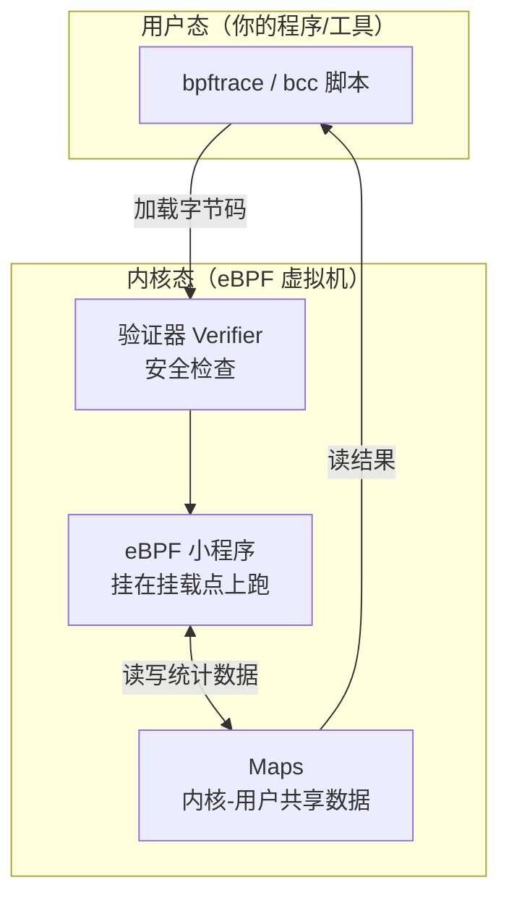
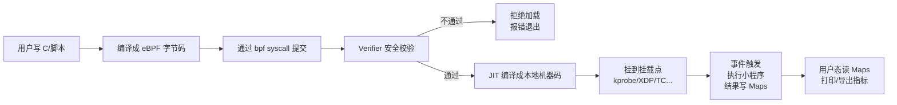
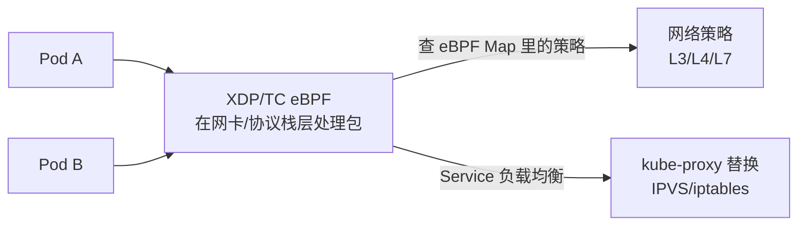
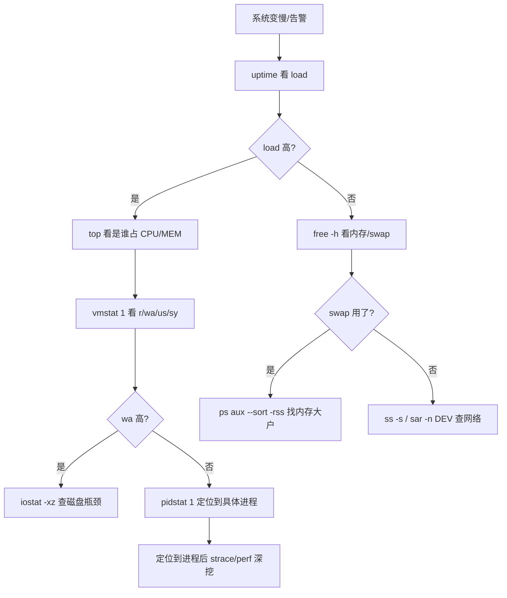

# Linux 系统管理

> 本页聚合 **Linux 操作系统层面**的所有操作指南：从安装、文件、存储、用户权限，到进程、日志、Shell 编程和安全加固。

## 文章索引

### 入门与基础

::: idx

| 文章 | 解决什么问题 | 状态 |
|---|---|---|
| [安装与初始环境](#合并资料) | 装系统、虚拟机、配 IP/SSH/软件源、发行版差异 | ✅️ 已完成 |
| [文件系统](#合并资料) | FHS 目录、文件类型、inode、软硬链接、挂载 | ✅️ 已完成 |
| [磁盘存储](./linux-storage) | 分区、格式化、LVM、RAID、磁盘配额 | ✅️ 已完成 |

:::

### 用户与权限

::: idx

| 文章 | 解决什么问题 | 状态 |
|---|---|---|
| [用户与权限](#合并资料) | 用户组管理、rwx、特殊权限、ACL、sudo、LDAP | ✅️ 已完成 |

:::

### 进程与任务

::: idx

| 文章 | 解决什么问题 | 状态 |
|---|---|---|
| [进程与服务](./linux-process) | systemd 服务管理、进程查看/控制、前后台、优先级 | ✅️ 已完成 |
| [定时任务](#合并资料) | crontab、at、systemd timer | ✅️ 已完成 |
| [性能排查](#合并资料) | top/ps/vmstat/iostat/pidstat、USE 方法、CPU/内存/IO/网络四类瓶颈实战 | ✅️ 已完成 |

:::

### 内核与日志

::: idx

| 文章 | 解决什么问题 | 状态 |
|---|---|---|
| [内核调优](#合并资料) | sysctl 参数、内核模块、ulimit 资源限制 | ✅️ 已完成 |
| [日志管理](./linux-log) | 日志分类、journalctl、rsyslog、logrotate、dmesg | ✅️ 已完成 |

:::

### 编程与安全

::: idx

| 文章 | 解决什么问题 | 状态 |
|---|---|---|
| [Shell 脚本编程](#合并资料) | 语法、条件、循环、函数、数组、调试、生产脚本 | ✅️ 已完成 |
| [安全加固](./linux-security) | 防火墙、SELinux、SSH 加固、SSL、VPN、NTP | ✅️ 已完成 |
| [iptables 防火墙](#合并资料) | iptables 四表五链、规则编写实战 | ✅️ 已完成 |  

:::


### eBPF 与内核前沿

::: idx

| 文章 | 解决什么问题 | 状态 |
|---|---|---|
| [eBPF 原理与应用](#合并资料) | eBPF 验证器/Maps、bcc/bpftrace、Cilium 数据面、可观测与安全 | ✅ 已完成 |

:::

## 命令速查

- 通用命令（文件 / 用户 / 进程 / 内存 / 内核）：[Linux 命令速查](/reference/linux-commands)
- 网络与防火墙命令：[网络命令速查](/reference/network-commands)

<!-- merged-qa-faq:start -->
## 常见问题 FAQ

> Linux 系统操作问题的高频问题已并入本页。默认只显示问题，点开查看完整答案。

### 一、部署前：发行版选型与系统初始化

<details>
<summary>Q1：RHEL 系与 Debian 系的主要区别？</summary>

**答：**

这俩是最常打交道的两大派，区别我按五个方面对比着说。

第一**包管理**：RHEL 系（RHEL/Rocky/Alma/CentOS）用 `rpm` 包格式，命令是 `dnf`（老版本是 `yum`），装包 `dnf install nginx`，查包 `dnf provides */nginx`；Debian 系（Ubuntu/Debian）用 `deb` 包，命令是 `apt`，装包 `apt install nginx`，更新前要先 `apt update` 刷新索引。

第二**防火墙**：RHEL 系默认 firewalld，用 `firewall-cmd --add-service=http --permanent` 加规则；Debian 系一般用 ufw，`ufw allow 80/tcp`，底层都是 netfilter。

第三**安全模块**：RHEL 系默认开 SELinux，这是新手最容易踩的坑——服务起不来常常是 SELinux 拦的，用 `getenforce` 看状态；Debian 系默认是 AppArmor，管控思路不同。

第四**网络配置**：RHEL 系老版写 `/etc/sysconfig/network-scripts/`，新版用 NetworkManager 的 `nmcli`；Ubuntu 用 netplan 写 YAML。

第五**版本策略**：RHEL 系追求稳定保守，一个大版本支持 10 年，适合生产；Ubuntu 两年一个 LTS，更新更激进，桌面和云生态用得多。

工作中以 RHEL 系为主线，遇到 Ubuntu 需要单独注意它防火墙是 ufw、没 SELinux、网络配置用 netplan 这三点差异。

</details>

<details>
<summary>Q2：系统安装后的基础优化？</summary>

**答：**

新机器装好系统，按一套固定清单做初始化，保证它能安全、稳定地上生产。

第一**配软件源和时间**：先把默认源换成内网或国内镜像，`dnf makecache`（或 `apt update`）；时间必须准，装 chrony 做时间同步，`timedatectl set-timezone Asia/Shanghai` 设时区——集群里时间不对，证书和日志全乱。

第二**SSH 加固**：禁止 root 直接密码登录，先建普通用户并加入 wheel/sudo 组，再 `PermitRootLogin no`、改默认端口、用密钥登录关掉密码登录。

第三**建普通用户、给 sudo**：日常不用 root 干活，`useradd -m ops`、`usermod -aG wheel ops`，再配 sudo 权限，所有操作可审计。

第四**防火墙和 SELinux 按需开**：firewalld 默认只放必要端口；SELinux 不建议直接关，先 `getenforce` 确认是 enforcing，业务跑通后再按需调策略，关了等于少一层防护。

第五**资源限制和内核参数**：改 `/etc/security/limits.conf` 调 ulimit（打开文件数调到 65535，不然高并发会 Too many open files）；按业务调 `/etc/sysctl.conf`，比如 `vm.overcommit_memory`、文件描述符上限，改完 `sysctl -p` 生效。

这套做完，新机器才算从"能装完"到"能上岗"。

</details>

<details>
<summary>Q3：描述 Linux 开机启动流程？</summary>

**答：**

可以按"从按下电源到登录"这条线分五步讲，每步出问题都能对上排查点。

第一步**固件自检**：按电源后先跑 BIOS 或 UEFI，做加电自检（POST），初始化 CPU、内存、键盘这些硬件，然后按启动顺序找可引导磁盘。UEFI 相比老 BIOS 支持 GPT 大盘和图形化启动菜单。

第二步**引导加载器**：从磁盘的引导记录拉 GRUB2。BIOS 模式读 MBR 前 512 字节，UEFI 模式读 EFI 分区里的 `grubx64.efi`。GRUB 会让你选内核，然后把内核镜像和 initramfs 加载进内存。

第三步**内核与 initramfs**：内核解压运行，先靠 initramfs（一个小的临时根文件系统）里的驱动，把磁盘控制器、LVM、软RAID 这些模块加载起来，再挂载真正的根分区 `/`，最后切到根分区上。

第四步**systemd 接管**：根挂好后启动 1 号进程 systemd（PID 永远是 1，所有进程的祖先）。它不直接按脚本顺序跑，而是按 target 来拉起服务——`multi-user.target` 对应字符界面多用户，`graphical.target` 再往上加图形界面。常用 `systemctl get-default` 看默认目标，`systemctl set-default multi-user.target` 修改。

第五步**登录**：启动 getty，弹出登录提示符，进入可操作状态。

排障上我会对应：起不来先看是卡在哪一步——屏幕没字是固件/硬件问题，GRUB 进不去是引导问题，内核 panic 看 initramfs/磁盘，服务起不来就 `systemctl status xxx` 看日志。

</details>

### 二、部署阶段：账号、权限与存储

<details>
<summary>Q4：rwx 权限如何计算？</summary>

**答：**

Linux 文件权限用三个数字表示，分别对应**属主、属组、其他人**三类人，每类占三位 rwx：读 r=4、写 w=2、执行 x=1，加起来就是该类人的权限值。

举几个例子就清楚了。`755` 拆开是 7-5-5：属主是 7（4+2+1，rwx 全有），属组是 5（4+1，r-x），其他人也是 5（r-x）。这是**目录和可执行脚本最常用的权限**——谁都能进去和读，但只有属主能改。`644` 是 6-4-4：属主 6（rw-，能读写），组和其他人只有 4（r--，只读），这是**普通配置文件和文档的默认权限**。

有两个点生产中常被追问。第一，**目录的 x 权限和文件不一样**：文件有 x 表示能执行它；目录有 x 表示"能不能进去（cd 进去）"，只有 r 没有 x 时，你能 `ls` 看到文件名列表，却进不去、也 stat 不了文件详情。第二，看权限用 `ls -l`，输出第一列 `-rwxr-xr--`，第一个字符 `-` 是普通文件、`d` 是目录、`l` 是软链接，后面九位才是三组 rwx。

改权限命令：`chmod 755 script.sh` 用数字，或 `chmod u+x script.sh` 用符号给属主加执行位；改属主 `chown user:group file`，常用 `-R` 递归。

</details>

<details>
<summary>Q5：su 和 sudo 的区别？</summary>

**答：**

这俩都能拿到 root 权限，但思路完全不同，可以这样对比。

`su` 是**切换用户**：`su - root` 会把我整个shell环境切成 root 的（`-` 表示连环境变量一起切，不写 `-` 只切身份不切环境），需要输入的是**目标用户 root 的密码**。也就是说，谁要临时当 root，都得知道 root 密码——这在团队里就尴尬了，root 密码人尽等于没人能负责。

`sudo` 是**授权执行**：我还是用自己的普通账号登录，在某条命令前加 `sudo`，临时以 root 身份跑这一条，需要输入的是**我自己的密码**。谁能 sudo、能跑哪些命令，由 `/etc/sudoers`（用 `visudo` 编辑）控制，比如 `ops ALL=(ALL) /usr/bin/systemctl restart nginx` 只允许 ops 重启 nginx。

对比下来 sudo 有三个生产优势：一是**不用共享 root 密码**，每个人用自己账号，离职直接删账号；二是**最小权限**，只给需要的命令，不是一上来全放权；三是**可审计**，所有 sudo 操作都记在 `/var/log/secure`（RHEL）或 `/var/log/auth.log`（Debian）里，出问题能追到谁干的。所以生产环境一律禁用 root 直登、用 sudo，这也是我新机器初始化的必做项。

</details>

<details>
<summary>Q6：硬链接和软链接区别？</summary>

**答：**

链接分硬链接和软链接（符号链接），核心区别是**它指向的是"文件本身"还是"文件名"**。

先理解原理：Linux 里一个文件真正的身份是 **inode**，文件名只是指向 inode 的一个"标签"。

**硬链接**：`ln 源文件 硬链接名`，它和源文件是**同一个 inode**，相当于同一个文件多挂了一个名字。特点是：删掉源文件后硬链接照样能用，因为 inode 还被硬链接引用着，磁盘数据没真删；缺点是**不能跨文件系统**（inode 只在本文件系统内唯一）、**不能给目录建**。适合防止误删重要文件——inode 链接数减到 0 数据才释放。

**软链接**：`ln -s 源文件 软链接名`，它是一个**独立的小文件，里面存的是源文件的路径字符串**，像 Windows 的快捷方式。特点是：**可以跨文件系统、可以链目录**，用得更广；但它依赖路径——删掉或移走源文件后，软链接就变成"断链"（失效的红箭头），`ls -l` 看出来就是指向不存在的地方。

一句话记：硬链接是"同一个文件的别名"，删源不影响；软链接是"指向路径的快捷方式"，源没了它就废了。日常做版本切换、目录映射（如 `ln -s /usr/local/nginx/sbin/nginx /usr/bin/nginx`）都用软链接。

</details>

<details>
<summary>Q7：umask 的作用？</summary>

**答：**

umask 决定我**新建文件和目录时的默认权限**，它是一个"遮罩"，把不该有的权限位去掉。

规则是：新建文件的默认最大权限是 `666`（rw-rw-rw-），新建目录是 `777`（rwxrwxrwx），然后**减掉 umask 的值**就是实际权限。注意文件默认不带执行位，所以即使 umask 算出来有 x，文件也不给 x，得手动 chmod。

举个例子，默认 umask 一般是 `022`。那新建文件就是 666 减 022 = **644**（rw-r--r--），新建目录是 777 减 022 = **755**（rwxr-xr-x）——这就是为什么你刚 `touch` 一个文件权限总是 644、`mkdir` 出来是 755。

如果想让新建文件更私密，把 umask 设成 `077`：文件就变成 600（只有属主能读写），目录变成 700，适合个人敏感环境。临时看和改：`umask` 看当前值，`umask 077` 临时设；永久生效写进 `/etc/profile` 或 `~/.bashrc`。

延伸理解：umask 和 chmod 的关系是——chmod 是"你主动指定权限"，umask 是"系统默认给你遮掉哪些位"，两者配合控制文件刚创建出来的安全基线。

</details>

<details>
<summary>Q8：LVM 原理和好处？</summary>

**答：**

LVM 是在磁盘分区和文件系统之间加的一层"弹性管理层"，解决的是传统分区写死大小、后期扩容要搬家的痛点。它分三层，从下往上是 **PV → VG → LV**。

最底层 PV（物理卷）：把整块盘或分区 `pvcreate /dev/sdb` 打造成物理卷。中间 VG（卷组）：把多个 PV 拼成一个大池子 `vgcreate data_vg /dev/sdb /dev/sdc`。最上层 LV（逻辑卷）：从池子里切一块出来用 `lvcreate -L 100G -n data_lv data_vg`，然后 mkfs 格式化、挂载，业务看到的就是这块 LV。

**好处有两个核心**。第一是**在线弹性扩容**：业务盘写满了，不用停机迁数据，往 VG 里加新盘再 `lvextend` 扩 LV、`xfs_growfs`（或 `resize2fs`）扩文件系统就行，全程在线。命令链是 `vgextend data_vg /dev/sdd && lvextend -L +50G /dev/data_vg/data_lv && xfs_growfs /data`。第二是**快照**：`lvcreate -s -n snap -L 1G data_vg/data_lv` 做个快照，相当于给文件系统拍个即时还原点，备份或测试时很有用。

反面我也踩过坑：当初装机图省事没做 LVM，盘写满了只能临时软链，所以后来我个人实验室一律先规划 LVM，这是吃了亏换的经验。

</details>

<details>
<summary>Q9：常见 RAID 级别及区别？</summary>

**答：**

RAID 是把多块盘组合成一块逻辑盘，换性能或冗余。我用一张对比说清楚常见四个级别。

| 级别 | 原理 | 可用容量 | 冗余 | 性能 | 典型场景 |
|---|---|---|---|---|---|
| RAID0 | 条带，数据劈开同时写多盘 | N 盘全用 | 无，坏一块全丢 | 读写最快 | 临时缓存、不在乎丢的数据 |
| RAID1 | 镜像，两块盘写一模一样 | 只用一半 | 能坏一块 | 读好写一般 | 系统盘、要求高可靠 |
| RAID5 | 分布式奇偶校验，至少 3 块 | (N-1) 盘 | 能坏一块 | 读好写一般 | 通用文件/数据库常用 |
| RAID10 | 先镜像再条带（1+0），至少 4 块 | 用一半 | 每组镜像能坏一块 | 读写都快 | 高要求数据库 |

我用自己的话总结选择逻辑：**要性能不要安全选 0；要安全不在乎容量选 1；要平衡性价比选 5；又要快又要安全、不差钱选 10。** 数据库生产我倾向 RAID10，写性能和冗余都顾得上；普通日志/备份用 RAID5 性价比最高。

补充一句：RAID 不等于备份。RAID 防的是单盘物理损坏，误删、病毒、逻辑损坏它都救不了，所以该备份还得备份。软硬 RAID 区别上，重要业务用硬 RAID 卡（有缓存、不占 CPU），软 RAID（`mdadm`）便宜但吃主机资源。

</details>

### 三、运行阶段：资源与磁盘

<details>
<summary>Q10：CPU 使用率高如何排查？</summary>

**答：**

CPU 高我按"先定位进程、再定位线程、再看在干什么"三步查。

第一步上 `top`：进交互界面后按 `P` 让进程按 CPU 从高到低排，先揪出是哪个进程吃 CPU。按 `1` 可以展开每个核心，看是单核打满还是整体忙。top 上方这行很关键：`us`（用户态）高是应用自己算得多，`sy`（内核态）高是系统调用/上下文切换多，`wa`（iowait）高说明 CPU 在等磁盘 IO——这三种情况根因完全不同。

第二步如果是 Java/多线程程序，要往下钻到线程：用 `top -Hp <pid>` 看这个进程里哪个线程在烧 CPU，拿到线程 ID 转成 16 进制，再 `jstack <pid> | grep <16进制tid>` 看这个线程在跑哪段代码。

第三步看它到底在干嘛：CPU 高但你不确定原因，可以 `strace -p <pid>` 看它在频繁发什么系统调用，或者用 `perf top` 看热点函数。

举个真实场景：`us` 高、某个 Java 进程占满，多半是死循环或者频繁 Full GC；`sy` 高可能是上下文切换太频繁（用 `vmstat` 看 cs 列）；`wa` 高其实不是 CPU 的锅，是磁盘慢，该去查 IO。所以我第一句话永远是"先看 top 里 us/sy/wa 哪个高"，这决定了后面往哪个方向查。

</details>

<details>
<summary>Q11：内存不足如何排查？</summary>

**答：**

查内存我第一步永远是 `free -h`，而且重点看 **available** 那一列，不是看 free。

```bash
free -h
#               total   used   free   shared  buff/cache  available
# Mem:           125Gi    20Gi    10Gi     1Gi        95Gi       100Gi
```

很多新人看到 free 只剩 10G 就慌了，其实不对——Linux 会把空闲内存拿去做磁盘缓存（buff/cache），这部分是"可回收"的，真正常用的是 **available** 列，它才是现在还能分给新程序的内存。所以 10G free + 95G cache ≈ 还有 100G 可用，根本不紧张。

如果 available 真的见底了，才是内存紧张。这时在 top 里按 `M` 让进程按内存从大到小排，揪出吃内存的进程。再深入：看 `/var/log/messages` 或 `dmesg | grep -i oom`，有没有内核 OOM killer 出来杀进程的记录——OOM 发生时内核会选一个"罪魁祸首"杀掉，日志里能看到杀了谁。

如果某进程内存只涨不跌，那是**内存泄漏**，需要抓 dump 分析。补充：swap 也要看，`free` 里 swap used 持续增长说明内存确实吃紧、在往磁盘上倒，性能会明显下降。一句话：先看 available 别被 cache 吓到，真紧张了按 M 找进程、查 OOM。

</details>

<details>
<summary>Q12：负载 load 高说明什么？</summary>

**答：**

load average 是 Unix 系统的经典指标，但它的定义很多人搞不清。**它不是 CPU 使用率，而是"处于运行态 + 不可中断睡眠态"的进程数的平均值**，就是"正在抢资源排队的队伍长度"。

`top` 或 `uptime` 开头会给三个数：`load average: 1.5, 0.8, 0.3`，分别是**过去 1 分钟、5 分钟、15 分钟**的平均值。怎么解读要结合 CPU 核数：

- 比如一台 8 核机器，load 是 8 才算打满，load 4 其实才用了一半。
- 如果 load 10 但机器才 4 核，说明有 6 个进程在排队等。

关键在于：**load 高不一定是 CPU 忙**。因为不可中断睡眠的进程（通常是在等磁盘 IO）也算进 load。所以我看到 load 高，会先判断是哪种：

- 同时 `top` 看 CPU 的 `us/sy` 高 → 确实是 CPU 计算瓶颈。
- CPU 不高但 load 高，再看 `wa`（iowait）高 → 是磁盘 IO 拖慢，进程都卡在等盘上。
- 也可能是大量进程在等锁、等 NFS。

还要看趋势：1 分钟 load 远高于 15 分钟，说明负载正在上来；反过来是在回落。所以我答 load 一定补一句"要结合核数和 iowait 一起看，不能单看数值大小"。

</details>

<details>
<summary>Q13：什么是僵尸进程？怎么处理？</summary>

**答：**

僵尸进程是**子进程已经退出了，但父进程没调用 wait() 去回收它的退出状态**，于是这个子进程残留成一个占着 PID 的空壳，在 `ps` 里状态显示为 **Z**（zombie）。

它的原理是：进程退出时并不会立刻消失，内核会保留一个退出状态码，等着父进程来取。父进程不取，它就一直挂着。僵尸进程本身**不占内存不占 CPU**（资源已经释放了），只占一个进程号 PID——少量几个无所谓，但如果大量堆积，PID 被耗尽就没法再开新进程了，这才是危害。

排查：

```bash
ps aux | grep defunct     # 或看 STAT 列是 Z 的
```

怎么处理？**直接 kill 僵尸本身是杀不掉的**，因为它已经死了。正确做法是找到它的父进程：

```bash
ps -ef | grep <僵尸pid>    # 看 PPID 那列是哪个父进程
```

然后让父进程去回收——要么给父进程发 `SIGCHLD` 信号让它 wait，最干脆的办法是**重启那个有 bug 的父进程**，父进程一死，僵尸就被 init（PID 1）接管并回收了。

根因是父进程写得不对、没处理子进程退出。一句话总结：少量僵尸是正常现象不用管，大量僵尸要找父进程修，治本是改父进程代码正确回收子进程。

</details>

<details>
<summary>Q14：磁盘有空间却提示 No space left？</summary>

**答：**

这个坑我实际遇到过——`df -h` 看明明还有几十 G，写文件却报 `No space left on device`。**第一反应不是看容量，而是看 inode 用完了没有。**

原理：Linux 里每个文件不管多小，都要占一个 inode 来存元数据（权限、大小、位置）。`df -h` 看的是数据块容量，而 `df -i` 看的是 inode 个数。如果你磁盘上有海量小文件（比如几万个几 KB 的 session、缓存、日志碎文件），数据块还没用多少，inode 却被小文件占光了——这时候新建文件就报 No space left，但大块文件还能写。

排查命令：

```bash
df -h /data     # 看容量，可能还有很多
df -i /data     # 看 inode，Use% 100% 就是它了
```

找到后定位是谁造的小文件：`du -sh /data/* | sort -rh` 找大目录，或者直接找小文件密集的地方（常见是 `/var/spool/clientmqueue`、应用缓存目录），清理掉没用的小文件，inode 就释放了。

其他次要原因：磁盘配额（quota）限制了用户用量，或者是挂载点下面藏着已被删除但进程还占着的大文件（这个用 `lsof | grep deleted` 查，见下一题）。排障时查到 inode 这一层，基本就到位。

</details>

<details>
<summary>Q15：磁盘空间满如何排查？</summary>

**答：**

磁盘满我有一套固定排查顺序，从粗到细两步定位。

第一步先看**整体谁满了**：

```bash
df -h            # 看哪个挂载点 Use% 到 100%
df -i            # 同时看 inode 是不是先满了（上一题）
```

第二步进满了的目录**逐层往下钻**：

```bash
du -sh /* 2>/dev/null          # 先看根下每个目录占多大
du -sh /var/* 2>/dev/null      # 一层层往下，通常在 /var/log 或 /var/lib
```

`du -sh` 加 `sort -rh` 倒序排，几轮就定位到最大的那个目录，一般是日志暴涨、core dump、或者上传目录没清理。

**还有一个高频坑必须单独查**：你 `du` 出来所有文件加起来远没用满，`df` 却显示满了——这是**进程还占着已被删除的大文件**。比如日志文件被 `rm` 删了，但那个写日志的进程没重启，文件句柄还开着，空间没真正释放。查法：

```bash
lsof | grep deleted     # 列出已删除但仍被进程占用的文件
```

找到对应进程，重启它（或 `> 那个已删除句柄`），空间立刻释放。这是 SRE 排磁盘满的标志性技能，这是排障的关键动作。

</details>

### 四、日常操作：Shell 与文本处理

<details>
<summary>Q16：grep、awk、sed 各自擅长？</summary>

**答：**

这三个是文本处理三剑客，我按"各管一段"来记：grep 管**找行**，awk 管**按列处理**，sed 管**编辑替换**。

**grep** 是行过滤器，作用是"从一堆文本里把符合条件的行筛出来"，不做修改。常用参数：`-i` 忽略大小写、`-v` 反选（排除匹配行）、`-r` 递归目录、`-n` 显示行号、`-E` 用扩展正则。比如 `grep -rn "error" /var/log/` 找出日志里所有 error 行。

**awk** 是按列处理的语言，适合"每行是一条记录、用空格或分隔符分成几列"的场景。它能取列、做统计、按条件过滤。比如 `awk '{print $1}'` 取第一列，`-F:` 指定冒号分隔（处理 /etc/passwd 特别好用）。

**sed** 是流编辑器，适合"按规则批量替换或删行"，最常用就是替换：`sed 's/旧/新/g'`。比如 `sed -i 's/192.168.1.10/10.0.0.5/g' nginx.conf` 直接改文件里的 IP。`-i` 是原地修改，不加 `-i` 只打印结果不改文件。

一句话分工：**要找用 grep，要算列用 awk，要改文本用 sed**，实战里经常仨串起来用——grep 先过滤，awk 再取列统计，sed 最后替换。

</details>

<details>
<summary>Q17：awk 如何统计列总和/出现次数？</summary>

**答：**

awk 的精髓就是它的"三段式"和数组统计，我用两个例子说清楚。

**统计某列总和**：它有 BEGIN、主体、END 三个块。BEGIN 是处理前跑一次（初始化），主体是每行跑一次，END 是全部读完跑一次（输出汇总）。比如统计 /tmp/data 里第二列的总和：

```bash
awk '{sum += $2} END {print "总和=" sum}' /tmp/data
```

这里 sum 每行累加第二列 `$2`，最后 END 打印总和。

**统计某个字段出现次数**：用数组当计数器，key 就是要统计的内容。比如统计 /etc/passwd 里每种 shell 出现多少次（用 `-F:` 指定冒号分隔，第 7 列是 shell）：

```bash
awk -F: '{cnt[$7]++} END {for (s in cnt) print s, cnt[s]}' /etc/passwd
```

原理是：每读一行，就把 `cnt[这个shell]` 加 1，遇到相同 shell 自动累加；END 里遍历这个数组，把每种 shell 和它的次数打出来。这就是 awk 做分组计数的经典套路。

再比如统计第 1 列等于某个值时第 3 列的和：`awk '$1=="web" {sum+=$3} END{print sum}'`。核心就记三点：`-F` 定分隔符、`数组[key]++` 做计数、`END` 出结果。

</details>

<details>
<summary>Q18：统计日志中访问最高的 IP？</summary>

**答：**

这是 awk/sort/uniq 组合的经典题，套路是"取 IP → 计数 → 排序 → 取前 N"。假设是 Nginx access.log，IP 在第一列：

```bash
awk '{print $1}' /var/log/nginx/access.log | sort | uniq -c | sort -rn | head -10
```

我一步步解释这条管道。第一截 `awk '{print $1}'` 把每行的 IP 单独取出来，一行一个。第二截 `sort` 先排序——uniq 只能合并相邻的重复行，所以前面必须先 sort，否则一样的 IP 不挨着就统计不到，这是新手最容易漏的一步。第三截 `uniq -c` 把相邻重复行合并并在前面打出出现次数。第四截 `sort -rn` 按出现次数**数字倒序**排（`-r` 倒序、`-n` 按数值）。最后 `head -10` 取前 10 个。

输出大概长这样：

```
   1523 1.2.3.4     ← 访问最多的 IP
    860 5.6.7.8
    210 9.10.11.12
```

如果日志格式复杂、IP 不在第一列，可以先用 grep 过滤，比如只统计 404 请求里的 IP：`grep ' 404 ' access.log | awk '{print $1}' | sort | uniq -c | sort -rn | head`。整个套路——取列、sort、uniq -c、sort -rn——记熟，统计 Top N 的题都能套。

</details>

<details>
<summary>Q19：find 常用用法？</summary>

**答：**

find 是按条件找文件再批量处理的工具，我按"找什么、怎么处理"两类记。

**按条件找（常用条件）：**

```bash
find /etc -name "*.conf"                 # 按名字找，-iname 忽略大小写
find /var -type f -size +100M            # 找大于 100M 的普通文件
find /home -type d -name "logs"          # -type d 只找目录，f 是文件
find /var/log -mtime -7                   # 7 天内被修改过的文件（+7 是 7 天前）
```

参数要点：`-name` 按文件名、`-type f/d` 按类型、`-size` 按大小（+大于 -小于）、`-mtime` 按修改时间（天）。

**找到之后批量处理（-exec）：**

```bash
find /var/log -name "*.log" -mtime +30 -exec rm -f {} \;
# 找出 30 天前的日志并删除，{} 代表找到的每个文件，\; 结尾

find /tmp -name "*.tmp" -exec ls -lh {} \;     # 先看下找到啥再删，保险
```

生产上有两个好习惯：一是**删之前先用 `-exec ls -lh {} \;` 预览一遍**，确认找的是对的再换 `rm`，别上来就删；二是清老日志用 `-mtime +N` 按时间删，这是日志轮转的手工做法。

我个人常用来排查的一条：`find / -name "*.pid" -mmin -60` 找最近一小时变动的文件。find 的核心就是"先把条件写准，再用 -exec 批量动作"。

</details>

<!-- merged-qa-faq:end -->

<!-- merged-guide-material:start -->
## 合并资料

> 原先单独成页的同主题内容已收进本页；默认折叠，点开看原页全文。

<details>
<summary><strong>定时任务 — 定时任务：cron 周期任务、at 一次性任务、systemd timer 的配置与注意事项。含关键步骤、验证与常见坑。</strong></summary>

::: tip 本篇定位
掌握三类定时任务：用 **cron** 配置周期性任务、用 **at** 配置只跑一次的任务、用 **systemd timer** 做更现代的定时方案，并理解它们的环境差异和排错方法。
:::

Linux 定时任务分两种：

| 类型 | 说明 | 实现 |
|---|---|---|
| 一次性任务 | 未来某个时间点执行一次 | `at`、`batch` |
| 周期性任务 | 按时间规律重复执行 | `cron`、systemd timer |

---

#### 一、crontab 基础

##### 1.1 cron 服务

cron 由守护进程 **crond** 提供，系统装好后默认运行，它每分钟检查一次是否有任务到期：

```bash
systemctl status crond        # RHEL/Rocky 服务名 crond
systemctl status cron         # Debian/Ubuntu 服务名 cron
```

##### 1.2 时间格式

每条 cron 任务由 **5 个时间字段 + 命令**组成：

```
  分      时      日      月      周        命令
minute  hour   day    month  weekday   command
(0-59)  (0-23) (1-31) (1-12)  (0-7)
```

::: details 星期字段的取值
星期 0 和 7 都表示周日，1=周一 … 6=周六；也可写英文 `sun,mon,...,sat`。
:::

**字段内的 4 种操作符：**

| 符号 | 含义 | 示例 |
|---|---|---|
| `*` | 该位置所有值 | `* * * * *` 每分钟 |
| `,` | 列举多个值 | `1,3,5` 第 1、3、5 |
| `-` | 范围 | `1-5` 从 1 到 5 |
| `/` | 步长/频率 | `*/5` 每隔 5 |

##### 1.3 用户级任务管理

每个用户有自己的 cron 任务，用 `crontab` 命令管理：

```bash
crontab -e          # 编辑当前用户的任务（最常用）
crontab -l          # 列出当前用户的任务
crontab -r          # 删除当前用户的全部任务
crontab -i -r       # 删除前交互确认（防止误删）
crontab -u user -l  # root 查看/管理指定用户的任务
```

用户任务文件实际保存在（一般不用直接动）：

- RHEL/Rocky：`/var/spool/cron/用户名`
- Ubuntu/Debian：`/var/spool/cron/crontabs/用户名`

::: warning 用户级任务不写用户名字段
`crontab -e` 里每行就是 `5 个时间字段 + 命令`，**不要再加用户名**（加了会被当成命令的一部分导致失败）。用户名字段只在系统级 `/etc/crontab` 中出现。
:::

##### 1.4 特殊关键字（简写）

cron 提供以 `@` 开头的简写：

| 关键字 | 等价表达式 | 含义 |
|---|---|---|
| `@reboot` | — | 开机启动后执行一次 |
| @yearly / @annually | `0 0 1 1 *` | 每年 1 月 1 日 0 点 |
| `@monthly` | `0 0 1 * *` | 每月 1 号 0 点 |
| `@weekly` | `0 0 * * 0` | 每周日 0 点 |
| `@daily` / @midnight | `0 0 * * *` | 每天 0 点 |
| `@hourly` | `0 * * * *` | 每小时整点 |

```bash
@reboot /opt/myapp/start.sh        # 开机后自动拉起应用
```

---

#### 二、系统级 cron

需要以指定用户身份跑、或属于系统维护的任务，用系统级 cron，有三种方式。

##### 2.1 /etc/crontab 主配置

```bash
cat /etc/crontab
```

```bash
SHELL=/bin/bash
PATH=/sbin:/bin:/usr/sbin:/usr/bin
MAILTO=root

# 分  时  日  月  周   用户名   命令
  *   *   *   *   *    root    /usr/bin/echo hello
```

::: tip 与用户级的关键区别
`/etc/crontab` 里在时间字段和命令之间**必须有用户名字段**（如 `root`），cron 会以该用户身份执行。
:::

##### 2.2 /etc/cron.d/ 子配置

把独立的任务文件放进 `/etc/cron.d/`，格式与 `/etc/crontab` 相同（含用户名字段），适合软件包投放任务，避免改动主文件：

```bash
# /etc/cron.d/mybackup
0 2 * * * root /usr/local/bin/backup.sh
```

##### 2.3 周期目录（放可执行脚本）

系统预置了一组目录，把**可执行脚本**直接放进去，就会按对应周期由 anacron/cron 调用，无需写时间表达式：

| 目录 | 执行周期 |
|---|---|
| `/etc/cron.hourly/` | 每小时 |
| `/etc/cron.daily/` | 每天 |
| `/etc/cron.weekly/` | 每周 |
| `/etc/cron.monthly/` | 每月 |

```bash
sudo cp cleanup.sh /etc/cron.daily/
sudo chmod +x /etc/cron.daily/cleanup.sh
```

> `cronie-anacron`（Debian 上是 anacron）负责保证：即使机器在预定时间关机（如笔记本、夜间关机的服务器），开机后也会补跑漏掉的 daily/weekly/monthly 任务。

##### 2.4 控制谁能用 cron

通过两个文件控制（与 at 同理）：

- `/etc/cron.allow`：白名单，只有其中用户能用 cron（文件默认不存在）；
- `/etc/cron.deny`：黑名单，其中用户不能用（默认存在、内容为空，即不限制）；
- 若两个都不存在，只有 root 能用；**allow 优先级高于 deny**。

---

#### 三、crontab 示例

##### 3.1 常用表达式

```bash
*/5 * * * * /usr/local/bin/job.sh          # 每 5 分钟
0 * * * * /usr/local/bin/job.sh            # 每小时整点
0 2 * * * /usr/local/bin/backup.sh         # 每天 2:00
30 3 * * 0 /usr/local/bin/weekly.sh        # 每周日 3:30
0 0 1 * * /usr/local/bin/monthly.sh        # 每月 1 号 0:00
0 9-18 * * 1-5 /usr/local/bin/check.sh     # 工作日(周一到周五)9-18 点每小时
*/10 9-18 * * 1-5 /usr/local/bin/check.sh  # 工作日 9-18 点每 10 分钟
0 0 1,15 * * /usr/local/bin/semi.sh        # 每月 1 号和 15 号
```

##### 3.2 实战：定时备份

```bash
crontab -e
```

```bash
# 每天凌晨 2:30 备份网站数据，日志单独记录
30 2 * * * /usr/local/bin/backup.sh >> /var/log/backup.log 2>&1
```

##### 3.3 实战：清理过期日志

```bash
# 每天凌晨 4 点删除 /var/log/myapp 下 7 天前的 .log
0 4 * * * /usr/bin/find /var/log/myapp -name "*.log" -mtime +7 -delete
```

##### 3.4 秒级任务

cron 最小粒度是**分钟**，做不到"每隔几秒"。变通方法是每分钟启动一个脚本，在脚本内循环：

```bash
* * * * * /usr/local/bin/every5sec.sh
```

```bash
#!/bin/bash
# every5sec.sh：在一分钟内每 5 秒执行一次
for i in {1..12}; do
    /usr/local/bin/job.sh
    sleep 5
done
```

##### 3.5 在线工具

表达式拿不准时可用在线生成/校验工具（注意不要把含敏感信息的命令贴上去）：

- crontab.guru：https://crontab.guru/
- Crontab Generator：https://crontab-generator.org/

---

#### 四、at 一次性任务

##### 4.1 安装与服务

- **RHEL/Rocky**：默认已安装并运行 `atd`；
- **Debian/Ubuntu**：默认未安装，需先装：

```bash
sudo apt install at -y
systemctl status atd        # Ubuntu 服务名也是 atd
```

##### 4.2 创建任务

进入交互式，输入要执行的命令，**按 Ctrl+D 结束**：

```bash
at 02:00                    # 今天 2:00（若已过则明天）
at 02:00 2026-09-20         # 指定年月日
at now + 5 minutes          # 5 分钟后
at now + 2 hours            # 2 小时后
at 17:00 tomorrow           # 明天 17:00
at noon                     # 中午 12:00
at midnight                 # 午夜 0 点
at teatime                   # 下午 4 点（16:00）
```

```bash
[root@rocky10 ~]# at now + 2 min
at> /usr/bin/touch /tmp/at-demo
at> <EOT>                   # 这里按 Ctrl+D
job 4 at Mon Sep 11 15:30:00 2026
```

也可以用管道直接传入（非交互）：

```bash
echo "/usr/bin/systemctl restart nginx" | at now + 10 min
```

##### 4.3 查看与删除

```bash
atq                # 或 at -l：列出待执行任务及编号
at -c 4            # 查看编号 4 任务的具体内容
atrm 4             # 或 at -d 4：删除编号 4 的任务
```

##### 4.4 权限控制

- `/etc/at.allow`：白名单，其中用户才能用 at；
- `/etc/at.deny`：黑名单（默认存在、为空，即不限制任何人）；
- 两文件都不存在时只有 root 能用；**allow 优先**。

##### 4.5 batch：系统空闲时执行

`batch`（也是 at 包提供）在**系统负载低于阈值时**才执行任务，适合跑不在乎具体时间、但不想加重高峰负担的重活，用法同 at：

```bash
batch
at> /usr/local/bin/heavy-job.sh
at> <EOT>
```

---

#### 五、systemd timer

systemd 自带定时能力，由一个 **`.timer`** 单元和它触发的 **`.service`** 单元配对组成。

##### 5.1 两种触发方式

| 指令 | 含义 |
|---|---|
| `OnCalendar=` | 按日历时间（类似 cron） |
| `OnBootSec=` / `OnStartupSec=` | 距开机/启动后多久 |
| `OnUnitActiveSec=` | 距该服务上次激活后多久（周期） |
| `OnUnitInactiveSec=` | 距该服务上次停止后多久 |

##### 5.2 完整示例：每 5 分钟跑一次任务

先写被触发的服务 `/etc/systemd/system/mytask.service`：

```ini
[Unit]
Description=My Periodic Task

[Service]
Type=oneshot
ExecStart=/usr/local/bin/mytask.sh
```

再写定时器 `/etc/systemd/system/mytask.timer`（**与服务同名**）：

```ini
[Unit]
Description=Run mytask every 5 minutes

[Timer]
OnBootSec=2min
OnUnitActiveSec=5min
Persistent=true

[Install]
WantedBy=timers.target
```

启用：

```bash
sudo systemctl daemon-reload
sudo systemctl enable --now mytask.timer
systemctl list-timers                 # 查看所有定时器及下次触发时间
```

##### 5.3 OnCalendar 日历表达式

```ini
[Timer]
OnCalendar=*:0/15                 # 每 15 分钟
OnCalendar=daily                  # 每天 0 点
OnCalendar=hourly                 # 每小时
OnCalendar=Mon..Fri 09:00         # 工作日 9 点
OnCalendar=*-*-1 00:00:00         # 每月 1 号 0 点
OnCalendar=Mon *-*-* 03:00:00     # 每周一 3 点
Persistent=true                   # 关机错过的，开机后补跑
```

> 语法为 `星期 年-月-日 时:分:秒`，比 cron 更直观，手册见 [systemd.time(7)](https://www.freedesktop.org/software/systemd/man/latest/systemd.time.html)、[systemd.timer(5)](https://www.freedesktop.org/software/systemd/man/latest/systemd.timer.html)。

##### 5.4 与 cron 对比

| 维度 | cron | systemd timer |
|---|---|---|
| 日志 | 需自己重定向/看邮件 | 自动进 journald，`journalctl -u xxx` 直接查 |
| 错过任务 | 靠 anacron（仅 daily 等） | `Persistent=true` 原生补跑 |
| 依赖管理 | 无 | 可配合 Unit 依赖、顺序 |
| 随机延迟 | 不支持 | `RandomizedDelaySec=` 防雪崩 |
| 精度/调试 | 简单通用 | 信息更全、`list-timers` 直观 |
| 适用 | 简单、跨平台通用 | 已全面使用 systemd 的系统 |

::: tip 怎么选
- 简单的周期任务、或需要跨不同 UNIX 通用，用 **cron**，最普及；
- 想要完善日志、错过补跑、与其他服务联动，用 **systemd timer**；
- 只跑一次用 **at**。
:::

---

#### 六、注意事项（cron 排错重点）

cron 任务"手动能跑、定时不跑"，90% 是下面几个原因。

##### 6.1 用绝对路径

cron 的环境非常精简，`PATH` 往往只有 `/usr/bin:/bin`，你在终端能用的命令可能找不到：

```bash
# 错误：依赖 PATH
0 2 * * * backup.sh
# 正确：命令和脚本都写绝对路径
0 2 * * * /usr/local/bin/backup.sh
```

也可在任务文件顶部自定义环境：

```bash
SHELL=/bin/bash
PATH=/usr/local/sbin:/usr/local/bin:/usr/sbin:/usr/bin:/bin
MAILTO=rocky
```

##### 6.2 环境变量与交互环境不同

cron 不加载 `~/.bashrc`、`~/.bash_profile`，所以里面定义的变量、别名、conda/nvm 环境等都不生效。需要的环境在脚本内显式 `source` 或写全。

##### 6.3 输出要重定向

任务有输出时，cron 默认会尝试**发本地邮件**给用户（没装邮件服务就丢失或堆积）。应显式重定向：

```bash
0 2 * * * /usr/local/bin/backup.sh >> /var/log/backup.log 2>&1   # 正常和错误都记日志
*/5 * * * * /usr/local/bin/heartbeat.sh >/dev/null 2>&1         # 丢弃所有输出
```

##### 6.4 权限与脚本可执行

- 脚本要有执行权限：`chmod +x script.sh`；
- cron 以任务属主身份运行，确保该用户对脚本、日志、目标路径有权限；
- 涉及系统操作放系统级 cron 或用 root，普通任务用普通用户。

##### 6.5 百分号 `%` 要转义

在 cron 命令中，未转义的 `%` 表示"换行"，其后内容被当作标准输入。需要字面 `%` 时写成 `\%`，或放进脚本里：

```bash
# date 的 +%F 中的 % 必须转义
0 2 * * * /usr/bin/tar -czf /data/bak_$(/usr/bin/date +\%F).tar.gz /data/www
```

##### 6.6 看日志定位

任务没执行时查日志：

```bash
# RHEL/Rocky
sudo grep CRON /var/log/cron
# Debian/Ubuntu
sudo grep CRON /var/log/syslog
# systemd timer
journalctl -u mytask.service
```

常见日志报错：`CMD (xxx) root: 未找到命令`（路径问题）、`(root) CMDEND` 配合邮件（输出问题）。

---

#### 本章自测

1. cron 时间表达式五个字段分别是什么？最小粒度是多少？
2. `*`、`,`、`-`、`/` 各代表什么？
3. 用户级 crontab 和 `/etc/crontab` 在写法上最关键的区别是什么？
4. `crontab -e/-l/-r` 分别做什么？
5. `/etc/cron.d/` 和 cron.hourly/daily 目录分别怎么用？
6. at 命令如何创建、查看、删除一次性任务？
7. cron.allow / cron.deny 的优先级和规则？
8. 如何实现"每隔几秒"的任务？
9. systemd timer 相比 cron 有哪些优势？Persistent 是干什么的？
10. 为什么脚本手动能跑、放进 cron 就不执行？怎么排查？
11. cron 里为什么要避免直接写 `%`？怎么处理？
12. @reboot 是什么场景用的？

#### 相关速查

- [Linux 命令速查](/reference/linux-commands)
- [进程与服务管理](/guide/linux-process)

</details>

<details>
<summary><strong>eBPF 原理与可观测/网络/安全应用 — 以前想在 Linux 内核里&#x27;插桩&#x27;观测系统（看每个进程什么时候打开文件、每个包在哪一层慢了），要么装一堆笨重工具，要么干脆改内核代码重编译。</strong></summary>

::: tip 本篇定位
以前想在 Linux 内核里"插桩"观测系统（看每个进程什么时候打开文件、每个包在哪一层慢了），要么装一堆笨重工具，要么干脆改内核代码重编译。**eBPF** 让你在不修改内核源码、不重启、不崩内核的前提下，往内核里注入一小段"沙箱小程序"实时观测和处理网络包/系统调用。这篇讲清 eBPF 是什么、怎么用 bcc/bpftrace 现场抓数据，以及 Cilium/Falco 这些明星项目背后的原理。
本篇版本：bpftrace 0.27、bcc（BCC Tools）0.37.0、Cilium v1.20.2（基于 eBPF 的 K8s 网络与负载均衡）、Falco 0.45.0（eBPF 运行时安全）。要求内核 5.x 以上（CO-RE 场景建议 5.8+）。所有版本以官网当前稳定版为准。
:::

#### 一、背景与基础

##### 1.1 小白类比：内核里的"安全沙箱小程序"

Linux 内核是系统的"心脏"，直接乱动会整机死机。传统上想观测内核，有两条苦路：

- 改内核源码，重新编译，重启服务器——线上根本不敢动。
- 用 `strace`/`tcpdump`——慢、信息有限、高并发扛不住。

eBPF 就像在内核里开了一个**受严格监管的安全沙箱**：你写一段小程序提交进去，内核里有个"安检员（验证器）"先检查它：会不会死循环？会不会越界访问内存？会不会跑飞？检查通过，才让它挂到某个"观测点"上跑。

> 类比：eBPF 像给心脏手术装的"微型内窥镜 + 记录仪"——不用开膛破肚（改内核），就能实时看到心脏（内核）内部每个阀门（函数/网络包）什么时候动了、动了多久。而且录完就撤，不留后遗症。

##### 1.2 用户态 vs 内核态



- **用户态程序**：写脚本、发指令、最后把统计结果打印出来。
- **内核态 eBPF 程序**：真正跑在挂载点上，事件触发时执行，把结果写进 Maps。
- **Maps**：一块"共享白板"，内核态写、用户态读，是两边传数据的通道。

#### 二、核心概念

##### 2.1 验证器、Helper、Maps、Program 类型

| 概念 | 作用 |
|---|---|
| **Verifier（验证器）** | 程序入内核前的安全检查：必须能在有限步内结束、不能越界、不能崩溃内核。这是 eBPF 敢在生产内核跑的根本保证 |
| **Maps** | 键值存储（哈希表、数组、柱状图等），内核态与用户态共享数据 |
| **Helper（辅助函数）** | eBPF 程序能调用的受限内核函数，如 `bpf_ktime_get_ns()` 取时间、`bpf_get_current_comm()` 取进程名 |
| **Program 类型** | 决定程序挂在哪、干什么 |

常见 Program 类型与挂载点：

| 类型 | 挂在哪 | 能干什么 |
|---|---|---|
| **kprobe** | 动态挂到任意内核函数入口/返回 | 观测任意内核函数被调用 |
| **tracepoint** | 挂到内核预定义的稳定 tracepoint 点 | 比 kprobe 稳定，内核升级不轻易变 |
| **uprobe** | 挂到用户态函数（如某二进制内部） | 观测某个应用内部函数 |
| **XDP** | 网络驱动最早期收包处（比协议栈还靠前） | 高性能过滤/DDoS 防护/负载均衡 |
| **TC** | 内核流量控制 hooks（ingress/egress） | 容器网络、包修改/转发 |
| **perf_event** | CPU 性能计数器 | 持续剖析（profiling） |

##### 2.2 一次 eBPF 程序的加载执行流程



#### 三、上手：bcc 与 bpftrace

##### 3.1 安装

```bash
# RHEL/Rocky 10：bcc-tools 与 bpftrace 已在仓库（示例为仓库打包版本）
sudo dnf install -y bcc-tools bpftrace
# Ubuntu/Debian：
# sudo apt install -y bpfcc-tools linux-headers-$(uname -r) bpftrace
sudo bpftrace --version     # 应输出 v0.27.x
```

> bpftrace 脚本常需要 `root`（或 CAP_BPF/CAP_PERFMON 等能力）。下面示例都用 `sudo` 跑，`Ctrl+C` 结束。

##### 3.2 可直接运行的 bpftrace 示例

**1) 看哪些进程在执行新程序（exec 系统调用）：**

```bash
sudo bpftrace -e 'tracepoint:syscalls:sys_enter_execve {
    printf("%-6s %s\n", comm, args->argv[0]);
}'
```

**2) 统计每个进程打开了多少文件（openat）：**

```bash
sudo bpftrace -e 'tracepoint:syscalls:sys_enter_openat {
    @[comm] = count();
} END { printf("打开文件最多的进程：\n"); print(@); }'
```

**3) 统计读系统调用的延迟分布（直方图）：**

```bash
sudo bpftrace -e 'tracepoint:syscalls:sys_enter_read {
    @start[tid] = nsecs;
}
tracepoint:syscalls:sys_exit_read /@start[tid]/ {
    @us = hist((nsecs - @start[tid]) / 1000);
    delete(@start[tid]);
}'
```

**4) XDP 收包计数（网卡驱动层，最高性能位置）：**

```bash
# 先看网卡名，如 eth0
sudo bpftrace -e 'tracepoint:xdp:xdp_exception { @[comm] = count(); }'
# 或用 XDP 程序统计收包（绑定到 eth0）：
sudo bpftrace -e 'kprobe:eth0_xdp { @rx = count(); }'
```

::: details bcc 工具集（开箱即用的现成脚本）
bcc 自带一堆现成小工具，不用自己写：`opensnoop`（谁在打开文件）、`execsnoop`（谁在执行新程序）、`biosnoop`（磁盘 IO 延迟）、`tcpconnect`（谁在发起 TCP 连接）、`bashreadline`（看 shell 历史）。直接 `sudo opensnoop-bpfcc` 就能跑，排障时极快定位问题。
:::

#### 四、三大应用场景

##### 4.1 可观测与持续剖析（Continuous Profiling）

传统监控（Prometheus 指标）告诉你"慢了"，但不知道"慢在哪一行代码"。eBPF 可以对线上服务做**低开销持续剖析**：不用改代码、不用重启，就采到每个函数占了多少 CPU、慢在哪。代表：Pyroscope/Parca（与 [OpenTelemetry](/guide/monitor#合并资料) 生态打通）。

##### 4.2 网络：Cilium 与 XDP

**Cilium** 把 K8s 的容器网络、网络策略、服务负载均衡全部搬到 eBPF 数据面：



- 相比传统 kube-proxy iptables 模式，规则多时 iptables 链遍历是 O(n)，eBPF Map 查询是 O(1)，规模越大优势越明显。
- **XDP** 在网卡驱动刚收到包时就能丢包，是高性能 DDoS 防护和负载均衡的利器——恶意包在还没进协议栈、没消耗 CPU 内存前就被丢弃。

```bash
# Cilium 在 K8s 上安装（固定版本 v1.20.2，Helm 仓库方式）
helm repo add cilium https://helm.cilium.io/
helm install cilium cilium/cilium --version 1.20.2 -n kube-system
cilium status          # 检查数据面是否就绪
cilium monitor         # 实时看跨 Pod 的包（eBPF 抓包）
```

##### 4.3 安全：Falco 运行时威胁检测

**Falco** 用 eBPF 跟踪系统调用，按规则检测"异常行为"：比如容器里突然开了 shell、有人读了 `/etc/shadow`、出现可疑的反向 shell。它不猜漏洞，而是在**运行时**发现行为异常。

```bash
# Falco 容器化跑（固定 tag）
docker run --rm -i --privileged \
  -v /var/run/docker.sock:/host/var/run/docker.sock \
  -v /dev:/host/dev -v /proc:/host/proc:ro \
  falcosecurity/falco:0.45.0
```

一条典型规则（检测容器内 openssl 被调用）：

```yaml
- rule: Shell Spawned in Container
  desc: A shell was spawned in a container
  condition: >
    spawned_process and container and shell_procs and proc.tty != 0
  output: "Shell spawned in container (user=%user container=%container.name)"
  priority: WARNING
```

#### 五、CO-RE、BTF 与内核要求

| 概念 | 通俗解释 |
|---|---|
| **CO-RE（Compile Once – Run Everywhere）** | 一次编译出的 eBPF 程序，能跑在不同内核版本上，不用每个内核都重编译 |
| **BTF（BPF Type Format）** | 内核里的"类型元数据"，CO-RE 靠它在不同内核上正确偏移字段 |
| **内核要求** | 基础 eBPF 能力 4.x 后期逐步加入；**生产建议 5.8+**，BTF 开箱自启用 CONFIG_DEBUG_INFO_BTF=y |

```bash
# 检查内核是否带 BTF（CO-RE 前提）
ls /sys/kernel/btf/vmmlinux && echo "BTF 可用"
uname -r                       # 看内核版本
zcat /proc/config.gz | grep BPF
```

::: warning eBPF 的能力边界
- eBPF 程序**不能随便改内核状态**，只能在挂载点观测/过滤；验证器保证它不会死循环、不会越界。
- 需要 root 或 CAP_BPF/CAP_PERFMON 等能力；容器里跑要 `--privileged` 或显式挂能力。
- 不是"万能加速"：挂载点选得不对、Maps 用得不合理，反而拖慢系统；高吞吐场景先小流量验证。
:::

#### 六、常见问题排错

| 现象 | 原因 | 解决 |
|---|---|---|
| `bpftrace` 报 `failed to load program: Operation not permitted` | 权限不够 / LSM（如 SELinux）拦 | 加 `sudo`；临时 `setenforce 0` 测试；容器要 `--privileged` |
| 加载报 `invalid kprobe: unknown address` | 内核函数名在当前内核不存在 | 用 `tracepoint`（更稳定）替代 kprobe；先 `bpftrace -l 'kprobe:*'` 列可用点 |
| CO-RE 程序在别的内核上跑崩 | 目标内核没有 BTF | 确认 `/sys/kernel/btf/vmmlinux` 存在；升级到 5.8+ 且编译带 BTF |
| 统计结果为 0 / 一直不打印 | 脚本没事件触发 / 过滤条件太严 | 先去掉 `/filter/` 试；`Ctrl+C` 后 END 才打印汇总 |
| Cilium 装完 Pod 不通 | kube-proxy 冲突 / 内核版本太低 | 确认内核 ≥ 推荐版本；按官方文档禁用 kube-proxy 或共存模式 |
| XDP 程序加载后网卡断流 | 驱动不支持通用 XDP / 挂错接口 | 先在测试网卡试；用 `ldpd` 驱动模式（generic XDP）兜底 |
| 高并发下 bpftrace 丢事件 | 环形缓冲区不够 | 调大 buffer；用更粗粒度的聚合（按 comm 聚合而不是每个事件打印） |

::: warning 生产红线
- eBPF 工具本身要 root 权限，只在可信场景用；不要把来路不明的 .bpf.o 直接加载到生产内核。
- XDP/TC 类"会丢包/改包"的程序先在测试网卡灰度，写错了会直接断业务网络。
- Cilium 替换 kube-proxy 前先在测试集群跑通，确认 NetworkPolicy、Service、Ingress 都符合预期再上生产。
- Falco 规则上线前先观察模式（不告警只记录）跑一周，避免误报轰炸。
- 镜像/版本固定（Cilium 1.20.2、Falco 0.45.0），跟随内核升级时一起验证 eBPF 程序兼容性。
:::

#### 相关速查

- 内核与性能：[Linux 内核](#合并资料)、[性能调优](#合并资料)、[Linux 网络](./linux-network)
- K8s 网络与入口：[Operator/CRD 与 Gateway API](/guide/container#合并资料)、[Pod 与服务发现](/services/container/kubernetes/01-理论)
- 可观测生态：[OpenTelemetry 统一可观测](/guide/monitor#合并资料)、[Prometheus 监控](/services/observability/prometheus/01-理论)
- 命令速查：[云原生命令速查](/reference/cloudnative-commands)、[Linux 命令速查](/reference/linux-commands)

##### 官方文档

- eBPF 官网：https://ebpf.io/
- bpftrace 官网与文档：https://bpftrace.org/
- bpftrace 版本发布：https://github.com/bpftrace/bpftrace/releases
- BCC 工具集（IO Visor）：https://github.com/iovisor/bcc
- Cilium 官网与文档：https://cilium.io/ 、https://docs.cilium.io/
- Cilium 版本发布（选 tag）：https://github.com/cilium/cilium/releases
- Falco 官网：https://falco.org/
- Falco 版本发布（选镜像 tag）：https://github.com/falcosecurity/falco/releases
- Linux 内核 BPF 文档：https://docs.kernel.org/bpf/

</details>

<details>
<summary><strong>文件系统 — 文件系统：理解 Linux 的目录组织、文件类型、inode、软硬链接和挂载机制。。含关键步骤、验证与常见坑。</strong></summary>

::: tip 本篇定位
理解 Linux 的目录组织、文件类型、inode、软硬链接和挂载机制。
这些是理解"文件存在哪、为什么磁盘没满却写不进、开机如何挂载"的基础。
:::

#### 一、FHS 目录结构

Linux 各发行版遵循 **FHS（Filesystem Hierarchy Standard，文件系统层次化标准）**，目录用途统一。

| 目录 | 作用 |
|---|---|
| `/` | 根目录，所有目录的起点 |
| `/etc` | **系统和服务的配置文件**（纯文本），如 `/etc/passwd`、`/etc/nginx/` |
| `/var` | **经常变化的数据**：日志 `/var/log`、缓存 `/var/cache`、队列 `/var/spool`、运行库 `/var/lib` |
| `/home` | 普通用户的家目录，如 `/home/wiki` |
| `/root` | root 用户的家目录 |
| `/usr` | 软件资源：命令 `/usr/bin`、`/usr/sbin`；**本地编译安装放 `/usr/local`**；文档 `/usr/share` |
| `/bin` `/sbin` | 基础命令（现代系统已软链接到 `/usr/bin`、`/usr/sbin`）；sbin 多为管理员命令 |
| `/boot` | 引导文件：内核 `vmlinuz`、`initramfs`、grub |
| `/dev` | 设备文件：硬盘 `/dev/sda`、`/dev/null`（黑洞）、`/dev/zero`（零） |
| `/tmp` | 临时文件，**重启会清空**；`/var/tmp` 则保留 |
| `/opt` | 可选的第三方大型软件 |
| `/run` | 运行时数据（PID、socket），内存文件系统，重启清空 |
| `/mnt` `/media` | 挂载点：`/mnt` 手动临时挂载，`/media` 光盘/U 盘自动挂载 |
| `/lib` `/lib64` | 库文件与内核模块 |
| `/proc` `/sys` | 虚拟文件系统，见第六节 |

::: tip 记忆重点
配置找 `/etc`，日志找 `/var/log`，自己的东西放 `/home`，手动装的软件放 `/usr/local`，临时挂载用 `/mnt`。
:::

#### 二、文件类型

`ls -l` 输出的**第一位字符**表示文件类型：

| 字符 | 类型 | 说明 / 例子 |
|---|---|---|
| `-` | 普通文件 | 文本、二进制程序、压缩包、图片等 |
| `d` | 目录 directory | 文件夹 |
| `l` | 软链接 symbolic link | 类似快捷方式，后面显示 `-> 目标` |
| `c` | 字符设备 character | 按字符流访问，如终端 `/dev/tty`、`/dev/null` |
| `b` | 块设备 block | 按块随机访问，如硬盘 `/dev/sda` |
| `p` | 命名管道 pipe | FIFO，用于进程间通信 |
| `s` | 套接字 socket | 进程/网络通信，如 `/run/docker.sock` |

判断文件真实类型：

```bash
file /etc/passwd          # 识别文件真实格式（不看扩展名）
stat /etc/passwd          # 查看详细元数据
ls -l /dev/sda /dev/null  # 观察 b、c 设备
```

#### 三、inode

##### 1. inode 与 block

文件在磁盘上由两部分组成：

- **block（数据块）**：存放文件实际内容，常见块大小 4KB。
- **inode（索引节点）**：存放文件**元数据**。

inode 中记录：文件大小、权限、属主、属组、时间戳、数据块的指针（位置）。
**inode 不含文件名**——文件名存在"上级目录"的 block 中，目录本质是一张 `文件名 → inode 号` 的映射表。

```bash
ls -i file          # 查看 inode 号
stat file           # 查看 inode 全部信息（含三个时间戳）
```

| 时间戳 | 含义 |
|---|---|
| `atime` | access，最后访问时间 |
| `mtime` | modify，内容最后修改时间（最常用） |
| `ctime` | change，inode/属性最后变更时间 |

##### 2. inode 也会被耗尽

```bash
df -h       # 查看磁盘空间（block）使用
df -i       # 查看 inode 使用情况
```

每个文件至少占用一个 inode。当存在**海量小文件**（缓存目录、邮件队列、崩溃转储等）时，可能磁盘空间还没满，但 **inode 已耗尽（IUse% 100%），导致无法新建文件**。

排查思路：

```bash
df -i                          # 找到 IUse% 100% 的分区
find /path -xdev -type f | wc -l     # 统计某目录文件数量，定位小文件集中地
```

::: warning 经典故障现象
"No space left on device"，但 `df -h` 明明有空间——这时就要想到用 `df -i` 查 inode。
:::

#### 四、硬链接与软链接

```bash
ln 相关选项 中文说明
ln --help
Usage: ln [OPTION]... [-T] TARGET LINK_NAME
  or:  ln [OPTION]... TARGET
  or:  ln [OPTION]... TARGET... DIRECTORY
  or:  ln [OPTION]... -t DIRECTORY TARGET...

在第一种形式中，创建一个指向TARGET的链接，链接名为LINK_NAME。  
在第二种形式中，创建一个指向当前目录下TARGET的链接。  
在第三种和第四种形式中，为DIRECTORY中的每个TARGET创建链接。  
默认情况下创建硬链接，使用--symbolic参数创建符号链接。  
默认情况下，每个目标（新链接的名称）不应已存在。  
创建硬链接时，每个TARGET必须已存在。符号链接可以包含任意文本；当后续解析时，相对链接将相对于其父目录进行解释。

长选项的必需参数对短选项也是必需的。
      --backup [=CONTROL]      # 为每个现有目标文件创建备份
  -b                          # 类似于 --backup，但不接受参数
  -d, -F, --directory         # 允许超级用户尝试硬链接目录（注意：由于系统限制，即使对超级用户也可能失败）
  -f, --force                 # 删除现有目标文件
  -i, --interactive           # 交互式确认删除现有目标文件
  -L, --logical               # 解引用符号链接的 TARGETs
  -n, --no-dereference        # 如果 LINK_NAME 是指向目录的符号链接，则将其视为普通文件
  -P, --physical              # 创建硬链接，而不是符号链接 直接将硬链接指向符号链接
  -r, --relative              # 创建相对链接（与链接所在目录相关），而不是绝对链接
  -s, --symbolic              # 创建符号链接（软链接），而不是硬链接
  -S, --suffix=SUFFIX         # 重写默认备份后缀 ~
  -t, --target-directory=DIRECTORY  # 在 DIRECTORY 目录下创建链接
  -T, --no-target-directory   # 如果 LINK_NAME 是指向目录的符号链接，则将其视为普通文件
  -v, --verbose               # 打印每个链接文件名
      --help        # 显示帮助信息并退出
      --version     # 输出版本信息并退出

备份后缀为 '~'，除非使用 --suffix 或 SIMPLE_BACKUP_SUFFIX 进行设置。  
版本控制方式可通过 --backup 选项或环境变量 VERSION_CONTROL 来选择。以下为可用值：

none, off       不创建备份（即使指定了 --backup）  
numbered, t     创建带编号的备份  
existing, nil   若存在带编号的备份，则创建编号备份；否则创建简单备份  
simple, never    始终创建简单备份  

使用 -s 时，-L 和 -P 会被忽略。否则，最后一个指定的选项将控制当目标为符号链接时的行为，默认为 -P。

GNU coreutils 在线帮助：https://www.gnu.org/software/coreutils/ 
完整文档： https://www.gnu.org/software/coreutils/ln 
```

##### 1. 软链接（符号链接）

```bash
ln -s 目标路径 链接名
# 例：
ln -s /usr/local/python3.11 /usr/local/python3
readlink /usr/local/python3     # 查看软链接指向
```

软链接是一个**独立的文件**，内容是目标的路径（类似 Windows 快捷方式）：

- 可以跨文件系统、可以链接目录。
- 目标被删除后，软链接失效（红名/悬空链接）。

##### 2. 硬链接

```bash
ln 源文件 硬链接名
# 例：
ln /data/a.txt /data/a.bak
ls -li /data/a.txt /data/a.bak   # 二者 inode 号相同，链接数为 2
```

硬链接让多个文件名指向**同一个 inode（同一份数据）**：

- 删除其中一个，只要链接数仍 > 0，数据还在。
- **不能跨文件系统，不能对目录创建**。

##### 3. 对比

| 对比项 | 硬链接 | 软链接 |
|---|---|---|
| inode | 与源相同 | 独立的新 inode |
| 跨文件系统 | 不可以 | 可以 |
| 链接目录 | 不可以 | 可以 |
| 源删除后 | 数据仍在（链接数>0） | 链接失效 |
| 典型场景 | 防误删、多入口、省空间 | 版本切换、路径兼容、快捷方式 |

#### 五、文件系统与挂载

##### 1. 常见文件系统类型

| 类型 | 说明 |
|---|---|
| `xfs` | **RHEL/CentOS 7+ 默认**，高性能、适合大文件，支持在线扩容（不支持缩容） |
| `ext4` | **Debian/Ubuntu 默认**，稳定通用，支持缩容 |
| `swap` | 交换分区/交换文件 |
| `tmpfs` | 内存文件系统（如 `/dev/shm`、`/run`），重启清空 |
| `iso9660` | 光盘镜像 |
| `nfs` | 网络文件系统（远程挂载） |

##### 2. 挂载与卸载

挂载 = 把一个设备（分区）与一个目录关联，访问该目录即访问设备内容。

```bash
mount                    # 查看当前所有挂载
sudo mount /dev/sdb1 /mnt/data        # 把 sdb1 挂载到 /mnt/data
sudo umount /mnt/data                 # 卸载
```

卸载时提示 `target is busy`（设备正被占用）：

```bash
lsof /mnt/data           # 查看哪些进程占用
fuser -mv /mnt/data      # 或用 fuser 查看
# 退出占用进程/目录后再 umount
```

##### 3. 用 UUID 标识设备

`/dev/sdb1` 这类名字可能因插拔顺序变化，**UUID 全局唯一且稳定**，推荐用它：

```bash
sudo blkid               # 查看各分区 UUID 和类型
```

##### 4. 开机自动挂载 /etc/fstab

挂载信息写入 `/etc/fstab`，开机时自动挂载。一行 6 个字段：

```fstab
# 设备/UUID              挂载点     类型    挂载选项   dump  fsck顺序
UUID=xxxx-xxxx           /data      xfs     defaults   0     0
```

```bash
sudo vim /etc/fstab      # 编辑
sudo mount -a            # 【关键】不重启立即测试 fstab 是否正确
df -h /data              # 确认已挂载
```

::: danger fstab 写错会导致开机失败
编辑 `/etc/fstab` 后**务必执行 `mount -a` 验证**，确认无报错再重启。写错可能让系统开机卡在挂载阶段。
:::

#### 六、虚拟文件系统

`/proc` 和 `/sys` 中的文件并不真实存在于磁盘，而是内核在内存中动态生成的，用于查看/调整内核状态。

##### /proc（进程与内核信息）

```bash
cat /proc/cpuinfo        # CPU 信息（等价 lscpu）
cat /proc/meminfo        # 内存信息（等价 free -h）
cat /proc/loadavg        # 系统负载
cat /proc/mounts         # 挂载信息
cat /proc/version        # 内核版本
ls /proc/$(pgrep -n nginx)   # 某进程的目录（PID 命名）
```

`/proc/sys/` 下可临时调整内核参数（配合 `sysctl`，永久配置写 `/etc/sysctl.conf`，详见 [内核调优](#合并资料)）。

##### /sys（硬件与驱动）

`sysfs`，以规整的目录形式暴露硬件设备、驱动、内核模块信息：

```bash
ls /sys/class/net        # 网卡设备
ls /sys/block            # 块设备
```

#### 相关速查

- [Linux 命令速查](/reference/linux-commands)
- [磁盘存储（LVM/RAID/分区）](./linux-storage)

</details>

<details>
<summary><strong>安装与初始环境 — 安装与初始环境：从零装好 Linux 并完成基础配置，最终能通过 SSH 远程连接、装好常用工具。。含关键步骤、验证与常见坑。</strong></summary>

::: tip 本篇定位
从零装好 Linux 并完成基础配置，最终能通过 SSH 远程连接、装好常用工具。
RHEL 系（CentOS / Rocky / AlmaLinux / RHEL）与 Debian 系（Debian / Ubuntu）的差异用代码组切换。
:::

#### 一、发行版选择

##### 两大阵营

| 阵营 | 代表发行版 | 包管理 | 特点 |
|---|---|---|---|
| **RHEL 系** | RHEL（商业付费）、**Rocky Linux / AlmaLinux**（RHEL 兼容、免费）、CentOS Stream（RHEL 上游、滚动）、Fedora（尝鲜） | `dnf` / `yum` | 稳定、企业生产环境占比高，资料里常说的"CentOS 7/8"即此系 |
| **Debian 系** | **Debian**（极致稳定）、**Ubuntu**（桌面/云友好，基于 Debian） | `apt` | 软件包新、社区活跃、云主机默认镜像多 |

> CentOS 8 已于 2021 年底停止维护，新机器建议用 **Rocky Linux / AlmaLinux**（RHEL 兼容）或 **Ubuntu Server LTS**。

##### 选择建议

- **生产服务器 / 企业运维**：Rocky/AlmaLinux 或 Ubuntu LTS（长期支持版，如 Ubuntu 22.04/24.04）。
- **学习**：两个阵营都要会，工作中常同时遇到；本地先装一个 Ubuntu 或 Rocky 即可。
- **CPU 架构**：`x86_64`（主流 PC / 服务器）；`aarch64`（ARM64，如鲲鹏、树莓派、Apple Silicon 上的 ARM 虚拟机）。用 `uname -m` 查看。

##### 查看当前系统版本

```bash
cat /etc/os-release      # 发行版信息（两系通用）
uname -r                 # 内核版本
uname -m                 # CPU 架构
```

#### 二、虚拟机安装

##### 1. 虚拟化软件

| 软件 | 适用平台 | 说明 |
|---|---|---|
| VMware Workstation Pro | Windows | 个人现已免费，功能强，最常用 |
| VMware Fusion | macOS | Intel / Apple Silicon 均有 |
| VirtualBox | 全平台 | 免费开源 |
| Parallels Desktop | macOS（M 芯片） | ARM 虚拟机体验好（付费） |

##### 2. 资源规划（新建虚拟机）

| 资源 | 最低 | 建议 |
|---|---|---|
| CPU | 1 核 | 2 核及以上 |
| 内存 | 1 GB | 2 GB（带图形界面 4 GB） |
| 磁盘 | 20 GB | 40–50 GB，选"动态分配/精简置备"（用多少占多少） |
| 网络 | — | 见下方网络模式 |

**网络模式（重点）：**

- **NAT**（默认）：虚拟机通过宿主机共享上网，可访问外网，但局域网其他机器默认访问不到它。适合只在本机学习。
- **桥接（Bridged）**：虚拟机相当于局域网里一台独立机器，拥有和宿主机同网段的 IP，**局域网其他机器（含你的电脑）能直接连它**。做服务器、想从别的设备 SSH 连接时选这个。
- **仅主机（Host-Only）**：只能和宿主机互通，不能上外网。

##### 3. 安装系统

1. 下载 ISO 镜像（见各官网：[Rocky](https://rockylinux.org/download)、[AlmaLinux](https://almalinux.org/get-almalinux/)、[Ubuntu](https://ubuntu.com/download/server)、[Debian](https://www.debian.org/distrib/)）。
2. 在虚拟机设置里把 ISO 挂载到"CD/DVD"，开机。
3. 选择 **Install**（RHEL 系）或进入 Ubuntu/Debian 安装向导。
4. 安装类型选 **最小化安装（Minimal Install / Ubuntu Server）**，不装图形界面，省资源、贴近服务器。
5. 磁盘分区：新手选**自动分区（LVM）**；想手动可参考第七节。
6. 设置 **root 密码**，并创建一个普通用户（建议勾选加入管理员/ wheel/sudo 组）。
7. 安装完成后重启，用 root 或普通用户登录。

::: details 最小化安装后没有图形界面，怎么操作？
服务器本就不需要图形界面，全部用命令行操作。宿主机通过 SSH 远程连接（见第五节），在你熟悉的终端窗口里敲命令即可。
:::

#### 三、安装后基础配置

##### 1. 配置网络（静态 IP）

先查看网卡名称和当前 IP：

```bash
ip addr            # 简写 ip a，记下网卡名（如 ens33、eth0、enp0s3）
```

**方法一：`nmtui`（最简单，推荐新手）**

在装有 NetworkManager 的系统（RHEL 系默认、Ubuntu 桌面版）执行 `nmtui`，方向键操作：
`Edit a connection` → 选网卡 → `Edit` → 把 IPv4 改为 `Manual` → 填 Address（如 `192.168.3.210/24`）、Gateway、DNS → 勾选 `Automatically connect` → 保存退出，再执行：

```bash
nmcli connection reload
nmcli connection up ens33      # ens33 换成你的网卡名
```

**方法二：配置文件**

::: code-group
```bash [RHEL 系]
# RHEL 9 起由 NetworkManager 管理，配置在：
ls /etc/NetworkManager/system-connections/
# 也可用 nmtui 自动生成；旧版 RHEL/CentOS 7 在：
#   /etc/sysconfig/network-scripts/ifcfg-ens33
# 关键参数：BOOTPROTO=static、IPADDR、NETMASK、GATEWAY、DNS1、ONBOOT=yes
systemctl restart NetworkManager
```
```bash [Debian/Ubuntu]
# Ubuntu 18.04+ 使用 netplan：
ls /etc/netplan/                 # 形如 00-installer-config.yaml
sudo vim /etc/netplan/00-installer-config.yaml
```
```yaml [netplan 配置示例]
network:
  version: 2
  renderer: networkd
  ethernets:
    ens33:                       # 换成你的网卡名
      dhcp4: no
      addresses: [192.168.3.210/24]
      routes:
        - to: default
          via: 192.168.3.1
      nameservers:
        addresses: [223.5.5.5, 114.114.114.114]
```
```bash [应用 netplan]
sudo netplan apply
ip addr show ens33
```
:::

##### 2. 主机名

```bash
hostname                                  # 查看
sudo hostnamectl set-hostname myblog      # 设置主机名为 myblog
# 设置后重新登录，提示符即变为 user@myblog
```

##### 3. 时区与时间同步

```bash
timedatectl                               # 查看时间、时区、NTP 状态
sudo timedatectl set-timezone Asia/Shanghai   # 设置时区为上海
```

开启网络时间同步（NTP）：

::: code-group
```bash [RHEL 系]
# RHEL 系默认用 chrony
sudo dnf install -y chrony
sudo systemctl enable --now chronyd
chronyc sources -v          # 查看时间源，^* 表示已同步
```
```bash [Debian/Ubuntu]
# Ubuntu 默认 systemd-timesyncd，也可改装 chrony
sudo timedatectl set-ntp true
timedatectl | grep "NTP"
sudo apt install -y chrony     # （可选）改用 chrony
chronyc sources -v
```
:::

##### 4. 验证网络连通

```bash
ping -c 4 www.baidu.com      # 能 ping 通说明外网 + DNS 正常
ip route                     # 查看默认网关
```

::: warning
ping 不通但 IP 能配好，优先检查：网关是否正确、DNS 是否能解析、网络模式是否选对（桥接/NAT）。
:::

#### 四、配置软件源（换国内源）

新装系统默认源在国外，下载慢，换成阿里云/清华镜像。

::: code-group
```bash [RHEL 系]
# 1) 安装 EPEL 扩展源（很多工具在 EPEL 里）
sudo dnf install -y epel-release
# 2) 备份原有源
sudo mkdir -p /etc/yum.repos.d/bak
sudo mv /etc/yum.repos.d/*.repo /etc/yum.repos.d/bak/ 2>/dev/null
# 3) 下载阿里云源（以 Rocky 9 为例，其他版本去 mirrors.aliyun.com 选对应文件）
sudo curl -o /etc/yum.repos.d/Rocky.repo https://mirrors.aliyun.com/repo/Rocky9.repo
sudo curl -o /etc/yum.repos.d/epel.repo  https://mirrors.aliyun.com/repo/epel-9.repo
# 4) 重建缓存并更新
sudo dnf clean all
sudo dnf makecache
sudo dnf -y update
```
```bash [Debian/Ubuntu]
# 1) 备份
sudo cp /etc/apt/sources.list /etc/apt/sources.list.bak 2>/dev/null
# 2) 一键替换为阿里云源（Ubuntu，版本代号用 lsb_release -cs 查看，如 jammy/noble）
sudo sed -i 's@//.*archive.ubuntu.com@//mirrors.aliyun.com@g' /etc/apt/sources.list 2>/dev/null
sudo sed -i 's@//.*security.ubuntu.com@//mirrors.aliyun.com@g' /etc/apt/sources.list 2>/dev/null
#    Debian 则替换为：deb https://mirrors.aliyun.com/debian/ 版本代号 main
# 3) 更新索引并升级
sudo apt update
sudo apt -y upgrade
```
:::

> 各发行版/版本对应的源文件不同，最稳妥是到镜像站按自己版本复制：
> [阿里云镜像站](https://mirrors.aliyun.com/)、[清华大学镜像站](https://mirrors.tuna.tsinghua.edu.cn/)。
> Ubuntu 24.04 的源文件可能在 `/etc/apt/sources.list.d/ubuntu.sources`（deb822 格式），同样把域名替换为镜像站即可。

#### 五、SSH 远程连接

##### 1. 安装并启动 SSH 服务

::: code-group
```bash [RHEL 系]
# RHEL 系最小安装一般已带 openssh-server
sudo systemctl enable --now sshd
sudo systemctl status sshd        # active (running) 即正常
```
```bash [Debian/Ubuntu]
sudo apt update
sudo apt install -y openssh-server
sudo systemctl enable --now ssh     # 注意 Debian 系服务名是 ssh
sudo systemctl status ssh
```
:::

确认 22 端口在监听：

```bash
ss -tlnp | grep :22
```

##### 2. 用终端工具连接

常用终端：Windows 自带 `ssh` / Windows Terminal、MobaXterm、Xshell、FinalShell；macOS 直接用"终端"。

```bash
ssh 用户名@服务器IP
# 例如：
ssh wiki@192.168.3.210
# 首次连接输入 yes，再输入密码
```

##### 3. 配置密钥免密登录（推荐）

密码登录每次要输入且不安全，密钥登录更方便安全。

```bash
# ① 在你自己的电脑（客户端）生成密钥对，一路回车
ssh-keygen -t ed25519
# ② 把公钥上传到服务器（最简单）
ssh-copy-id wiki@192.168.3.210
# ③ 之后再 ssh 登录无需密码
ssh wiki@192.168.3.210
```

::: details 没有 ssh-copy-id 时，手动配置
```bash
# 在客户端查看公钥内容
cat ~/.ssh/id_ed25519.pub
# 登录服务器，把公钥内容追加到 authorized_keys
mkdir -p ~/.ssh && chmod 700 ~/.ssh
vim ~/.ssh/authorized_keys      # 粘贴公钥，保存
chmod 600 ~/.ssh/authorized_keys
```
:::

##### 4. SSH 安全加固（可选，建议）

确认密钥能正常登录后，再编辑 `/etc/ssh/sshd_config`：

```bash
sudo vim /etc/ssh/sshd_config
```

```ini
PermitRootLogin no              # 禁止 root 直接登录（用普通用户 + sudo）
PasswordAuthentication no       # 确认密钥登录无误后，再关闭密码登录
PubkeyAuthentication yes
```

```bash
# 改完重启（RHEL 系 sshd / Debian 系 ssh）
sudo systemctl restart sshd 2>/dev/null || sudo systemctl restart ssh
```

::: warning
**务必先验证密钥能登录，再关闭密码登录**，否则可能把自己锁在外面。改配置时保留一个已登录的会话不要关，用于兜底。
:::

#### 六、基础工具与帮助

##### 1. 安装常用工具

::: code-group
```bash [RHEL 系]
sudo dnf install -y vim wget curl net-tools lrzsz bash-completion \
                    tree unzip telnet bind-utils
# bind-utils 提供 dig/nslookup/host；net-tools 提供 ifconfig/netstat
```
```bash [Debian/Ubuntu]
sudo apt install -y vim wget curl net-tools lrzsz bash-completion \
                    tree unzip telnet dnsutils
# dnsutils 提供 dig/nslookup/host
```
:::

| 工具 | 用途 |
|---|---|
| `vim` | 文本编辑器 |
| `wget` / `curl` | 下载 / 请求 |
| `net-tools` | `ifconfig`、`netstat`、`route`（旧命令集） |
| `iproute2` | `ip`、`ss`（新命令集，系统默认；推荐用 `ss` 替代 `netstat`、`ip a` 替代 `ifconfig`） |
| `lrzsz` | 终端里 `rz`/`sz` 上传下载小文件 |
| `bash-completion` | 命令/参数 Tab 补全 |
| `tree` | 树状显示目录 |
| `bind-utils`/`dnsutils` | `dig`、`nslookup`、`host` |

##### 2. 如何获取帮助（必须学会）

```bash
man ls                # 查看命令手册（按 q 退出，/ 搜索）
man 5 passwd          # man 章节：1 普通命令，5 配置文件格式
ls --help             # 多数命令的简要帮助
info ls               # 另一种手册
```

- 记不住参数时，`命令 --help` 和 `man` 是最权威的资料。
- 软件自带文档在 `/usr/share/doc/`。

#### 七、物理机安装（可选）

在真实服务器/裸机上安装，与虚拟机步骤基本一致，区别在启动介质和分区。

##### 1. 制作启动 U 盘

- **Ventoy**（推荐）：装好后把多个 ISO 直接拷进 U 盘，开机选择即可，[ventoy.net](https://www.ventoy.net/cn/)。
- **Rufus**（Windows）：选择 ISO 写入 U 盘，[rufus.ie](https://rufus.ie/zh/)。
- **balenaEtcher**（跨平台/Mac）：[etcher.balena.io](https://etcher.balena.io/)。
- Linux 下可用 `dd`（危险，务必确认盘符，勿写错盘）：
  ```bash
  sudo dd if=xxx.iso of=/dev/sdX bs=4M status=progress
  ```

##### 2. 从 U 盘启动

开机按启动菜单键（常见 F12 / F11 / F2 / Del，因品牌而异），选择从 U 盘启动；部分机器需先在 BIOS/UEFI 中关闭 **Secure Boot**。

##### 3. 推荐分区方案（服务器）

| 挂载点 | 大小 | 说明 |
|---|---|---|
| `/boot/efi` | 200 MB–1 GB | UEFI 模式需要；Legacy 模式用 `/boot`（约 1 GB） |
| `swap` | 约等于内存（内存大可减小） | 交换分区 |
| `/` | 50 GB+ | 系统根分区 |
| `/data` | 剩余空间 | 数据单独分区（或用 LVM，便于后续扩容） |

> 生产环境建议用 **LVM** 管理系统/数据盘，后续扩容、加盘更灵活（存储相关见 [磁盘存储](./linux-storage)）。

#### 相关速查

- [Linux 命令速查](/reference/linux-commands)
- [网络命令速查](/reference/network-commands)

</details>

<details>
<summary><strong>内核调优与资源限制 — 内核调优与资源限制：sysctl 内核参数、网络/内存/文件句柄调优、ulimit 资源限制与内核模块管理。含关键步骤、验证与常见坑。</strong></summary>

::: tip 本篇定位
理解内核参数的查看与修改方式（`/proc/sys`、`sysctl`），掌握**网络、内存、文件句柄、进程数**等高频调优参数和 `ulimit` 资源限制，了解内核模块管理，并建立"先理解再调整"的调优原则。
:::

#### 一、内核参数概览

##### 1.1 /proc 虚拟文件系统

`/proc` 是内核在内存中生成的**虚拟文件系统**，不占磁盘，实时反映内核和进程的运行状态：

```bash
cat /proc/cpuinfo          # CPU 信息
cat /proc/meminfo          # 内存信息
cat /proc/version          # 内核版本
ls /proc/                  # 数字目录即各进程 PID
```

**可调整的内核参数集中在 `/proc/sys/` 下**，按子系统分类：

| 目录 | 子系统 |
|---|---|
| `/proc/sys/net/` | 网络（ipv4、core） |
| `/proc/sys/vm/` | 内存、虚拟内存、交换 |
| `/proc/sys/fs/` | 文件系统、文件句柄 |
| `/proc/sys/kernel/` | 内核通用、进程、调度 |

##### 1.2 临时修改：直接写文件

参数以文件形式存在，写入新值立即生效，但**重启后丢失**：

```bash
cat /proc/sys/net/ipv4/ip_forward      # 查看（0 关闭）
echo 1 > /proc/sys/net/ipv4/ip_forward # 临时开启
```

##### 1.3 sysctl 命令

`sysctl` 是读写内核参数的专用工具，用"点分路径"代替目录：

```bash
sysctl net.ipv4.ip_forward              # 查看单个参数
sysctl -a | grep tcp                    # 列出所有参数并过滤
sudo sysctl -w net.ipv4.ip_forward=1    # 临时修改（等同写文件）
sudo sysctl -p                          # 加载 /etc/sysctl.conf 使其生效
sudo sysctl -p /etc/sysctl.d/99-my.conf # 加载指定文件
```

##### 1.4 永久生效：配置文件

把参数写进配置文件，重启或 `sysctl -p` 后持续生效：

| 文件/目录 | 说明 |
|---|---|
| `/etc/sysctl.conf` | 主配置（传统，通常软链或汇总） |
| `/etc/sysctl.d/*.conf` | 分片配置（推荐，按 `数字-名称` 排序加载） |
| `/usr/lib/sysctl.d/` | 软件包自带，勿手改 |

```bash
# /etc/sysctl.d/99-my-tuning.conf
net.ipv4.ip_forward = 1
vm.swappiness = 10
```

```bash
sudo sysctl -p /etc/sysctl.d/99-my-tuning.conf   # 立即加载
```

::: warning 配置文件语法
- 用 `=` 赋值，等号两侧空格可有可无；
- 路径用点分（`net.ipv4.tcp_fin_timeout`）；
- 文件名前缀数字决定加载顺序，自定义用 `99-` 确保最后加载、覆盖默认。
:::

---

#### 二、网络相关参数

网络调优是高并发场景最常见的部分。

##### 2.1 连接与转发

```bash
net.ipv4.ip_forward = 1
# 是否允许转发数据包。做路由器/NAT、Docker 跨容器通信时必须开启（Docker 会自动处理）

net.ipv4.tcp_tw_reuse = 1
# 允许将 TIME_WAIT 状态的连接重新用于新的出站连接，高并发短连接可缓解端口耗尽

net.ipv4.tcp_fin_timeout = 30
# 本端关闭连接后，FIN-WAIT-2 状态保持秒数，默认 60，调小可加快回收
```

##### 2.2 连接队列

```bash
net.core.somaxconn = 4096
# 每个监听端口"已完成三次握手、等待 accept"队列的最大长度。
# 默认值较小（如 4096/4096 因版本而异），高并发新连接多时调大，否则新连接被丢弃。

net.ipv4.tcp_max_syn_backlog = 8192
# SYN 半连接队列（还没完成三次握手）长度，应对大量并发新建连接 / 轻度 SYN 攻击。

net.core.netdev_max_backlog = 10000
# 网卡接收数据包的内核队列长度，瞬时流量大、内核处理不过来时避免丢包。
```

::: warning somaxconn 还要应用配合
`socket listen()` 时应用传入的 backlog 如果比 `somaxconn` 小，实际取较小值。所以光调内核不够，Nginx（`net.core.somaxconn`）、应用框架的连接队列参数也要相应调大。
:::

##### 2.3 端口范围与 TIME_WAIT 上限

```bash
net.ipv4.ip_local_port_range = 1024 65535
# 作为客户端发起出站连接时可用的本地端口范围，默认偏窄，调大缓解高并发外连端口耗尽。

net.ipv4.tcp_max_tw_buckets = 100000
# 系统同时保持 TIME_WAIT 的最大数量，超出后直接清理并告警，防止耗尽资源。
```

##### 2.4 TCP Keepalive 与缓冲区

```bash
net.ipv4.tcp_keepalive_time = 600      # 连接空闲多久后开始发探测（秒）
net.ipv4.tcp_keepalive_intvl = 30      # 探测间隔
net.ipv4.tcp_keepalive_probes = 3      # 探测次数，无响应则判定连接失效

net.core.rmem_max / wmem_max           # socket 接收/发送缓冲区最大值
net.ipv4.tcp_rmem = 4096 87380 6291456 # TCP 接收缓冲：最小 默认 最大
net.ipv4.tcp_wmem = 4096 65536 4194304 # TCP 发送缓冲：最小 默认 最大
```

> 网络参数原理详见 [网络基础](/guide/linux-network)，排障详见 [故障排障](/cases/)。

---

#### 三、文件句柄与进程数

##### 3.1 系统级文件句柄

Linux 中"一切皆文件"，打开的普通文件、socket、管道都占用**文件描述符（file descriptor）**：

```bash
fs.file-max = 2097152
# 整个系统能同时打开的文件描述符总数（系统级上限）

fs.nr_open = 1048576
# 单个进程能打开的文件描述符上限
```

```bash
cat /proc/sys/fs/file-nr      # 已分配 / 空闲 / 上限，三个数
```

##### 3.2 用户/进程级限制：ulimit

`fs.file-max` 是全局限，单个进程能开多少由 **ulimit** 控制（默认常只有 1024，高并发服务明显不够）：

```bash
ulimit -a              # 查看当前所有限制
ulimit -n              # 查看最大打开文件数（nofile）
ulimit -u              # 查看最大进程/线程数（nproc）
ulimit -n 65535        # 当前 shell 临时调大（重启失效）
```

常见项：

| 选项 | 限制内容 |
|---|---|
| `-n` | 最大打开文件描述符数（nofile） |
| `-u` | 用户最大进程/线程数（nproc） |
| `-s` | 栈大小（stack） |
| `-l` | 最大可锁定内存（memlock） |
| `-f` | 单个文件最大大小 |

##### 3.3 永久配置：limits.conf

```bash
# /etc/security/limits.conf  或 /etc/security/limits.d/99-nofile.conf
*    soft  nofile  65535
*    hard  nofile  65535
*    soft  nproc   65535
*    hard  nproc   65535
```

字段含义：`域(用户/*)  类型(soft/hard)  项目  值`

- **soft**：当前生效值，用户可自行调大到 hard；
- **hard**：上限，soft 不能超过它（只有 root 能设）；
- 通常两者设成相同值。

```bash
# 进程/线程数上限也有内核参数
kernel.pid_max = 4194304        # 全系统 PID 上限
kernel.threads-max = 2097152    # 全系统线程总数上限
```

::: warning limits.conf 对 systemd 服务不一定生效
通过 `systemctl` 启动的服务，其限制由 systemd 接管，`limits.conf` 可能不生效。应在 Unit 文件里设置：

```ini
[Service]
LimitNOFILE=65535
LimitNPROC=65535
```

改完 `systemctl daemon-reload && systemctl restart 服务`。
:::

---

#### 四、内存参数

##### 4.1 交换倾向 swappiness

```bash
vm.swappiness = 10
# 内核使用 swap 的倾向，范围 0-100：
#   值越高越积极把内存数据换到 swap；0 尽量不用（并非完全禁用），100 积极换出。
# 物理内存充足的服务器设低值（10-20）减少磁盘 I/O；内存紧张的机器适当调高防 OOM。
```

##### 4.2 内存过量分配 overcommit

```bash
vm.overcommit_memory = 0
# 控制 malloc 申请内存的策略：
#   0 启发式（默认）：内核判断是否超量，明显不合理就拒绝；
#   1 总是允许 overcommit（如 Redis 推荐，配合其持久化）；
#   2 禁止超过：可分配 = swap + 物理内存 * ratio(overcommit_ratio)，最稳妥。

vm.panic_on_oom = 0
# 发生 OOM 时的行为：0 由 OOM killer 挑进程杀掉（默认）；1 直接内核 panic（一般不开）。
```

::: details OOM killer
内存耗尽时，内核的 OOM killer 会按 `oom_score`（占用内存越多分越高）选一个进程杀掉保命。排查：`dmesg | grep -i "out of memory"` 或 `journalctl -k | grep -i oom`，可看到 "Killed process ... score ..."。
:::

##### 4.3 脏页参数

"脏页"指已被修改、但还没写回磁盘的内存页：

```bash
vm.dirty_background_ratio = 5
# 脏页占内存百分比达到该值，内核在后台异步开始刷盘（不阻塞进程）。

vm.dirty_ratio = 20
# 脏页达到该百分比时，写操作被同步阻塞、强制刷盘（可能造成卡顿）。

vm.dirty_expire_centisecs = 3000
# 脏页最老存活时间（百分之一秒），到了就会被刷盘。
```

> 数据库等对写入敏感的服务，调小脏页比例可减少突发 I/O 停顿，但会增加写盘次数，需按业务权衡。

##### 4.4 共享内存

```bash
kernel.shmmax = 68719476736     # 单个共享内存段最大值（字节）
kernel.shmall = 4294967296      # 系统可用共享内存总量（页）
# 部署 Oracle/PostgreSQL 等使用 SysV 共享内存的数据库时需要关注。
```

---

#### 五、内核模块

##### 5.1 模块概念

Linux 采用**单内核 + 可加载内核模块（LKM, Loadable Kernel Module）**：

- 核心功能常驻内核，驱动、文件系统、协议等以 `.ko` 模块形式按需加载，**无需重新编译内核、无需重启**；
- 兼顾单内核的高性能和动态扩展的灵活性。

##### 5.2 查看模块

```bash
lsmod                          # 列出已加载模块（读 /proc/modules）
modinfo nf_nat                 # 查看某模块信息（文件、参数、版本）
```

##### 5.3 加载与卸载

```bash
sudo modprobe nf_nat           # 加载模块（推荐：自动解决依赖、从标准路径找）
sudo insmod /path/to/xx.ko     # 加载指定 .ko（不解决依赖，需写绝对路径）

sudo modprobe -r nf_nat        # 卸载（推荐）
sudo rmmod xx                  # 卸载（被依赖/使用中时无法卸载）
```

##### 5.4 开机自动加载与模块参数

```bash
# 开机加载：把模块名写入 /etc/modules-load.d/ 下文件
echo "nf_nat" | sudo tee /etc/modules-load.d/mymod.conf

# 模块参数：写入 /etc/modprobe.d/ 下文件
# /etc/modprobe.d/my.conf
options 模块名 参数=值
# 例：options bonding mode=1 miimon=100
```

::: tip 黑名单（禁用模块）
安全加固时常禁用不需要的模块（如 USB 存储、内核协议）：

```bash
# /etc/modprobe.d/blacklist-usb.conf
blacklist usb-storage
install usb-storage /bin/true
```
:::

---

#### 六、调优原则

::: danger 不要盲目照搬网上的"优化模板"
网上流传的 sysctl 参数表常来自特定内核版本和特定业务，直接整段套用可能**适得其反甚至引发故障**。请遵循以下原则。
:::

1. **先理解含义**：每个参数搞清楚作用、取值范围、默认值，以及它解决什么问题，再决定是否调整；
2. **先备份**：修改前 `sysctl -a > sysctl.bak` 或记录原值，便于回滚；
3. **先临时、后永久**：先用 `sysctl -w` 临时调整，观察一段时间确认有效，再写进配置文件持久化；
4. **小步调整、逐项验证**：一次只改一类参数，配合监控观察 CPU/内存/网络/业务指标，避免多处同时改无法定位影响；
5. **有瓶颈才调**：默认参数对多数场景已经合理，没有监控数据证明存在瓶颈，就不要"为了优化而优化"；
6. **全链路考虑**：内核参数要和应用配置（连接数、队列、工作线程）、硬件能力匹配，单改一层往往无效；
7. **记录与复核**：记录每次调整的原因、时间和结果，纳入运维文档。

##### 调优排查思路（以高并发连接异常为例）

```bash
# 1. 看现象：ss 统计各状态连接数
ss -s
ss -ant | awk '{print $1}' | sort | uniq -c
# 2. 看队列是否溢出
nstat -az | grep -i "listen"      # ListenOverflows / ListenDrops
# 3. 看端口/句柄是否耗尽
cat /proc/sys/fs/file-nr
dmesg | grep -i "too many open files"
# 4. 针对性调整 somaxconn / port_range / nofile，并同步应用配置
```

---

#### 本章自测

1. /proc/sys 下的参数如何临时修改、如何永久生效？
2. `sysctl -p` 和 `sysctl -w` 的区别？
3. net.core.somaxconn 和 tcp_max_syn_backlog 分别是什么队列？
4. tcp_tw_reuse、ip_local_port_range 解决什么问题？
5. fs.file-max、ulimit -n、fs.nr_open 三者的区别和层级关系？
6. limits.conf 里 soft 和 hard 的区别？为什么对 systemd 服务可能不生效，怎么办？
7. vm.swappiness 的含义和典型取值？
8. vm.overcommit_memory 三个取值的含义？OOM killer 如何选进程？
9. 脏页 dirty_ratio / dirty_background_ratio 的区别？
10. modprobe 和 insmod 的区别？如何让模块开机自动加载？
11. 为什么不能直接照搬网上的内核调优模板？
12. 内核参数调优的正确流程是什么？

#### 相关速查

- [Linux 命令速查](/reference/linux-commands)
- [网络基础](/guide/linux-network)
- [系统性能监控](#合并资料)

</details>

<details>
<summary><strong>Linux 性能排查指南 — 服务器变慢了、CPU 跑满了、内存被吃了、磁盘 IO 打满了、网络拥塞了——这套指南告诉你先看什么、再看什么、每个数字什么意思。不是命令堆砌，而是一套经过实战检验的排查路径。命令以 RHEL/CentOS/Rocky 为主线，Debian/Ubuntu 差异单独标注。</strong></summary>

::: tip 本篇定位
服务器变慢了、CPU 跑满了、内存被吃了、磁盘 IO 打满了、网络拥塞了——这套指南告诉你**先看什么、再看什么、每个数字什么意思**。不是命令堆砌，而是一套经过实战检验的排查路径。命令以 RHEL/CentOS/Rocky 为主线，Debian/Ubuntu 差异单独标注。
:::

#### 一、性能指标全局认识

排查性能问题，本质就是盯四类资源：**CPU、内存、磁盘 IO、网络**。再加上一个综合指标——**负载（load average）**。

| 资源 | 关心什么 | 出问题的典型表现 |
|---|---|---|
| CPU | 使用率、队列、上下文切换 | 命令卡顿、请求排队、负载飙高 |
| 内存 | 已用/空闲、swap、cache/buffer | 程序 OOM、系统开始用 swap 变慢 |
| 磁盘 IO | 利用率、await、IOPS | 程序卡在等磁盘（D 状态进程） |
| 网络 | 带宽、重传、丢包、连接数 | 接口超时、跨机调用慢 |

##### 什么是 load average（小白类比）

`uptime` 命令最后三个数就是 load average，分别是 **1 分钟、5 分钟、15 分钟**的平均负载。

**类比**：把 CPU 核心数想象成银行窗口数量。load average 就是"排队等候 + 正在办理"的总人数。

- 窗口数 = 8 核；
- load = 2：大厅里一共 2 个人（都在办业务，还有 6 个窗口空着），轻松；
- load = 8：8 个人，正好每个窗口一个，不排队；
- load = 16：8 个窗口办业务，门口还排着 8 个队——这就过载了。

**判定标准**：

- load 持续 **小于 CPU 核心数**：健康；
- load 持续 **等于核心数**：满载但还能扛；
- load 持续 **大于核心数（如 2 倍以上）**：过载，要查谁在抢 CPU/IO。

注意：load 高**不一定是 CPU 忙**——大量进程在等磁盘 IO（D 状态）也会把 load 顶上去，这是新手最容易误判的地方。

#### 二、排查方法论

##### USE 方法

Brendan Gregg 提出的 **USE 方法**：对每一种资源（CPU/内存/磁盘/网络），依次检查三件事：

1. **Utilization（利用率）**：这个资源忙了百分之多少？
2. **Saturation（饱和度）**：排队长不长？有没有队列堆积？
3. **Errors（错误）**：有没有报错、重传、EIO？

任何一项异常，就顺着它往下钻。

##### 标准排查路径

不要一上来就 `top` 里瞎看。按这个顺序：



一句话路径：**`uptime` 看大盘 → `top` 找大户 → `vmstat` 看整体 CPU/IO 分布 → `iostat`/`pidstat` 钻到具体盘/进程**。

#### 三、逐工具详解

##### uptime：先看大盘

```bash
uptime
# 输出：
# 14:22:01 up 35 days,  2:11,  2 users,  load average: 0.50, 0.80, 1.20
```

- `up 35 days`：系统已稳定运行 35 天（没意外重启过）；
- 最后三个 load：看趋势——1 分钟 < 5 分钟 < 15 分钟说明负载在下降，反之在上升。

##### top / htop：找大户

```bash
top
# 或装 htop（更好看）
htop
```

top 界面上半部分关键行：

| 行 | 字段含义 |
|---|---|
| `Cpu(s)` | `us` 用户态 CPU（你的程序）、`sy` 内核态、`id` 空闲、`wa` 等磁盘 IO、`st` 被偷走的（虚拟机被宿主机超卖） |
| `MiB Mem` | total / free / used / **buff/cache** |
| `MiB Swap` | swap 用了多少 |

下半部分每个进程：`%CPU`、`%MEM`、`COMMAND`。按 `P` 按 CPU 排序，按 `M` 按内存排序。

::: tip 看 top 的诀窍
先看 `wa`（iowait）——如果 wa 很高（>20%），说明瓶颈在磁盘不在 CPU，再去 iostat；us 高才说明是程序本身吃 CPU。
:::

##### ps / pstree：看进程

```bash
ps aux --sort=-%cpu | head        # CPU 占用前 10
ps aux --sort=-%mem | head        # 内存占用前 10
pstree -p                          # 树状看进程父子关系
ps -efL | wc -l                    # 线程总数（异常多也要警惕）
```

##### vmstat：整体一秒一看

```bash
vmstat 1        # 每秒刷一次
```

典型输出：

```
r  b   swpd   free   buff  cache   si  so    bi   bo  in  cs  us sy id wa st
2  0      0  180000  40000 800000   0   0    1    2 120 300 10  3 85  2  0
```

各列：

| 列 | 含义 | 异常信号 |
|---|---|---|
| `r` | 等待运行的进程数 | 长期 > CPU 核数说明 CPU 不够 |
| `b` | 处于不可中断睡眠（等 IO）的进程 | 长期 > 0 说明磁盘 IO 堵 |
| `si`/`so` | swap 换入/换出 | 持续非零 = 内存吃紧，在用 swap |
| `wa` | iowait % | 高 = 磁盘瓶颈 |
| `us`+`sy` | 非 idle CPU | 加起来接近 100 = CPU 饱和 |

##### free：内存到底够不够

```bash
free -h
#               total        used        free      shared  buff/cache   available
# Mem:            15Gi       4.2Gi       1.1Gi       200Mi        10Gi        10Gi
# Swap:          4.0Gi          0B       4.0Gi
```

**新手最大误区**：盯着 `free` 那列看——只剩 1.1G 就慌了。其实 `buff/cache`（10G）是 Linux 拿空闲内存当磁盘缓存用的，**要用随时能让出来**。真正看够不够用 `available` 那一列（这里 10G，很健康）。

- `buff/cache`：内核为了加速磁盘读写主动占的内存，不算"真被用掉"；
- `available`：估算出来的、程序现在真能用的内存，这才是准的。

##### iostat：磁盘 IO 瓶颈

```bash
iostat -xz 1
```

关键列：

| 列 | 含义 | 阈值参考 |
|---|---|---|
| `%util` | 磁盘利用率 | 接近 100% = 磁盘忙不过来 |
| `r_await`/`w_await` | 读写平均延迟（毫秒） | 机械盘 >20ms、SSD >2ms 就要注意 |
| `rkB/s`/`wkB/s` | 读写吞吐 | 对照磁盘标称带宽看打满没 |

`%util` 长期 100% + await 高 = 磁盘是瓶颈，要么换 SSD、要么把 IO 大户拆走。

##### mpstat：每个 CPU 核心

```bash
mpstat -P ALL 1      # 每个核心的 us/sy/wa/id 分布
```

偶尔会发现"总 CPU 不高，但某一个核心 100%"——那是单线程程序跑满了一个核，全局平均看不出来，mpstat 才能抓到。

##### pidstat：按进程拆 CPU/IO

```bash
pidstat 1                # 每个进程的 CPU
pidstat -d 1             # 每个进程的磁盘 IO（哪个进程在狂写盘）
pidstat -u -p <PID> 1    # 盯单个进程
```

##### sar：历史数据

`sar` 最大的价值是**能看历史**——现在系统好好的，但昨晚 3 点卡过？sar 数据还在。

```bash
sar -u 1 3               # CPU
sar -r                    # 内存（看昨天：sar -r -f /var/log/sa/sa29）
sar -n DEV 1             # 网络网卡吞吐
sar -b                   # 磁盘 IO 历史
```

RHEL 默认装 sysstat，数据在 `/var/log/sa/`。

##### ss：网络连接

```bash
ss -s                     # 摘要：各状态连接数
ss -tnp | grep :80       # 看 80 端口的连接和进程
ss -tn state established | wc -l   # ESTABLISHED 总数
```

老的 `netstat` 已被 `ss` 取代，更快更全。

##### /proc 关键文件

工具不够用时，直接读内核：

```bash
cat /proc/cpuinfo | grep "model name" | head -1   # CPU 型号
nproc                                              # 逻辑核数
cat /proc/meminfo | head -5                        # 内存明细
cat /proc/loadavg                                  # load
cat /proc/<PID>/status | grep -E 'VmRSS|State'     # 某进程内存
```

#### 四、四类实战场景

##### 场景 1：CPU 飙高

1. `uptime` 确认 load 真的高；
2. `top`（按 P）找到 `%CPU` 最高的进程；
3. `pidstat 1` 确认是不是它持续吃 CPU；
4. 进去看它在干嘛：
   ```bash
   # Java 应用：jstack <PID> | head -100，看哪个线程在跑
   # 通用：strace -p <PID> -c      统计系统调用
   # perf top -p <PID>             看函数级热点
   ```
5. 常见原因：死循环、频繁 Full GC、正则回溯、日志打太多。

##### 场景 2：内存泄漏 / OOM

1. `free -h`：看 `available` 是不是真见底、`swap` 是不是开始用了（si/so 非零）；
2. `ps aux --sort=-%mem | head` 找内存大户；
3. `dmesg | grep -i oom` 看内核是不是杀过进程；
4. Java 应用 dump 堆：`jmap -dump:live,format=b,file=heap.hprof <PID>`，用 MAT 分析；
5. 临时应急：`systemctl restart <服务>`，根治要改代码。

##### 场景 3：磁盘 IO 瓶颈

1. `vmstat 1` 看到 `wa` 高、`b` 列有进程堵着；
2. `iostat -xz 1` 确认哪块盘 `%util` 接近 100%；
3. `pidstat -d 1` 找出是哪个进程在读/写；
4. 常见元凶：日志写太猛、MySQL 大查询、临时文件没清理、大文件 scp。

##### 场景 4：网络打满

1. `sar -n DEV 1` 看哪块网卡 `rxkB/s`/`txkB/s` 接近网卡带宽；
2. `ss -s` 看连接数、TIME-WAIT 多不多、`Recv-Q` 堆积没；
3. `nethogs`（如装了）按进程看谁吃带宽；
4. `ethtool <网卡名>` 确认网卡协商的速率是不是被降到 100M 了。

#### 五、工具安装差异

::: code-group

```bash [RHEL / Rocky]
# sysstat 自带 sar/iostat/mpstat/pidstat
dnf install -y sysstat
systemctl enable --now sysstat
# htop / dstat / nethogs
dnf install -y htop dstat nethogs
```

```bash [Debian / Ubuntu]
apt update
apt install -y sysstat
# Debian/Ubuntu 默认不开 sar 历史采集，要打开：
sed -i 's/ENABLED="false"/ENABLED="true"/' /etc/default/sysstat
systemctl enable --now sysstat
apt install -y htop dstat nethogs
```

:::

::: warning Ubuntu 下 sar 没数据？
Debian/Ubuntu 的 sysstat 默认 `ENABLED="false"`，装完必须改 `/etc/default/sysstat` 再重启服务，否则 `/var/log/sa/` 里没有历史数据，`sar -f` 查不到历史。RHEL 系默认就是开的。
:::

#### 六、注意事项

- **先看监控历史，再上服务器**：有 Prometheus/Grafana 就先看图，别一上来在生产机上 `top` 蹲半天。
- **生产上避免重命令**：`tar`、`gzip`、`scp`、大 `dd` 本身就吃 IO；磁盘已经堵了就别再雪上加霜。
- **`strace`/`perf` 会拖慢目标进程**，生产上短时间采样即可，别长期挂着。
- **区分"现象"和"病根"**：CPU 高可能是 Java GC 引起的，GC 频繁可能是内存不够引起的——一路 USE 往下钻，别停在第一层。
- **保存现场**：发现问题后赶紧 `top -b -n1 > /tmp/top.txt`、`pidstat 1 5` 存几份快照，方便事后复盘。

#### 相关速查

- [Linux 命令速查](/reference/linux-commands)

##### 权威文档

- Brendan Gregg（性能分析大牛）主页：https://www.brendangregg.com/
- Brendan Gregg 的 USE 方法：https://www.brendangregg.com/usemethod.html
- Brendan Gregg 的 Linux 观测工具地图：https://www.brendangregg.com/linuxperf.html
- Red Hat 企业版性能调优指南：https://access.redhat.com/documentation/en-us/red_hat_enterprise_linux/9/html/performance_tuning_guide/index
- sysstat 官方仓库：https://github.com/sysstat/sysstat

</details>

<details>
<summary><strong>iptables 防火墙 — netfilter/iptables 四表五链、规则语法、过滤与 NAT 实战、持久化，含 RHEL/Debian 差异</strong></summary>

::: tip 本篇定位
理解 **netfilter/iptables 的四表五链与数据包流向**，能独立编写主机过滤规则、做 NAT（共享上网/端口映射），并让规则开机不丢。
iptables 是 Linux 网络安全的核心，Docker、K8s、云主机安全组的底层思路都和它一脉相承。
:::

#### 一、防火墙概述

##### 1.1 什么是防火墙

防火墙是部署在**可信网络与不可信网络之间**的一套访问控制机制：它允许"同意"的流量通过，把"不同意"的流量挡在门外。本质是一种**隔离**技术。

##### 1.2 IDS、IPS、防火墙的区别

这几个概念常被混在一起，要分清：

| 技术 | 全称 | 部署方式 | 干什么 |
|---|---|---|---|
| **FW** | Firewall 防火墙 | 串联（在线） | 按规则做访问控制，放行/阻断连接 |
| **IDS** | Intrusion Detection System 入侵检测 | **旁路**（镜像流量） | 只检测、报警，**不阻断** |
| **IPS** | Intrusion Prevention System 入侵防御 | **串联**（在线） | 深度检测，发现攻击**立即阻断** |

- IDS 是"监控摄像头"，流量不经过它也不影响业务；
- IPS 是"安检门"，所有流量都要过，发现问题当场拦下；
- 现代设备通常把三者功能合一（NGFW，下一代防火墙）。

> 另有 **WW（Waterwall 防水墙）**，防的是内部敏感信息泄露（DLP），关注"内部流量的隐患"，与防火墙方向相反。

##### 1.3 主机防火墙 vs 网络防火墙

| 维度 | 主机防火墙 | 网络防火墙 |
|---|---|---|
| 保护对象 | 单台主机 | 整个网段/网络集群 |
| 典型位置 | 云服务器、单机 | 网络出入口、子网边界 |
| 工具 | iptables/firewalld/ufw | 硬件防火墙、云安全组 |
| 定位 | 最后一道防线 | 第一道防线 |

##### 1.4 Linux 防火墙技术栈（重点理清关系）

很多人被 iptables、firewalld、ufw、nftables 搞晕，记住下面这张演进图：

```text
内核框架：netfilter（Linux 2.4 起内置，真正干活的是它）
   │
   ├─ 用户态工具（老）：iptables ── 命令行写规则
   │
   ├─ 前端封装（让配置更简单）：
   │     ├─ firewalld   （RHEL/CentOS/Rocky 默认）
   │     └─ ufw         （Debian/Ubuntu 默认）
   │
   └─ 新一代内核/工具：nftables（nft 命令），iptables 的继任者
```

::: warning 关键关系
- **iptables、firewalld、ufw 本质上都在操作内核的 netfilter**；
- 在较新的发行版上，`iptables` 命令的后端其实已经是 nftables（称为 **iptables-nft / xtables-nft-multi**），可以用下面命令确认：
  ```bash
  iptables --version
  # iptables v1.8.10 (nf_tables)   ← nf_tables 表示底层是 nftables
  # iptables v1.8.7  (legacy)      ← legacy 才是老式线性实现
  ```
- **一台主机只启用一个防火墙工具**，同时开 ufw/firewalld/手写 iptables 会互相冲突。
:::

---

#### 二、四表五链（核心）

##### 2.1 netfilter 的五个钩子函数

netfilter 在内核网络栈的关键位置放了 **5 个"钩子函数"（hook）**，数据包经过时就会被检查。这 5 个钩子对应 iptables 的 **5 条内置链（chain）**：

| 链名 | 触发时机 |
|---|---|
| **PREROUTING** | 数据包刚进入网卡、**路由判断之前** |
| **INPUT** | 路由判断后，数据包**目标是本机** |
| **FORWARD** | 路由判断后，数据包**要转发给其他主机** |
| **OUTPUT** | **本机进程产生**、向外发送的数据包 |
| **POSTROUTING** | 数据包离开网卡**之前**（路由之后） |

##### 2.2 数据包的三种流向

理解五链的关键，是分清一个包到底走哪条路径：

| 场景 | 经过的链 |
|---|---|
| **流入本机**（别人访问我） | PREROUTING → **INPUT** → 用户空间进程 |
| **流出本机**（我访问别人） | 用户空间进程 → **OUTPUT** → POSTROUTING |
| **本机转发**（我当路由器） | PREROUTING → **FORWARD** → POSTROUTING |

::: tip 一个判断技巧
数据包进入网卡先过 PREROUTING，然后内核做**路由判断**：
- 目标 IP 是本机 → 走 INPUT（"上车"）；
- 目标 IP 是别的机器 → 走 FORWARD（"转车"）；
本机回应的包从 OUTPUT 出发，最后过 POSTROUTING（"出站安检"）。
:::

##### 2.3 五张表

规则按功能被组织到不同的**表（table）**里，共 5 张：

| 表名 | 作用 | 典型场景 |
|---|---|---|
| **filter** | 过滤：放行/丢弃（**最常用，默认表**） | 放行 22/80、禁止恶意 IP |
| **nat** | 网络地址转换（地址/端口转换） | 共享上网、端口映射 |
| **mangle** | 修改数据包标记、TTL、QoS 等 | 流量整形、打标记 |
| **raw** | 关闭连接追踪，提升性能 | 高并发、排查追踪异常 |
| **security** | 强制访问控制（MAC），由 SELinux 实现 | 高安全场景，很少直接用 |

**表的优先级（数据包依次经过的顺序，从高到低）：**

```text
security → raw → mangle → nat → filter
```

##### 2.4 表与链的对应关系

不是每条链都包含所有表，对应关系如下：

| 表 | 可使用的链 |
|---|---|
| raw | PREROUTING、OUTPUT |
| mangle | PREROUTING、POSTROUTING、INPUT、OUTPUT、FORWARD |
| nat | PREROUTING、POSTROUTING、INPUT、OUTPUT |
| filter | **INPUT、FORWARD、OUTPUT** |

可用 `iptables -t raw -L` 等命令确认某张表包含哪些链。

##### 2.5 完整流转过程

以数据包进入网卡为例：

1. 进入网卡，先过 **PREROUTING**（依次 raw → mangle → nat，可做 DNAT）；
2. 内核做路由判断：
   - 目标是本机 → 进入 **INPUT**（mangle → filter → security），交给应用进程；
   - 目标是其他主机且允许转发 → 进入 **FORWARD**（mangle → filter），再过 **POSTROUTING**（mangle → nat，可做 SNAT）；
3. 本机应用向外发包，先过 **OUTPUT**（raw → mangle → nat → filter），最后过 **POSTROUTING** 发出。

---

#### 三、规则语法

##### 3.1 命令的组成

一条完整的 iptables 命令由四部分组成：

```bash
iptables  [-t 表名]  子命令  链名  [匹配条件]  -j 动作
```

| 部分 | 说明 |
|---|---|
| `-t 表名` | 指定操作哪张表，省略时默认 **filter** |
| 子命令 | 对规则做什么：增/删/改/查（-A/-I/-D/-R/-L） |
| 链名 | 操作哪条链：INPUT/OUTPUT/FORWARD/PREROUTING/POSTROUTING |
| 匹配条件 | 筛选数据包：协议、源/目 IP、端口、接口等 |
| `-j 动作` | 匹配后执行什么：ACCEPT/DROP/REJECT 等 |

##### 3.2 链与规则的子命令

| 子命令 | 全称 | 作用 |
|---|---|---|
| `-A` | --append | 在链**末尾追加**一条规则 |
| `-I` | --insert | 在链**开头（指定位置）插入**，`-I INPUT 3` 插到第 3 行 |
| `-D` | --delete | 删除规则（可按内容或规则编号） |
| `-R` | --replace | 替换指定编号的规则 |
| `-L` | --list | 列出链上的规则 |
| `-F` | --flush | **清空**链上所有规则 |
| `-Z` | --zero | 清零数据包/字节计数器 |
| `-N` | --new-chain | 新建自定义链 |
| `-X` | --delete-chain | 删除空的自定义链 |
| `-P` | --policy | 设置链的**默认策略**（ACCEPT/DROP） |

##### 3.3 查看规则

```bash
iptables -L                    # 查看 filter 表所有规则（会做反解，可能很慢）
iptables -L INPUT              # 只看 INPUT 链
iptables -nL                   # -n 以数字显示 IP/端口，不反解（推荐，快）
iptables -nL -v                # -v 详细信息：pkts/bytes/in/out 接口
iptables -nL --line-numbers    # 显示规则编号（删除/插入时要用）
iptables -S                     # 以命令格式打印规则（便于学习和备份）
```

::: warning -n 和 -L 的顺序
合并写时必须是 `-nL`，写成 `-Ln` 会报错。
`-v` 比 `-nL` 多出这些字段：
- `pkts`：命中的数据包数量；`bytes`：命中的字节数；
- `in`：流入接口；`out`：流出接口。
:::

##### 3.4 基本匹配条件

| 选项 | 作用 | 示例 |
|---|---|---|
| `-s` | 源地址（IP/网段） | `-s 192.168.1.0/24` |
| `-d` | 目标地址 | `-d 10.0.0.5` |
| `-p` | 协议（tcp/udp/icmp，可查 /etc/protocols） | `-p tcp` |
| `-i` | 流入接口（仅 PREROUTING/INPUT/FORWARD） | `-i eth0` |
| `-o` | 流出接口（仅 OUTPUT/FORWARD/POSTROUTING） | `-o eth0` |

- 多个匹配条件写在一条规则里，默认是 **"与"**关系，必须同时满足；
- 条件前加 `!` 表示**取反**，如 `! -s 10.0.0.12` 表示"除了 10.0.0.12 之外"。

##### 3.5 隐式扩展（tcp/udp/icmp）

用 `-p` 指定协议后，可直接使用该协议的扩展，叫**隐式扩展**（不用加 -m）：

```bash
# TCP：源端口/目标端口，可写范围
-p tcp --dport 22            # 目标端口 22
-p tcp --sport 1024:65535    # 源端口范围
-p tcp --syn                 # 只匹配 SYN（第一次握手），简写 --tcp-flags SYN,ACK,FIN,RST SYN

# UDP
-p udp --dport 53            # DNS
-p udp --sport 1024:65535

# ICMP：--icmp-type，8=请求(echo-request)，0=应答(echo-reply)
-p icmp --icmp-type 8        # 匹配 ping 请求
```

##### 3.6 显式扩展（-m）

需要更复杂的匹配时，用 `-m 模块名` 加载，叫**显式扩展**：

| 模块 | 作用 | 典型用法 |
|---|---|---|
| **multiport** | 一次匹配多个离散端口（最多 15 个） | `-m multiport --dports 22,80,443` |
| **iprange** | 匹配连续 IP 范围（非整网段） | `-m iprange --src-range 10.0.0.13-10.0.0.99` |
| **mac** | 匹配源 MAC 地址 | `-m mac --mac-source 00:0c:29:b1:f4:54` |
| **string** | 匹配应用层内容中的字符串（性能差） | `-m string --string "baidu" --algo kmp` |
| **time** | 按时间段匹配（**默认用 UTC**） | `-m time --timestart 01:00 --timestop 04:00` |
| **connlimit** | 限制单 IP 的并发连接数（防 DoS） | `-m connlimit --connlimit-above 2` |
| **limit** | 按速率限速（令牌桶） | `-m limit --limit 20/minute --limit-burst 10` |
| **state** | 按连接追踪状态匹配 | `-m state --state ESTABLISHED,RELATED` |

**state（连接追踪）的状态：**

| 状态 | 含义 |
|---|---|
| NEW | 新连接的第一个包（如三次握手的 SYN） |
| ESTABLISHED | 连接已建立后的通信状态 |
| RELATED | 与已有连接相关的新连接（如 FTP 数据连接、ICMP 报错） |
| INVALID | 无效连接（flag 标记不正确） |
| UNTRACKED | 未做追踪（raw 表关闭追踪的包） |

::: details state 模块排障：nf_conntrack table full
连接追踪要消耗内存，能追踪的连接数有上限，超限会丢包并报错：
```bash
cat /proc/sys/net/netfilter/nf_conntrack_max     # 最大追踪连接数
cat /proc/sys/net/netfilter/nf_conntrack_count   # 当前已追踪数
dmesg | grep "nf_conntrack: table full"          # 超限时的报错
```
解决：调大上限、缩短超时时间（见 `nf_conntrack_*_timeout`），或对无需追踪的流量在 raw 表 `-j NOTRACK`。
:::

##### 3.7 规则的匹配顺序（非常重要）

::: danger 规则自上而下、命中即停
- 规则按**从上到下**顺序检查，一旦某条规则命中（且是 DROP/ACCEPT 这类终止动作），**就不再往下匹配**；
- 所有规则都没命中时，才走链的**默认策略（policy）**。
:::

因此编写顺序有讲究：

1. **范围小、需要精确匹配的放前面**；
2. **范围大、负责兜底的放后面**；
3. 从效率看，**命中频率高的规则尽量靠前**（规则无交集时顺序不影响结果，但影响性能）；
4. 默认策略（-P）作为最后兜底。

---

#### 四、处理动作 target

##### 4.1 基础动作

| 动作 | 说明 |
|---|---|
| **ACCEPT** | 允许通过，命中后进入下一个处理环节 |
| **DROP** | **静默丢弃**，不做任何回应，发送方收不到任何回执 |
| **REJECT** | 拒绝，并向发送方**返回错误响应**（默认 ICMP port-unreachable） |
| **RETURN** | 在自定义链中返回主链，继续往下匹配 |
| **LOG** | 把命中的包记录到系统日志（**记录后继续往下匹配**） |

##### 4.2 DROP 和 REJECT 怎么选

```bash
iptables -A INPUT -s 10.0.0.12 -j DROP      # 对方收不到任何回应
iptables -A INPUT -s 10.0.0.14 -j REJECT    # 对方收到"目标端口不可达"
```

- **DROP**：对方一直等超时（如 ping 一直卡住），**不暴露主机存在，安全性稍高**，是生产常用；
- **REJECT**：对方立刻知道被拒，便于排查和减少等待，但会暴露主机；
- 本机回环、信任内网有时用 REJECT 更友好。

##### 4.3 LOG 记录日志

```bash
iptables -A INPUT -s 10.0.0.12 -j LOG --log-prefix "test-IN:" --log-level warn
```

- `--log-prefix`：日志前缀（最多 29 字符），用于在日志里区分；
- `--log-level`：级别（debug/info/notice/warn/error 等）；
- 日志位置：`/var/log/syslog`（Debian）或 `/var/log/messages`（RHEL）。

::: warning LOG 不会阻断
LOG 只记录、不终止匹配，包会继续往下走。所以通常 LOG 后面再跟一条 DROP/REJECT。
:::

##### 4.4 NAT 动作

| 动作 | 作用 | 所在链 |
|---|---|---|
| **SNAT** | 源地址转换（固定出口 IP 共享上网） | POSTROUTING |
| **MASQUERADE** | 源地址**动态**转换（自动获取出口 IP） | POSTROUTING |
| **DNAT** | 目标地址转换（端口映射/发布内网服务） | PREROUTING |
| **REDIRECT** | 重定向到本机端口（透明代理/端口跳转） | PREROUTING/OUTPUT |

---

#### 五、过滤实战

##### 5.1 准备：关闭其他防火墙服务

手写 iptables 前，先关掉发行版自带的前端，避免冲突：

```bash
# Debian/Ubuntu：关闭 ufw
systemctl disable --now ufw

# RHEL/Rocky：关闭 firewalld
systemctl disable --now firewalld

# 确认（iptables 操作需要 root）
iptables -V
```

> Ubuntu **server** 默认可能没装 iptables，需 `apt install iptables`；桌面版默认已装。

##### 5.2 白名单思路（推荐）

主机防火墙推荐**默认拒绝、按需放行**（白名单），比默认放行再拉黑更安全。

::: danger 务必先放行管理通道，再改默认策略
设置默认 DROP 前，**一定先放行 SSH 和回环口**，否则当前 SSH 会话会立刻断开、再也连不上（"自杀"）。
:::

##### 5.3 完整主机过滤脚本

下面是一套可直接使用的规则（假设 SSH 端口为默认 22，若改过端口请替换）：

```bash
#!/bin/bash
IPT="iptables"

# 1) 先清空现有规则
$IPT -F
$IPT -X
$IPT -Z

# 2) 放行回环口（本机进程间通信）
$IPT -A INPUT -i lo -j ACCEPT
$IPT -A OUTPUT -o lo -j ACCEPT

# 3) 放行已建立/相关连接（让出站连接的回应包能回来，一条规则覆盖大量流量）
$IPT -A INPUT  -m state --state ESTABLISHED,RELATED -j ACCEPT
$IPT -A OUTPUT -m state --state ESTABLISHED,RELATED -j ACCEPT

# 4) 放行 SSH（生产建议改高端口 + 限制来源 IP）
$IPT -A INPUT -p tcp --dport 22 -m state --state NEW -j ACCEPT
# 更严格：只允许某网段连 SSH
# $IPT -A INPUT -p tcp --dport 22 -s 192.168.1.0/24 -m state --state NEW -j ACCEPT

# 5) 放行 HTTP/HTTPS（多端口一条规则）
$IPT -A INPUT -p tcp -m multiport --dports 80,443 -m state --state NEW -j ACCEPT

# 6) 放行 ping（可选；不想被 ping 就删掉这两条）
$IPT -A INPUT  -p icmp --icmp-type echo-request -j ACCEPT
$IPT -A OUTPUT -p icmp -j ACCEPT

# 7) 限制单 IP 对 80 的并发连接数（防简单 CC）
$IPT -A INPUT -p tcp --dport 80 -m connlimit --connlimit-above 20 -j REJECT

# 8) 拉黑某个恶意 IP（黑名单补充，放在默认 DROP 前）
# $IPT -A INPUT -s 1.2.3.4 -j DROP

# 9) 最后设置默认策略：未匹配的全部丢弃
$IPT -P INPUT DROP
$IPT -P FORWARD DROP
$IPT -P OUTPUT ACCEPT        # 出站一般放行，方便本机主动访问
```

##### 5.4 验证

```bash
iptables -nL --line-numbers   # 检查规则顺序
# 从另一台机器测试 SSH、HTTP、ping 是否符合预期
```

::: tip Docker 会自动管理 iptables
如果机器上跑着 Docker，Docker 会自动向 nat/filter 表插入 DOCKER 相关链和规则（端口映射、容器互通都靠它）。
**不要手动清空或改 DOCKER 链**，否则容器网络会异常；容器端口的访问控制建议在应用层或 `DOCKER-USER` 链里做。
:::

---

#### 六、NAT 实战

##### 6.1 开启转发开关

做 NAT/路由器前，必须先打开内核的 **ip_forward**（默认关闭）：

```bash
# 临时开启（重启失效）
sysctl -w net.ipv4.ip_forward=1

# 永久开启
echo 'net.ipv4.ip_forward = 1' > /etc/sysctl.d/99-ipforward.conf
sysctl -p /etc/sysctl.d/99-ipforward.conf

# 验证
cat /proc/sys/net/ipv4/ip_forward    # 输出 1 即开启
```

::: warning ip_forward 和 FORWARD 链缺一不可
- `ip_forward=1` 是"是否允许转发"的**总开关**；
- FORWARD 链规则是"哪些转发包放行"的**过滤器**；
- 只有开关打开 **且** FORWARD 放行，数据包才能被转发。
:::

##### 6.2 SNAT：内网共享固定公网 IP 上网

场景：内网 `10.0.0.0/24` 的机器，通过本机出口（公网 IP `192.168.8.13`）上网。

```bash
iptables -t nat -A POSTROUTING -s 10.0.0.0/24 ! -d 10.0.0.0/24 \
  -j SNAT --to-source 192.168.8.13
```

- 源地址是内网、目标不是内网（即出外网）的包，把源 IP 改写成出口 IP；
- `--to-source` 可写多个 IP 做地址池，也可加端口范围。

##### 6.3 MASQUERADE：动态出口 IP（拨号/多 IP）

如果出口 IP 不固定（家庭宽带、4G/5G、DHCP），用 SNAT 写死 IP 会失效，改用 MASQUERADE，它会**自动读取出口网卡当前的 IP**：

```bash
iptables -t nat -A POSTROUTING -s 10.0.0.0/24 ! -d 10.0.0.0/24 -j MASQUERADE
# 或指定出口网卡
iptables -t nat -A POSTROUTING -s 10.0.0.0/24 -o eth0 -j MASQUERADE
```

> MASQUERADE 本质是特殊的动态 SNAT，会多一点查询开销，但更灵活、免维护。

##### 6.4 DNAT：发布内网服务（端口映射）

场景：把访问本机 80 端口的流量，转发给内网服务器 `10.0.0.14` 的 80：

```bash
# 目标是本机、访问 80 的包，目标地址改写成内网服务器
iptables -t nat -A PREROUTING -d <本机对外IP> -p tcp --dport 80 \
  -j DNAT --to-destination 10.0.0.14:80

# 映射到不同端口也可以（外部 8080 → 内网 80）
iptables -t nat -A PREROUTING -d <本机对外IP> -p tcp --dport 8080 \
  -j DNAT --to-destination 10.0.0.14:80
```

同时要确保 FORWARD 链放行这些转发流量（上面白名单脚本里默认 DROP，需要加放行规则）：

```bash
iptables -A FORWARD -d 10.0.0.14 -p tcp --dport 80 -j ACCEPT
iptables -A FORWARD -s 10.0.0.14 -m state --state ESTABLISHED,RELATED -j ACCEPT
```

::: warning DNAT 不做负载均衡
一条 DNAT 规则只能重定向到一台后端，无法实现负载均衡；多目标需要多条规则，或用 LVS/IPVS、Nginx 等。
:::

##### 6.5 REDIRECT：重定向到本机端口

把访问某端口的流量重定向到**本机另一个端口**，常用于透明代理（如 Squid）或服务迁移：

```bash
# 把本机 80 流量重定向到 8080
iptables -t nat -A PREROUTING -p tcp --dport 80 -j REDIRECT --to-ports 8080
# 本机自己产生的流量要在 OUTPUT 链处理
iptables -t nat -A OUTPUT -p tcp --dport 80 -j REDIRECT --to-ports 8080
```

> REDIRECT 是 DNAT 的特例，目标 IP 会被改成网关本机（127.0.0.1 或网卡 IP），只能转到本机，转其他主机要用 DNAT。

---

#### 七、保存与持久化

::: warning 用 iptables 命令写的规则是临时的
规则的生命周期就是**内核运行期间**，一旦**重启系统（或重启相关服务），规则全部丢失**。必须手动持久化。
:::

##### 7.1 通用：iptables-save / iptables-restore

```bash
iptables-save > /root/iptables.rules          # 导出当前规则
iptables-restore < /root/iptables.rules       # 从文件恢复
cat /root/iptables.rules                       # 查看保存格式（*filter ... COMMIT）
```

##### 7.2 RHEL/Rocky：iptables-services

```bash
# 安装（在 EPEL/Base 源）
yum install -y iptables-services

# 规则文件位置
#   IPv4：/etc/sysconfig/iptables    IPv6：/etc/sysconfig/ip6tables
iptables-save > /etc/sysconfig/iptables

# 启用开机加载
systemctl enable --now iptables
systemctl restart iptables
```

##### 7.3 Debian/Ubuntu：iptables-persistent

```bash
# 安装（会询问是否保存当前规则）
apt install -y iptables-persistent

# 规则文件位置
#   IPv4：/etc/iptables/rules.v4    IPv6：/etc/iptables/rules.v6
netfilter-persistent save        # 保存当前规则
netfilter-persistent reload      # 重新加载
systemctl enable netfilter-persistent
```

::: warning iptables 和 firewalld 不要同时启用
两个服务都管 netfilter 规则，同时开会互相覆盖、造成混乱。二选一。
:::

---

#### 八、自定义链（了解）

当规则很多时，可以把一类规则放进**自定义链**分组管理、复用。

```bash
# 1. 创建自定义链
iptables -N WEB_CHAIN

# 2. 往自定义链里加规则
iptables -A WEB_CHAIN -p tcp -m multiport --dports 80,443 -j ACCEPT

# 3. 在主链里"跳转"到自定义链（关键：不关联就不会生效）
iptables -I INPUT 1 -j WEB_CHAIN

# 4. 清理：先删主链里的跳转，再清空自定义链，最后删除
iptables -D INPUT -j WEB_CHAIN
iptables -F WEB_CHAIN
iptables -X WEB_CHAIN          # 链必须为空、且无引用才能删
```

> 数据包在自定义链里若没匹配到终止动作，会通过 `RETURN` 返回主链继续匹配。

---

#### 九、firewalld / ufw / nftables 对比

##### 9.1 firewalld（RHEL 系）

firewalld 用 **zone（区域）** 管理规则，不同网卡/场景绑定不同 zone，修改可即时生效、不中断连接。

常用 zone：`public`（默认，仅放行指定服务）、`trusted`（全放行）、`drop`（全丢弃）、`block`（拒绝并回应）、`dmz`、`home/work/internal`。

```bash
firewall-cmd --state                          # 运行状态
firewall-cmd --get-default-zone               # 默认 zone
firewall-cmd --get-zones                      # 所有 zone
firewall-cmd --list-all                       # 默认 zone 详情
firewall-cmd --add-service=http               # 临时放行 http
firewall-cmd --permanent --add-service=http   # 永久放行（需 reload）
firewall-cmd --reload                         # 重新加载永久规则
firewall-cmd --add-rich-rule='rule family="ipv4" source address="1.2.3.4" drop'  # 富规则
```

##### 9.2 ufw（Debian 系）

ufw 语法最简单，适合单机快速配置：

```bash
ufw status verbose
ufw default deny incoming
ufw allow 22/tcp
ufw allow 80,443/tcp
ufw enable
ufw delete allow 80/tcp
```

##### 9.3 nftables（新一代）

nftables 用 `nft` 命令，相比 iptables 的优势：

1. **规则用哈希表/集合匹配**，不再线性遍历，规则多时性能高；
2. 一个命令可批量下发规则，减少内核调用；
3. 统一管理 IPv4/IPv6、arp、bridge，语法更简洁；
4. 与 iptables 兼容（iptables-nft 后端）。

```bash
nft list ruleset                       # 查看所有规则
nft add table inet myfw                # 建表（inet 同时管 v4/v6）
nft 'add chain inet myfw input { type filter hook input priority 0; policy drop; }'
nft add rule inet myfw input tcp dport 22 accept
```

##### 9.4 选型建议

| 场景 | 建议 |
|---|---|
| 个人/云主机快速配置 | ufw（Debian）或 firewalld（RHEL），够用 |
| 需要精细控制、写脚本、理解底层 | iptables（规则即文档） |
| 规则量极大、追求性能、面向未来 | nftables（nft） |
| 容器环境 | 交给 Docker 管理，只在 DOCKER-USER 做补充 |

---

#### 本章自测

1. 什么是 iptables？netfilter 和 iptables 是什么关系？
2. 说清四表五链，以及数据包流入、流出、转发分别经过哪些链。
3. filter/nat/raw/mangle/security 各有什么作用？表的优先级？
4. DROP 和 REJECT 的区别？生产一般用哪个？
5. 如何让内网机器通过本机共享上网？（ip_forward + SNAT/MASQUERADE）
6. 如何把内网服务发布到公网？（DNAT，FORWARD 放行）
7. 为什么 iptables 规则重启会丢？RHEL 和 Debian 分别怎么持久化？
8. state 模块 NEW/ESTABLISHED/RELATED 分别是什么？`nf_conntrack: table full` 怎么处理？
9. 设置默认 DROP 前为什么要先放行 SSH？（防"自杀"）
10. iptables 和 nftables 的区别？

#### 相关速查

- [网络命令速查](/reference/network-commands)
- [Linux 命令速查](/reference/linux-commands)

</details>

<details>
<summary><strong>Shell 脚本编程 — Bash 脚本系统教程：变量、运算测试、条件循环、函数、数组、trap、调试与生产实战脚本</strong></summary>

::: tip 本篇定位
系统掌握 **Bash 脚本**：从 Shell 概念、变量、运算与测试，到条件、循环、函数、数组、输入输出、信号陷阱和调试，最后给出可直接改造使用的**生产实战脚本**，能独立编写自动化运维小工具。
:::

#### 一、Shell 概述

##### 1.1 什么是 Shell

Shell 是**命令解释器**，位于用户（应用程序）和操作系统内核之间：它把用户输入的命令解释给内核执行，再把结果返回给用户。登录后看到的命令行界面就是 Shell 提供的。

```
应用程序 → Shell → 操作系统内核 → 硬件
```

常见 Shell：

| Shell | 说明 |
|---|---|
| **bash** | GNU Bourne Again Shell，多数发行版默认，功能全 |
| sh | 早期 Bourne Shell（现代常是 bash/dash 的软链） |
| zsh | 交互体验强、补全丰富（macOS 默认） |
| dash | 轻量，Debian/Ubuntu 中 /bin/sh 常指向它 |

```bash
echo $SHELL          # 当前登录 Shell
cat /etc/shells      # 系统可用的 Shell
bash --version       # bash 版本
```

##### 1.2 脚本结构与 shebang

Shell 脚本是把多条命令写进一个文本文件批量执行。第一行的 `#!` 叫 **shebang**，指定用哪个解释器执行：

```bash
#!/bin/bash
# 或 #!/usr/bin/env bash（通过 env 查找，移植性更好）
```

##### 1.3 注释

```bash
# 单行注释（# 后到行尾）

: <<'EOF'
多行注释（块注释），EOF 之间都是注释
第二行
EOF
```

##### 1.4 运行方式

```bash
bash script.sh          # 用 bash 解释执行，无需可执行权限
./script.sh             # 直接运行，需要可执行权限 + shebang
source script.sh        # 在当前 Shell 中执行（. script.sh），不开启子进程
```

```bash
chmod +x script.sh      # 赋予执行权限
```

::: warning source 与直接执行的区别
- `bash script.sh` / `./script.sh` 会开启**子 Shell**，脚本里设置的变量、cd 等不影响当前终端；
- `source`（`.`）在**当前 Shell** 执行，常用于加载环境变量配置（如 `source ~/.bashrc`）。
:::

##### 1.5 开发规范

- 文件名见名知意，一般 `.sh` 结尾（如 `backup_mysql.sh`）；
- 脚本开头写注释：用途、作者、日期；
- 复杂逻辑加注释，缩进统一（4 空格）；
- 变量用 `${var}`、路径/变量加引号防止空格问题；
- 重要操作先判断、给出提示。

---

#### 二、变量

##### 2.1 定义与引用

```bash
name="tom"            # 赋值：等号两侧【不能有空格】
echo $name            # 引用
echo "${name}_log"    # 花括号明确变量边界
```

##### 2.2 本地变量与环境变量

```bash
local_var=123                 # 本地变量，仅当前 Shell 有效
export GLOBAL_VAR=abc         # 环境变量，子进程可继承
env | grep GLOBAL             # 查看环境变量
```

##### 2.3 特殊变量

| 变量 | 含义 |
|---|---|
| `$0` | 脚本/程序名 |
| `$1`…`$9` | 第 1…9 个位置参数 |
| `${10}` | 第 10 个参数（超过 9 用花括号） |
| `$#` | 参数个数 |
| `$@` / `$*` | 所有参数（加双引号时 `$@` 保持各参数独立，推荐） |
| `$?` | 上一条命令的退出状态（0 成功，非 0 失败） |
| `$$` | 当前 Shell/脚本 PID |
| `$!` | 最近一个后台进程的 PID |

```bash
#!/bin/bash
echo "脚本名: $0"
echo "参数个数: $#"
echo "第一个参数: $1"
echo "所有参数: $@"
```

##### 2.4 只读与删除

```bash
readonly PI=3.14          # 只读，不可修改
unset name                # 删除变量
```

##### 2.5 命令替换

把命令的输出赋给变量：

```bash
today=$(date +%F)         # 推荐写法
today=`date +%F`          # 旧式反引号
files=$(ls /etc)
```

##### 2.6 引号区别（重要）

| 引号 | 行为 |
|---|---|
| 单引号 `'...'` | **原样输出**，变量、命令不展开 |
| 双引号 `"..."` | 变量 `$`、命令替换会展开（推荐默认用双引号） |
| 反引号 `` `...` `` | 命令替换（建议用 `$( )`） |

```bash
name=tom
echo 'hello $name'        # hello $name
echo "hello $name"        # hello tom
```

##### 2.7 declare

```bash
declare -i num=10         # 整数类型
declare -r ro=abc         # 只读
declare -x export_var=1   # 导出为环境变量
declare -l/-u str         # 转小写/大写
```

---

#### 三、运算与测试

##### 3.1 算术运算

```bash
# $(( )) 整数运算（最常用）
a=3; b=2
echo $((a + b))          # 加
echo $((a - b))
echo $((a * b))
echo $((a / b))
echo $((a % b))          # 取余
echo $((a ** b))         # 幂
((a++))                  # 自增
((a += 5))

let "c = a + b"          # let 算术
expr $a + $b             # expr（运算符两侧需空格，老式）
echo "scale=2; 10/3" | bc   # bc 支持小数
```

##### 3.2 test 与 [ ]

`test` 和 `[ ]` 等价（`[` 后、`]` 前必须有空格），用于条件判断。

**数值比较：**

| 写法 | 含义 |
|---|---|
| `-eq` / `-ne` | 等于 / 不等于 |
| `-gt` / `-ge` | 大于 / 大于等于 |
| `-lt` / `-le` | 小于 / 小于等于 |

**字符串比较：**

| 写法 | 含义 |
|---|---|
| `=` / `==` | 相等 |
| `!=` | 不等 |
| `-z "$s"` | 字符串为空（长度 0） |
| `-n "$s"` | 字符串非空 |

**文件测试：**

| 写法 | 含义 |
|---|---|
| `-e file` | 文件/目录存在 |
| `-f file` | 是普通文件 |
| `-d file` | 是目录 |
| `-r/-w/-x file` | 可读/写/执行 |
| `-s file` | 存在且非空 |
| `-L file` | 是软链接 |
| `file1 -nt/-ot file2` | 比 file2 新 / 旧 |

```bash
test -f /etc/passwd && echo "存在"
[ -d /etc ] && echo "是目录"
[ "$name" = "tom" ] && echo "匹配"
```

##### 3.3 [[ ]] 进阶

`[[ ]]` 是 bash 增强，支持 `&&`、`||`、模式匹配、正则，更安全（推荐 bash 脚本使用）：

```bash
[[ -f /etc/hosts && -r /etc/hosts ]] && echo "存在且可读"
[[ "$file" == *.tar.gz ]] && echo "压缩包"
[[ "$str" =~ ^[0-9]+$ ]] && echo "是数字"      # 正则匹配
```

##### 3.4 逻辑运算

```bash
[ 条件1 ] && [ 条件2 ]      # 与
[ 条件1 ] || [ 条件2 ]      # 或
! [ 条件 ]                  # 非
command1 && command2        # cmd1 成功才执行 cmd2
command1 || command2        # cmd1 失败才执行 cmd2
```

---

#### 四、条件判断

##### 4.1 if 语句

```bash
if 条件; then
    命令
elif 条件; then
    命令
else
    命令
fi
```

```bash
#!/bin/bash
read -p "请输入分数: " score
if [ "$score" -ge 90 ]; then
    echo "优秀"
elif [ "$score" -ge 60 ]; then
    echo "及格"
else
    echo "不及格"
fi
```

##### 4.2 case 分支

适合多值匹配（模式 + `)`）：

```bash
case 变量 in
模式1)
    命令 ;;
模式2|模式3)
    命令 ;;
*)
    默认命令 ;;
esac
```

```bash
read -p "继续吗?(y/n): " ans
case "$ans" in
y|Y|yes) echo "执行" ;;
n|N|no)   echo "退出" ;;
*)        echo "无效输入" ;;
esac
```

---

#### 五、循环

##### 5.1 for 循环

```bash
# 遍历
for 变量 in 值1 值2 值3; do
    命令
done

for i in {1..5}; do echo $i; done
for f in /etc/*.conf; do echo "$f"; done

# C 风格
for ((i=1; i<=5; i++)); do
    echo $i
done
```

##### 5.2 while 循环

```bash
while 条件; do
    命令
done

i=1
while [ "$i" -le 5 ]; do
    echo $i
    ((i++))
done
```

**逐行读取文件（处理文本常用）：**

```bash
while IFS= read -r line; do
    echo "行内容: $line"
done < /etc/hosts
```

> `IFS=` 保留行首空格，`-r` 不转义反斜杠，是读取文件行的标准写法。

##### 5.3 until 循环

条件为**假**时一直执行（与 while 相反）：

```bash
until [ "$i" -gt 5 ]; do
    echo $i
    ((i++))
done
```

##### 5.4 break / continue

```bash
break        # 跳出整个循环
continue     # 跳过本次，进入下一次
break 2      # 跳出外层循环（数字指定层数）
```

##### 5.5 seq 与遍历

```bash
seq 1 5              # 生成 1-5
seq 1 2 10           # 从 1 步长 2 到 10
for i in $(seq 1 5); do echo $i; done
```

---

#### 六、函数

##### 6.1 定义

```bash
函数名() {
    命令
}

# 或
function 函数名 {
    命令
}
```

##### 6.2 调用与参数

```bash
#!/bin/bash
greet() {
    echo "hello, $1"
}
greet tom          # 调用并传参，函数内 $1、$#、$@ 是函数自己的参数
```

##### 6.3 返回值

```bash
add() {
    return $(( $1 + $2 ))     # return 返回【状态码】0-255
}
add 3 5; echo $?

calc() {
    echo $(( $1 * 2 ))        # 用 echo 输出实际值，$(calc) 接收
}
result=$(calc 10)
```

::: warning return 只能返回 0-255
`return` 返回的是退出状态码，不是任意数值。要返回计算结果，用 `echo`/`printf` 输出，再通过命令替换 `$(函数)` 获取。
:::

##### 6.4 局部变量

```bash
test_func() {
    local x=10          # local 仅函数内有效，避免污染全局
    echo $x
}
```

##### 6.5 函数库

把常用函数集中到一个库文件，用 `source` 引入：

```bash
# mylib.sh
pkg_check() { rpm -q "$1" &>/dev/null && echo "$1 已装" || echo "$1 未装"; }

# 主脚本
source ./mylib.sh
pkg_check nginx
```

---

#### 七、数组

##### 7.1 普通数组

```bash
arr=(a b c d)              # 定义
echo "${arr[0]}"           # 取第 0 个
echo "${arr[@]}"           # 所有元素
echo "${#arr[@]}"          # 元素个数
echo "${!arr[@]}"          # 所有索引
arr[4]=e                   # 添加/修改
unset arr[1]               # 删除元素

# 遍历
for item in "${arr[@]}"; do
    echo $item
done
```

##### 7.2 关联数组（键值对）

```bash
declare -A person
person=([name]=tom [age]=20 [city]=cd)
echo "${person[name]}"
for key in "${!person[@]}"; do
    echo "$key = ${person[$key]}"
done
```

---

#### 八、输入输出

##### 8.1 read 交互

```bash
read name                  # 读取输入到变量
read -p "用户名: " user    # 提示信息
read -s -p "密码: " pwd    # -s 静默（输入不显示，用于密码）
read -t 5 var              # 超时时间
read -n 1 key              # 只读 1 个字符
```

##### 8.2 echo / printf

```bash
echo "hello"
echo -n "不换行"
echo -e "a\tb"             # -e 解释转义符

printf "%s\t%d\n" "tom" 20  # printf 格式化（类似 C）
```

##### 8.3 重定向

```bash
cmd > file        # 标准输出覆盖
cmd >> file       # 追加
cmd 2> err.log    # 标准错误
cmd > file 2>&1   # 正确和错误都写入
cmd &> file       # 同上简写
cmd 2>/dev/null   # 丢弃错误
cmd1 | cmd2       # 管道
```

---

#### 九、信号与陷阱

##### 9.1 trap 捕获信号

`trap` 在脚本收到指定信号时执行命令，常用于**清理临时文件、优雅退出**：

```bash
#!/bin/bash
cleanup() {
    echo "收到退出信号，清理中..."
    rm -f /tmp/tempfile
    exit 0
}
trap cleanup INT TERM        # 捕获 Ctrl+c(INT)、TERM
trap '' INT                  # 信号后空字符串表示忽略

touch /tmp/tempfile
while true; do sleep 1; done
```

##### 9.2 退出钩子 EXIT

```bash
trap 'echo 脚本结束' EXIT    # 无论正常退出还是异常，都会执行
```

##### 9.3 kill 信号回顾

常用信号：`1 HUP`、`2 INT(Ctrl+c)`、`9 KILL`、`15 TERM`、`20 TSTP(Ctrl+z)`、`18 CONT`、`19 STOP`，详见 [进程与服务管理](/guide/linux-process)。

---

#### 十、调试

##### 10.1 调试选项

```bash
bash -x script.sh       # 跟踪执行，每条命令展开后显示（最常用，+ 前缀）
bash -n script.sh       # 只检查语法错误，不执行
bash -v script.sh       # 执行前打印每一行
bash -x -e script.sh    # 遇错即停并跟踪
```

##### 10.2 脚本内 set

```bash
set -x        # 开启调试跟踪
set +x        # 关闭调试
set -e        # 命令失败（非0）立即退出
set -u        # 使用未定义变量时报错
set -o pipefail   # 管道中任一命令失败整个管道算失败
```

::: tip 生产脚本推荐开头
```bash
#!/bin/bash
set -euo pipefail     # 遇错停、未定义变量报错、管道失败可感知
```
:::

##### 10.3 常见错误

| 错误 | 原因 |
|---|---|
| `command not found` | 路径/拼写问题，cron 中 PATH 不全 |
| `[: missing ]` | `[` 后或 `]` 前缺空格 |
| 变量为空导致判断异常 | 变量没加双引号、未定义 |
| 赋值报错 | 等号两侧有空格 |
| 整数表达式错误 | `[ ]` 数值比较用了 `>`（应 `-gt`） |

---

#### 十一、实战脚本集

##### 11.1 系统巡检

```bash
#!/bin/bash
# syscheck.sh：系统健康巡检
echo "===== 主机信息 ====="
hostname; uptime
echo "===== CPU/内存 ====="
free -h
echo "===== 磁盘使用 ====="
df -h | grep -v tmpfs
echo "===== TOP5 CPU 进程 ====="
ps -eo pid,pcpu,pmem,comm --sort=-pcpu | head -6
echo "===== 监听端口 ====="
ss -tunlp | head
echo "===== 失败登录次数 ====="
lastb 2>/dev/null | wc -l
```

##### 11.2 批量建用户

```bash
#!/bin/bash
# batch_user.sh：从文件批量创建用户
while IFS= read -r user; do
    id "$user" &>/dev/null && echo "$user 已存在" && continue
    useradd -m "$user"
    echo "Default@123" | passwd --stdin "$user" &>/dev/null
    echo "$user 创建成功"
done < users.txt
```

> Ubuntu 没有 `passwd --stdin`，改用 `echo "$user:Default@123" | chpasswd`。

##### 11.3 定时备份

```bash
#!/bin/bash
# backup.sh：备份网站数据
set -e
SRC=/data/www
DEST=/data/backup
DATE=$(date +%F)
mkdir -p "$DEST"
tar -czf "$DEST/www_$DATE.tar.gz" "$SRC"
# 删除 7 天前的备份
find "$DEST" -name "www_*.tar.gz" -mtime +7 -delete
echo "$DATE 备份完成"
```

##### 11.4 日志清理

```bash
#!/bin/bash
# log_clean.sh：清理过期日志
find /var/log/myapp -name "*.log" -mtime +30 -delete
# 清空超大当前日志
find /var/log -name "*.log" -size +500M -exec truncate -s 0 {} \;
```

##### 11.5 服务状态检查

```bash
#!/bin/bash
# svc_check.sh：检查服务是否运行，异常则重启并告警
SERVICES=(nginx crond sshd)
for svc in "${SERVICES[@]}"; do
    if systemctl is-active --quiet "$svc"; then
        echo "$svc 正常"
    else
        echo "$svc 异常，尝试重启"
        systemctl restart "$svc"
        # 可加告警：curl/邮件/钉钉 webhook
    fi
done
```

---

#### 本章自测

1. Shell 是什么？bash、sh、zsh、dash 有什么区别？
2. `#!/bin/bash`（shebang）的作用？
3. 运行脚本的三种方式（bash、./、source）有何区别？
4. 本地变量和环境变量的区别？如何让子进程看到变量？
5. `$? $# $@ $0 $$ $!` 分别是什么？
6. 单引号和双引号的区别？
7. 整数运算有哪些方式？如何做小数运算？
8. `[ ]` 和 `[[ ]]` 的区别？
9. `-eq/-gt` 和 `=/!=`、`-f/-d/-z` 分别用于什么比较？
10. while 如何逐行读取文件？为什么用 `IFS= read -r`？
11. 函数如何传参、如何返回数值结果？local 的作用？
12. 普通数组和关联数组怎么定义和遍历？
13. trap 是干什么的？典型使用场景？
14. `set -euo pipefail` 分别什么含义？
15. 如何调试 Shell 脚本？

#### 相关速查

- [Linux 命令速查](/reference/linux-commands)
- [进程与服务管理](/guide/linux-process)
- [定时任务](#合并资料)

</details>

<details>
<summary><strong>用户、权限与认证 — Linux 用户与组、文件权限、特殊权限、ACL、sudo 提权与集中认证，含 RHEL/Debian 差异</strong></summary>

::: tip 本篇定位
讲清三件事：**用户和组怎么管理、文件权限怎么控制、普通用户怎么安全地获得管理员能力**。
这是 Linux 安全的地基——绝大多数"访问被拒绝"的问题，最终都能回到 UID/GID、权限位、特殊权限或 PAM/SELinux 上。
:::

#### 先建立全局观：AAA 模型

几乎所有软件级安全方案都遵循 **AAA** 流程：

| 环节 | 英文 | 解决的问题 |
|---|---|---|
| 认证 | **A**uthentication | 你是谁？（校验用户名/密码、密钥） |
| 授权 | **A**uthorization | 你能做什么？（权限、sudo 规则） |
| 审计 | **A**uditing / Accounting | 你做过什么？（日志记录，`/var/log/secure`） |

Linux 本地账号体系正是按这个思路：登录时认证（PAM）→ 操作时按 UID/GID 授权 → 全程写日志。

---

#### 一、用户与组的核心概念

##### 1.1 为什么需要"用户"

Linux 是**多用户多任务**系统，多个用户可同时使用同一台机器。用户机制带来三样东西：

1. **身份标识**：每个进程、文件都归属某个用户；
2. **资源隔离**：A 用户默认不能动 B 用户的文件；
3. **责任追溯**：配合日志，知道是谁做的操作。

::: warning 生产环境别长期直接用 root
初学时常直接用 root 图省事，但 root 权限不受限制，一个误操作（如 `rm -rf /路径`）可能毁掉系统。
生产环境应使用普通账号 + `sudo` 提权。
:::

##### 1.2 UID 与 GID

- 登录成功后系统会发一块"令牌 token"，包含用户标识和组成员信息；
- 每个用户通过 **UID（User ID）** 唯一标识，每个组通过 **GID（Group ID）** 唯一标识；
- 用户名/组名只是给人看的，系统真正识别的是数字 ID。

**用户分类（以 RHEL/CentOS/Rocky 为例）：**

| 类型 | UID | 用途 |
|---|---|---|
| 管理员 root | `0` | 超级用户 |
| 系统用户 | `1–999`（CentOS 6 以前是 1–499） | 给守护进程/服务使用，通常不能登录 |
| 登录用户 | `1000+`（CentOS 6 以前是 500+） | 给人交互登录 |

> Ubuntu/Debian 的划分基本一致：系统用户 1–999，普通用户从 1000 开始。
> 默认普通用户 UID 上限约 60000，但创建时可用 `-u` 指定更大的值（执行时会有提示，不影响成功）。

**用户组分类：**

| 类型 | GID |
|---|---|
| root 组 | `0` |
| 系统组 | `1–999` |
| 普通组 | `1000+` |

##### 1.3 主组与附加组

- **主组（primary group）**：每个用户**必须有且只有一个**主组。默认创建用户时会自动建一个同名组作为主组，因组内只有该用户，也称**私有组**；
- **附加组（supplementary group）**：一个用户可以属于 0 个或多个附加组，用于批量获得额外权限（如加入 `wheel`/`sudo` 组才能管理员提权）。

##### 1.4 用 id 查看身份

```bash
id              # 查看当前用户
id root         # 用户id=0(root) 组id=0(root) 组=0(root)
id zhangsan     # 用户id=1000 组id=1000(zhangsan) 组=1000(zhangsan),10(wheel)
id -u zhangsan  # 只看 UID
id -gn zhangsan # 只看主组名
```

输出中 `组=` 后面：第一个是主组，逗号后是所有附加组。

---

#### 二、用户和组的配置文件

四个核心文件：

| 文件 | 内容 | 默认权限 |
|---|---|---|
| `/etc/passwd` | 用户及其属性（名称、UID、主 GID、家目录、Shell） | `644`（所有人可读） |
| `/etc/shadow` | 用户密码哈希及密码策略 | `000`/`600`（仅 root 读） |
| `/etc/group` | 组及其属性 | `644` |
| `/etc/gshadow` | 组密码及管理员 | `000`/`600` |

::: tip 为什么密码要单独放 shadow
早期密码哈希在 passwd 里，而 passwd 所有人可读，攻击者可离线破解哈希。
后来把哈希移到仅 root 可读的 shadow（称为 shadow-utils），passwd 里密码位只留一个 `x`。
:::

##### 2.1 /etc/passwd 字段

```bash
getent passwd zhangsan
zhangsan:x:1000:1000:张三:/home/zhangsan:/bin/bash
```

| 字段 | 示例 | 含义 |
|---|---|---|
| 用户名 | zhangsan | 登录名，建议 ≤8 位、无特殊符号 |
| 密码位 | `x` | 真实哈希在 shadow；`x` 表示用 shadow |
| UID | 1000 | 用户标识号 |
| GID | 1000 | **主组**标识号 |
| 描述(GECOS) | 张三 | 备注信息，可空 |
| 家目录 | /home/zhangsan | 登录后默认所在目录 |
| 登录 Shell | /bin/bash | 登录后使用的 Shell；`/sbin/nologin` 表示禁止登录 |

##### 2.2 /etc/shadow 字段

```bash
root:$6$xxxx....:19000:0:99999:7:::
```

| 字段 | 示例 | 含义 |
|---|---|---|
| 用户名 | root | |
| 密码哈希 | `$6$...` | `$6$`=SHA-512；`$1$`=MD5；空=免密登录；`!`/`*`=**锁定，不能登录** |
| 最后改密时间 | 19000 | 从 1970-01-01 起的天数 |
| 最小间隔 | 0 | 两次改密最少间隔天数 |
| 最大间隔 | 99999 | 密码有效天数 |
| 警告时间 | 7 | 到期前多少天警告 |
| 不活动期限 | 空 | 过期后仍保留的宽限天数 |
| 失效时间 | 空 | 账号绝对失效日期（天数） |

> 密码位前出现 `!`（如 `!$6$...`）即被锁定；连续两个 `!` 或 `!!` 通常是新建未设密码的系统用户。

##### 2.3 /etc/group 与 /etc/gshadow

```bash
getent group web
web:x:1008:zhangsan,lisi
```

group 字段：`组名:组密码位(x):GID:组成员列表`（成员用逗号分隔，不含以该组为主组的用户）。

gshadow 字段：`组名:组密码哈希:组管理员:组成员列表`。组密码用于用户通过 `newgrp` 临时加入非自己所在的组，实际很少用。

---

#### 三、用户组管理

##### 3.1 groupadd 新建组

```bash
groupadd web              # 新建组，GID 自动分配
groupadd -g 1086 dba      # 指定 GID
groupadd -r sysops        # 新建系统组（GID<1000）
groupadd -f web           # 已存在不报错、直接退出
```

常用选项：`-g` 指定 GID；`-r` 系统组；`-f/--force` 已存在则成功退出。

##### 3.2 groupmod 修改组

```bash
groupmod -g 2087 dba      # 改 GID
groupmod -n dba-new dba   # 改组名（-n 新名 旧名）
```

##### 3.3 groupdel 删除组

```bash
groupdel dba-new          # 删除空组
groupdel -f dba-new       # 强制删除（即使是某用户主组，会导致该用户无有效主组）
```

> 不能删除某个用户的**主组**（除非 -f）；要先把该用户改到别的主组。

##### 3.4 gpasswd：管理组成员和组密码

```bash
gpasswd -a zhangsan web       # 加入用户
gpasswd -d zhangsan web       # 移除用户
gpasswd -M zhangsan,lisi web  # 批量设置成员（覆盖）
gpasswd -A zhangsan web       # 设置组管理员
gpasswd web                   # 给组设密码
```

##### 3.5 groupmems：管理附加组成员

```bash
groupmems -g web -l           # 列出 web 组成员
groupmems -g web -a zhangsan  # 添加
groupmems -g web -d zhangsan  # 删除
groupmems -g web -p           # 清空成员
```

> Ubuntu 下用 groupmems 增删成员可能要求输入当前用户密码，RHEL 下通常不需要。

---

#### 四、用户管理

##### 4.1 useradd 创建用户

```bash
useradd zhangsan                      # 按默认配置创建
useradd -u 1100 -g dba -G wheel web   # 指定 UID、主组、附加组
useradd -d /data/zhangsan zhangsan    # 指定家目录
useradd -s /sbin/nologin app          # 不允许登录（服务账号）
useradd -r nginx                      # 系统用户
useradd -c "运维张三" zhangsan         # 加描述
useradd -e 2026-12-31 zhangsan        # 指定失效日期
```

常用选项：

| 选项 | 作用 |
|---|---|
| `-u` | 指定 UID |
| `-g` | 指定主组（组名/GID，须已存在） |
| `-G` | 指定附加组，多个用逗号 |
| `-d` | 指定家目录 |
| `-s` | 指定登录 Shell |
| `-m` / `-M` | 强制建 / 不建家目录 |
| `-r` | 创建系统用户 |
| `-c` | 描述信息（GECOS） |
| `-e` / `-f` | 失效日期 / 过期宽限天数 |

**创建后默认会：** 新建同名私有组、（在 RHEL 上）建家目录并把 `/etc/skel` 里的模板文件复制进去：

```bash
ls -a /home/zhangsan
.  ..  .bash_logout  .bash_profile  .bashrc  .mozilla  .zshrc
```

##### 4.2 RHEL 与 Ubuntu/Debian 的关键差异

::: warning 重点差异：useradd 默认不建家目录
- **RHEL/CentOS/Rocky**：`useradd zhangsan` 默认**会创建家目录**；
- **Ubuntu/Debian**：`useradd zhangsan` 默认**不创建家目录**，必须加 `-m`：
  ```bash
  useradd -m zhangsan
  ```
:::

**更推荐的做法：**

- **Ubuntu/Debian 用 `adduser`**（交互式 Perl 脚本）：自动建家目录、设密码、复制 skel，更友好：
  ```bash
  adduser zhangsan
  ```
- 注意 RHEL 上的 `adduser` 只是 `useradd` 的软链接，**没有交互**，别混淆。

##### 4.3 默认配置从哪来

| 文件 | 控制内容 |
|---|---|
| `/etc/default/useradd` | useradd 默认值（家目录根、Shell、是否建邮箱等），`useradd -D` 查看 |
| `/etc/login.defs` | UID/GID 范围、密码有效期、umask、加密算法等全局默认 |
| `/etc/skel/` | 新建用户家目录的模板文件（想给每个新用户放初始配置就放这里） |
| `/etc/motd` | 用户登录后显示的欢迎信息 |

```bash
useradd -D                 # 查看默认配置
useradd -D -s /bin/sh      # 修改默认 Shell
grep -vE '^#|^$' /etc/login.defs   # 查看生效的全局策略
```

##### 4.4 usermod 修改用户

```bash
usermod -s /bin/bash zhangsan      # 改 Shell
usermod -d /data/zs -m zhangsan    # 改家目录并迁移内容（-m 一起用）
usermod -g dba zhangsan            # 改主组
usermod -aG wheel zhangsan         # 追加附加组（-a 追加，务必和 -G 一起，否则覆盖）
usermod -c "新描述" zhangsan
usermod -l newname oldname         # 改登录名
usermod -L zhangsan                # 锁定（shadow 密码前加 !）
usermod -U zhangsan                # 解锁
```

::: danger 改附加组一定加 -a
`usermod -G group user` 会**覆盖**现有附加组，可能导致用户丢掉原有组（如 wheel）。
追加请用 `usermod -aG group user`。
:::

##### 4.5 userdel 删除用户

```bash
userdel zhangsan          # 删除用户，保留家目录
userdel -r zhangsan       # 同时删除家目录和邮件
userdel -f zhangsan       # 强制，即使用户已登录
```

> 正在使用中的用户默认无法删除（`user xxx is currently used by process N`）；
> `-f` 强删后，该用户的进程要等其退出才真正消失。

##### 4.6 newusers 批量创建

准备文件，每行一个用户，格式 `用户名:密码:UID:GID:描述:家目录:Shell`：

```bash
cat > users.txt <<'EOF'
u1:123456:1024:1024::/home/u1:/bin/bash
u2:123456:1025:1025::/home/u2:/bin/bash
EOF
newusers users.txt
```

---

#### 五、密码管理

##### 5.1 passwd 改密码

```bash
passwd                # 改自己的密码
passwd zhangsan       # root 改指定用户密码
```

**非交互式（脚本里用）：**

```bash
# RHEL/CentOS/Rocky 支持 --stdin
echo 'NewPass123' | passwd --stdin zhangsan

# Ubuntu/Debian 不支持 --stdin，统一用 chpasswd
echo 'zhangsan:NewPass123' | chpasswd
```

设置密码时若太简单会提示（仅警告，root 可强制设置）：
- `无效的密码：密码少于 8 个字符`
- `无效的密码：密码未通过字典检查 - 太简单或太有规律`
- `抱歉，密码不匹配`（两次输入不一致）

##### 5.2 chpasswd 批量改密

```bash
chpasswd < passwd.txt          # 文件每行 用户名:密码
echo 'zhangsan:123456' | chpasswd
chpasswd -e < users.txt        # -e：密码已是加密哈希，直接写入
```

##### 5.3 密码策略

- 基础有效期策略在 `/etc/login.defs`（PASS_MAX_DAYS / PASS_MIN_DAYS / PASS_WARN_AGE）；
- 复杂度（长度、大小写、数字、特殊字符）由 **PAM** 的 `pam_pwquality`（RHEL）/ `pam_cracklib` 控制，配置在 `/etc/security/pwquality.conf`。

##### 5.4 生成强随机密码

```bash
openssl rand -base64 12                  # 推荐
tr -dc 'A-Za-z0-9!@#$%^&*' < /dev/urandom | head -c 12; echo
mkpasswd -m sha-512 123456               # 生成哈希
```

---

#### 六、文件权限

##### 6.1 权限的两个维度

**维度一：针对谁（ugo）**

| 对象 | 英文 | 含义 |
|---|---|---|
| u | User / Owner | 文件所有者（创建者），权限最高 |
| g | Group | 文件所属组的所有成员 |
| o | Others | 既不是所有者也不在所属组的其他人 |
| a | All | 以上全部 |

**维度二：能做什么（rwx）**

| 权限 | 数字 | 对**文件** | 对**目录** |
|---|---|---|---|
| r（读） | 4 | 可查看文件内容 | 可列出目录下的文件（ls） |
| w（写） | 2 | 可修改文件内容 | 可在目录中新建/删除/重命名文件 |
| x（执行） | 1 | 可执行该文件 | 可进入该目录（cd） |

::: tip 目录权限是高频考点
- 目录的 `x` 决定能不能**进入**（cd）；没有 x，连 r 都无法正常使用；
- 目录的 `w` 决定能不能**增删里面的文件**（能否删一个文件看的是**所在目录**的 w，不是文件本身的权限！）；
- 记忆："r 看里面有什么，w 增删里面的东西，x 能进去"。
:::

##### 6.2 查看权限 ls -l

```bash
ls -l /etc/bashrc
-rw-r--r--. 1 root root 2696 9月 23 06:13 /etc/bashrc
```

权限串 `-rw-r--r--.` 拆解：

- 第 1 位 `-`：文件类型（`-`普通文件、`d`目录、`l`软链接、`s`套接字、`c/b`设备）；
- 第 2–4 位 `rw-`：所有者权限；
- 第 5–7 位 `r--`：所属组权限；
- 第 8–10 位 `r--`：其他人权限；
- 最后的 `.`/`+`：`.`表示有 SELinux 安全上下文，`+`表示设置了 ACL。

##### 6.3 chown：改属主/属组

```bash
chown zhangsan file.txt          # 只改属主
chown :dba file.txt              # 只改属组
chown zhangsan:dba file.txt      # 同时改（推荐写法）
chown -R zhangsan:dba /dir       # 递归
chown --reference=f1 f2          # 参照 f1 的归属设置 f2
```

##### 6.4 chgrp：只改属组

```bash
chgrp dba file.txt
chgrp -R dba /dir
```

##### 6.5 chmod：改权限

**数字法（最常用）：** 把 ugo 三个数字相加

```bash
chmod 755 script.sh    # rwxr-xr-x：所有者全权，其他人读+执行
chmod 644 file.txt     # rw-r--r--：所有者读写，其他人只读
chmod 600 key.pem      # rw-------：仅所有者可读写（密钥常用）
chmod 777 dir          # 所有人全权（生产慎用）
```

**符号法（精确增删）：**

```bash
chmod u+x script.sh    # 所有者加执行
chmod g-w file.txt     # 组去掉写
chmod o=r file.txt     # 其他人设为只读（覆盖）
chmod a+r file.txt     # 所有人加读
chmod u+r,g-x file.txt # 同时指定
```

符号含义：`u/g/o/a` + `+`(加) / `-`(减) / `=`(覆盖) + `r/w/x`。

##### 6.6 root 不受权限限制

- r/w 对 root 无效：即使文件是 000，root 仍可读写；
- 只要所有者、组、其他人**三者之一有 x**，root 就能执行；
- 所以 `ls -l /etc/shadow` 显示 000，root 照样能打开。

---

#### 七、默认权限 umask

##### 7.1 什么是 umask

新建文件/目录时，系统会给一个"起始权限"，再用 **umask（权限掩码）** 屏蔽掉一些位：

- 普通文件起始 `666`（rw-rw-rw-，默认不给执行）；
- 目录起始 `777`（rwxrwxrwx）。

**默认 umask 通常是 `022`：**

```bash
文件：666 - 022 = 644   # rw-r--r--
目录：777 - 022 = 755   # rwxr-xr-x
```

::: warning 这里是"掩码"不是简单减法
当 umask 含奇数位时，直接相减可能出错，应理解为"**把 umask 中为 1 的位从起始权限里去掉**"。
例如文件 666 与 umask 027：结果是 640（rw-r-----），而不是 639。
:::

##### 7.2 查看与修改

```bash
umask              # 查看（022）
umask -S           # 符号显示 u=rwx,g=rx,o=rx
umask 027          # 临时修改（仅当前会话）
( umask 666; touch f.txt )   # 子 Shell 临时生效，不影响当前会话
```

永久生效写入用户的 `~/.bashrc` / `~/.profile`。

---

#### 八、特殊权限 SUID / SGID / Sticky

除了 rwx，还有三个特殊权限，位于权限串的特殊位置：

| 特殊权限 | 数字 | 显示位置 | 作用对象 |
|---|---|---|---|
| **SUID**（Set User ID） | 4 | 所有者的 x 位 | 可执行文件 |
| **SGID**（Set Group ID） | 2 | 所属组的 x 位 | 文件或目录 |
| **Sticky**（粘滞位） | 1 | 其他人的 x 位 | 目录 |

##### 8.1 SUID

```bash
ls -l /usr/bin/passwd
-rwsr-xr-x 1 root root ... /usr/bin/passwd      # 所有者 x 位变成 s
```

- **作用**：用户执行带 SUID 的程序时，**临时以文件所有者（常是 root）的身份**运行；
- **典型例子**：`/usr/bin/passwd` 有 SUID，普通用户改密码时程序临时获得 root 权限，才能写入只有 root 能改的 `/etc/shadow`；
- 显示：所有者有 x 加 SUID 显示 `s`，没有 x 显示 `S`。

```bash
chmod u+s /usr/bin/cat     # 加 SUID
chmod 4755 program         # 数字法（前面加 4）
chmod u-s /usr/bin/cat     # 去掉
```

::: danger SUID 是高危项
SUID 程序若有漏洞或能被利用（如 `cat` 被加 SUID，普通用户就能读 /etc/shadow），等于变相提权。
安全基线会扫描所有异常 SUID 文件：`find / -perm -4000 -type f 2>/dev/null`。
:::

##### 8.2 SGID

- **对文件**：执行时临时以**文件所属组**身份运行（类似 SUID）；
- **对目录（更常用）**：在该目录下新建的文件**自动继承目录的属组**，方便组协作。

```bash
chmod g+s /shared          # 目录加 SGID
chmod 2770 /shared         # 数字法（前面加 2）
```

效果：在 /shared 下新建文件，属组自动是 /shared 的组，而不是创建者的私有组。

##### 8.3 Sticky 粘滞位

```bash
ls -ld /tmp
drwxrwxrwt 18 root root ... /tmp      # 其他人 x 位变成 t
```

- **作用**：目录设了 Sticky 后，文件**只有其所有者、目录所有者或 root 才能删除/重命名**；
- 防止多人共用目录时互相删对方文件，`/tmp` 就是典型。

```bash
chmod o+t /shared          # 加 Sticky
chmod 1777 /shared         # 数字法（前面加 1）
```

##### 8.4 特殊权限组合数字

| 权限组合 | 前缀数字 |
|---|---|
| SUID | 4xxx |
| SGID | 2xxx |
| Sticky | 1xxx |
| SUID+SGID+Sticky | 7xxx |

---

#### 九、文件特殊属性 chattr / lsattr

特殊权限之外，ext4/xfs 文件还支持一组**文件属性**，用 `chattr` 设置、`lsattr` 查看，连 root 也受其约束。

```bash
chattr +i /etc/resolv.conf     # 加"不可修改"
lsattr /etc/resolv.conf
chattr -i /etc/resolv.conf     # 去掉
```

| 属性 | 作用 | 典型用途 |
|---|---|---|
| `i`（immutable） | 不可修改：不能删除、重命名、改内容、建链接 | 保护关键配置不被误改 |
| `a`（append） | 只能**追加**数据，不能删除或修改已有内容 | 日志文件防篡改 |
| `A` | 访问不更新 atime | 减少磁盘 IO |
| `S` | 同步写入（不缓存） | 重要文件 |
| `u` | 删除时保留数据可恢复 | 防误删 |

::: tip 常见排障
明明是 root、权限也够，却提示 `Operation not permitted` 无法修改/删除文件，先 `lsattr 文件` 看是否被加了 `i` 或 `a` 属性。
:::

---

#### 十、ACL 细粒度权限

UGO 只能给"一个所有者 + 一个组"授权，若要给**多个指定用户/组分别授权**（如让 zhangsan 读写、lisi 只读），需要 **ACL（Access Control List）**。

```bash
# 给指定用户加权限（rwx）
setfacl -m u:zhangsan:rw file.txt
# 给指定组加权限
setfacl -m g:dba:r file.txt
# 查看
getfacl file.txt
# 递归 + 给目录设"默认 ACL"（新建文件自动继承）
setfacl -R -m d:u:zhangsan:rwx /dir
# 删除某条 ACL / 清空全部
setfacl -x u:zhangsan file.txt
setfacl -b file.txt
```

设置 ACL 后 `ls -l` 权限串末尾会显示 `+`。

::: warning 用 ACL 需文件系统支持
ACL 要求挂载的文件系统支持 POSIX ACL（现代 ext4/xfs 默认支持）。
mask 项会限制附加用户/组的实际最大权限，改 ACL 后注意 mask 是否被重置。
:::

---

#### 十一、sudo 提权

##### 11.1 为什么用 sudo

- 不用把 root 密码告诉每个需要管理权限的人；
- 可**精细控制**某个用户只能执行哪些命令；
- 每次提权默认有日志，满足审计。

用户要能用 sudo，通常需加入指定组：RHEL 的 `wheel`、Debian/Ubuntu 的 `sudo`。

##### 11.2 配置方式

**永远用 `visudo` 编辑**（会做语法检查，写错可能导致 sudo 失效）：

```bash
visudo                       # 编辑 /etc/sudoers
visudo -f /etc/sudoers.d/zhangsan   # 推荐：单独文件，便于管理
```

授权语法：

```text
用户/组  来源主机=(以谁的身份)  命令
```

示例：

```text
zhangsan ALL=(ALL) ALL                  # zhangsan 可执行所有命令（需输自己的密码）
%wheel   ALL=(ALL) ALL                  # wheel 组成员可执行所有命令
zhangsan ALL=(ALL) NOPASSWD: ALL        # 免密码（自动化/个人常用）
zhangsan ALL=(ALL) /usr/bin/systemctl restart nginx   # 只允许这一条
```

> 组以 `%` 开头；多条命令用逗号分隔；命令写**完整路径**更安全。

##### 11.3 常用操作与别名

```bash
sudo systemctl restart nginx     # 以 root 执行单条命令
sudo -i                          # 切换到 root 的登录 Shell
sudo -u app whoami               # 以指定用户身份执行
sudo -l                          # 查看当前用户被授予的权限
```

sudoers 里还可用 `User_Alias`、`Cmnd_Alias` 把一批用户/命令归类。sudo 操作记录在 `/var/log/secure`（RHEL）或 `/var/log/auth.log`（Ubuntu）。

---

#### 十二、集中认证 LDAP（了解）

当服务器成百上千台时，每台都维护本地账号不现实，需要**集中认证**：

- **LDAP**（常用 389/636 端口，开源实现 OpenLDAP）：统一存放用户/组，多台机器登录时到 LDAP 校验；
- **Active Directory（AD）**：微软的目录服务，企业内网常见；
- 客户端通过 **SSSD** 或 `nslcd` 接入，配合 PAM/NSS 完成认证与信息查询。

与本地账号区别：本地账号信息在 `/etc/passwd`；LDAP 用户在目录服务器，本地文件里没有。

> 现代更流行用 SSO（OIDC/SAML，如 Keycloak、Authentik）统一登录 Web 服务，原理类似。

---

#### 十三、登录相关日志与命令

| 命令/文件 | 作用 |
|---|---|
| `who` / `w` | 当前谁在线、在做什么 |
| `last` | 历史登录记录（读 /var/log/wtmp） |
| `lastlog` | 各用户最后一次登录时间 |
| `/var/log/secure` | **RHEL** 认证、sudo、登录日志 |
| `/var/log/auth.log` | **Ubuntu/Debian** 对应日志 |
| `/var/log/audit/audit.log` | auditd 审计日志（更细） |

排查"谁登录过、认证为何失败"时，先看上述日志。

---

#### 本章自测

1. Linux 中文件和目录的 r、w、x 权限有什么区别？（重点说目录）
2. 能否删除一个文件由什么权限决定？（**所在目录的 w+x**，不是文件本身）
3. SUID、SGID、Sticky 分别解决什么问题？各举一个系统自带例子（passwd / 组协作目录 / tmp）。
4. umask 027 下，新建文件和目录的权限分别是多少？
5. `usermod -G` 和 `-aG` 的区别？
6. 为什么密码哈希放在 /etc/shadow 而不是 /etc/passwd？
7. root 想改文件却提示 Operation not permitted，可能是什么原因？（chattr +i / +a）

#### 相关速查

- [Linux 命令速查](/reference/linux-commands)
- [网络命令速查](/reference/network-commands)

</details>

<!-- merged-guide-material:end -->
