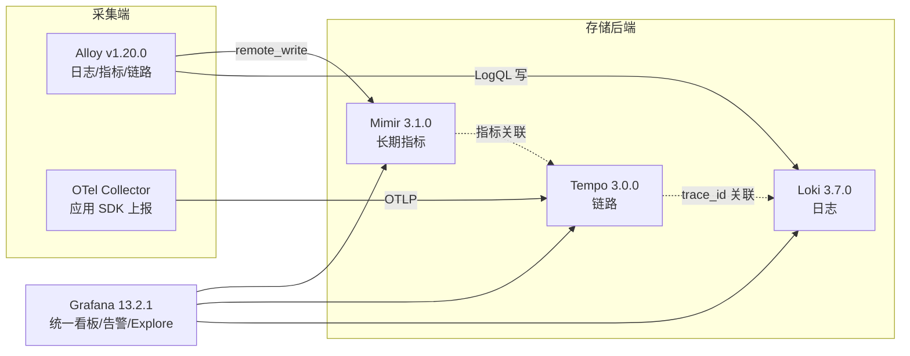

# Grafana LGTM 栈与 Jaeger 链路追踪

::: tip 本篇定位
用 Grafana 自家开源组件，在本地/私有机房搭一套「指标 + 日志 + 链路」开箱即用的可观测栈：Grafana 统一看板、Loki 存日志、Tempo 存链路、Mimir 存长期指标，再叠加 Jaeger 做链路查询。读完你能拿到一份可直接 `docker compose up` 起栈的完整配置。
本篇版本：Grafana OSS 13.2.1、Loki 3.7.0、Tempo 3.0.0、Mimir 3.1.0、Grafana Alloy v1.20.0、Jaeger v2.21.0（均为 2026-09 官网当前稳定版）。
:::

## 一、为什么是 LGTM

### 1.1 小白类比：「一个前台 + 三个仓库」

公司大楼里，访客（你）每次要找东西都不知道去哪个仓库，得跑三个门。Grafana 就是大楼**统一前台**：你在一个网页里就能查指标、翻日志、看链路，不用记三个系统的地址。

LGTM 四个字母正好是四个组件：

| 字母 | 组件 | 存什么 | 对标 |
|---|---|---|---|
| **L** | **Loki** | 日志（只索引标签，正文压缩存对象存储） | ELK 的 ES 轻量替代 |
| **G** | **Grafana** | 统一查询/看板/告警的 UI 前台 | —— |
| **T** | **Tempo** | 链路 Trace（按 trace_id 查，不做全文索引） | Jaeger 后端 |
| **M** | **Mimir** | 长期、可水平扩展的指标库 | Thanos / Cortex |

### 1.2 Loki 为什么省

ELK 把日志正文全建索引，存储贵得离谱。Loki 的思路是「**只给标签建索引，日志正文原样压缩存磁盘/对象存储**」——就像图书馆只索引书名和分类，不索引书里每个字。查日志时先按标签（`app=order, env=prod`）圈定范围，再在这批日志里做 grep。标签设计好，查询又快又便宜。

### 1.3 Tempo 为什么省

Tempo 只按 `trace_id` 查整条链路，**不对 Span 内容建索引**，存储极省。它的杀手锏是和 Grafana 联动：在指标看板上发现某个服务 P99 高，点一下就能跳过去看是哪条链路、再跳到那条链路对应的日志。

## 二、各组件速览

### 2.1 Grafana（13.2.1）

| 能力 | 说明 |
|---|---|
| 数据源 | 一个 Grafana 接 Prometheus/Mimir、Loki、Tempo、Jaeger、MySQL、Postgres 等上百种 |
| Alerting | 统一告警（Grafana Alerting），可对任意数据源建告警规则，统一通知渠道 |
| Dashboard | 可视化面板，支持多数据源同屏 |
| Explore | 临时查询界面，指标/日志/链路可互相跳转（数据关联的关键） |

### 2.2 Loki 与采集端

- **Loki**：日志聚合后端，查询语言叫 **LogQL**。
- **Promtail**：老牌采集端（已进入维护模式）。
- **Grafana Alloy v1.20.0**：Grafana 新一代**统一采集 Agent**，一个进程同时采指标、日志、链路，是 Promtail + OpenTelemetry Collector 能力的合体。**新部署一律用 Alloy，不要再上新 Promtail**。

LogQL 示例：

```logql
# 统计 order 服务过去 1h 每分钟错误日志条数
sum by (status) (count_over_time({app="order"} |= "error" [1m]))
```

### 2.3 Tempo 与 TraceQL

Tempo 用 **TraceQL** 查链路，例如找出「HTTP 状态 500 且耗时 > 500ms 的 Span」：

```traceql
{ span.http.status_code = 500 && duration > 500ms }
```

### 2.4 Mimir（与 Cortex/Thanos 的关系）

Mimir 是 Grafana 把 Cortex 项目正式产品化后的开源版本，用于**长期存储 + 水平扩展 Prometheus 指标**：多租户、对象存储后端、全球扩展。和 Thanos 思路类似（都是给 Prometheus 加长期存储和全局视图），区别是 Mimir 是「中心化远程写」架构，Thanos 是「在现有 Prometheus 旁边加 sidecar/bucket 」架构。小规模先用 Prometheus，量大了再上 Mimir。

### 2.5 Jaeger（v2.21.0）

Jaeger v2 是 **CNCF 毕业的链路追踪项目**，v2 版本已经**直接基于 OpenTelemetry Collector 框架重写**，所以它和 OTel 是同一套管道：你已经有 OTel Collector 的话，甚至可以直接用 OTLP 把链路喂给 Tempo，Jaeger 更多作为「专业链路查询 UI/生态」的选择。v1 已于 2025-12-31 EOL。

## 三、整体架构



## 四、本地起栈（docker-compose 完整示例）

下面是一份最小可跑的 LGTM 栈（Grafana + Loki + Tempo，外加 Jaeger all-in-one），存盘为 `docker-compose.yaml`：

```yaml
services:
  grafana:
    image: grafana/grafana:13.2.1
    ports: ["3000:3000"]
    environment:
      GF_AUTH_ANONYMOUS_ENABLED: "true"
      GF_AUTH_ANONYMOUS_ORG_ROLE: "Admin"
    volumes:
      - grafana-data:/var/lib/grafana
    depends_on: [loki, tempo]

  loki:
    image: grafana/loki:3.7.0
    command: -config.file=/etc/loki/local-config.yaml
    ports: ["3100:3100"]
    volumes:
      - ./loki-config.yaml:/etc/loki/local-config.yaml:ro

  tempo:
    image: grafana/tempo:3.0.0
    command: -config.file=/etc/tempo.yaml
    ports:
      - "3110:3100"     # Tempo 原生
      - "4317:4317"     # OTLP gRPC 入口，给 OTel Collector / 应用用
    volumes:
      - ./tempo-config.yaml:/etc/tempo.yaml:ro

  jaeger:
    image: jaegertracing/all-in-one:2.21.0
    ports:
      - "16686:16686"   # Jaeger UI
      - "4318:4318"     # OTLP HTTP
    environment:
      COLLECTOR_OTLP_ENABLED: "true"

volumes:
  grafana-data:
```

`tempo-config.yaml`（单机模式，本地磁盘）：

```yaml
server:
  http_listen_port: 3100
distributor:
  receivers:
    otlp:
      protocols:
        grpc:
          endpoint: 0.0.0.0:4317
ingester:
  trace_idle_period: 10s
  max_block_duration: 5m
compactor:
  compaction:
    block_retention: 24h
storage:
  trace:
    backend: local
    local:
      path: /var/tempo/blocks
    wal:
      path: /var/tempo/wal
```

`loki-config.yaml`（单机日志）：

```yaml
auth_enabled: false
server:
  http_listen_port: 3100
common:
  instances:
    - path_prefix: /loki
      storage:
        filesystem:
          directory: /loki/chunks
schema_config:
  configs:
    - from: 2024-01-01
      store: tsdb
      object_store: filesystem
      schema: v13
      index:
        prefix: index_
        period: 24h
limits_config:
  retention_period: 168h
```

一键起栈：

```bash
docker compose up -d
# Grafana: http://localhost:3000  (默认 admin/admin，首登改密)
# Jaeger UI: http://localhost:16686
```

### 4.1 把 OTel 数据接进来

应用/Collector 把 OTLP 指向 Tempo 即可（即上一篇 [OpenTelemetry](./monitor-opentelemetry) 里的 exporter endpoint）：

```yaml
exporters:
  otlp/tempo:
    endpoint: tempo:4317
    tls:
      insecure: true
```

Grafana 里加数据源：Loki 地址填 `http://loki:3100`，Tempo 填 `http://tempo:3100`，并在 Tempo 数据源里「Trace to logs / Trace to metrics」勾选好关联，就能在 Explore 里三向跳转。

## 五、常见问题排错

| 现象 | 原因 | 解决 |
|---|---|---|
| Grafana 加 Loki 数据源报错 | 容器名解析不通 | compose 同网络下用服务名 `loki:3100`；宿主机用 `localhost:3100` |
| Loki 查日志很慢 | 标签设计太宽/没先过滤 | LogQL 里 `{app=...}` 标签要尽量精确，先缩范围再 `|=` |
| Tempo 收不到链路 | 应用 endpoint 没指向 4317 | 确认 OTLP gRPC 4317 通；先看 Tempo 日志 `tempodb` 是否在写 |
| Grafana Trace to logs 跳转空 | 数据源关联字段没配 | 在 Tempo 数据源配置里把 span 的 `service.name` 映射到 Loki label |
| Loki 磁盘涨太快 | 没设 retention | `limits_config.retention_period` 设保留期，并配 compactor |
| Jaeger v2 起不来 | 还用 v1 的老配置 | v2 配置格式同 OTel Collector，别再用 v1 的 `--es.*` 参数 |

::: warning 生产红线
- 单机 docker-compose 只适合本机演示；生产 Loki/Tempo/Mimir 要用对象存储（S3/OSS）+ 多副本，别用本地 filesystem 持久化。
- 所有镜像 tag 写死（`13.2.1`、`3.7.0`、`3.0.0`、`3.1.0`、`v1.20.0`、`2.21.0`），禁用 `latest`。
- Grafana 默认 admin/admin，生产务必改强密码、接 OAuth/企业登录，3000 端口别裸奔公网。
- Mimir 是多租户系统，生产必须开认证和 `usage_stats` 限流，避免单租户打爆。
- 日志标签（label）基数不能太高（别把 user_id 当 label），否则 Loki 索引爆炸。
:::

## 相关速查

- 上游采集标准：[OpenTelemetry 统一可观测](./monitor-opentelemetry)
- 指标采集基础：[Prometheus 从 0 到 1](./monitor-prometheus)
- 日志 ELK 方案对比：[ELK 日志栈](./monitor-elk)
- SLO 告警：[SLO/SLI、错误预算与 Burn Rate](./monitor-slo)
- K8s 部署：[Kubernetes 架构与集群](./container-k8s-01-architecture-cluster)
- 云原生排障命令：[云原生排障命令速查](/reference/cloudnative-commands)

### 官方文档

- Grafana 官网：https://grafana.com/
- Grafana 下载（选版本）：https://grafana.com/grafana/download
- Loki 文档：https://grafana.com/docs/loki/
- Tempo 文档：https://grafana.com/docs/tempo/
- Mimir 文档：https://grafana.com/docs/mimir/
- Grafana Alloy：https://grafana.com/docs/alloy/
- Jaeger 官网（v2）：https://www.jaegertracing.io/
- Jaeger Releases：https://github.com/jaegertracing/jaeger/releases
