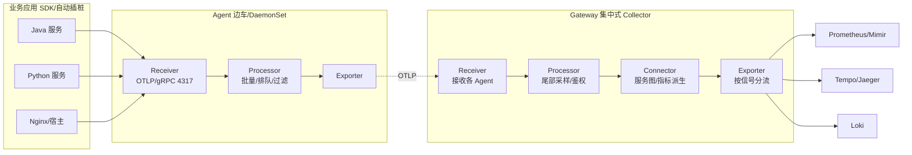

# OpenTelemetry 统一可观测

::: tip 本篇定位
让你在 K8s / 微服务环境里，用一套「厂商中立」的标准把指标、链路、日志三种信号统一采上来，不再被某家 APM 厂商绑死。读完你能搭起 OTel Collector，并把 Java / Python 应用自动插桩后接到 Prometheus、Tempo、Jaeger、Loki。
本篇版本：OpenTelemetry Collector Contrib v0.162.0（2026-09-29，镜像 `otel/opentelemetry-collector-contrib:0.162.0`）、OTel Java 自动插桩 Agent 1.26.0、OTel Python 插桩库 0.66b0、OTel Operator 0.114.0。版本以官网 releases 为准（2026-09 核验）。
:::

## 一、为什么需要 OpenTelemetry

### 1.1 小白类比：「统一电源插座」

以前你买手机、笔记本、剃须刀，每家充电口都不一样：苹果 Lightning、安卓 Micro-USB、USB-C，出差要带一堆线。后来行业统一成 USB-C，一根线充所有设备。

可观测世界以前也一样割裂：

- 指标用 Prometheus，链路用 Jaeger/Zipkin，日志用 ELK；
- 想做 APM 就得接 Datadog、NewRelic、SkyWalking，各家 SDK 互不通用；
- 换一家后端？应用代码里埋点全得重写——这就是**厂商锁定**。

**OpenTelemetry（简称 OTel）就是可观测世界的 USB-C 标准**：应用只管按统一规范把遥测数据吐出来，后面想接 Prometheus、Grafana Tempo、Jaeger、Loki 还是商用 APM，随便换，应用代码一行不改。

### 1.2 三支柱与「信号关联」

| 信号 | 回答的问题 | 典型例子 |
|---|---|---|
| Metrics 指标 | 现在大概健康吗？ | P99 延迟、QPS、错误率、CPU |
| Traces 链路 | 这次请求为什么慢？卡在哪一跳？ | 一个订单请求横跨网关→下单→库存→支付，每段耗时 |
| Logs 日志 | 当时具体报了什么错？ | 异常堆栈、业务报错详情 |

单看任何一种都不够：指标告诉你「错误率涨了」，链路告诉你「是支付服务慢」，日志告诉你「支付服务连数据库超时」。OTel 的关键能力是让三者用同一个 `trace_id` / `span_id` 串起来——在 Grafana 里点一个慢链路，能一键跳到它对应的日志和指标。

### 1.3 核心概念（先混个脸熟）

| 概念 | 通俗解释 |
|---|---|
| **Resource** | 描述「这条数据来自谁」：服务名、版本、K8s 命名空间/Pod/节点、主机名。相当于快递单上的寄件人 |
| **Span** | 链路里的一段操作，如「调用 /order 接口」「查一次 MySQL」。有开始/结束时间、属性、状态码 |
| **Trace** | 一次完整请求串起来的一棵 Span 树，用 `trace_id` 标识 |
| **Instrumentation Scope** | 这段遥测是哪个库/插桩包产生的（如 `io.opentelemetry.servlet`），方便定位来源 |
| **Context Propagation** | 跨服务传递 `traceparent` 头，让 A 服务的 Span 能挂到 B 服务的 Span 下 |
| **OTLP** | OTel 自己的传输协议（HTTP/gRPC），是 Collector 与后端之间的「普通话」 |

## 二、Collector 架构

### 2.1 一个管道三段式

Collector 本身不产生数据，它是个「数据中转站」：接收（Receiver）→ 处理（Processor）→ 导出（Exporter），中间还能用 Connector 把信号互相转换。



### 2.2 Agent 与 Gateway 两种部署

| 模式 | 部署位置 | 优点 | 缺点 |
|---|---|---|---|
| **Agent** | 每台机器一个（K8s 里用 DaemonSet） | 离应用近、低延迟、做本机采集（日志/主机指标） | 数量多，配置要随节点扩散 |
| **Gateway** | 独立集中部署、多副本 | 集中做尾部采样、鉴权、路由，统一对接后端 | 是汇聚点，要高可用 |

实践里常是 **Agent + Gateway 两层**：Agent 负责就近接收，Gateway 负责采样和分流。

### 2.3 管道组件速查

| 组件类型 | 作用 | 常见例子 |
|---|---|---|
| Receiver | 收数据 | `otlp`（gRPC 4317 / HTTP 4318）、`prometheus`、`filelog`、`hostmetrics`、`jaeger` |
| Processor | 加工数据 | `batch`（必须）、`memory_limiter`（防 OOM）、`filter`、`k8sattributes`、`resource`、`tail_sampling` |
| Exporter | 发数据 | `otlp`、`otlphttp`、`prometheus`、`prometheusremotewrite`、`loki`、`jaeger`、`debug` |
| Connector | 信号互转 | `spanmetrics`（链路→延迟指标）、`servicegraph`、`forward` |

## 三、部署与配置

### 3.1 用 Docker 起一个 Collector（最小组）

```bash
docker run -d --name otelcol \
  -p 4317:4317 -p 4318:4318 -p 8889:8889 \
  -v "$PWD/otel-collector-config.yaml":/etc/otelcol-contrib/config.yaml:ro \
  otel/opentelemetry-collector-contrib:0.162.0
```

`otel-collector-config.yaml`：

```yaml
receivers:
  otlp:
    protocols:
      grpc:
        endpoint: 0.0.0.0:4317
      http:
        endpoint: 0.0.0.0:4318

processors:
  memory_limiter:
    limit_mib: 400
    spike_limit_mib: 100
    check_interval: 5s
  batch:
    timeout: 5s
    send_batch_size: 1024

exporters:
  debug:
    verbosity: normal          # 调试用，生产换掉
  otlp/jaeger:
    endpoint: tempo:4317       # 指向 Tempo/Jaeger 的 OTLP 入口
    tls:
      insecure: true
  prometheus:
    endpoint: 0.0.0.0:8889     # 暴露 /metrics 给 Prometheus 抓

service:
  pipelines:
    traces:
      receivers: [otlp]
      processors: [memory_limiter, batch]
      exporters: [debug, otlp/jaeger]
    metrics:
      receivers: [otlp]
      processors: [memory_limiter, batch]
      exporters: [debug, prometheus]
    logs:
      receivers: [otlp]
      processors: [memory_limiter, batch]
      exporters: [debug]
```

验证：

```bash
docker logs otelcol | grep -i "everything is ready"   # 看到 ready 才算起来
curl -s localhost:8889/metrics | head                    # Prometheus 抓取端点
```

### 3.2 K8s 上用 Operator 做自动插桩（推荐）

手动给每个应用改代码很痛苦，OTel Operator 可以给 Pod 注入自动插桩 sidecar，**应用零改动**：

```bash
helm repo add open-telemetry https://open-telemetry.github.io/opentelemetry-helm-charts
helm install opentelemetry-operator open-telemetry/opentelemetry-operator \
  --namespace otel-operator --create-namespace --version 0.114.0
```

然后给命名空间打标签 + 建一个 Instrumentation 自定义资源：

```yaml
apiVersion: opentelemetry.io/v1alpha1
kind: Instrumentation
metadata:
  name: otel-instrumentation
  namespace: default
spec:
  exporter:
    endpoint: http://otel-collector.observability:4317   # 指向你的 Collector Service
  propagators: [tracecontext, baggage]
  java:
    image: ghcr.io/open-telemetry/opentelemetry-operator/autoinstrumentation-java:1.26.0
```

```bash
kubectl label namespace default instrumentation.opentelemetry.io/inject-java="true"
# 重启业务 Pod 后，Operator 会自动注入 java agent，无需改镜像
kubectl rollout restart deploy/my-java-app
```

## 四、自动插桩与手动插桩

### 4.1 Java：两种方式

方式一，零代码自动插桩（`-javaagent`）：

```bash
# 下载与 Operator 同版本的 java agent
wget https://github.com/open-telemetry/opentelemetry-java-instrumentation/releases/download/v1.26.0/opentelemetry-javaagent.jar

java -javaagent:./opentelemetry-javaagent.jar \
  -Dotel.service.name=order-service \
  -Dotel.exporter.otlp.endpoint=http://otel-collector:4317 \
  -jar order-service.jar
```

常用环境变量（等价 `-D`）：

| 环境变量 | 作用 |
|---|---|
| `OTEL_SERVICE_NAME` | 服务名（Resource 里最重要的标签） |
| `OTEL_EXPORTER_OTLP_ENDPOINT` | Collector 地址 |
| `OTEL_TRACES_SAMPLER` | `parentbased_always_on` / `parentbased_traceidratio` |
| `OTEL_TRACES_SAMPLER_ARG` | 采样率，如 `0.1` 表示 10% |

### 4.2 Python：自动插桩

```bash
pip install 'opentelemetry-distro==0.66b0' 'opentelemetry-exporter-otlp==1.32.0'
opentelemetry-bootstrap -a install          # 自动装好用到的库的插桩

export OTEL_SERVICE_NAME=payment-service
export OTEL_EXPORTER_OTLP_ENDPOINT=http://otel-collector:4317
opentelemetry-instrument python app.py      # 一行包裹你的启动命令
```

### 4.3 手动插桩（加自定义业务 Span）

自动插桩覆盖不到的业务逻辑，手动埋点（Python 示例）：

```python
from opentelemetry import trace
from opentelemetry.sdk.trace import TracerProvider
from opentelemetry.sdk.trace.export import BatchSpanProcessor
from opentelemetry.exporter.otlp.proto.grpc.trace_exporter import OTLPSpanExporter

provider = TracerProvider()
provider.add_span_processor(BatchSpanProcessor(OTLPSpanExporter()))
trace.set_tracer_provider(provider)
tracer = trace.get_tracer(__name__)

def create_order(user_id):
    with tracer.start_as_current_span("db.insert_order") as span:
        span.set_attribute("order.user_id", user_id)
        span.set_attribute("order.amount", 99.5)
        # ...真正的业务代码
```

### 4.4 采样：别把全量链路都存下来

全量 Trace 存储成本极高，采样决定「留下哪些」。

| 采样策略 | 原理 | 适用 |
|---|---|---|
| **头部采样 Head-based** | 应用/Collector 在 Span 刚进来就决定采不采（如固定 10%） | 简单、省资源；缺点：采不到偶发错误 |
| **尾部采样 Tail-based** | Gateway 攒完整条 Trace 再决定，可按「是否有错误/慢」采样 | 错误和慢请求 100% 保留，正常请求抽样——推荐 |

尾部采样配置片段（放在 Gateway）：

```yaml
processors:
  tail_sampling:
    decision_wait: 10s
    num_traces: 50
    expected_new_traces_per_sec: 100
    policies:
      - name: keep-errors
        type: status_code
        status_code: { status_codes: [ERROR] }
      - name: keep-slow
        type: latency
        latency: { threshold_ms: 1000 }
      - name: sample-rest
        type: probabilistic
        probabilistic: { sampling_percentage: 10 }
```

## 五、对接常见后端

| 后端 | 在 Collector 里怎么配 |
|---|---|
| Prometheus | 用 `prometheus` exporter 暴露 `/metrics`，或 `prometheusremotewrite` 远程写 |
| Grafana Tempo | `otlp` exporter 指向 Tempo:4317 |
| Jaeger | 新版 Jaeger v2 本身就是 OTel Collector 发行版，直接 `otlp` 指向它即可 |
| Grafana Loki | 用 `loki` exporter 或 Alloy 采集日志 |

> 这几家后端的具体部署见 [Grafana LGTM 栈与 Jaeger](./monitor-grafana-stack)；Prometheus 基础见 [Prometheus 从 0 到 1](./monitor-prometheus)。

## 六、常见问题排错

| 现象 | 原因 | 解决 |
|---|---|---|
| Collector 起不来、端口占用 | 4317/4318 被占 | `ss -lntup | grep -E '4317|4318'`，换端口或停旧进程 |
| 后端收不到任何数据 | endpoint 写错/网络不通 | 在 Collector 机器上 `grpcurl -v otel-collector:4317`；先用 `debug` exporter 看日志确认数据进来了 |
| 链路断了、Trace 不贯通 | 没传 `traceparent` 头/跨进程丢了 propagator | 检查 HTTP/gRPC 客户端是否在 propagator 列表里；网关到服务必须透传该头 |
| 指标有了但 Trace 是 0 | 采样率设成了 0 或 sampler 配错 | 临时 `OTEL_TRACES_SAMPLER=parentbased_always_on` 验证 |
| 内存暴涨/OOM | 没配 `memory_limiter`/batch 太大 | 加 `memory_limiter`，调小 `send_batch_size` |
| 日志里全是 `failed to export` | 后端地址/TLS/鉴权错 | 检查 exporter endpoint、`tls.insecure`、token |

::: warning 生产红线
- **镜像 tag 写死版本号**（如 `0.162.0`），禁止用 `latest`；升级前在测试环境验证 processor 兼容性。
- 不要把 Collector 的 4317 端口暴露到公网，OTLP 默认无鉴权，前面加网关或 mTLS。
- 生产**至少配 `memory_limiter` + `batch`**，否则流量突增会 OOM 整个 Collector。
- 采样策略先在灰度环境验证「错误是否真的被留住」，别盲目把全量链路写进存储。
- Resource 标签（service.name、deployment.environment）要规范统一，否则后端按服务聚合会乱。
:::

## 相关速查

- 监控基础：[Prometheus 从 0 到 1](./monitor-prometheus)
- 后端存储：[Grafana LGTM 栈与 Jaeger](./monitor-grafana-stack)
- K8s 集群基础：[Kubernetes 架构与集群](./container-k8s-01-architecture-cluster)
- 服务间链路与网格：[Service Mesh 服务网格](./container-servicemesh)
- 包管理：[Helm 包管理与 Kustomize](./container-helm)
- 云原生排障命令：[云原生排障命令速查](/reference/cloudnative-commands)
- K8s 命令：[kubectl 命令速查](/reference/kubectl-commands)

### 官方文档

- OpenTelemetry 官网：https://opentelemetry.io/
- Collector 文档：https://opentelemetry.io/docs/collector/
- Collector Releases（选 tag）：https://github.com/open-telemetry/opentelemetry-collector-releases/releases
- OTel Java 自动插桩：https://opentelemetry.io/docs/zero-code/java/
- OTel Python 自动插桩：https://opentelemetry.io/docs/zero-code/python/
- OTel Operator：https://opentelemetry.io/docs/kubernetes/operator/
