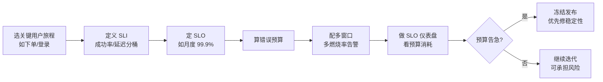

# SLO/SLI、错误预算与 Burn Rate

::: tip 本篇定位
让你从「拍脑袋告警」升级到「用错误预算说话」：定义用户真正在乎的 SLI/SLO，算出错误预算，并用 Google 经典的多窗口多燃烧率（Multi-Window Multi-Burn-Rate）方法写一套既不漏报、也不把人叫醒过头的告警规则。
本篇版本：Prometheus 3.15.0、Alertmanager 0.34.1（与本站 [Prometheus 从 0 到 1](./monitor-prometheus) 一致）、Grafana 13.2.1。规则基于 PromQL，2026-09 可用。
:::

## 一、SLI / SLO / SLA 到底啥区别

### 1.1 小白类比：外卖准时率

你点外卖，平台对外承诺「99% 的单子 30 分钟内送到」：

| 概念 | 外卖例子 | 技术含义 |
|---|---|---|
| **SLA** | 合同写：超时赔付、超时率超过 X% 平台要赔钱 | 对用户的**正式承诺+违约责任**（商务合同） |
| **SLO** | 平台内部目标：本月准时率做到 99.9% | 团队**自己定的内部目标**（留有余量） |
| **SLI** | 「准时送达单数 ÷ 总单数」这个测量值 | **具体怎么量化测量**（指标） |

一句话：**SLI 是测出来的数字，SLO 是你对这个数字定的目标，SLA 是对外违约要赔钱的承诺。** SLO 永远比 SLA 严一点，留出缓冲。

### 1.2 好 SLI 的标准

- **用户视角**：别测「服务器 CPU 50%」，要测「用户打开页面成功率 99.9%」。
- **可度量**：能写成一个 PromQL 算出来的比值。
- **分母要全**：别只统计成功的请求，失败的、超时的都要进分母。

### 1.3 常见 SLI 类型

| SLI 类型 | 测什么 | 典型指标 |
|---|---|---|
| 可用性 Availability | 请求成功了吗 | `成功数 / 总请求数` |
| 延迟 Latency | 快不快 | P50/P95/P99 在阈值内的比例 |
| 饱和度 Saturation | 资源挤不挤 | CPU/内存/连接池使用率 |
| 正确性 Correctness | 结果对不对 | 返回业务错误（如库存算错）的比例 |

## 二、错误预算 Error Budget

### 2.1 概念

假设 SLO = 99.9% 可用性，那么**允许失败的 0.1% 就是错误预算**。

- 一个月约 43200 分钟，0.1% ≈ 43 分钟。意思是「这个月系统最多可以坏 43 分钟」。
- **预算花得快** → 稳定性告急，该冻结新功能、优先修 bug。
- **预算花不完、很充裕** → 可以放心搞高风险发布、激进迭代。

错误预算把「稳不稳定」变成了**产品和工程之间的对话语言**：不是「开发要上线」vs「运维不让上」，而是「这个月错误预算还剩多少，够不够扛这次发布风险」。

### 2.2 燃烧率 Burn Rate

错误预算在以多快的速度被烧掉？就是燃烧率：

```
燃烧率 = 当前实际错误率 / 允许的错误率
```

- 燃烧率 = 1：错误速度正好等于预算速度，正常。
- 燃烧率 = 14.4：正在以 14.4 倍速度烧预算，几小时就会把预算烧光——必须立刻处理。

## 三、多窗口多燃烧率告警（核心）

### 3.1 为什么不能只看一个窗口

单窗口告警有两难：窗口太长→告警慢；窗口太短→抖动误报。Google 的办法是**长短两个窗口 AND 起来**，再叠加**不同燃烧率档位**：

| 档位 | 短窗口 | 长窗口 | 燃烧率 | 含义 | 通知级别 |
|---|---|---|---|---|---|
| 紧急 | 5 分钟 | 1 小时 | 14.4x | 正在疯狂烧预算，立刻叫醒 | Page（电话/短信） |
| 高 | 30 分钟 | 6 小时 | 6x | 烧得较快，工作时间跟进 | Page（工作时间） |
| 中 | 2 小时 | 1 天 | 3x | 慢性恶化，记工单 | Ticket（不叫醒人） |

> 设计要点：**两个窗口都超阈值才报警**——短窗口负责「快」，长窗口负责「稳」，两者 AND 就既快又不怕抖动。14.4x 在 5 分钟内大约烧掉 2% 的错误预算，必须立刻处理。

### 3.2 完整可复制的 Prometheus 规则

下面是针对一个 `order-service` 服务、99.9% 可用性 SLO 的**完整 recording + alerting 规则**。存为 `slo-order-service.rules.yml`：

```yaml
groups:
  - name: slo-order-service
    interval: 30s
    rules:
      # ---------- 记录规则：按窗口算好好请求/坏请求 ----------
      - record: job:sli_availability:ratio_rate5m
        expr: |
          sum(rate(http_requests_total{job="order-service",code=~"2.."}[5m]))
          /
          sum(rate(http_requests_total{job="order-service"}[5m]))
      - record: job:sli_availability:ratio_rate1h
        expr: |
          sum(rate(http_requests_total{job="order-service",code=~"2.."}[1h]))
          /
          sum(rate(http_requests_total{job="order-service"}[1h]))
      - record: job:sli_availability:ratio_rate30m
        expr: |
          sum(rate(http_requests_total{job="order-service",code=~"2.."}[30m]))
          /
          sum(rate(http_requests_total{job="order-service"}[30m]))
      - record: job:sli_availability:ratio_rate6h
        expr: |
          sum(rate(http_requests_total{job="order-service",code=~"2.."}[6h]))
          /
          sum(rate(http_requests_total{job="order-service"}[6h]))
      - record: job:sli_availability:ratio_rate2h
        expr: |
          sum(rate(http_requests_total{job="order-service",code=~"2.."}[2h]))
          /
          sum(rate(http_requests_total{job="order-service"}[2h]))
      - record: job:sli_availability:ratio_rate1d
        expr: |
          sum(rate(http_requests_total{job="order-service",code=~"2.."}[1d]))
          /
          sum(rate(http_requests_total{job="order-service"}[1d]))

      # ---------- 告警：紧急档 14.4x（5m AND 1h）----------
      - alert: SLOBurnRateCritical
        expr: |
          (
            (1 - job:sli_availability:ratio_rate5m) / (1 - 0.999) > 14.4
            and
            (1 - job:sli_availability:ratio_rate1h) / (1 - 0.999) > 14.4
          )
          * on(job) group_left() (job:sli_availability:ratio_rate5m > 0)
        for: 1m
        labels:
          severity: page
        annotations:
          summary: "order-service 正在以 14.4x 速度烧错误预算（5m/1h）"
          description: "可用性 SLO 99.9%，当前错误率远超预算，立即处理。"

      # ---------- 告警：高档 6x（30m AND 6h）----------
      - alert: SLOBurnRateHigh
        expr: |
          (
            (1 - job:sli_availability:ratio_rate30m) / (1 - 0.999) > 6
            and
            (1 - job:sli_availability:ratio_rate6h) / (1 - 0.999) > 6
          )
        for: 5m
        labels:
          severity: page-business-hours
        annotations:
          summary: "order-service 以 6x 速度烧预算（30m/6h）"
          description: "错误率偏高，工作时间跟进，避免升级成紧急事故。"

      # ---------- 告警：中档 3x（2h AND 1d），只开工单 ----------
      - alert: SLOBurnRateMedium
        expr: |
          (
            (1 - job:sli_availability:ratio_rate2h) / (1 - 0.999) > 3
            and
            (1 - job:sli_availability:ratio_rate1d) / (1 - 0.999) > 1
          )
        for: 30m
        labels:
          severity: ticket
        annotations:
          summary: "order-service 慢性劣化（2h@3x / 1d@1x）"
          description: "长期错误率偏高，建工单排期治理，不叫醒值班。"
```

加载到 Prometheus（在 `prometheus.yml` 里）：

```yaml
rule_files:
  - /etc/prometheus/slo-*.rules.yml
```

```bash
promtool check rules slo-order-service.rules.yml    # 先校验语法
curl -X POST http://localhost:9090/-/reload           # 热加载
```

### 3.3 Alertmanager 路由（按级别分流）

```yaml
route:
  receiver: default
  group_by: ['job']
  routes:
    - matchers: [severity="page"]
      receiver: oncall-phone          # 电话/短信值班
      group_wait: 0s
      repeat_interval: 5m
    - matchers: [severity="page-business-hours"]
      receiver: oncall-workhours      # 工作时间群通知
    - matchers: [severity="ticket"]
      receiver: ticketing-system      # 自动建工单
```

## 四、落地流程与仪表盘



Grafana SLO 仪表盘至少四块：**当前 SLI 实际值、本月剩余错误预算、预算消耗速度（burn rate）、按天的错误率趋势**。Grafana 13.2.1 自带「SLO」App 可直接基于上述 recording rule 生成。

## 五、常见误区

| 现象 | 原因 | 解决 |
|---|---|---|
| 告警满天飞没人看 | SLI 定义成了 CPU/磁盘等内部指标 | 改成用户视角的成功率/延迟 |
| 半夜被抖动叫醒 | 只用单短窗口 | 长短窗口 AND + 分级，慢性只开工单 |
| SLO 定 100% | 错误预算为 0，无法发布 | 承认一定有失败，留 0.1%~1% 预算 |
| 分母只算成功请求 | SLI 虚高 | 分母要包含失败、超时、取消的全部请求 |
| 延迟只看平均值 | 平均值掩盖长尾 | 用延迟分桶：`sum(rate(req_bucket{le="0.5"})) / sum(rate(req_total))` 算 P99 达标率 |

::: warning 生产红线
- 告警规则上线前**必须 `promtool check rules` 校验**，错的规则会让 Prometheus 热加载失败。
- 先在测试环境跑 1~2 周观察告警噪声，再切到电话叫醒，别一上来就全量 page。
- SLO 目标要和产品/业务方**书面对齐**，错误预算怎么花要有明确决策机制，不能 SRE 自己拍。
- 燃烧率阈值（14.4x/6x/3x）和 SLO 数值强相关，换 SLO 要重新算。
:::

## 相关速查

- 指标采集与 PromQL 基础：[Prometheus 从 0 到 1](./monitor-prometheus)
- 事故发生后怎么复盘：[事故管理与无指责复盘](./sre-incident)
- 压测与容量：[容量规划、高可用与灾备](./sre-capacity-dr)
- 统一遥测采集：[OpenTelemetry 统一可观测](./monitor-opentelemetry)
- 发布管理：[CI/CD 进阶与渐进式交付](./devops-cicd-advanced)
- 云原生排障命令：[云原生排障命令速查](/reference/cloudnative-commands)

### 官方文档

- Google SRE Workbook《Alerting on SLOs》：https://sre.google/workbook/alerting-on-slos/（需科学上网）；国内平替：https://www.cnblogs.com/lhxBlogs/p/17924893.html
- Prometheus 告警规则：https://prometheus.io/docs/prometheus/latest/configuration/recording_rules/
- Alertmanager 配置：https://prometheus.io/docs/alerting/latest/configuration/
- Grafana SLO 文档：https://grafana.com/docs/grafana/latest/explore/simplified-exploration/slo/
