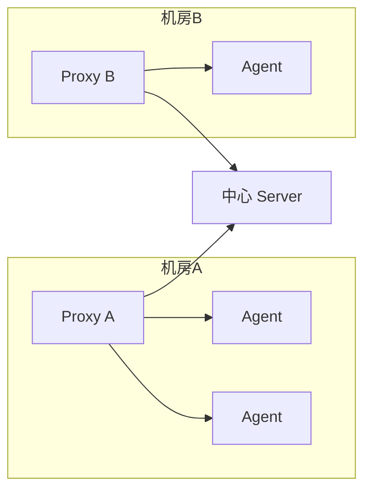

# Zabbix 进阶

::: tip 本篇定位
在基础篇装好 Zabbix 7.0 的基础上，掌握模板复用、图形大屏、自动发现/注册、Proxy 分布式、自定义监控项和 Zabbix API，让几十上百台机器也能管得过来。
:::

## 模板

### 为什么需要模板

手动给每台主机配几十个 Item + 触发器，100 台机器就是 100 倍工作量。**模板（Template）就是把"一组监控项 + 触发器 + 图形"打包成一个可复用的壳**：新机器上线只要链接一下模板，全套监控就带过来了。

打个比方：模板就是"职业照模板"——摄影师调好光、构图、参数存起来，来一个新人套同一个模板拍就行。

### 制作与链接

菜单：**数据采集 → 模板 → 创建模板**。

1. 新建模板，如 `Template App Nginx Custom`，放到群组 `Templates/Applications`；
2. 在模板里加 Item（如 `nginx.connections.active`）、加触发器（连接数 > 500 告警）；
3. 回到**主机** → 选中某台主机 → 模板 → Link templates → 选这个模板，Update。

模板支持**嵌套**：一个模板可以链接另一个模板（如公司的基础 Linux 模板里再套官方 `Linux by Zabbix agent`），改父模板所有子主机一起生效。

### 标准模板复用

生产上推荐这样分层：

- 最底层：官方 `Linux by Zabbix agent`（系统指标）；
- 中间层：公司自定义模板，加磁盘 SMART、硬盘温度、登录失败数；
- 最上层：按业务角色套，如 `Template Web Server`（再加上 Nginx 指标）、`Template DB Server`（再加上 MySQL 指标）。

新机器上线只需要链接"角色模板"，不用从零配。

## 图形与大屏

### 图形 Graph

单个 Item 默认没图，需要建 Graph。菜单：**监测 → 图表**，或者在模板/主机的"图形"标签里创建。

- 简单图形（Graph）：一张图画一个或几个 Item 的曲线，如 CPU 使用率、内存使用率；
- 新建时选要画的 Item、颜色、Y 轴单位（%、Bps 等）。

### 聚合图形（聚合图）与 Screens

单张图没意思，**Screen（大屏）就是把一堆图、状态列表、地图拼在一个页面上**，贴到监控室的大屏幕上。

菜单：**监测 → 报表 → Screens（7.0 里叫 Dashboard 仪表盘）**。新建 Dashboard → 添加 widget：

- Graph widget：选之前建好的图；
- Host status widget：看一组主机的 Problem/OK 状态；
- Clock、System info 等小配件。

企业大屏一般一块 Dashboard 放：核心主机状态总览 + 关键业务指标曲线 + 当前告警列表。

## 自动发现/注册

手动加主机几十台还能忍，上百台就必须自动化。Zabbix 有三条路子。

### LLD（低阶自动发现，Low-Level Discovery）

**解决"一类东西数量不确定"的问题**：比如一台机器有几块网卡、几个磁盘分区是不固定的，你不可能事先给每块网卡建一个 Item。LLD 的思路是：先跑一个发现规则，自动枚举出"有几个对象"，再对每个对象自动创建一套 Item/触发器。

举例：自动发现所有磁盘分区并监控使用率——

1. 模板里 → 自动发现规则 → 创建，Key 用 `vfs.fs.discovery`（Agent 自带，枚举所有挂载点）；
2. 规则里" prototypes（原型）"建一个 Item prototype：Key `vfs.fs.size[{#FSNAME},pused]`，其中 `{#FSNAME}` 是发现规则枚举出来的宏；
3. Zabbix 会对 `/`、`/data`、`/boot` 每个分区各自动建一个 Item。

### 网络发现规则（Network Discovery）

**解决"网段里有新机器冒出来"的问题**：Server 定时扫一个 IP 段，发现能连 10050 的机器就自动加进 Zabbix。

菜单：**数据采集 → 网络发现规则 → 创建发现规则**：

- 范围：`10.0.0.1-10.0.0.254`；
- 检查：Zabbix agent 端口通不通、SSH 通不通；
- 动作：发现后自动 Link 哪个模板、加到哪个主机群组。

### Agent 自动注册（Auto Registration）

比网络发现更优雅：**新机器上装好 Agent，Agent 主动向 Server 注册**，Server 按主机名匹配规则自动套模板。

Agent 端 `/etc/zabbix/zabbix_agent2.conf` 开自动注册：

```conf
ServerActive=10.0.0.10
Hostname=web01
HostMetadata=Linux|WebServer      # 自定义元数据，Server 按这个判断套哪个模板
```

Server 端：**数据采集 → 动作 → 自动注册动作**，条件设为 `HostMetadata` 包含 `WebServer`，操作是 Link `Template Web Server` 模板。

## Proxy 分布式

### 适用场景

当监控机器跨机房、跨地域时，让中心 Server 直连每台 Agent 会：① 公网链路慢/不稳定；② Server 采集压力大。**Proxy 就是部署在每个机房的"分站站长"**：本地机房的 Agent 都把数据给 Proxy，Proxy 攒一波再统一传给中心 Server。



### 部署 Proxy

在机房就近机器上装 `zabbix-proxy-mysql`（或 pgsql），同样初始化一个 proxy 库，配 `/etc/zabbix/zabbix_proxy.conf`：

```conf
Server=10.0.0.10          # 中心 Server 地址
Hostname=proxy-dc-a        # Proxy 自己的名字
DBHost=localhost
DBPassword=xxx
```

启动后，在被监控 Agent 的 `/etc/zabbix/zabbix_agent2.conf` 里把 `Server` / `ServerActive` 改成这台 Proxy 的 IP；Server Web 里"Administration → Proxies"会自动看到它。

## 自定义监控

官方 Key 覆盖不到你的业务指标（比如"Nginx 当前活跃连接数"、"订单队列长度"），就要自己加。

### UserParameter

在被监控机的 Agent2 配置 `/etc/zabbix/zabbix_agent2.d/*.conf` 里加：

```conf
UserParameter=nginx.active,/usr/local/bin/nginx-active.sh
```

脚本 `/usr/local/bin/nginx-active.sh`：

```bash
#!/bin/bash
# 从 nginx stub_status 取 active 连接数
curl -s http://127.0.0.1/nginx_status | grep 'Active connections' | awk '{print $3}'
```

```bash
chmod +x /usr/local/bin/nginx-active.sh
systemctl restart zabbix-agent2
```

Server 上验证：

```bash
zabbix_get -s web01 -p 10050 -k "nginx.active"
# 输出：42
```

然后在 Zabbix Web 对应主机/模板里建 Item，Key 填 `nginx.active` 即可。

### 带参数的自定义 Key

想一个 Key 通用、自动区分参数，用 `$1` `$2` 占位：

```conf
UserParameter=mysql.ping[*],mysqladmin -h '$1' -uroot ping | grep -c alive
```

调用时：`mysql.ping(127.0.0.1)`。脚本里传参同理，`nginx.active[$1]` → `$1` 就是第一个参数。

## API 与调优

### Zabbix API

Zabbix 所有 Web 操作都能通过 API 脚本化（批量建主机、批量改触发器）。接口地址：`http://<Server>/zabbix/api_jsonrpc.php`。

**第一步：登录拿 token**：

```bash
curl -s -X POST http://10.0.0.10:8080/api_jsonrpc.php \
  -H 'Content-Type: application/json-rpc' \
  -d '{
    "jsonrpc": "2.0",
    "method": "user.login",
    "params": {
      "username": "Admin",
      "password": "你的密码"
    },
    "id": 1
  }'
# 返回：{"jsonrpc":"2.0","result":"abcd1234token...","id":1}
```

**第二步：查询主机**：

```bash
curl -s -X POST http://10.0.0.10:8080/api_jsonrpc.php \
  -H 'Content-Type: application/json-rpc' \
  -d '{
    "jsonrpc": "2.0",
    "method": "host.get",
    "params": {
      "output": ["hostid","host","name"]
    },
    "auth": "abcd1234token...",
    "id": 2
  }'
```

**第三步：创建主机**（把上面 `host.get` 换成 `host.create`，params 里带 host 名、群组 ID、接口、链接的模板 ID）：

```bash
curl -s -X POST http://10.0.0.10:8080/api_jsonrpc.php \
  -H 'Content-Type: application/json-rpc' \
  -d '{
    "jsonrpc": "2.0",
    "method": "host.create",
    "params": {
      "host": "web02",
      "name": "Web Server 02",
      "groups": [{"groupid": "2"}],
      "interfaces": [{
        "type": 1, "main": 1, "useip": 1,
        "ip": "10.0.0.12", "dns": "", "port": "10050"
      }],
      "templates": [{"templateid": "10259"}]
    },
    "auth": "abcd1234token...",
    "id": 3
  }'
```

运维上最常见的用途：CMDB 变更时自动调 API 加/删主机，不用人点 Web。

### 性能调优

监控机器上千台后，Server 会吃力。常见调优点：

| 方向 | 参数/做法 |
|---|---|
| Server 缓存 | `CacheSize`（配置缓存）、`HistoryCacheSize`、`TrendCacheSize`、`ValueCacheSize`，数据量大了成倍加大 |
| 数据库 | MySQL 用 InnoDB 调大 `innodb_buffer_pool_size`；历史表按分区/分表；上百台后强烈建议换 PostgreSQL |
| Housekeeper | 历史数据自动清理：`HousekeeperFrequency`、在"管理 → 通用"里配 History/Trend 保留天数（如历史 90 天、趋势 5 年） |
| Proxy 分担 | 远端机房/大规模采集交给 Proxy，中心 Server 只做汇总和告警 |
| 采集间隔 | 不是所有 Item 都要 30 秒一采；不敏感的指标改成 5 分钟 |

## 相关速查

- [Linux 命令速查](/reference/linux-commands)
- [Zabbix 基础](/guide/monitor-zabbix)

### 官方文档

- Zabbix API 手册：https://www.zabbix.com/documentation/current/en/manual/api
- 自动注册与 LLD：https://www.zabbix.com/documentation/current/en/manual/discovery
- Proxy 部署：https://www.zabbix.com/documentation/current/en/manual/installation/install#frontend-package-installation
