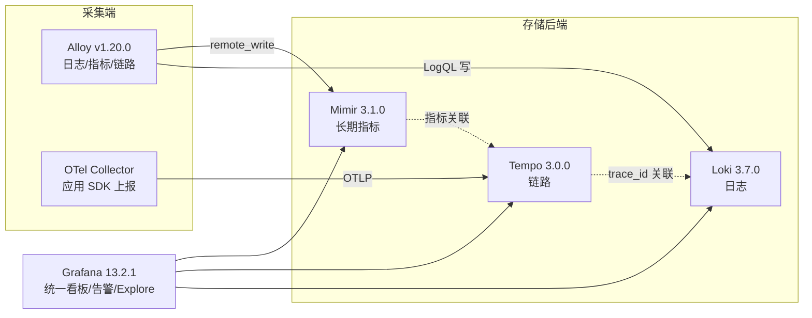
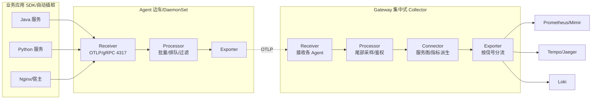
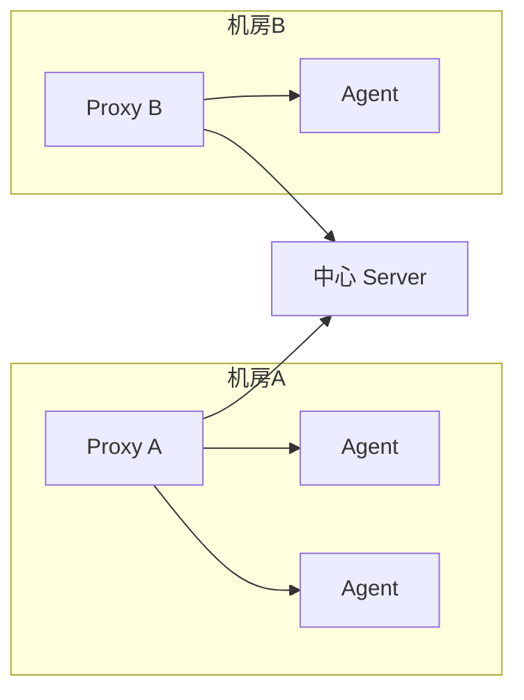

# 监控与日志

> 本页聚合 **监控告警、日志平台、云原生可观测性、SRE 稳定性和运维安全审计**：Zabbix、Prometheus、ELK、OpenTelemetry、Grafana LGTM、SLO/事故/混沌/灾备、JumpServer 堡垒机。

## 文章索引

### Zabbix

::: idx

| 文章 | 解决什么问题 | 状态 |
|---|---|---|
| [Zabbix 基础](#合并资料) | 架构、Server/Agent 部署、主机/Items、触发器、告警动作 | ✅ 已完成 |
| [Zabbix 进阶](#合并资料) | 模板、图形、自动发现、Proxy、自定义脚本、API、调优 | ✅ 已完成 |

:::

### Prometheus 监控（从 0 到 1 · 10 篇系列）

::: idx

| 文章 | 解决什么问题 | 状态 |
|---|---|---|
| [01 入门与监控基础](/services/observability/prometheus/01-理论) | 监控组成、指标类型、Prometheus 架构与全家桶 | ✅ |
| [02 部署 Prometheus 服务端](/services/observability/prometheus/03-功能) | 服务器初始化、二进制部署、主配置详解 | ✅ |
| [03 主机采集、Grafana 与 Pushgateway](/services/observability/prometheus/03-功能) | Node Exporter、Grafana 大屏、短任务采集 | ✅ |
| [04 PromQL 与自定义 Exporter](/services/observability/prometheus/03-功能) | PromQL 查询运算、Python/Go 开发 Exporter | ✅ |
| [05 标签、记录规则与 Alertmanager](/services/observability/prometheus/04-实战) | relabel、记录规则、部署 Alertmanager、告警规则 | ✅ |
| [06 告警通知、路由与高可用](/services/observability/prometheus/04-实战) | 模板、路由分组、抑制、企微/钉钉、HA | ✅ |
| [07 服务发现与 MySQL/Redis 采集](/services/observability/prometheus/03-功能) | 文件/DNS/Consul/K8s 发现、MySQL/Redis Exporter | ✅ |
| [08 Nginx/JMX/Blackbox 等 Exporter](/services/observability/prometheus/03-功能) | Nginx/JMX/HAProxy、Blackbox 黑盒监控 | ✅ |
| [09 容器监控、联邦与长期存储](/services/observability/prometheus/01-理论) | cAdvisor、联邦、TSDB、VictoriaMetrics | ✅ |
| [10 Kubernetes 集成与 SOP/FAQ](/services/observability/prometheus/04-实战) | K8s YAML/Helm/Operator、实战 SOP、FAQ | ✅ |

:::

### 日志平台

::: idx

| 文章 | 解决什么问题 | 状态 |
|---|---|---|
| [ELK 日志平台](/services/observability/elk) | ES/Kibana、Logstash/Filebeat、查询、Nginx 日志案例 | ✅ 已完成 |

:::

### 运维审计

::: idx

| 文章 | 解决什么问题 | 状态 |
|---|---|---|
| [JumpServer 堡垒机](#合并资料) | 部署、资产授权、用户管理、会话审计 | ✅ 已完成 |

:::

### 云原生可观测性

::: idx

| 文章 | 解决什么问题 | 状态 |
|---|---|---|
| [OpenTelemetry 统一可观测](#合并资料) | Traces/Metrics/Logs 三支柱、Collector、OTLP、自动/手动插桩 | ✅ 已完成 |
| [Grafana LGTM 栈](#合并资料) | Grafana + Loki/Tempo/Mimir、Jaeger 链路追踪、统一可观测栈 | ✅ 已完成 |

:::

### SRE 稳定性工程

::: idx

| 文章 | 解决什么问题 | 状态 |
|---|---|---|
| [SLO 与错误预算](./monitor-slo) | SLI/SLO/SLA、错误预算、多窗口多燃烧率 Burn Rate 告警 | ✅ 已完成 |
| [事故管理与复盘](./sre-incident) | On-call 值班、应急指挥、时间线、无指责 Postmortem | ✅ 已完成 |
| [混沌工程](/guide/sre-incident#合并资料) | Chaos Mesh/Litmus、稳态假设、故障注入、韧性演练 | ✅ 已完成 |
| [容量规划与灾备](./sre-capacity-dr) | 容量规划、变更管理、高可用、RTO/RPO、DR 演练 | ✅ 已完成 |

:::

## 命令速查

- 日志查看（journalctl / tail / dmesg）：[Linux 命令速查](/reference/linux-commands)
- 端口与进程排查：[网络命令速查](/reference/network-commands)

<!-- merged-qa-faq:start -->
## 常见问题 FAQ

> 监控、告警与日志问题的高频问题已并入本页。默认只显示问题，点开查看完整答案。

### 一、部署：可观测体系

<details>
<summary>Q1：一套完整的可观测体系包含什么？</summary>

**答：**

业界公认可观测有**三大支柱**：指标（Metrics）、日志（Logs）、链路追踪（Tracing），三者互补。

先说是什么：指标是浓缩的数值时间序列，比如 CPU 利用率、QPS、错误率，好处是轻、能存很久、适合画大盘和告警；日志是离散的事件文本，出问题时看具体报了什么错；链路追踪是一个请求穿过多个服务的完整调用链，用来定位慢在哪一跳。

一套完整链路是：**采集 → 存储 → 展示 → 告警**。采集层在机器上跑 node_exporter、在应用里暴露 `/metrics`；存储层用 Prometheus 存指标、用 Elasticsearch 存日志；展示层用 Grafana 画大盘；告警层由 Alertmanager 发通知。

监控对象也要分层：基础设施（CPU/内存/磁盘/网络）、中间件（MySQL、Redis、Nginx）、应用本身（接口延迟、错误率、JVM）。只监控服务器 CPU 不监控业务接口是不够的——机器很闲但接口全 502，用户照样打不开。

我的原则是：**指标回答"有没有问题"，日志回答"出了什么错"，链路回答"问题在哪一跳"**，三者串起来才能从告警一路定位到代码行。

</details>

<details>
<summary>Q2：Prometheus 的工作原理？Pull 模式怎么理解？</summary>

**答：**

Prometheus 我用的是 3.x 版本，架构从左到右几块：首先是**数据源**，业务应用直接暴露 `/metrics` 接口，或机器上跑 node_exporter、MySQL 自带 mysqld_exporter 这类采集器。

核心是 **Pull（拉）模式**：和传统 Zabbix 那种 Agent 主动 Push 上来不一样，Prometheus Server 定时（默认 15 秒）主动去拉这些 `/metrics` 地址。我平时验证一个端点就直接 `curl http://10.0.0.5:9100/metrics`，能看到一坨带 HELP/TYPE 注释的时间序列，比如 `node_cpu_seconds_total`。被抓的地址写在 `prometheus.yml` 的 `scrape_configs` 里；机器多了就用**服务发现**（Kubernetes 里直接发现 Pod，云上用云 API 发现 ECS），不用手写一堆 IP。

拉回来的数据存进本地 **TSDB 时序数据库**，按时间+标签建索引，自带多副本压缩。查询用 **PromQL**，展示喂给 Grafana，告警规则在 Prometheus 里算好后发给 **Alertmanager** 做收敛、分组、路由到企业微信/钉钉/电话。

我对 Pull 模式的理解是：好处是 Prometheus 完全掌控采集节奏、出问题不丢自己的数据；缺点是 Prometheus 自己单点，所以生产上要么用联邦集群、要么用远端存储（Thanos/Mimir）。配置写完我一定会跑 `promtool check config prometheus.yml` 先校验语法，再 reload，避免把整个监控搞挂。

</details>

<details>
<summary>Q3：日志系统怎么收集和分析？ELK 各管什么？</summary>

**答：**

日志栈现在主流叫 **ELK/EFK**，我先把每个组件职责讲清楚，这是必考题。

- **Filebeat（或 Fluentd）**：跑在每台机器上的轻量采集器，负责读日志文件、按行切割、打标签（来自哪台机器、哪个服务），然后发给后面。它很轻，不占多少资源，还能做断点续传。
- **Logstash**：重一点的处理管道，负责 grok 把非结构化文本切成字段、过滤脱敏、做富化；现在很多场景用 Filebeat 直接送 ES，把 Logstash 省掉。
- **Elasticsearch（ES）**：存储和检索引擎，日志写进去建倒排索引，支持全文和条件查询。
- **Kibana**：可视化和查询界面，在上面搜日志、画柱状图、做错误率看板。

一条链路就是：**应用写日志文件 → Filebeat 采集 →（Logstash 处理）→ 存入 ES → Kibana 查询展示**。

我的设计要点：日志要**结构化**输出成 JSON，带 time/level/trace_id，这样不用 grok 硬切；级别要规范（DEBUG/INFO/WARN/ERROR）。排障时我常用 Kibana 按 trace_id 把一个请求串起来，配合链路追踪看是哪步慢。

K8s 环境里我会这么说：容器日志不落地，用 `kubectl logs <pod>` 先现场看，再由 DaemonSet 形式的采集器统一收进 ES。生产要注意 ES 本身的容量和分片数，日志要设保留周期（比如留 30 天），老的删冷，不然磁盘先被日志写满。

</details>

### 二、运行：查询与告警

<details>
<summary>Q4：PromQL 常用查询怎么写？</summary>

**答：**

PromQL 不用背全，日常排障就几类。

第一类是**直接查瞬时值**：`node_cpu_seconds_total` 一把抓会返回所有核、所有 mode 的序列，一般要按标签过滤，比如 `node_cpu_seconds_total{mode="idle"}`。

第二类是**算 CPU 使用率**，这是最高频的：先求各核空闲率，再 `100 - avg by(instance)(rate(node_cpu_seconds_total{mode="idle"}[5m])) * 100`。`rate()` 算的是这 5 分钟内每秒平均增长速率， Counter 类型必须套 `rate()` 或 `increase()`，不然拿到的是累计总量没意义。

第三类是**按维度聚合**：`sum by(instance)(rate(http_requests_total[5m]))` 算每台机器 QPS；`topk(5, ...)` 取前 5。

第四类是**算分位数延迟**：`histogram_quantile(0.99, rate(http_request_duration_seconds_bucket[5m]))` 就是 P99 延迟，SRE 盯延迟必用。

我给个实战记忆：看接口是否变慢，就 `sum by(uri)(rate(http_request_duration_seconds_count[5m]))` 找流量、`histogram_quantile(0.99, ...)` 看长尾、`rate(http_requests_total{status=~"5.."}[5m])` 看 5xx 错误量。K8s 里 Pod 指标是 `container` 开头，排 Pod 问题我先 `kubectl logs <pod>` 看日志，再配 Prometheus 看这个 Pod 的 CPU/内存曲线，两个对着看。

</details>

<details>
<summary>Q5：什么是四大黄金信号？</summary>

**答：**

Google SRE 书里提的四大黄金信号，是衡量一个服务健康度最核心的四个维度，我背得很熟。

第一是**延迟（Latency）**：请求花了多久，要分成功和失败请求分别看——失败请求往往更快返回，混在一起会误判。重点看 P99、P95 这种长尾，不是平均值。

第二是**流量（Traffic）**：当前服务承载了多少负载，比如每秒多少请求、每秒多少字节，用 QPS 衡量。

第三是**错误（Errors）**：错误率，比如 5xx 占比、异常抛出率，要盯着它是不是突然抬升。

第四是**饱和度（Saturation）**：资源还剩多少余量，CPU、内存、磁盘、连接数这些最紧的瓶颈用了多少。

我的用法是：新接一个服务，先按这四个信号各配一条 Grafana 图和一条告警，服务健康度就心里有数了。出问题时也按这四个方向分诊——延迟高先查慢查询和下游，错误涨先看发布，流量爆先扩容，饱和了先看资源瓶颈。它其实就是把"用户体验"翻译成了四个能采集的指标。

</details>

<details>
<summary>Q6：告警怎么设计才不被吐槽"狼来了"？</summary>

**答：**

告警设计是 SRE 的硬功夫，我有几条原则。

第一，**告警要可执行**。一个告警发出来，值班的人看到得知道该干嘛，发"CPU 高"没用，要发"支付服务实例 i-xxx CPU 持续 10 分钟超 90%，已影响下单，请扩容"。那种只是"磁盘用了 80%"但两周内不会写满的，就别发。

第二，**用 `for` 持续时间去抖**。告警规则里写 `for: 5m`，意思是条件连续满足 5 分钟才触发，避免一次毛刺就把人叫醒。

第三，**分级 + 收敛抑制**。Alertmanager 里配 severity，P0 电话+短信，P1 企业微信群；配 `group_by` 把同实例的告警合并成一条，配 `inhibit` 抑制——比如整个机房挂了，就不要再把下面每台机器的告警全发出来，否则告警风暴能把人淹没。

第四，**告警流程我清楚**：Prometheus 按 rules 算出 firing 状态 → 推给 Alertmanager → Alertmanager 做分组、抑制、静默 → 按 route 路由到不同 receiver（企业微信/钉钉/邮件/电话）。

最后一条铁律：**永远不要发没用的告警**，发多了大家就习惯性忽略，真出大事反而没人看。告警数量要持续精简，每条都要问"这条叫醒我值不值"。

</details>

<!-- merged-qa-faq:end -->

<!-- merged-guide-material:start -->
## 合并资料

> 原先单独成页的同主题内容已收进本页；默认折叠，点开看原页全文。

<details>
<summary><strong>Grafana LGTM 栈与 Jaeger 链路追踪 — 用 Grafana 自家开源组件，在本地/私有机房搭一套「指标 + 日志 + 链路」开箱即用的可观测栈：Grafana 统一看板、Loki 存日志、Tempo 存链路、Mimir 存长期指标，再叠加 Jaeger 做链路查询。</strong></summary>

::: tip 本篇定位
用 Grafana 自家开源组件，在本地/私有机房搭一套「指标 + 日志 + 链路」开箱即用的可观测栈：Grafana 统一看板、Loki 存日志、Tempo 存链路、Mimir 存长期指标，再叠加 Jaeger 做链路查询。读完你能拿到一份可直接 `docker compose up` 起栈的完整配置。
本篇版本：Grafana OSS 13.2.1、Loki 3.7.0、Tempo 3.0.0、Mimir 3.1.0、Grafana Alloy v1.20.0、Jaeger v2.21.0（均为 2026-09 官网当前稳定版）。
:::

#### 一、为什么是 LGTM

##### 1.1 小白类比：「一个前台 + 三个仓库」

公司大楼里，访客（你）每次要找东西都不知道去哪个仓库，得跑三个门。Grafana 就是大楼**统一前台**：你在一个网页里就能查指标、翻日志、看链路，不用记三个系统的地址。

LGTM 四个字母正好是四个组件：

| 字母 | 组件 | 存什么 | 对标 |
|---|---|---|---|
| **L** | **Loki** | 日志（只索引标签，正文压缩存对象存储） | ELK 的 ES 轻量替代 |
| **G** | **Grafana** | 统一查询/看板/告警的 UI 前台 | —— |
| **T** | **Tempo** | 链路 Trace（按 trace_id 查，不做全文索引） | Jaeger 后端 |
| **M** | **Mimir** | 长期、可水平扩展的指标库 | Thanos / Cortex |

##### 1.2 Loki 为什么省

ELK 把日志正文全建索引，存储贵得离谱。Loki 的思路是「**只给标签建索引，日志正文原样压缩存磁盘/对象存储**」——就像图书馆只索引书名和分类，不索引书里每个字。查日志时先按标签（`app=order, env=prod`）圈定范围，再在这批日志里做 grep。标签设计好，查询又快又便宜。

##### 1.3 Tempo 为什么省

Tempo 只按 `trace_id` 查整条链路，**不对 Span 内容建索引**，存储极省。它的杀手锏是和 Grafana 联动：在指标看板上发现某个服务 P99 高，点一下就能跳过去看是哪条链路、再跳到那条链路对应的日志。

#### 二、各组件速览

##### 2.1 Grafana（13.2.1）

| 能力 | 说明 |
|---|---|
| 数据源 | 一个 Grafana 接 Prometheus/Mimir、Loki、Tempo、Jaeger、MySQL、Postgres 等上百种 |
| Alerting | 统一告警（Grafana Alerting），可对任意数据源建告警规则，统一通知渠道 |
| Dashboard | 可视化面板，支持多数据源同屏 |
| Explore | 临时查询界面，指标/日志/链路可互相跳转（数据关联的关键） |

##### 2.2 Loki 与采集端

- **Loki**：日志聚合后端，查询语言叫 **LogQL**。
- **Promtail**：老牌采集端（已进入维护模式）。
- **Grafana Alloy v1.20.0**：Grafana 新一代**统一采集 Agent**，一个进程同时采指标、日志、链路，是 Promtail + OpenTelemetry Collector 能力的合体。**新部署一律用 Alloy，不要再上新 Promtail**。

LogQL 示例：

```logql
# 统计 order 服务过去 1h 每分钟错误日志条数
sum by (status) (count_over_time({app="order"} |= "error" [1m]))
```

##### 2.3 Tempo 与 TraceQL

Tempo 用 **TraceQL** 查链路，例如找出「HTTP 状态 500 且耗时 > 500ms 的 Span」：

```traceql
{ span.http.status_code = 500 && duration > 500ms }
```

##### 2.4 Mimir（与 Cortex/Thanos 的关系）

Mimir 是 Grafana 把 Cortex 项目正式产品化后的开源版本，用于**长期存储 + 水平扩展 Prometheus 指标**：多租户、对象存储后端、全球扩展。和 Thanos 思路类似（都是给 Prometheus 加长期存储和全局视图），区别是 Mimir 是「中心化远程写」架构，Thanos 是「在现有 Prometheus 旁边加 sidecar/bucket 」架构。小规模先用 Prometheus，量大了再上 Mimir。

##### 2.5 Jaeger（v2.21.0）

Jaeger v2 是 **CNCF 毕业的链路追踪项目**，v2 版本已经**直接基于 OpenTelemetry Collector 框架重写**，所以它和 OTel 是同一套管道：你已经有 OTel Collector 的话，甚至可以直接用 OTLP 把链路喂给 Tempo，Jaeger 更多作为「专业链路查询 UI/生态」的选择。v1 已于 2025-12-31 EOL。

#### 三、整体架构



#### 四、本地起栈（docker-compose 完整示例）

下面是一份最小可跑的 LGTM 栈（Grafana + Loki + Tempo，外加 Jaeger all-in-one），存盘为 `docker-compose.yaml`：

```yaml
services:
  grafana:
    image: grafana/grafana:13.2.1
    ports: ["3000:3000"]
    environment:
      GF_AUTH_ANONYMOUS_ENABLED: "true"
      GF_AUTH_ANONYMOUS_ORG_ROLE: "Admin"
    volumes:
      - grafana-data:/var/lib/grafana
    depends_on: [loki, tempo]

  loki:
    image: grafana/loki:3.7.0
    command: -config.file=/etc/loki/local-config.yaml
    ports: ["3100:3100"]
    volumes:
      - ./loki-config.yaml:/etc/loki/local-config.yaml:ro

  tempo:
    image: grafana/tempo:3.0.0
    command: -config.file=/etc/tempo.yaml
    ports:
      - "3110:3100"     # Tempo 原生
      - "4317:4317"     # OTLP gRPC 入口，给 OTel Collector / 应用用
    volumes:
      - ./tempo-config.yaml:/etc/tempo.yaml:ro

  jaeger:
    image: jaegertracing/all-in-one:2.21.0
    ports:
      - "16686:16686"   # Jaeger UI
      - "4318:4318"     # OTLP HTTP
    environment:
      COLLECTOR_OTLP_ENABLED: "true"

volumes:
  grafana-data:
```

`tempo-config.yaml`（单机模式，本地磁盘）：

```yaml
server:
  http_listen_port: 3100
distributor:
  receivers:
    otlp:
      protocols:
        grpc:
          endpoint: 0.0.0.0:4317
ingester:
  trace_idle_period: 10s
  max_block_duration: 5m
compactor:
  compaction:
    block_retention: 24h
storage:
  trace:
    backend: local
    local:
      path: /var/tempo/blocks
    wal:
      path: /var/tempo/wal
```

`loki-config.yaml`（单机日志）：

```yaml
auth_enabled: false
server:
  http_listen_port: 3100
common:
  instances:
    - path_prefix: /loki
      storage:
        filesystem:
          directory: /loki/chunks
schema_config:
  configs:
    - from: 2024-01-01
      store: tsdb
      object_store: filesystem
      schema: v13
      index:
        prefix: index_
        period: 24h
limits_config:
  retention_period: 168h
```

一键起栈：

```bash
docker compose up -d
# Grafana: http://localhost:3000  (默认 admin/admin，首登改密)
# Jaeger UI: http://localhost:16686
```

##### 4.1 把 OTel 数据接进来

应用/Collector 把 OTLP 指向 Tempo 即可（即上一篇 [OpenTelemetry](#合并资料) 里的 exporter endpoint）：

```yaml
exporters:
  otlp/tempo:
    endpoint: tempo:4317
    tls:
      insecure: true
```

Grafana 里加数据源：Loki 地址填 `http://loki:3100`，Tempo 填 `http://tempo:3100`，并在 Tempo 数据源里「Trace to logs / Trace to metrics」勾选好关联，就能在 Explore 里三向跳转。

#### 五、常见问题排错

| 现象 | 原因 | 解决 |
|---|---|---|
| Grafana 加 Loki 数据源报错 | 容器名解析不通 | compose 同网络下用服务名 `loki:3100`；宿主机用 `localhost:3100` |
| Loki 查日志很慢 | 标签设计太宽/没先过滤 | LogQL 里 `{app=...}` 标签要尽量精确，先缩范围再 `|=` |
| Tempo 收不到链路 | 应用 endpoint 没指向 4317 | 确认 OTLP gRPC 4317 通；先看 Tempo 日志 `tempodb` 是否在写 |
| Grafana Trace to logs 跳转空 | 数据源关联字段没配 | 在 Tempo 数据源配置里把 span 的 `service.name` 映射到 Loki label |
| Loki 磁盘涨太快 | 没设 retention | `limits_config.retention_period` 设保留期，并配 compactor |
| Jaeger v2 起不来 | 还用 v1 的老配置 | v2 配置格式同 OTel Collector，别再用 v1 的 `--es.*` 参数 |

::: warning 生产红线
- 单机 docker-compose 只适合本机演示；生产 Loki/Tempo/Mimir 要用对象存储（S3/OSS）+ 多副本，别用本地 filesystem 持久化。
- 所有镜像 tag 写死（`13.2.1`、`3.7.0`、`3.0.0`、`3.1.0`、`v1.20.0`、`2.21.0`），禁用 `latest`。
- Grafana 默认 admin/admin，生产务必改强密码、接 OAuth/企业登录，3000 端口别裸奔公网。
- Mimir 是多租户系统，生产必须开认证和 `usage_stats` 限流，避免单租户打爆。
- 日志标签（label）基数不能太高（别把 user_id 当 label），否则 Loki 索引爆炸。
:::

#### 相关速查

- 上游采集标准：[OpenTelemetry 统一可观测](#合并资料)
- 指标采集基础：[Prometheus 从 0 到 1](/services/observability/prometheus/01-理论)
- 日志 ELK 方案对比：[ELK 日志栈](/services/observability/elk)
- SLO 告警：[SLO/SLI、错误预算与 Burn Rate](./monitor-slo)
- K8s 部署：[Kubernetes 架构与集群](/services/container/kubernetes/01-理论)
- 云原生排障命令：[云原生排障命令速查](/reference/cloudnative-commands)

##### 官方文档

- Grafana 官网：https://grafana.com/
- Grafana 下载（选版本）：https://grafana.com/grafana/download
- Loki 文档：https://grafana.com/docs/loki/
- Tempo 文档：https://grafana.com/docs/tempo/
- Mimir 文档：https://grafana.com/docs/mimir/
- Grafana Alloy：https://grafana.com/docs/alloy/
- Jaeger 官网（v2）：https://www.jaegertracing.io/
- Jaeger Releases：https://github.com/jaegertracing/jaeger/releases

</details>

<details>
<summary><strong>JumpServer 堡垒机实战 — 部署开源堡垒机 JumpServer，实现资产集中纳管、统一登录入口、访问授权控制和操作全程审计。本篇以 v4.10.17 LTS 为例（容器化部署），并说明 v5.0.0 的情况。</strong></summary>

::: tip 本篇定位
部署开源堡垒机 JumpServer，实现资产集中纳管、统一登录入口、访问授权控制和操作全程审计。本篇以 v4.10.17 LTS 为例（容器化部署），并说明 v5.0.0 的情况。
:::

#### 一、堡垒机概述

##### 1.1 跳板机与堡垒机

- **跳板机**：一台作为统一入口的服务器，运维人员先登录跳板机、再跳到内网其他机器。它解决了"入口统一"，但**无法控制和审计登录后的操作行为**，一旦跳板机被攻破，内网门户大开。
- **堡垒机**：在跳板机基础上，增加了身份认证、访问授权、操作控制和全程审计，能记录"谁、在什么时间、对哪台资产、做了什么"，是运维安全管控的核心设施。

##### 1.2 4A 理念

堡垒机的核心能力常概括为 4A：

| 能力 | 含义 |
|---|---|
| Authentication（认证） | 确认"你是谁"，支持密码、MFA 多因子、统一身份源 |
| Account（账号） | 集中管理登录账号，并托管资产上的系统账号与密码 |
| Authorization（授权） | 控制"你能访问哪些资产、用哪个账号、能做什么动作" |
| Audit（审计） | 对登录、命令、文件传输、操作录像进行记录和回放 |

##### 1.3 JumpServer 简介与组件

JumpServer 是开源堡垒机（GPL v2.0），使用 Python/Django 开发，符合 4A，提供 Web Terminal，支持 SSH、Telnet、RDP、VNC、数据库、K8s 等多种资产，支持分布式、跨机房部署。

各组件分工：

| 组件 | 职责 |
|---|---|
| Core | 核心组件，Django 提供 API、认证、调度，其他组件依赖它启动 |
| Koko | 提供 SSH/Telnet 字符型（Linux/Unix）资产连接 |
| Lion | 提供 Windows RDP 等图形资产连接（基于 Guacamole） |
| Chen | 提供数据库资产连接 |
| Web | 前端 Nginx，对外提供 Web 页面 |
| PostgreSQL / Redis | 数据存储与缓存，默认以容器方式一起部署 |


##### 1.4 版本选择

- **v5.0.0**：2026-09-17 发布的最新大版本，主打全新原生客户端和内置 AI；但属于大版本的首个（.0）版本，刚发布不久，生产采用通常会先观察一段时间。
- **v4.10.17 LTS**：成熟的长期支持版本，文档和实践丰富、稳定。

::: tip 学习和生产建议
学习或生产部署，建议先用 **v4.10.17 LTS**，等 v5 经过几个小版本打磨后再升级。想用最新版时，只需把下文命令里的版本号替换为 `v5.0.0`，安装流程一致。官方对 v4 早期版本也建议先升到最新 v4.10.x LTS 再升 v5。
:::

#### 二、部署 JumpServer

##### 2.1 环境要求

官方建议配置为 **4 核 CPU / 8 GB 内存 / 100 GB 磁盘**（因为要同时运行 Core、Koko、Lion、Chen、PostgreSQL、Redis 等多个容器）。小规格机器（如 2 核 2 GB）可以用于学习体验，但会比较吃紧，建议关闭暂时不用的组件、加 swap。操作系统支持主流 Debian/RedHat 系发行版，内核建议 4.0 以上。

##### 2.2 前置条件

JumpServer 基于 Docker 部署，先安装 Docker 和 Compose 插件：

```bash
# 安装 Docker（以 Ubuntu 为例）
apt update
apt install -y docker.io docker-compose-plugin
systemctl enable --now docker
docker version
docker compose version
```

##### 2.3 下载安装器并安装

```bash
cd /opt
wget https://github.com/jumpserver/installer/releases/download/v4.10.17/jumpserver-installer-v4.10.17.tar.gz
tar -xf jumpserver-installer-v4.10.17.tar.gz
cd jumpserver-installer-v4.10.17
```

::: tip GitHub 下载慢
安装器和后续镜像都在 GitHub/Docker Hub，直连慢时可使用加速代理下载，或在本机下载后上传到服务器 `/opt`；镜像拉取慢可配置 Docker 镜像加速器。
:::

执行安装（交互式）：

```bash
./jmsctl.sh install
```

安装过程会依次询问，一般可直接回车使用默认值：

- 是否自动配置防火墙；
- 是否安装内置 PostgreSQL 和 Redis（学习环境选是，用容器自建）；
- 各服务端口（Web 默认 80、SSH 默认 2222）；
- `SECRET_KEY` 和 `BOOTSTRAP_TOKEN`（留空则自动生成）；
- 是否完成后启动。

安装完成后启动全部服务：

```bash
./jmsctl.sh start
docker ps
```

正常会看到 `jms_core`、`jms_koko`、`jms_lion`、`jms_chen`、`jms_web`、`jms_postgresql`、`jms_redis` 等容器处于 Up 状态。

##### 2.4 首次登录

浏览器访问 `http://服务器IP`（若改过 Web 端口则带端口）：

- 用户名：`admin`
- 密码：`ChangeMe`（v4 默认；v3 为 admin/admin）

首次登录强制修改密码，且不能使用原密码。改完用新密码重新登录。

也可以通过 SSH 连接 JumpServer 的 2222 端口：

```bash
ssh -p 2222 admin@服务器IP
```

::: tip jmsctl 常用命令
`./jmsctl.sh start|stop|restart` 启停、`./jmsctl.sh status` 状态、`./jmsctl.sh uninstall` 卸载、`./jmsctl.sh upgrade` 升级、`./jmsctl.sh help` 查看全部。配置文件在 `/opt/jumpserver/config/config.txt`，改端口等需先 stop、改完再 start。
:::

##### 2.5 配置文件与默认端口

统一配置文件为 `/opt/jumpserver/config/config.txt`，常用配置项：

| 配置项 | 含义 | 默认值 |
|---|---|---|
| `HTTP_PORT` / `HTTPS_PORT` | Web 访问端口 | 80 / 443 |
| `SSH_PORT` | SSH/SFTP 资产连接端口 | 2222 |
| `SECRET_KEY` | 数据加密密钥，生产务必自定义并妥善保存 | 安装时生成 |
| `BOOTSTRAP_TOKEN` | 各组件向 Core 注册用的令牌 | 安装时生成 |
| `DB_*` | 数据库连接（内置 PostgreSQL） | 容器自建 |
| `REDIS_*` | Redis 连接 | 容器自建 |

::: warning SECRET_KEY 不要随意变更
SECRET_KEY 用于加密数据库中保存的资产密码，改动会导致已保存的密码无法解密。重装或迁移时要保持 SECRET_KEY、BOOTSTRAP_TOKEN 与原环境一致。
:::

##### 2.6 备份、升级与卸载

- **备份**：核心是数据库和配置。用 `./jmsctl.sh backup_db` 备份数据库，并备份 `/opt/jumpserver/config/config.txt`、安装目录下的密钥文件；
- **升级**：下载新版安装器，在新版目录执行 `./jmsctl.sh upgrade`，升级前先备份数据库；
- **卸载**：`./jmsctl.sh uninstall` 会停止并删除容器，按提示选择是否保留数据卷（数据库）。

#### 三、用户与资产

JumpServer 里有三类容易混淆的"用户"，先理清：


1. **登录用户**：人用来登录 JumpServer 的账号，在 JumpServer 中创建（如 wang、admin）。
2. **特权账号（旧称管理用户）**：资产上具有 root/Administrator 或 sudo ALL 权限的账号，JumpServer 用它来采集资产信息、推送创建普通账号。
3. **普通系统账号（旧称系统用户）**：登录用户连接资产时实际使用的业务账号，一般不给管理权限。

##### 3.1 创建登录用户与用户组

JumpServer 登录用户有三种角色：系统管理员、普通用户、系统审计员。

- 在 **用户管理 → 用户** 中创建用户（如 wang），邮箱不能重复；
- 在 **用户组** 中创建组（如 development），把用户加入组，便于按组批量授权；
- 可对用户启用/禁用、重置 MFA。

##### 3.2 多因子认证（MFA）

在用户设置中开启 MFA 后，登录时除了账号密码，还要输入手机验证器（如 Google Authenticator）生成的动态码，安全性更高。管理员可在用户列表中为用户开启，用户首次登录时扫码绑定。

##### 3.3 通过账号模板创建系统账号

新版推荐在 **账号管理 → 账号模板** 中统一创建特权账号和普通账号模板，不必为每台资产重复配置：

- **特权账号模板**：填 root（或管理员）用户名和密码/密钥，用于资产采集和管理；
- **普通账号模板**：可设置用户名、密文策略（随机生成或指定），授权后 JumpServer 会自动在资产上创建该账号。

::: tip 生产实践
企业里通常已用自动化工具在所有服务器上统一创建好系统账号（UID、命名一致），JumpServer 直接引用即可；学习环境可让 JumpServer 通过特权账号自动创建普通账号。
:::

##### 3.4 创建资产与节点

- 在 **资产管理 → 资产** 中创建资产，选择类型（主机/网络设备/数据库等），填 IP、管理端口，选择管理账号（特权账号）并测试可连接；
- 用**节点（树状分组）**对资产分类，如按"生产/测试""机房/业务线"组织；子节点资产可继承节点上的授权。

##### 3.5 测试资产与账号改密

- **测试连通**：资产详情里用特权账号测试，JumpServer 会通过它登录资产、采集主机名、硬件等信息；测试失败多为网络不通、账号无 sudo 权限或密钥未配置；
- **账号收集**：可让 JumpServer 通过特权账号扫描资产上已存在的系统账号并纳管；
- **批量改密**：支持对纳管的账号定期轮换密码（随机生成并密文保存），避免长期使用固定密码；
- 资产信息变更后可手动刷新，保证与实际一致。

#### 四、授权与访问

##### 4.1 创建资产授权规则

在 **权限管理 → 资产授权** 中新建规则，把"用户/用户组"和"资产/节点"以及"可使用的系统账号"绑定：

- 选择被授权的用户或用户组；
- 选择资产或节点（节点内资产自动继承）；
- 选择可使用的系统账号（普通账号）；
- 勾选协议（SSH、SFTP 用于登录和文件传输）；
- 可设置授权的生效时间段。

规则生效后，普通账号会被自动推送到对应资产。

##### 4.2 Web 终端访问

普通用户登录后，在资产列表里选择有权限的主机，点击连接即可在浏览器中打开 Web Terminal 操作；也可点页面上的 Web 终端图标。文件上传下载通过 Web 界面或 SFTP 完成。

##### 4.3 SSH 与文件传输

除了浏览器，还能用本地终端直连 JumpServer 的 2222 端口，再选择资产：

```bash
ssh -p 2222 登录用户@服务器IP
```

文件传输可用 SFTP 工具（如 FileZilla）连接 2222 端口进行上传下载。

##### 4.4 数据库资产

数据库作为一类资产纳管：先在账号模板中创建数据库账号，在资产中添加数据库（填主机、端口、类型），授权规则中针对具体数据库资产授权（数据库授权不支持只按节点），之后即可在 Web 端或通过 SSH 连接数据库。

##### 4.5 登录限制与连接令牌

- 在系统设置里可限制用户登录的来源 IP、设置会话超时时间，长时间无操作自动断开；
- 支持为用户或资产生成有时效的**连接令牌**，用于临时授权或免登录快速连接；
- 用户可在个人设置查看自己的授权资产、修改密码和 MFA；
- 管理员可随时禁用某个登录用户，立即阻断其访问。

#### 五、会话审计

##### 5.1 在线与历史会话

- **会话管理 → 在线会话**：查看当前正在进行的连接和实时执行的命令，管理员可**强制中断（踢出）**用户会话；
- **历史会话**：查看过去所有连接记录，支持在线回放操作录像、查看每条命令，也可下载录像离线播放（离线播放需用官方 VideoPlayer）。

##### 5.2 命令历史与审计

在历史会话中可查看该会话执行过的全部命令，配合系统审计员角色，由专人负责审计录像和高危操作。审计员账号默认只看审计内容、不参与运维，实现职责分离。

##### 5.3 命令过滤器

命令过滤器用于禁止执行危险命令，防止误操作或恶意行为：

1. 在 **命令过滤 → 命令组** 中定义要管控的命令（如 `rm -rf /`、`shutdown`、`mkfs` 等）；
2. 创建命令过滤规则，指定哪些用户/系统账号、在哪些资产上应用，设置动作（允许/拒绝/复核）和优先级；
3. 将过滤器绑定到系统账号；
4. 用户执行命令时按优先级逐条匹配：命中允许则放行，命中拒绝则禁止，都未命中则默认允许。

::: tip 复核动作
除允许、拒绝外，规则动作还可设为"复核"：用户执行该命令时需提交申请，管理员审批通过后才放行，适用于高危但确有需要的操作。
:::

##### 5.4 分布式多节点部署

当资产数量大或跨机房时，JumpServer 支持分布式：在额外节点上只部署 Koko、Lion、Chen 等接入组件，通过 `BOOTSTRAP_TOKEN` 注册到同一个 Core 和数据库，由 Core 统一调度。这样可把连接、录像的负载分散到多个节点，不同机房就近接入。安装新节点时在安装向导中选择对应组件、填写主 Core 地址和相同的 BOOTSTRAP_TOKEN 即可。学习环境单机部署即可。

#### 本章自测

1. 跳板机和堡垒机有什么区别？跳板机存在什么安全短板？
2. 堡垒机的 4A 分别指什么？各自解决什么问题？
3. JumpServer 中 Core、Koko、Lion、Chen 各负责连接哪类资产？
4. JumpServer 依赖哪些数据库/缓存？默认是怎么部署的？
5. v5.0.0 和 v4.10.17 LTS 该怎么选？为什么生产不急于追大版本的 .0 版本？
6. JumpServer 官方推荐的硬件配置？小内存机器学习要注意什么？
7. 说清 JumpServer 里三类"用户"（登录用户、特权账号、普通系统账号）的区别和作用。
8. 特权账号为什么必须是 root/管理员权限？它被用来做什么？
9. 什么是账号模板？为什么推荐用它而不是逐台资产创建账号？
10. 用户组和节点分别用于解决什么问题？
11. MFA 是什么？开启后登录流程有什么变化？
12. 一台新 Linux 主机要纳管进 JumpServer，完整步骤是什么？
13. 资产授权规则包含哪几个要素？节点授权有什么继承特性？
14. 用户通过哪几种方式访问资产？SSH 直连用哪个端口？
15. 文件上传下载通过什么协议、哪个端口？
16. 数据库资产的授权有什么注意事项？
17. 在线会话管理能做哪些操作？如何踢出一个正在进行的会话？
18. 历史会话的审计包含哪些内容？离线看录像需要什么？
19. 为什么要设置系统审计员角色、与运维角色分离？
20. 命令过滤器的工作流程是怎样的？匹配不到规则时默认放行还是拒绝？
21. 为什么说堡垒机是运维安全合规（等保）中的重要设施？

#### 相关速查

- 命令速查：[Linux 命令速查](/reference/linux-commands)、[Docker 命令速查](/reference/docker-commands)
- 官方资源：
  - JumpServer 官网：https://www.jumpserver.org/
  - 官方文档（v4）：https://docs.jumpserver.org/zh/v4/
  - 快速入门：https://docs.jumpserver.org/zh/v4/quick_start/
  - 环境要求：https://docs.jumpserver.org/zh/v4/installation/setup_linux_standalone/requirements/
  - jmsctl 命令：https://docs.jumpserver.org/zh/v4/installation/jmsctl_sh/
  - 反向代理：https://docs.jumpserver.org/zh/v4/installation/proxy/
  - GitHub 主仓库：https://github.com/jumpserver/jumpserver
  - Installer 下载：https://github.com/jumpserver/installer/releases
  - v5 发布说明：https://www.jumpserver.com/blog/introducing-jumpserver-v5
  - 录像播放器：https://github.com/jumpserver/VideoPlayer/releases

</details>

<details>
<summary><strong>OpenTelemetry 统一可观测 — 让你在 K8s / 微服务环境里，用一套「厂商中立」的标准把指标、链路、日志三种信号统一采上来，不再被某家 APM 厂商绑死。读完你能搭起 OTel Collector，并把 Java / Python 应用自动插桩后接到 Prometheus、Tempo、Jaeger、Loki。</strong></summary>

::: tip 本篇定位
让你在 K8s / 微服务环境里，用一套「厂商中立」的标准把指标、链路、日志三种信号统一采上来，不再被某家 APM 厂商绑死。读完你能搭起 OTel Collector，并把 Java / Python 应用自动插桩后接到 Prometheus、Tempo、Jaeger、Loki。
本篇版本：OpenTelemetry Collector Contrib v0.162.0（2026-09-29，镜像 `otel/opentelemetry-collector-contrib:0.162.0`）、OTel Java 自动插桩 Agent 1.26.0、OTel Python 插桩库 0.66b0、OTel Operator 0.114.0。版本以官网 releases 为准（2026-09 核验）。
:::

#### 一、为什么需要 OpenTelemetry

##### 1.1 小白类比：「统一电源插座」

以前你买手机、笔记本、剃须刀，每家充电口都不一样：苹果 Lightning、安卓 Micro-USB、USB-C，出差要带一堆线。后来行业统一成 USB-C，一根线充所有设备。

可观测世界以前也一样割裂：

- 指标用 Prometheus，链路用 Jaeger/Zipkin，日志用 ELK；
- 想做 APM 就得接 Datadog、NewRelic、SkyWalking，各家 SDK 互不通用；
- 换一家后端？应用代码里埋点全得重写——这就是**厂商锁定**。

**OpenTelemetry（简称 OTel）就是可观测世界的 USB-C 标准**：应用只管按统一规范把遥测数据吐出来，后面想接 Prometheus、Grafana Tempo、Jaeger、Loki 还是商用 APM，随便换，应用代码一行不改。

##### 1.2 三支柱与「信号关联」

| 信号 | 回答的问题 | 典型例子 |
|---|---|---|
| Metrics 指标 | 现在大概健康吗？ | P99 延迟、QPS、错误率、CPU |
| Traces 链路 | 这次请求为什么慢？卡在哪一跳？ | 一个订单请求横跨网关→下单→库存→支付，每段耗时 |
| Logs 日志 | 当时具体报了什么错？ | 异常堆栈、业务报错详情 |

单看任何一种都不够：指标告诉你「错误率涨了」，链路告诉你「是支付服务慢」，日志告诉你「支付服务连数据库超时」。OTel 的关键能力是让三者用同一个 `trace_id` / `span_id` 串起来——在 Grafana 里点一个慢链路，能一键跳到它对应的日志和指标。

##### 1.3 核心概念（先混个脸熟）

| 概念 | 通俗解释 |
|---|---|
| **Resource** | 描述「这条数据来自谁」：服务名、版本、K8s 命名空间/Pod/节点、主机名。相当于快递单上的寄件人 |
| **Span** | 链路里的一段操作，如「调用 /order 接口」「查一次 MySQL」。有开始/结束时间、属性、状态码 |
| **Trace** | 一次完整请求串起来的一棵 Span 树，用 `trace_id` 标识 |
| **Instrumentation Scope** | 这段遥测是哪个库/插桩包产生的（如 `io.opentelemetry.servlet`），方便定位来源 |
| **Context Propagation** | 跨服务传递 `traceparent` 头，让 A 服务的 Span 能挂到 B 服务的 Span 下 |
| **OTLP** | OTel 自己的传输协议（HTTP/gRPC），是 Collector 与后端之间的「普通话」 |

#### 二、Collector 架构

##### 2.1 一个管道三段式

Collector 本身不产生数据，它是个「数据中转站」：接收（Receiver）→ 处理（Processor）→ 导出（Exporter），中间还能用 Connector 把信号互相转换。



##### 2.2 Agent 与 Gateway 两种部署

| 模式 | 部署位置 | 优点 | 缺点 |
|---|---|---|---|
| **Agent** | 每台机器一个（K8s 里用 DaemonSet） | 离应用近、低延迟、做本机采集（日志/主机指标） | 数量多，配置要随节点扩散 |
| **Gateway** | 独立集中部署、多副本 | 集中做尾部采样、鉴权、路由，统一对接后端 | 是汇聚点，要高可用 |

实践里常是 **Agent + Gateway 两层**：Agent 负责就近接收，Gateway 负责采样和分流。

##### 2.3 管道组件速查

| 组件类型 | 作用 | 常见例子 |
|---|---|---|
| Receiver | 收数据 | `otlp`（gRPC 4317 / HTTP 4318）、`prometheus`、`filelog`、`hostmetrics`、`jaeger` |
| Processor | 加工数据 | `batch`（必须）、`memory_limiter`（防 OOM）、`filter`、`k8sattributes`、`resource`、`tail_sampling` |
| Exporter | 发数据 | `otlp`、`otlphttp`、`prometheus`、`prometheusremotewrite`、`loki`、`jaeger`、`debug` |
| Connector | 信号互转 | `spanmetrics`（链路→延迟指标）、`servicegraph`、`forward` |

#### 三、部署与配置

##### 3.1 用 Docker 起一个 Collector（最小组）

```bash
docker run -d --name otelcol \
  -p 4317:4317 -p 4318:4318 -p 8889:8889 \
  -v "$PWD/otel-collector-config.yaml":/etc/otelcol-contrib/config.yaml:ro \
  otel/opentelemetry-collector-contrib:0.162.0
```

`otel-collector-config.yaml`：

```yaml
receivers:
  otlp:
    protocols:
      grpc:
        endpoint: 0.0.0.0:4317
      http:
        endpoint: 0.0.0.0:4318

processors:
  memory_limiter:
    limit_mib: 400
    spike_limit_mib: 100
    check_interval: 5s
  batch:
    timeout: 5s
    send_batch_size: 1024

exporters:
  debug:
    verbosity: normal          # 调试用，生产换掉
  otlp/jaeger:
    endpoint: tempo:4317       # 指向 Tempo/Jaeger 的 OTLP 入口
    tls:
      insecure: true
  prometheus:
    endpoint: 0.0.0.0:8889     # 暴露 /metrics 给 Prometheus 抓

service:
  pipelines:
    traces:
      receivers: [otlp]
      processors: [memory_limiter, batch]
      exporters: [debug, otlp/jaeger]
    metrics:
      receivers: [otlp]
      processors: [memory_limiter, batch]
      exporters: [debug, prometheus]
    logs:
      receivers: [otlp]
      processors: [memory_limiter, batch]
      exporters: [debug]
```

验证：

```bash
docker logs otelcol | grep -i "everything is ready"   # 看到 ready 才算起来
curl -s localhost:8889/metrics | head                    # Prometheus 抓取端点
```

##### 3.2 K8s 上用 Operator 做自动插桩（推荐）

手动给每个应用改代码很痛苦，OTel Operator 可以给 Pod 注入自动插桩 sidecar，**应用零改动**：

```bash
helm repo add open-telemetry https://open-telemetry.github.io/opentelemetry-helm-charts
helm install opentelemetry-operator open-telemetry/opentelemetry-operator \
  --namespace otel-operator --create-namespace --version 0.114.0
```

然后给命名空间打标签 + 建一个 Instrumentation 自定义资源：

```yaml
apiVersion: opentelemetry.io/v1alpha1
kind: Instrumentation
metadata:
  name: otel-instrumentation
  namespace: default
spec:
  exporter:
    endpoint: http://otel-collector.observability:4317   # 指向你的 Collector Service
  propagators: [tracecontext, baggage]
  java:
    image: ghcr.io/open-telemetry/opentelemetry-operator/autoinstrumentation-java:1.26.0
```

```bash
kubectl label namespace default instrumentation.opentelemetry.io/inject-java="true"
# 重启业务 Pod 后，Operator 会自动注入 java agent，无需改镜像
kubectl rollout restart deploy/my-java-app
```

#### 四、自动插桩与手动插桩

##### 4.1 Java：两种方式

方式一，零代码自动插桩（`-javaagent`）：

```bash
# 下载与 Operator 同版本的 java agent
wget https://github.com/open-telemetry/opentelemetry-java-instrumentation/releases/download/v1.26.0/opentelemetry-javaagent.jar

java -javaagent:./opentelemetry-javaagent.jar \
  -Dotel.service.name=order-service \
  -Dotel.exporter.otlp.endpoint=http://otel-collector:4317 \
  -jar order-service.jar
```

常用环境变量（等价 `-D`）：

| 环境变量 | 作用 |
|---|---|
| `OTEL_SERVICE_NAME` | 服务名（Resource 里最重要的标签） |
| `OTEL_EXPORTER_OTLP_ENDPOINT` | Collector 地址 |
| `OTEL_TRACES_SAMPLER` | `parentbased_always_on` / `parentbased_traceidratio` |
| `OTEL_TRACES_SAMPLER_ARG` | 采样率，如 `0.1` 表示 10% |

##### 4.2 Python：自动插桩

```bash
pip install 'opentelemetry-distro==0.66b0' 'opentelemetry-exporter-otlp==1.32.0'
opentelemetry-bootstrap -a install          # 自动装好用到的库的插桩

export OTEL_SERVICE_NAME=payment-service
export OTEL_EXPORTER_OTLP_ENDPOINT=http://otel-collector:4317
opentelemetry-instrument python app.py      # 一行包裹你的启动命令
```

##### 4.3 手动插桩（加自定义业务 Span）

自动插桩覆盖不到的业务逻辑，手动埋点（Python 示例）：

```python
from opentelemetry import trace
from opentelemetry.sdk.trace import TracerProvider
from opentelemetry.sdk.trace.export import BatchSpanProcessor
from opentelemetry.exporter.otlp.proto.grpc.trace_exporter import OTLPSpanExporter

provider = TracerProvider()
provider.add_span_processor(BatchSpanProcessor(OTLPSpanExporter()))
trace.set_tracer_provider(provider)
tracer = trace.get_tracer(__name__)

def create_order(user_id):
    with tracer.start_as_current_span("db.insert_order") as span:
        span.set_attribute("order.user_id", user_id)
        span.set_attribute("order.amount", 99.5)
        # ...真正的业务代码
```

##### 4.4 采样：别把全量链路都存下来

全量 Trace 存储成本极高，采样决定「留下哪些」。

| 采样策略 | 原理 | 适用 |
|---|---|---|
| **头部采样 Head-based** | 应用/Collector 在 Span 刚进来就决定采不采（如固定 10%） | 简单、省资源；缺点：采不到偶发错误 |
| **尾部采样 Tail-based** | Gateway 攒完整条 Trace 再决定，可按「是否有错误/慢」采样 | 错误和慢请求 100% 保留，正常请求抽样——推荐 |

尾部采样配置片段（放在 Gateway）：

```yaml
processors:
  tail_sampling:
    decision_wait: 10s
    num_traces: 50
    expected_new_traces_per_sec: 100
    policies:
      - name: keep-errors
        type: status_code
        status_code: { status_codes: [ERROR] }
      - name: keep-slow
        type: latency
        latency: { threshold_ms: 1000 }
      - name: sample-rest
        type: probabilistic
        probabilistic: { sampling_percentage: 10 }
```

#### 五、对接常见后端

| 后端 | 在 Collector 里怎么配 |
|---|---|
| Prometheus | 用 `prometheus` exporter 暴露 `/metrics`，或 `prometheusremotewrite` 远程写 |
| Grafana Tempo | `otlp` exporter 指向 Tempo:4317 |
| Jaeger | 新版 Jaeger v2 本身就是 OTel Collector 发行版，直接 `otlp` 指向它即可 |
| Grafana Loki | 用 `loki` exporter 或 Alloy 采集日志 |

> 这几家后端的具体部署见 [Grafana LGTM 栈与 Jaeger](#合并资料)；Prometheus 基础见 [Prometheus 从 0 到 1](/services/observability/prometheus/01-理论)。

#### 六、常见问题排错

| 现象 | 原因 | 解决 |
|---|---|---|
| Collector 起不来、端口占用 | 4317/4318 被占 | `ss -lntup | grep -E '4317|4318'`，换端口或停旧进程 |
| 后端收不到任何数据 | endpoint 写错/网络不通 | 在 Collector 机器上 `grpcurl -v otel-collector:4317`；先用 `debug` exporter 看日志确认数据进来了 |
| 链路断了、Trace 不贯通 | 没传 `traceparent` 头/跨进程丢了 propagator | 检查 HTTP/gRPC 客户端是否在 propagator 列表里；网关到服务必须透传该头 |
| 指标有了但 Trace 是 0 | 采样率设成了 0 或 sampler 配错 | 临时 `OTEL_TRACES_SAMPLER=parentbased_always_on` 验证 |
| 内存暴涨/OOM | 没配 `memory_limiter`/batch 太大 | 加 `memory_limiter`，调小 `send_batch_size` |
| 日志里全是 `failed to export` | 后端地址/TLS/鉴权错 | 检查 exporter endpoint、`tls.insecure`、token |

::: warning 生产红线
- **镜像 tag 写死版本号**（如 `0.162.0`），禁止用 `latest`；升级前在测试环境验证 processor 兼容性。
- 不要把 Collector 的 4317 端口暴露到公网，OTLP 默认无鉴权，前面加网关或 mTLS。
- 生产**至少配 `memory_limiter` + `batch`**，否则流量突增会 OOM 整个 Collector。
- 采样策略先在灰度环境验证「错误是否真的被留住」，别盲目把全量链路写进存储。
- Resource 标签（service.name、deployment.environment）要规范统一，否则后端按服务聚合会乱。
:::

#### 相关速查

- 监控基础：[Prometheus 从 0 到 1](/services/observability/prometheus/01-理论)
- 后端存储：[Grafana LGTM 栈与 Jaeger](#合并资料)
- K8s 集群基础：[Kubernetes 架构与集群](/services/container/kubernetes/01-理论)
- 服务间链路与网格：[Service Mesh 服务网格](/guide/container#合并资料)
- 包管理：[Helm 包管理与 Kustomize](/services/container/helm)
- 云原生排障命令：[云原生排障命令速查](/reference/cloudnative-commands)
- K8s 命令：[kubectl 命令速查](/reference/kubectl-commands)

##### 官方文档

- OpenTelemetry 官网：https://opentelemetry.io/
- Collector 文档：https://opentelemetry.io/docs/collector/
- Collector Releases（选 tag）：https://github.com/open-telemetry/opentelemetry-collector-releases/releases
- OTel Java 自动插桩：https://opentelemetry.io/docs/zero-code/java/
- OTel Python 自动插桩：https://opentelemetry.io/docs/zero-code/python/
- OTel Operator：https://opentelemetry.io/docs/kubernetes/operator/

</details>

<details>
<summary><strong>Zabbix 进阶 — 在基础篇装好 Zabbix 7.0 的基础上，掌握模板复用、图形大屏、自动发现/注册、Proxy 分布式、自定义监控项和 Zabbix API，让几十上百台机器也能管得过来。</strong></summary>

::: tip 本篇定位
在基础篇装好 Zabbix 7.0 的基础上，掌握模板复用、图形大屏、自动发现/注册、Proxy 分布式、自定义监控项和 Zabbix API，让几十上百台机器也能管得过来。
:::

#### 模板

##### 为什么需要模板

手动给每台主机配几十个 Item + 触发器，100 台机器就是 100 倍工作量。**模板（Template）就是把"一组监控项 + 触发器 + 图形"打包成一个可复用的壳**：新机器上线只要链接一下模板，全套监控就带过来了。

打个比方：模板就是"职业照模板"——摄影师调好光、构图、参数存起来，来一个新人套同一个模板拍就行。

##### 制作与链接

菜单：**数据采集 → 模板 → 创建模板**。

1. 新建模板，如 `Template App Nginx Custom`，放到群组 `Templates/Applications`；
2. 在模板里加 Item（如 `nginx.connections.active`）、加触发器（连接数 > 500 告警）；
3. 回到**主机** → 选中某台主机 → 模板 → Link templates → 选这个模板，Update。

模板支持**嵌套**：一个模板可以链接另一个模板（如公司的基础 Linux 模板里再套官方 `Linux by Zabbix agent`），改父模板所有子主机一起生效。

##### 标准模板复用

生产上推荐这样分层：

- 最底层：官方 `Linux by Zabbix agent`（系统指标）；
- 中间层：公司自定义模板，加磁盘 SMART、硬盘温度、登录失败数；
- 最上层：按业务角色套，如 `Template Web Server`（再加上 Nginx 指标）、`Template DB Server`（再加上 MySQL 指标）。

新机器上线只需要链接"角色模板"，不用从零配。

#### 图形与大屏

##### 图形 Graph

单个 Item 默认没图，需要建 Graph。菜单：**监测 → 图表**，或者在模板/主机的"图形"标签里创建。

- 简单图形（Graph）：一张图画一个或几个 Item 的曲线，如 CPU 使用率、内存使用率；
- 新建时选要画的 Item、颜色、Y 轴单位（%、Bps 等）。

##### 聚合图形（聚合图）与 Screens

单张图没意思，**Screen（大屏）就是把一堆图、状态列表、地图拼在一个页面上**，贴到监控室的大屏幕上。

菜单：**监测 → 报表 → Screens（7.0 里叫 Dashboard 仪表盘）**。新建 Dashboard → 添加 widget：

- Graph widget：选之前建好的图；
- Host status widget：看一组主机的 Problem/OK 状态；
- Clock、System info 等小配件。

企业大屏一般一块 Dashboard 放：核心主机状态总览 + 关键业务指标曲线 + 当前告警列表。

#### 自动发现/注册

手动加主机几十台还能忍，上百台就必须自动化。Zabbix 有三条路子。

##### LLD（低阶自动发现，Low-Level Discovery）

**解决"一类东西数量不确定"的问题**：比如一台机器有几块网卡、几个磁盘分区是不固定的，你不可能事先给每块网卡建一个 Item。LLD 的思路是：先跑一个发现规则，自动枚举出"有几个对象"，再对每个对象自动创建一套 Item/触发器。

举例：自动发现所有磁盘分区并监控使用率——

1. 模板里 → 自动发现规则 → 创建，Key 用 `vfs.fs.discovery`（Agent 自带，枚举所有挂载点）；
2. 规则里" prototypes（原型）"建一个 Item prototype：Key `vfs.fs.size[{#FSNAME},pused]`，其中 `{#FSNAME}` 是发现规则枚举出来的宏；
3. Zabbix 会对 `/`、`/data`、`/boot` 每个分区各自动建一个 Item。

##### 网络发现规则（Network Discovery）

**解决"网段里有新机器冒出来"的问题**：Server 定时扫一个 IP 段，发现能连 10050 的机器就自动加进 Zabbix。

菜单：**数据采集 → 网络发现规则 → 创建发现规则**：

- 范围：`10.0.0.1-10.0.0.254`；
- 检查：Zabbix agent 端口通不通、SSH 通不通；
- 动作：发现后自动 Link 哪个模板、加到哪个主机群组。

##### Agent 自动注册（Auto Registration）

比网络发现更优雅：**新机器上装好 Agent，Agent 主动向 Server 注册**，Server 按主机名匹配规则自动套模板。

Agent 端 `/etc/zabbix/zabbix_agent2.conf` 开自动注册：

```conf
ServerActive=10.0.0.10
Hostname=web01
HostMetadata=Linux|WebServer      # 自定义元数据，Server 按这个判断套哪个模板
```

Server 端：**数据采集 → 动作 → 自动注册动作**，条件设为 `HostMetadata` 包含 `WebServer`，操作是 Link `Template Web Server` 模板。

#### Proxy 分布式

##### 适用场景

当监控机器跨机房、跨地域时，让中心 Server 直连每台 Agent 会：① 公网链路慢/不稳定；② Server 采集压力大。**Proxy 就是部署在每个机房的"分站站长"**：本地机房的 Agent 都把数据给 Proxy，Proxy 攒一波再统一传给中心 Server。



##### 部署 Proxy

在机房就近机器上装 `zabbix-proxy-mysql`（或 pgsql），同样初始化一个 proxy 库，配 `/etc/zabbix/zabbix_proxy.conf`：

```conf
Server=10.0.0.10          # 中心 Server 地址
Hostname=proxy-dc-a        # Proxy 自己的名字
DBHost=localhost
DBPassword=xxx
```

启动后，在被监控 Agent 的 `/etc/zabbix/zabbix_agent2.conf` 里把 `Server` / `ServerActive` 改成这台 Proxy 的 IP；Server Web 里"Administration → Proxies"会自动看到它。

#### 自定义监控

官方 Key 覆盖不到你的业务指标（比如"Nginx 当前活跃连接数"、"订单队列长度"），就要自己加。

##### UserParameter

在被监控机的 Agent2 配置 `/etc/zabbix/zabbix_agent2.d/*.conf` 里加：

```conf
UserParameter=nginx.active,/usr/local/bin/nginx-active.sh
```

脚本 `/usr/local/bin/nginx-active.sh`：

```bash
#!/bin/bash
# 从 nginx stub_status 取 active 连接数
curl -s http://127.0.0.1/nginx_status | grep 'Active connections' | awk '{print $3}'
```

```bash
chmod +x /usr/local/bin/nginx-active.sh
systemctl restart zabbix-agent2
```

Server 上验证：

```bash
zabbix_get -s web01 -p 10050 -k "nginx.active"
# 输出：42
```

然后在 Zabbix Web 对应主机/模板里建 Item，Key 填 `nginx.active` 即可。

##### 带参数的自定义 Key

想一个 Key 通用、自动区分参数，用 `$1` `$2` 占位：

```conf
UserParameter=mysql.ping[*],mysqladmin -h '$1' -uroot ping | grep -c alive
```

调用时：`mysql.ping(127.0.0.1)`。脚本里传参同理，`nginx.active[$1]` → `$1` 就是第一个参数。

#### API 与调优

##### Zabbix API

Zabbix 所有 Web 操作都能通过 API 脚本化（批量建主机、批量改触发器）。接口地址：`http://<Server>/zabbix/api_jsonrpc.php`。

**第一步：登录拿 token**：

```bash
curl -s -X POST http://10.0.0.10:8080/api_jsonrpc.php \
  -H 'Content-Type: application/json-rpc' \
  -d '{
    "jsonrpc": "2.0",
    "method": "user.login",
    "params": {
      "username": "Admin",
      "password": "你的密码"
    },
    "id": 1
  }'
# 返回：{"jsonrpc":"2.0","result":"abcd1234token...","id":1}
```

**第二步：查询主机**：

```bash
curl -s -X POST http://10.0.0.10:8080/api_jsonrpc.php \
  -H 'Content-Type: application/json-rpc' \
  -d '{
    "jsonrpc": "2.0",
    "method": "host.get",
    "params": {
      "output": ["hostid","host","name"]
    },
    "auth": "abcd1234token...",
    "id": 2
  }'
```

**第三步：创建主机**（把上面 `host.get` 换成 `host.create`，params 里带 host 名、群组 ID、接口、链接的模板 ID）：

```bash
curl -s -X POST http://10.0.0.10:8080/api_jsonrpc.php \
  -H 'Content-Type: application/json-rpc' \
  -d '{
    "jsonrpc": "2.0",
    "method": "host.create",
    "params": {
      "host": "web02",
      "name": "Web Server 02",
      "groups": [{"groupid": "2"}],
      "interfaces": [{
        "type": 1, "main": 1, "useip": 1,
        "ip": "10.0.0.12", "dns": "", "port": "10050"
      }],
      "templates": [{"templateid": "10259"}]
    },
    "auth": "abcd1234token...",
    "id": 3
  }'
```

运维上最常见的用途：CMDB 变更时自动调 API 加/删主机，不用人点 Web。

##### 性能调优

监控机器上千台后，Server 会吃力。常见调优点：

| 方向 | 参数/做法 |
|---|---|
| Server 缓存 | `CacheSize`（配置缓存）、`HistoryCacheSize`、`TrendCacheSize`、`ValueCacheSize`，数据量大了成倍加大 |
| 数据库 | MySQL 用 InnoDB 调大 `innodb_buffer_pool_size`；历史表按分区/分表；上百台后强烈建议换 PostgreSQL |
| Housekeeper | 历史数据自动清理：`HousekeeperFrequency`、在"管理 → 通用"里配 History/Trend 保留天数（如历史 90 天、趋势 5 年） |
| Proxy 分担 | 远端机房/大规模采集交给 Proxy，中心 Server 只做汇总和告警 |
| 采集间隔 | 不是所有 Item 都要 30 秒一采；不敏感的指标改成 5 分钟 |

#### 相关速查

- [Linux 命令速查](/reference/linux-commands)
- [Zabbix 基础](#合并资料)

##### 官方文档

- Zabbix API 手册：https://www.zabbix.com/documentation/current/en/manual/api
- 自动注册与 LLD：https://www.zabbix.com/documentation/current/en/manual/discovery
- Proxy 部署：https://www.zabbix.com/documentation/current/en/manual/installation/install#frontend-package-installation

</details>

<details>
<summary><strong>Zabbix 基础 — 从零部署 Zabbix 7.0 LTS，完成主机添加、监控项（Item）、触发器（Trigger）和告警动作（Action）的全流程配置。学完你就能搭出一套能真正发告警的监控系统。</strong></summary>

::: tip 本篇定位
从零部署 Zabbix 7.0 LTS，完成主机添加、监控项（Item）、触发器（Trigger）和告警动作（Action）的全流程配置。学完你就能搭出一套能真正发告警的监控系统。
:::

#### 简介与架构

##### 一句话理解

Zabbix 是一套**企业级开源监控系统**：你想盯的每台服务器、每个服务，都派一个"探子"（Agent）上去定时采数据，数据汇总到中心（Server）存进数据库，Server 再按你设的规则判断"要不要报警"，通过邮件/钉钉/企业微信通知你。

和 Prometheus 那种"服务自己暴露指标、Server 来拉"的思路不同，Zabbix 传统上是 Agent 装在被监控机上，Server 主动去 Agent 那儿问（也支持 Agent 主动上报）。

##### 各组件职责

| 组件 | 作用 | 小白类比 |
|---|---|---|
| Zabbix Server | 核心：调度采集、判断触发器、发告警 | 总部监控中心 |
| Agent2 | 装在被监控机器上的数据采集器 | 派到每台机器的探子 |
| 数据库（MySQL / PostgreSQL） | 存配置和历史监控数据 | 总部的档案室 |
| Web 前端（PHP） | 浏览器里看图、配规则、收告警 | 监控大屏和控制台 |
| Proxy（可选） | 替 Server 分管一批远端机器 | 分站站长，后面进阶篇讲 |

##### 数据流向

```mermaid
flowchart LR
  A[被监控主机<br/>Agent2 :10050] -->|定时拉取指标| S[Zabbix Server<br/>:10051]
  S -->[(MySQL /<br/>PostgreSQL)]
  S --> T{触发器判断}
  T -->|异常| N[邮件/钉钉/<br/>企业微信]
  W[浏览器] <--> S
  S --> W
```

关键端口：Agent 监听 **10050**，Server 监听 **10051**，Web 是 80/443。

::: tip 版本说明
本文以 **Zabbix 7.0 LTS** 为准（2024-06 发布，完整支持到 2027-06，有限支持到 2029-06）。装之前可到官网下载页确认是否有更新的小版本：https://www.zabbix.com/cn/download 。
:::

#### 部署

下面分 Server 端（数据库 + Server + Web）和 Agent 端两步走。操作系统以 Rocky/RHEL 系为主线，Debian/Ubuntu 差异单独标。

##### 1. Server 端：安装软件包

::: code-group

```bash [RHEL / Rocky]
# 1. 导入官方源
rpm -Uvh https://repo.zabbix.com/zabbix/7.0/release/el/x86_64/zabbix-release-7.0-1.el.noarch.rpm
dnf clean all

# 2. 安装 Server + MySQL 库 + Web + Nginx 前端 + Agent2
dnf install -y zabbix-server-mysql zabbix-web-mysql zabbix-nginx-conf zabbix-sql-scripts zabbix-selinux-policy zabbix-agent2
```

```bash [Debian / Ubuntu]
# 1. 导入官方源（Debian 12 为例；Ubuntu 把 debian 换成 ubuntu、debian12 换成 ubuntu24.04）
wget https://repo.zabbix.com/zabbix/7.0/release/debian/pool/main/z/zabbix-release/zabbix-release_7.0-1+debian12_all.deb
dpkg -i zabbix-release_7.0-1+debian12_all.deb
apt update

# 2. 安装
apt install -y zabbix-server-mysql zabbix-frontend-php zabbix-nginx-conf zabbix-sql-scripts zabbix-agent2
```

:::

##### 2. 初始化数据库

以 MariaDB/MySQL 为例（PostgreSQL 见本节末尾）：

```bash
# 登录 MySQL，建库、建用户、授权
mysql -uroot -p
```

```sql
CREATE DATABASE zabbix CHARACTER SET utf8mb4 COLLATE utf8mb4_bin;
CREATE USER 'zabbix'@'localhost' IDENTIFIED BY 'Zabbix@2026';
GRANT ALL PRIVILEGES ON zabbix.* TO 'zabbix'@'localhost';
SET GLOBAL log_bin_trust_function_creators = 1;
EXIT;
```

导入初始表结构（**注意是导入到 zabbix 库**）：

```bash
zcat /usr/share/zabbix-sql-scripts/mysql/server.sql.gz | mysql --default-character-set=utf8mb4 -uzabbix -p zabbix
# 输入刚才设的密码 Zabbix@2026
# 导完关掉那个临时开关
mysql -uroot -p -e "SET GLOBAL log_bin_trust_function_creators = 0;"
```

::: details PostgreSQL 做法
```bash
sudo -u postgres createuser --pwprompt zabbix
sudo -u postgres createdb -O zabbix -E Unicode -T template0 zabbix
zcat /usr/share/zabbix-sql-scripts/postgresql/server.sql.gz | sudo -u postgres psql -d zabbix
```
对应安装包换成 `zabbix-server-pgsql`、`zabbix-web-pgsql`。
:::

##### 3. 配置并启动 Server

```bash
# 编辑 /etc/zabbix/zabbix_server.conf，至少改这几项
#   DBPassword=Zabbix@2026
#   DBHost=localhost
vim /etc/zabbix/zabbix_server.conf
```

Nginx 前端默认监听 8080 端口、ServerName 未配置，按需要改 `/etc/zabbix/nginx.conf`（取消 `listen` 和 `server_name` 注释）。

```bash
systemctl restart zabbix-server zabbix-agent2 nginx php-fpm
# RHEL 系 php-fpm 服务名是 php-fpm；Debian 是 php8.3-fpm
systemctl enable zabbix-server zabbix-agent2 nginx php-fpm
```

验证：

```bash
systemctl status zabbix-server
# 日志在 /var/log/zabbix/zabbix_server.log，没有红色 Database 报错即正常
ss -lntp | grep -E '10051|8080'
```

##### 4. Web 安装向导

浏览器打开 `http://<ServerIP>:8080/`（按你的 Nginx 配置），一路下一步：

1. **Welcome** → Next step；
2. **Check of pre-requisites**：PHP 版本、时区等，全是绿勾才继续；若 `date.timezone` 报错，编辑 `/etc/php-fpm.d/zabbix.ini`（或 `/etc/zabbix/php-fpm.conf`）设 `date.timezone = Asia/Shanghai`，重启 php-fpm；
3. **Configure DB connection**：选 MySQL，Database `zabbix`，User `zabbix`，Password 填刚才的；
4. **Zabbix server details**：Host 留 `localhost`，Port `10051`；
5. **Pre-installment** → Next → Finish。

登录默认账号：**Admin / zabbix**（注意 Admin 首字母大写），登录后立刻改密码。

##### 5. Agent2 部署与配置（被监控机器上）

被监控机上同样装官方源，然后：

```bash
# RHEL
dnf install -y zabbix-agent2
# Debian
apt install -y zabbix-agent2
```

编辑 `/etc/zabbix/zabbix_agent2.conf`：

```conf
Server=10.0.0.10          # Zabbix Server 的 IP，Agent 只接受它来拉数据
ServerActive=10.0.0.10    # 主动模式上报地址
Hostname=web01             # 这台机器在 Zabbix 里叫什么（后面加主机时要一致）
```

启动：

```bash
systemctl restart zabbix-agent2
systemctl enable zabbix-agent2
ss -lntp | grep 10050      # Agent 监听 10050
```

防火墙要放行：Server 到 Agent 的 10050（被拉模式），以及 Agent 到 Server 的 10051（主动模式）。

#### 主机与监控项

##### 添加主机

Web 菜单：**数据采集 → 主机 → 创建主机**。

- 主机名称：`web01`（必须和 Agent 配置里的 Hostname 一致）；
- 模板：Link templates 里选 `Linux by Zabbix agent`（官方自带的 Linux 监控模板，CPU/内存/磁盘全套自带）；
- 群组：`Linux servers`；
- 接口：Add → Agent，IP 填被监控机 IP，Port `10050`。

保存后，主机列表"可用性"那一行的 **ZBX** 图标变绿，说明 Server 能连上 Agent 了。红了就去查：Agent 起没起、防火墙、Server/Agent 配置里的 IP 对不对。

##### Item 与 Key

**Item（监控项）= 你要采的一个具体指标**，比如"CPU 使用率"。每个 Item 靠一个 **Key** 告诉 Agent 采什么。

几个最常用的 Key：

| Key | 采什么 | 典型值 |
|---|---|---|
| `agent.ping` | Agent 存活 | 1 = 活着 |
| `system.cpu.load` | 系统负载（1/5/15 分钟） | 0.05 |
| `vfs.fs.size[/,pused]` | 根分区已用百分比 | 45.2 |
| `system.cpu.util` | CPU 使用率 % | 12.3 |
| `vm.memory.util` | 内存使用率 % | 60.1 |
| `net.if.in[eth0]` | eth0 入站字节 | 计数器 |

可以在 Server 上手动验证 Agent 某个 Key 通不通：

```bash
zabbix_get -s web01 -p 10050 -k "system.cpu.load"
# 输出示例：0.050000
```

模板 `Linux by Zabbix agent` 已经把几十个常用 Item 配好了，一般不用自己加；自己业务指标才需要手动建 Item（进阶篇讲 UserParameter）。

#### 触发器

##### 它是干什么的

光有数据不报警等于没监控。**触发器（Trigger）= 给 Item 设一个阈值规则**，比如"根分区使用率 > 80% 就报警"。

##### 表达式语法（7.0 新语法）

菜单：**数据采集 → 主机 → web01 → 触发器 → 创建触发器**。

经典表达式举例：

```
last(/web01/vfs.fs.size[/,pused]) > 80
```

含义：`web01` 这台主机上，最近一次根分区使用率 > 80%，触发器就变成"问题"状态。

再举几个：

```
min(/web01/system.cpu.load[,avg5]) > 4        # 5 分钟平均负载连续超 4
max(/web01/vm.memory.util) > 90               # 内存使用率峰值超 90%
last(/web01/agent.ping)=0                     # Agent 失联
```

函数速记：`last()` 最近值、`min()` 一段时间最小值、`max()` 最大值、`avg()` 平均值、`change()` 变化量。

##### 告警级别分类

触发器的"严重性（Severity）"分档，从低到高：

| 级别 | 颜色 | 什么时候用 |
|---|---|---|
| 未分类 | 灰 | 记录类 |
| 信息 | 浅蓝 | 不影响业务 |
| 警告 | 黄 | 值得关注但不急 |
| 一般严重 | 橙 | 需要当天处理 |
| 严重 | 红 | 核心业务受影响 |
| 灾难 | 深红 | 全挂了，必须立刻电话叫醒人 |

#### 告警动作

触发器只负责"判断出问题了"，**真正发通知靠 Action（动作）**。

##### Action 配置

菜单：**告警 → 动作 → 创建动作**（7.0 里叫 Action，在 Actions 菜单下）。

1. **动作**标签：名字如"主机告警通知"；
2. **条件**：`触发器的严重性 >= 警告`，或者按主机群组过滤；
3. **操作**：发送消息给用户组（如 Zabbix Administrators），选择发送媒介（邮件/钉钉 Webhook），消息模板里可以写：

```
{HOST.NAME1} 触发告警：{TRIGGER.NAME}
当前值：{ITEM.LASTVALUE}
时间：{EVENT.DATE} {EVENT.TIME}
```

##### 邮件 / 钉钉 / 企业微信通知思路

Zabbix 自带 Email 媒体类型，但钉钉、企业微信要自己配 Webhook 脚本：

- **思路**：在 `/usr/lib/zabbix/alertscripts/` 放一个脚本（如 `dingtalk.sh`），脚本里 `curl` 钉钉机器人 Webhook 地址，把消息 POST 过去；
- Zabbix 里**管理 → 媒体类型**新建一个脚本类型媒体类型，Script name 填 `dingtalk.sh`；
- 用户的"报警媒介"里选这个媒体类型，收件人填钉钉机器人 webhook 对应的手机号/标识。

```bash
# dingtalk.sh 极简示例（生产要加签名和重试）
#!/bin/bash
TO=$1
SUBJECT=$2
MESSAGE=$3
curl -s "https://oapi.dingtalk.com/robot/send?access_token=你的token" \
  -H 'Content-Type: application/json' \
  -d "{\"msgtype\":\"text\",\"text\":{\"content\":\"$SUBJECT\n$MESSAGE\"}}"
```

##### 告警升级（Escalation）

同一条告警如果一段时间没人处理，自动升级通知到更高级别人。在 Action 的"操作"里配步骤：

- 步骤 1（0-5 分钟）：通知值班运维组；
- 步骤 2（5-10 分钟）：通知运维组长；
- 步骤 3（10 分钟后）：打电话/发短信给负责人。

#### 验证

##### 看最新数据

菜单：**监测 → 最新数据**，选主机 `web01`，能看到每个 Item 最近一次采到的值和时间曲线。有数据说明采集链路通了。

##### 手动触发一次告警

最快的办法：把某个阈值临时调到当前就越界，观察告警是否真的发出来。

```bash
# 1. 找一个肯定超标的触发器，比如磁盘 > 80%
#    临时改成 last(/web01/vfs.fs.size[/,pused]) > 1（当前使用率肯定 > 1%）
# 2. 等 1 分钟左右（取决于 Item 采集间隔）
# 3. 菜单：问题 → 告警，应该能看到这条 Problem 出现
# 4. 收到邮件/钉钉后，把触发器改回 80
# 5. 问题自动恢复（OK 事件），说明整个闭环通了
```

也可以在命令行模拟：

```bash
# 用 zabbix_get 手动拉一次，确认数据本身没问题
zabbix_get -s web01 -p 10050 -k "vfs.fs.size[/,pused]"
```

::: tip 验收标准
一套可用的监控 = ① 最新数据有值 ② 触发器能变 Problem ③ 动作真的把消息发到你手机。三步都通，基础篇就算出师了。
:::

#### 相关速查

- [Linux 命令速查](/reference/linux-commands)
- [Zabbix 进阶](#合并资料)

##### 官方文档

- Zabbix 官方文档（当前版本）：https://www.zabbix.com/documentation/current/
- Zabbix 下载页：https://www.zabbix.com/cn/download
- 发布周期与版本支持：https://www.zabbix.com/cn/life_cycle_and_release_policy

</details>

<!-- merged-guide-material:end -->
