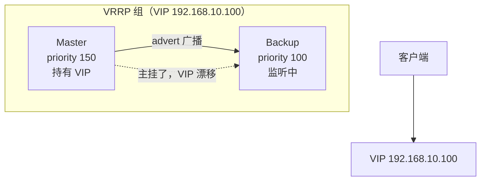

# LVS 与 Keepalived 四层高可用

::: tip 本篇定位
当流量大到一台 Nginx 都扛不住、或要求入口不能有单点时，需要在 **TCP/IP 层（四层）** 做负载均衡：性能极高、不解析应用协议。这篇讲透 **LVS/IPVS** 的转发模式与配置，以及用 **Keepalived** 给 LVS（或任何 TCP 服务）做主备 VIP 漂移的高可用方案。这也是理解 K8s kube-proxy IPVS 模式的底层基础。
本篇版本：Keepalived 2.4.3（2026-07-20 发布）、ipvsadm（内核 IPVS 子系统，主流发行版内核自带）、对照内核 6.x。所有版本以官网当前稳定版为准。
:::

## 一、背景与基础

### 1.1 小白类比：四层 vs 七层负载均衡

把进来的请求比作"寄到写字楼的快递"：

- **四层（L4，传输层）** 负载均衡像楼下的**前台分拣员**：它只看快递单上的"目的端口 + 目标 IP"，按规则把包裹直接转给某一间办公室，**不拆开包裹看里面是什么内容**。它根本不知道你寄的是网页还是视频，只做 IP:Port 的转发。
- **七层（L7，应用层）** 负载均衡像**快递站内的拆包检查员**：它要拆开包裹、看内容（HTTP 里的域名、URL、Cookie），再决定转给谁。更聪明，但慢、吃资源。

| 对比 | 四层（LVS/IPVS） | 七层（Nginx/Ingress） |
|---|---|---|
| 工作层 | 传输层（TCP/UDP） | 应用层（HTTP/HTTPS/gRPC） |
| 看什么 | 目标 IP+端口 | Host、URL、Header、Cookie |
| 性能 | 极高（内核态转发，百万级 PPS） | 相对低（要终止/重建连接、解析协议） |
| 功能 | 纯转发、调度 | 路由、改写、限流、TLS 终止、缓存 |
| 典型位置 | 机房最前端、入口 | LVS 之后、业务之前 |
| 健康检查 | 简单（TCP 探活） | 可做 HTTP 接口探活 |

> 现实架构常是 **LVS（四层）→ Nginx（七层）→ 业务**：LVS 扛住海量连接做第一层分发，Nginx 做精细化路由。

### 1.2 LVS 是什么

**LVS（Linux Virtual Server）** 是章文嵩博士发起的项目，其内核实现叫 **IPVS**（IP Virtual Server），已经内置于 Linux 内核。用户态用 `ipvsadm` 命令配置规则。它工作在 netfilter 框架上，在**内核态**完成报文转发，所以极快。

## 二、三种转发模式对比

### 2.1 VS/NAT、VS/DR、VS/TUN、FULLNAT

| 模式 | 原理 | Director（调度器）是否改 IP | RS 回包路径 | RS 需同网段？ | 性能 | 典型 |
|---|---|---|---|---|---|---|
| **VS/NAT** | 改目标 IP 转给 RS，RS 回包必经 Director | 改目的 IP（也改源） | 必须回到 Director | 可以跨网段 | 一般（进出都过 Director） | 小规模、测试 |
| **VS/DR**（最常用） | Director 改**二层 MAC** 转发，RS 直接回客户端 | 不改 IP，只改 MAC | RS **直接回客户端**（不经过 Director） | **必须同二层广播域** | 最高 | 生产主力 |
| **VS/TUN** | 把 IP 包再套一层 IP 隧道发给 RS | 加 IPIP 封装 | RS 直接回客户端 | 可跨网段 | 高 | 异地机房、RS 跨机房 |
| **FULLNAT** | 同时改源+目的 IP（阿里扩展） | 改源和目的 | 可经可不经 | 可跨网段 | 较高 | 大厂内部定制 |

```mermaid
flowchart LR
    C["客户端"] -->|"VIP 请求"| D["LVS Director<br>DR 模式只改 MAC"]
    D -->|"二层帧转发"| R1["RS1<br>lo 上绑 VIP"]
    D -->|"二层帧转发"| R2["RS2<br>lo 上绑 VIP"]
    R1 -.|"直接回包<br>绕开 Director" .-> C
    R2 -.-> C
```

> **DR 模式为什么快**：请求过 Director，**响应不过 Director**，RS 直接把包发回客户端。Director 只处理"进门"那一半流量，所以瓶颈小、能扛极大并发。代价是 Director 和所有 RS 必须在同一个二层广播域，且要解决 ARP 问题（见 2.3）。

### 2.2 常用调度算法

`ipvsadm -s` 后面跟调度算法名：

| 算法 | 缩写 | 含义 | 适用 |
|---|---|---|---|
| 轮询 | rr | 依次分给每台 RS，不看负载 | RS 性能相近、短连接 |
| 加权轮询 | wrr | 按权重比例分，性能好的多分 | RS 性能不均 |
| 最少连接 | lc | 分给当前连接数最少的 RS | 长连接、RS 不均 |
| 加权最少连接 | wlc | 按权重 + 最少连接（LVS 默认） | 大多数生产场景 |
| 源地址哈希 | sh | 同一源 IP 固定打到同一 RS | 会话粘滞 |
| 目标地址哈希 | dh | 按目标 IP 哈希 | 缓存代理场景 |

## 三、DR 模式实战配置

### 3.1 规划

- Director（调度器）：`192.168.10.10`，VIP `192.168.10.100`
- RS1：`192.168.10.21`，RS2：`192.168.10.22`，都在同一网段，跑 80 端口的 Nginx
- 客户端访问 `192.168.10.100:80`

### 3.2 Director 上用 ipvsadm 配置

```bash
# 安装（RHEL/Rocky）
sudo dnf install -y ipvsadm
# Ubuntu/Debian: sudo apt install -y ipvsadm

# 1) 在 Director 外网口上绑 VIP
sudo ip addr add 192.168.10.100/32 dev eth0

# 2) 开启 IP 转发
sudo sysctl -w net.ipv4.ip_forward=1

# 3) 清空旧规则，建一条虚拟服务（wlc 算法，80 端口）
sudo ipvsadm -C
sudo ipvsadm -A -t 192.168.10.100:80 -s wlc

# 4) 加两台真实服务器（-g = DR 模式，-w 权重）
sudo ipvsadm -a -t 192.168.10.100:80 -r 192.168.10.21:80 -g -w 1
sudo ipvsadm -a -t 192.168.10.100:80 -r 192.168.10.22:80 -g -w 1

# 5) 查看规则
sudo ipvsadm -Ln
# IP Virtual Server version 1.2.1
# Prot LocalAddress:Port Scheduler Flags
#   -> RemoteAddress:Port Forward Weight ActiveConn InActConn
# TCP  192.168.10.100:80 wlc
#   -> 192.168.10.21:80   Route   1      0          0
#   -> 192.168.10.22:80   Route   1      0          0
```

规则持久化：

```bash
sudo ipvsadm-save -n | sudo tee /etc/sysconfig/ipvsadm   # RHEL 系
# Ubuntu 用 netfilter-persistent 思路或写 systemd unit 在开机时重放上面命令
sudo systemctl enable --now ipvsadm
```

### 3.3 RS 上的 ARP 抑制问题（DR 模式关键）

**问题**：VIP `192.168.10.100` 同时绑在 Director 和两台 RS 的 lo 上。局域网里谁该响应对 VIP 的 ARP 请求？如果 RS 也回答"VIP 是我这个 MAC"，交换机就会把发往 VIP 的包直接送给某台 RS，**绕开了 Director**，负载均衡就乱了。

**解决**：让 RS 对 VIP"装聋作哑"——不对外通告自己持有 VIP，只在 lo 口上悄悄绑着它用来回包。

在**每台 RS** 上执行（写脚本 `rs_dr.sh`）：

```bash
#!/bin/bash
# 在每台 real server 上执行
VIP=192.168.10.100
. /etc/rc.d/init.d/functions

case "$1" in
start)
    # 1) 在 lo 上绑 VIP（/32，不占整个网段）
    /sbin/ifconfig lo:0 $VIP broadcast $VIP netmask 255.255.255.255 up
    /sbin/route add -host $VIP dev lo:0
    # 2) 抑制 ARP：不回应别人对 VIP 的 ARP 请求
    echo "1" > /proc/sys/net/ipv4/conf/lo/arp_ignore
    echo "2" > /proc/sys/net/ipv4/conf/lo/arp_announce
    echo "1" > /proc/sys/net/ipv4/conf/all/arp_ignore
    echo "2" > /proc/sys/net/ipv4/conf/all/arp_announce
    ;;
stop)
    /sbin/route del -host $VIP dev lo:0
    /sbin/ifconfig lo:0 down
    echo "0" > /proc/sys/net/ipv4/conf/lo/arp_ignore
    echo "0" > /proc/sys/net/ipv4/conf/lo/arp_announce
    ;;
esac
```

| 参数 | 值 | 含义 |
|---|---|---|
| `arp_ignore` | 1 | 只响应"目标 IP 是本机入接口地址"的 ARP 请求 |
| `arp_announce` | 2 | 对外通告时尽量用最优化的源地址，不把 lo 上的 VIP 通告出去 |

让内核参数持久化：

```bash
cat >> /etc/sysctl.conf <<'EOF'
net.ipv4.conf.all.arp_ignore = 1
net.ipv4.conf.all.arp_announce = 2
net.ipv4.conf.lo.arp_ignore = 1
net.ipv4.conf.lo.arp_announce = 2
EOF
sysctl -p
```

## 四、Keepalived：给 LVS 做高可用

### 4.1 为什么还需要 Keepalived

上面的 Director 只有一台，挂了整个入口就没了。Keepalived 用 **VRRP 协议**解决"两台 Director 谁来持有 VIP、主挂了 VIP 自动漂到备机"的问题。

> 类比：VRRP 像"两个门卫共用一个工号"。平时只有主门卫拿着 VIP 这个工号接客；主门卫晕倒了，备门卫立刻接过工号顶上，外面的人只看到工号（VIP）没变，根本不知道里面换了个人。



### 4.2 完整 keepalived.conf（主备 + 健康检查）

在 **Master**（`192.168.10.10`）上：

```nginx
! /etc/keepalived/keepalived.conf
global_defs {
    router_id LVS_MASTER
    enable_script_security
    script_user root
}

# 健康检查脚本：探自己本机服务/出口是否正常，不正常就降优先级让出 VIP
vrrp_script chk_http_port {
    script "/usr/bin/curl -s -o /dev/null http://127.0.0.1:80"
    interval 2          # 每 2 秒检查一次
    weight -20          # 失败就把 priority 减 20
    fall 2
    rise 2
}

vrrp_instance VI_1 {
    state MASTER
    interface eth0
    virtual_router_id 51     # 主备必须一致
    priority 150              # 主比备高
    advert_int 1              # 每秒发一次 VRRP 通告
    authentication {
        auth_type PASS
        auth_pass S3cr3tPass
    }
    virtual_ipaddress {
        192.168.10.100/24 dev eth0
    }
    track_script {
        chk_http_port         # 挂上上面的健康检查脚本
    }
}

# 还可以让 Keepalived 直接管理 IPVS（这里用 LVS DR）
virtual_server 192.168.10.100 80 {
    delay_loop 6
    lb_algo wlc
    lb_kind DR                # 直接就是 DR 模式
    protocol TCP

    real_server 192.168.10.21 80 {
        weight 1
        TCP_CHECK {
            connect_port 80
            connect_timeout 3
        }
    }
    real_server 192.168.10.22 80 {
        weight 1
        TCP_CHECK {
            connect_port 80
            connect_timeout 3
        }
    }
}
```

**Backup**（`192.168.10.11`）：把 `state MASTER` 改成 `state BACKUP`，`priority 150` 改成 `priority 100`，其余完全一样。

::: tip 双主（互为主备）
上面是"主备"：备机平时闲置。要让两台都干活，再建一个 `vrrp_instance VI_2`，VIP2 浮在第二台为主、第一台为备——两个 VIP 各自工作，互为备份，资源不浪费。
:::

启动验证：

```bash
sudo systemctl enable --now keepalived
sudo ip addr show eth0 | grep 192.168.10.100   # 主上能看到 VIP
# 在主上停掉 keepalived：sudo systemctl stop keepalived
# 再到备上看，VIP 应该漂过来了
```

## 五、与 Nginx 四层、K8s kube-proxy IPVS 的关系

| 场景 | 用的是谁 | 说明 |
|---|---|---|
| 物理机机房入口 | LVS/DR + Keepalived | 本文方案，扛万兆入口流量 |
| Nginx  stream 模块 | Nginx 四层 | 小规模、要和七层路由共用一套配置时用 |
| K8s Service 集群内转发 | kube-proxy IPVS 模式 | **底层就是同一个内核 IPVS**：kube-proxy 把 ClusterIP 的服务规则翻译成 ipvs 规则，跳过 iptables 链遍历，性能更高 |

> 理解了 LVS/DR，再看 K8s `kube-proxy --proxy-mode=ipvs` 就会发现：它本质上是在每台节点上用 IPVS 把 Service ClusterIP 负载均衡到后端 Pod。详见 [K8s 架构与集群](./container-k8s-01-architecture-cluster)。

## 六、常见问题排错

| 现象 | 原因 | 解决 |
|---|---|---|
| 客户端访问 VIP 不通 | Director 没绑 VIP / IP 转发没开 / RS 没配 | `ip addr` 看 VIP；`sysctl net.ipv4.ip_forward`；RS 跑 `rs_dr.sh start` |
| 能通但只有一台 RS 收包 | RS 没做 ARP 抑制，VIP 被某台 RS 独占 | 检查 RS 上 `arp_ignore/arp_announce` 是否为 1/2 |
| RS 回包到不了客户端 | DR 模式下 RS 网关不对 / 防火墙拦了 | 确认 RS 有到客户端的路由；`iptables -L` 检查 |
| ipvs 规则加了但 `ipvsadm -Ln` 没流量 | 后端 RS 的 80 没真起来 | 在 Director 上 `curl 192.168.10.21` 直连 RS 验证 |
| VIP 主备同时存在（脑裂） | 网络不通导致两台都以为自己是 Master | 检查 VRRP 组播（224.0.0.18）是否被防火墙拦；统一 `virtual_router_id` 与认证密码 |
| 主挂了 VIP 不漂 | track_script 判断过松 / priority 差太小 | 调 weight 衰减；确认备机 priority 确实更低 |
| Keepalived reload 后规则丢失 | 用了 ipvsadm 手动配又让 keepalived 接管，冲突 | 二选一：要么手动 ipvsadm，要么让 keepalived 的 virtual_server 统一管 |

::: warning 生产红线
- DR 模式要求 Director 与所有 RS **同一二层广播域**，跨机房必须用 TUN 或 FULLNAT，别硬上 DR。
- VRRP 认证密码要改强、VRRP 组播不要暴露公网；主备配置除 `state/priority` 外保持一致，`virtual_router_id` 同组必须相同。
- 健康检查脚本一定要短、要幂等，别在 track_script 里跑耗时命令导致误判；脚本超时要设上限。
- VIP 漂移属于"瞬时中断"（秒级），长连接（数据库、WebSocket）要靠应用层重连，别指望 LVS 会话保持无限。
- 配置变更先在备机验证，再切主；改完 `ipvsadm-save` 持久化，重启不丢规则。
:::

## 相关速查

- 网络基础：[Linux 网络](./linux-network)、[性能调优](./linux-performance)、[内核](./linux-kernel)
- 七层入口：[Nginx Web 服务](./services-web-nginx)
- K8s 里的四层：[Pod 与服务发现](./container-k8s-02-pod-service-discovery)、[架构与集群](./container-k8s-01-architecture-cluster)
- 命令速查：[网络命令速查](/reference/network-commands)、[Linux 命令速查](/reference/linux-commands)

### 官方文档

- Keepalived 官网与文档：https://www.keepalived.org/
- Keepalived 下载（选版本）：https://www.keepalived.org/download/
- Keepalived 配置手册：https://manpages.org/keepalived.conf/5
- LVS/IPVS 官方站点：http://www.linuxvirtualserver.org/
- Red Hat 企业版 LVS 指南：https://access.redhat.com/documentation/en-us/red_hat_enterprise_linux/9/html/load_balancer_administration/
- kube-proxy IPVS 模式：https://kubernetes.io/docs/concepts/services-networking/service/#virtual-ips-and-service-proxies
