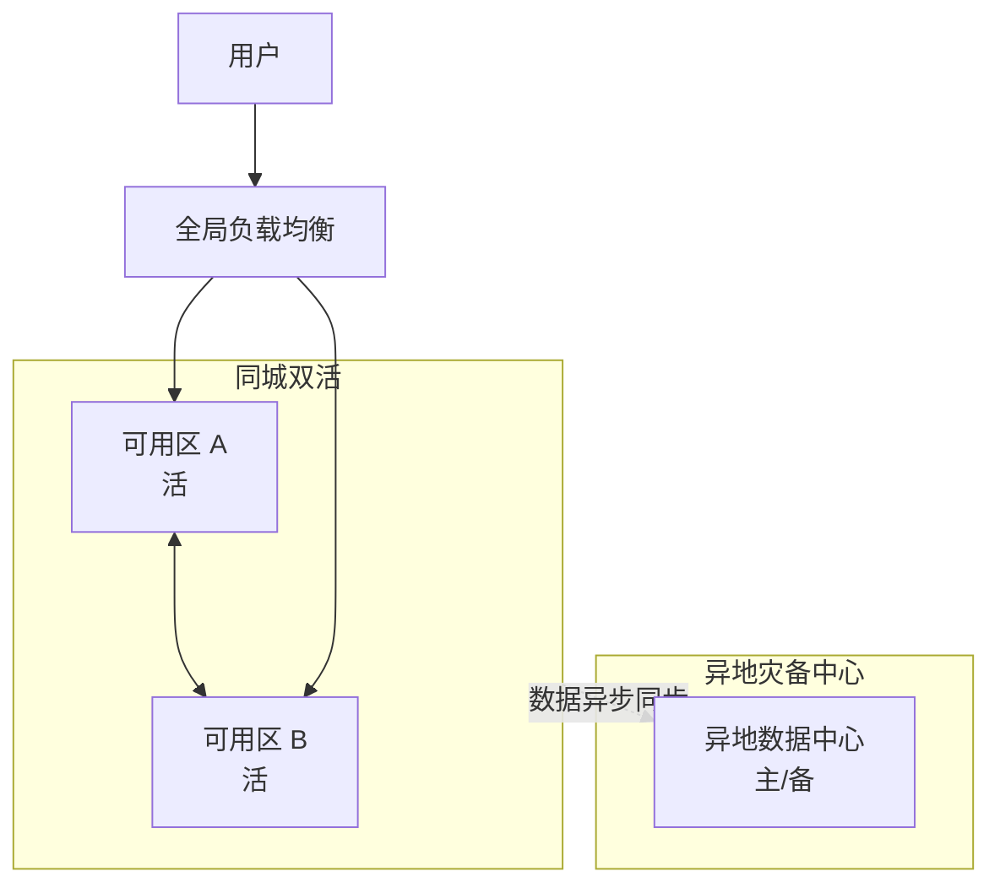

# 容量规划、高可用与灾备

::: tip 本篇定位
回答三件事：机器该买多少才不浪费也不扛不住（容量规划）、怎么让系统挂了一台还能继续跑（高可用）、整个机房都没了怎么办（灾备）。读完你能说清 RTO/RPO，会对比主备/双活/两地三中心，并有一份备份与 DR 演练检查清单。
本篇版本：方法基于业界 SRE 通用实践，配套 K8s HPA、Prometheus 3.15.0 做容量观测。本文为方法与清单，版本以各组件官网为准。
:::

## 一、容量规划

### 1.1 小白类比：「餐厅该备多少菜」

开饭店，菜备多了浪费、备少了客人点不到单。容量规划就是**提前算清楚：按现在的客流量趋势，下个月该备多少桌位、多少厨师，才既不浪费也不挤爆**。

放到服务器上：根据流量增长趋势 + 压测得出的单台承载能力，算出未来 3 个月需要多少台机器。

### 1.2 容量规划四步

| 步骤 | 做什么 | 工具/方法 |
|---|---|---|
| 看趋势 | 过去 6~12 个月 QPS/CPU/内存增长曲线 | Prometheus + Grafana 看历史 |
| 做压测 | 单台机器到底能扛多少 QPS、峰值 CPU 多少 | 压测工具（见 [CI/CD 进阶](./devops-cicd-advanced)） |
| 留余量 Headroom | 别跑满，留 20%~30% 余量应对突发 | 水位线告警 |
| 联动伸缩 | 高峰自动加机器、低谷缩容省成本 | K8s HPA、集群 CA |


> 经验值：单台机器日常 CPU 别超过 60%~70%，留出余量应对突发流量和单台宕机后的接管。

### 1.3 HPA 自动伸缩示例

K8s 里用 HPA 让 Deployment 按 CPU/内存自动加副本，是容量弹性的基础：

```yaml
apiVersion: autoscaling/v2
kind: HorizontalPodAutoscaler
metadata:
  name: order-hpa
  namespace: default
spec:
  scaleTargetRef:
    apiVersion: apps/v1
    kind: Deployment
    name: order
  minReplicas: 3            # 最少 3 副本，保证基本冗余
  maxReplicas: 20          # 最多扩到 20，别无上限
  metrics:
    - type: Resource
      resource:
        name: cpu
        target:
          type: Utilization
          averageUtilization: 60    # CPU 平均超过 60% 就扩容
```

```bash
kubectl apply -f order-hpa.yaml
kubectl get hpa order-hpa          # 观察当前/目标副本数
```

> HPA 只是「Pod 级」弹性；节点不够时还要配合集群自动伸缩（CA）加机器。容量规划要算到「Pod 扩满后节点还够不够」。

## 二、变更与发布管理

容量规划再好，一次烂发布也能把系统打挂。发布要管：

| 做法 | 说明 |
|---|---|
| 风险分级 | 高风险变更（数据库结构改、核心链路改）走双人评审 |
| 变更评审 | 高风险变更必须有两人以上确认，写明回滚方案 |
| 发布窗口 | 避开高峰、周五晚上不发高风险变更 |
| 回滚预案 | 每次发布前先确认「出问题怎么 1 分钟内退回去」 |

渐进式发布（灰度/金丝雀）详见 [CI/CD 进阶与渐进式交付](./devops-cicd-advanced)。

## 三、高可用

### 3.1 核心原则：去单点

**单点（SPOF）就是「这台挂了整个系统就挂」的那台机器。** 高可用的第一件事就是把所有单点找出来消灭掉。

| 手段 | 说明 |
|---|---|
| 冗余 | 每个关键组件至少 2~3 副本，挂一个不影响 |
| 故障域隔离 | 副本打散到不同机架/可用区，一个机房断电不全挂 |
| 限流降级 | 扛不住时先保核心功能，非核心功能先关掉 |
| 熔断 | 下游挂了别让请求堆积拖垮自己，快速失败 |

服务网格的熔断/重试/限流见 [Service Mesh 服务网格](./container-servicemesh)；四层高可用见 [LVS 与 Keepalived](./services-lvs-keepalived)。

## 四、灾备：RTO 与 RPO

### 4.1 小白类比

你在写一篇很重要的论文，电脑突然死机：

| 指标 | 你的感受 | 技术含义 |
|---|---|---|
| **RTO** | 从死机到你恢复写作，花了多久？ | **恢复时间目标**：故障后多久内必须恢复服务 |
| **RPO** | 你最后一次保存是多久之前？丢了多少字？ | **恢复点目标**：能容忍丢多长时间的数据 |

- RTO = 1 小时：挂了之后 1 小时内必须恢复。
- RPO = 5 分钟：最多容忍丢 5 分钟的数据。

### 4.2 架构模式对比

| 模式 | RTO | RPO | 成本 | 适用 |
|---|---|---|---|---|
| **主备（冷备）** | 小时级 | 分钟~小时 | 低 | 小公司、非核心系统 |
| **同城双活** | 秒~分钟级 | 接近 0 | 中 | 核心业务、同城机房互备 |
| **两地三中心** | 分钟级 | 接近 0 | 高 | 金融、强监管行业 |
| **异地多活** | 秒级 | 0 | 很高 | 超大互联网公司全球业务 |



## 五、备份：3-2-1 原则

- **3 份数据**：生产 1 份 + 至少 2 份备份。
- **2 种介质**：备份存在两种不同存储介质上（如本地磁盘 + 对象存储）。
- **1 份异地**：至少 1 份备份放在异地（防机房整体火灾/水灾）。

> **备份不验证等于没备份。** 很多团队定期备份，但真要恢复时才发现备份是坏的。务必定期做「从备份恢复」演练。

### 5.1 备份与恢复验证示例

以 MySQL 为例（见 [MySQL 数据管理](./data-mysql)），备份后必须在另一台机器上真恢复一遍：

```bash
# 1. 定时备份（crontab 每天 2 点）
mysqldump -u root -p --single-transaction order_db > /backup/order_db_$(date +%F).sql

# 2. 每周在测试库真恢复一次，验证备份文件没坏
mysql -u root -p test_restore < /backup/order_db_$(date +%F).sql

# 3. 校验关键表行数是否对得上
mysql -u root -p test_restore -e "SELECT COUNT(*) FROM orders;"
#    和生产库同时间点的行数对比，差太多就说明备份/恢复有问题
```

> 对象存储异地备份（如 `rclone copy` 到另一个城市的 OSS bucket）也要定期下载回来恢复一次——光看「上传成功」不代表能恢复出来。

## 六、DR 演练检查清单

```markdown
# 灾备演练检查清单（每季度至少一次）

## 演练前
- [ ] 明确本次演练目标：模拟哪个故障？（如可用区整体宕机）
- [ ] 通知所有相关团队，约定演练窗口
- [ ] 确认回退/中止预案
- [ ] 记录当前正常指标作为基线

## 演练中
- [ ] 模拟主可用区故障，观察是否自动切到备可用区
- [ ] 记录实际 RTO：从故障到恢复用了多久
- [ ] 记录实际 RPO：恢复后丢了多少数据
- [ ] 验证数据一致性（有没有出现数据错乱）

## 演练后
- [ ] 对比实际 RTO/RPO 与目标，差距多大
- [ ] 找出问题（如切换要手动、DNS 没切过去）
- [ ] 形成行动项，owner + 截止时间
- [ ] 更新灾备手册
```

## 七、常见问题

| 现象 | 原因 | 解决 |
|---|---|---|
| 高峰期突然不够用 | 只看了平均值没看峰值 | 按峰值压测，留 Headroom |
| 一台机器挂了全站挂 | 存在单点 | 关键组件多副本 + 打散故障域 |
| 备份从来没恢复过 | 没做恢复演练 | 每季度做一次 DR 恢复演练 |
| 异地切换 RTO 比预期长 | DNS/全局 LB 切换慢 | 预热备用流量、缩短 TTL |
| 平时很稳，演练才发现切不过去 | 只在文档里写了没真练 | 定期 GameDay 实战演练 |

> 一句话总结：**容量规划解决「够不够用」，高可用解决「挂一台不影响」，灾备解决「整个机房没了怎么办」**。三者层层递进，缺一环都不算稳。

::: warning 生产红线
- **备份必须做恢复演练**，只备份不验证等于裸奔。
- 跨可用区/异地的数据同步要确认 RPO 满足业务要求，别异步同步延迟很大还当双活。
- 高可用副本必须打散在不同故障域，别把 3 个副本调度到同一台物理机。
- 容量 Headroom 别拉满到 95%，留 20%+ 应对突发和单台接管。
- 异地灾备切换要提前写好 SOP 并演练，真出事时没时间临场想。
:::

## 相关速查

- 主动找脆弱点：[混沌工程](./sre-chaos)
- 故障后应对：[事故管理与无指责复盘](./sre-incident)
- 指标观测与水位告警：[Prometheus 从 0 到 1](./monitor-prometheus)
- K8s 调度与伸缩：[Kubernetes 架构与集群](./container-k8s-01-architecture-cluster)
- 四层高可用：[LVS 与 Keepalived](./services-lvs-keepalived)
- 发布与回滚：[CI/CD 进阶与渐进式交付](./devops-cicd-advanced)
- 云原生排障命令：[云原生排障命令速查](/reference/cloudnative-commands)

### 官方文档

- Kubernetes HPA 自动伸缩：https://kubernetes.io/docs/tasks/run-application/horizontal-pod-autoscale/
- Google SRE Book《Addressing Cascading Failures》：https://sre.google/sre-book/addressing-cascading-failures/（需科学上网）；国内平替：https://blog.csdn.net/sanhewuyang/article/details/162757718
- 3-2-1 备份原则（CISA）：https://www.cisa.gov/
- Prometheus 容量规划：https://prometheus.io/docs/operating/capacity_plan/
