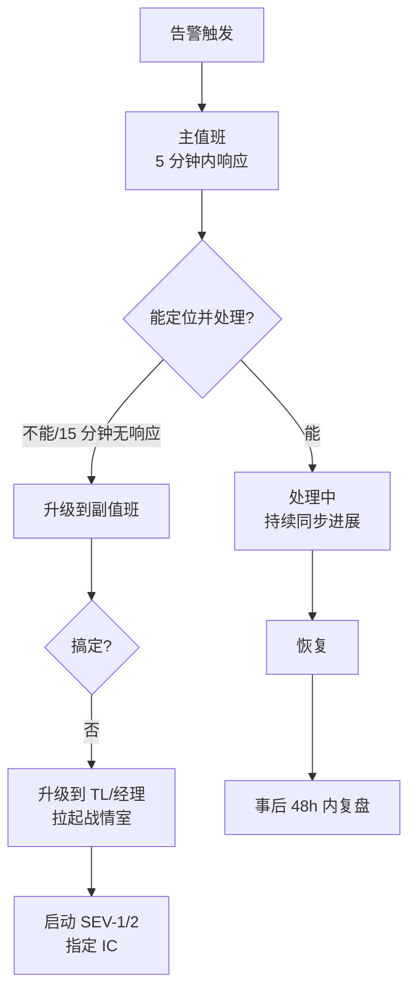
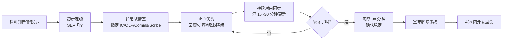
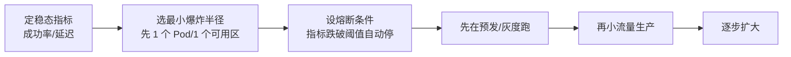

# 事故管理与无指责复盘

::: tip 本篇定位
系统挂了别慌：把「谁该上、谁说了算、怎么沟通、事后怎么复盘不甩锅」这套流程固定下来。读完你能拿到一份事故分级、On-call 轮值、应急指挥分工、响应流程图和一份可直接复制的无指责 Postmortem 模板。
本篇版本：方法体系基于 Google SRE Book / 业界通用实践，配套工具 Alertmanager 0.34.1、Grafana OnCall（开源）。本文为流程与模板，不绑定特定版本。
:::

## 一、为什么需要事故管理流程

### 1.1 小白类比：「火灾来了谁指挥」

饭店着火，若大家各喊各的——有人泼水、有人抢东西、有人乱跑——火只会越烧越大。专业消防队有固定章法：**谁报警、谁是现场指挥、谁灭火、谁对外面喊话、谁记录**，各司其职，不乱。

线上事故也一样。没有流程时，常见的混乱是：十几个人同时改配置、群里 99+ 条消息没人看、不知道现在谁在操作、对外不知道该说什么。**事故管理就是给「救火」定一套流程**，让大家在高压下还能有序。

### 1.2 事故严重性等级

| 等级 | 定义 | 例子 | 响应要求 |
|---|---|---|---|
| **SEV-1 致命** | 核心业务全站不可用/数据泄露，影响全部用户 | 支付全挂、数据库主库宕机 | 立刻电话叫醒，全员投入，30 分钟内响应 |
| **SEV-2 严重** | 核心功能受损但有降级/部分用户受影响 | 下单慢但能下、部分区域故障 | 5~15 分钟响应，值班立即处理 |
| **SEV-3 一般** | 非核心功能问题、有 workaround | 后台报表慢、某个边缘接口报错 | 工作时间处理，不叫醒 |
| **SEV-4 轻微** | 体验问题、不影响业务 | 页面文案错、偶发慢一次 | 排期修复即可 |

## 二、On-call 值班与升级路径

### 2.1 轮值设计

- **主值班（Primary）**：第一个接电话的人，负责初步判断和拉起事故。
- **副值班（Secondary）**：主值班 15 分钟没响应/搞不定时升级到他。
- **后备（Manager/TL）**：两人都搞不定时升级，负责协调资源和对外决策。



### 2.2 升级路径要点

- 升级要**有明确时间阈值**（如主值班 15 分钟不响应自动转副值班），不能靠「觉得差不多了」。
- 告警要分级：SEV-1/2 走电话+短信，SEV-3 只走群消息，SEV-4 开工单。这正是上一篇 [SLO 多燃烧率告警](./monitor-slo) 做的分层。

## 三、应急指挥（IC）与角色分工

事故一旦拉起战情室（语音会议/群），**第一件事是指定一个 IC（Incident Commander，事件指挥官）**。IC 自己不动手修，他只管调度。

| 角色 | 职责 | 小白类比 |
|---|---|---|
| **IC 事件指挥官** | 统一指挥、做决策、宣布升降级/恢复 | 火场总指挥，不自己拿灭火器 |
| **OLP 操作负责人** | 真正执行命令、改配置、回滚 | 冲上去灭火的消防员 |
| **Comms 通信官** | 对内同步进度、对外发公告 | 对媒体喊话的发言人 |
| **Scribe 记录员** | 记录时间线：几点发生了什么 | 现场书记员 |

> 关键原则：**IC 和操作的人必须分开**。一个人又当指挥又改命令，忙起来就会忘了同步，别人不知道现在进行到哪一步。

## 四、事故响应流程



**第一原则：先止血，后查因。** 用户正在受损时，不要钻进去深挖根因——先回滚、先切流、先降级把影响止住，根因留到恢复后慢慢查。

## 五、对内对外沟通与时间线

- **对内**：在战情群固定频率（如每 30 分钟）发一条进展：现在现象、已尝试的动作、下一步、预计时间。别让大家追着问。
- **对外**：面向用户/客户的公告要谨慎——说事实、说影响范围、说正在处理，**不要甩锅、不要猜根因**。
- **时间线**：记录员按「时间戳 + 事件」记录，例如 `14:02 告警触发 / 14:08 IC 张三拉起会议 / 14:20 回滚 v1.4.2 / 14:35 流量恢复`。这份时间线是复盘的原料。

### 5.1 沟通话术模板（直接套用）

**拉起事故时的对内通知（发到战情群）：**

```text
【SEV-2 事故通报】
现象：下单接口 P99 飙升，错误率约 30%，影响华东区用户。
IC：张三（电话 xxx）
OLP：李四
Comms：王五
Scribe：赵六
下一步：正在回滚 v1.4.2，预计 15 分钟内反馈。
```

**进展同步（每 30 分钟一条，别让人追着问）：**

```text
【14:30 进展】
已回滚 v1.4.2 → v1.4.1，错误率从 30% 降到 2%，正在观察。
下一步：继续观察 30 分钟，若稳定则宣布解除。
```

**对外公告（只说事实，不猜根因）：**

```text
尊敬的用户：我们监测到部分用户在 14:02~14:35 期间下单遇到超时，
目前服务已恢复正常，正在进一步排查原因，给您带来不便深表歉意。
```

### 5.2 值班工具选型

| 工具 | 用途 | 说明 |
|---|---|---|
| Alertmanager | 告警分发 | 按 severity 路由到电话/群/工单，见 [SLO 告警](./monitor-slo) |
| Grafana OnCall | 值班轮班、升级 | 开源，支持轮班表、自动升级、电话通知 |
| 战情语音会议 | 事故时实时沟通 | 拉起后所有人进同一个语音频道 |
| 共享文档 | 记录时间线 | 多人同时编辑，Scribe 主笔 |

## 六、无指责复盘（Blameless Postmortem）

### 6.1 文化核心

> 无指责不是「不找人负责」，而是「**在当时的信息和条件下，做决策的人是合理的**」。

出事故后最忌讳的是骂「谁谁谁怎么会犯这种低级错误」。因为人在高压、信息不全下的判断，事后看是错的，当时往往是合理的。**复盘要对着系统找漏洞，而不是对着个人发脾气**——否则下次出事没人敢上报，问题被藏起来，更危险。

### 6.2 可直接复制的复盘模板

```markdown
# 事故复盘：<一句话标题，如「9.28 下单接口大面积超时」>

## 摘要
- 等级：SEV-2
- 时间：2026-09-28 14:02 ~ 14:55（约 53 分钟）
- 影响：约 12% 用户下单失败，订单损失估算 X 笔
- 一句话结论：发布 v1.4.2 引入连接池配置错误，导致数据库连接耗尽

## 影响面
- 受影响服务：order-service
- 受影响用户：华东区约 12% 请求
- 数据影响：无数据丢失，无资损

## 时间线（UTC+8）
| 时间 | 事件 | 操作人 |
|---|---|---|
| 14:02 | 告警触发：订单 P99 飙升、错误率 30% | 监控 |
| 14:08 | 主值班李四拉起战情室，指定 IC | 李四 |
| 14:20 | 决定回滚 v1.4.2 → v1.4.1 | IC/OLP |
| 14:35 | 流量恢复正常 | OLP |
| 14:55 | 观察期结束，宣布解除 | IC |

## 根因分析
- 直接原因：v1.4.2 把数据库连接池 maxOpenConns 从 200 改成了 10，高峰连接被打满。
- 促成因素：该配置变更没有走评审；压测没覆盖高峰并发；告警到发现有 6 分钟延迟。

## 做得好的
- 值班 6 分钟内响应，回滚果断。
- 时间线记录完整，沟通及时。

## 做得不好的
- 配置变更未评审就上线。
- 缺少连接池饱和度告警。

## 行动项（必须有 owner + 截止时间）
| 行动项 | Owner | 截止时间 | 状态 |
|---|---|---|---|
| 连接池配置纳入变更评审清单 | 王五 | 2026-10-10 | 待办 |
| 增加 DB 连接池使用率告警 | 赵六 | 2026-10-08 | 待办 |
| 压测补充高峰并发用例 | 孙七 | 2026-10-15 | 待办 |
```

### 6.3 行动项闭环

- 每个行动项**必须有 owner 和截止时间**，否则等于没写。
- 行动项要进跟踪系统（Jira/飞书任务），定期 review 完成情况。
- 复盘结论要**分享给全团队**，让别人也从你的事故里学到东西。

## 七、常见反模式

| 反模式 | 为什么不好 | 正确做法 |
|---|---|---|
| 复盘会变成批斗会 | 下次没人敢报事故 | 无指责，对着系统 |
| 没有 IC，一群人同时操作 | 互相覆盖、越改越乱 | 先指定指挥，操作统一由 OLP |
| 只顾深挖根因不先止血 | 用户一直在受损 | 先回滚/降级，根因事后查 |
| 行动项没人跟 | 同样事故再犯一次 | owner+截止时间+闭环跟踪 |
| 对外公告瞎猜原因 | 说错了更被动 | 只说事实和进展，根因复盘后再补 |
| 事故一解除就散会 | 没观察期，问题反复 | 恢复后至少观察 30 分钟再解除 |
| 复盘报告写完就归档 | 行动项没人跟 | 进任务系统定期 review 闭环 |

> 经验：SEV-1 事故的复盘要在**恢复后 48 小时内**开掉，趁大家记忆还新鲜；行动项跟踪到全部关闭才算结束。
>
> 复盘会控制在 60~90 分钟，主持要引导大家「对事不对人」，把精力放在「系统怎么改下次不再犯」而不是「谁的锅」。

::: warning 生产红线
- SEV-1/2 事故必须**先指定 IC 再动手**，禁止多人同时改生产配置。
- 所有生产变更保留一键回滚能力（见 [CI/CD 进阶与渐进式交付](./devops-cicd-advanced)）。
- 复盘模板里**不许出现「某某某不小心」这类人身归因**，只写系统与流程缺陷。
- 对外公告走 Comms 统一出口，别让工程师在群里随口评论。
:::

## 相关速查

- 告警分级来源：[SLO/SLI、错误预算与 Burn Rate](./monitor-slo)
- 主动发现系统弱点：[混沌工程](#合并资料)
- 容灾与恢复：[容量规划、高可用与灾备](./sre-capacity-dr)
- 发布与回滚：[CI/CD 进阶与渐进式交付](./devops-cicd-advanced)
- 自动化巡检：[Python 运维自动化](/services/cicd/ansible)
- 真实排障案例：[排障案例集](/cases/)

### 官方文档

- Google SRE Book《Managing Incidents》：https://sre.google/sre-book/managing-incidents/（需科学上网）；国内平替：https://www.cnblogs.com/lhxBlogs/p/17936005.html
- Google Postmortem 文化（Blameless）：https://sre.google/sre-book/postmortem-culture/（需科学上网）；国内平替：https://www.cnblogs.com/lhxBlogs/p/17936005.html
- Grafana OnCall：https://grafana.com/oss/oncall/
- Alertmanager 告警路由：https://prometheus.io/docs/alerting/latest/notification_examples/

<!-- merged-guide-material:start -->
## 合并资料

> 原先单独成页的同主题内容已收进本页；默认折叠，点开看原页全文。

<details>
<summary><strong>混沌工程 — 与其等线上半夜挂掉才发现「这个服务挂了整个站就瘫了」，不如主动、可控地往系统里「打针」制造故障，提前测出它的韧性。读完你能理解混沌工程的核心思想，并用 Chaos Mesh 在 K8s 上跑一个安全的故障注入实验。</strong></summary>

::: tip 本篇定位
与其等线上半夜挂掉才发现「这个服务挂了整个站就瘫了」，不如主动、可控地往系统里「打针」制造故障，提前测出它的韧性。读完你能理解混沌工程的核心思想，并用 Chaos Mesh 在 K8s 上跑一个安全的故障注入实验。
本篇版本：Chaos Mesh v2.8.4（Helm chart `chaos-mesh-2.8.4`）、LitmusChaos 3.32.0。均为 2026-09 官网当前稳定版。
:::

#### 一、起源与核心思想

##### 1.1 小白类比：「汽车碰撞测试」

新车上市前，厂家会故意把车撞一下，看气囊能不能弹出来、车架够不够硬——**不是盼着车坏，而是在可控环境里提前知道坏起来什么样**。

混沌工程就是给软件系统做「碰撞测试」：主动、可控地制造故障（杀个 Pod、加点网络延迟、堵点磁盘），观察系统会不会优雅降级、能不能自动恢复。

Netflix 当年做了个叫 **Chaos Monkey** 的工具，凌晨随机把生产环境的微服务 Pod 杀掉——逼着工程师把每个服务都做成「挂了也不影响大局」。这就是混沌工程的起点。

##### 1.2 稳态假设 Steady-state Hypothesis

做实验前先问自己两个问题：

1. **稳态是什么**：平时系统健康长什么样？（如 P99 延迟 < 300ms、成功率 > 99.9%）
2. **实验后我预期怎样**：杀掉一个 order Pod 后，成功率应该基本不变（因为有副本）。

> 如果实验后稳态和你预期不符——比如杀一个 Pod 成功率就掉了——那就是**发现了一个之前不知道的脆弱点**，这就是混沌实验的价值。

#### 二、故障注入类型

| 故障类型 | 具体注入 | 想验证什么 |
|---|---|---|
| Pod/容器杀死 | 随机删 Pod、杀容器 | 副本数够不够、有没有自动拉起 |
| 网络延迟 | 给某服务加 200ms~2s 延迟 | 超时/重试/熔断是否生效 |
| 网络丢包/分区 | 丢 50% 包、把服务和数据库隔离 | 熔断、降级、数据一致性 |
| DNS 故障 | 篡改 DNS 解析 | 服务发现、兜底逻辑 |
| CPU/内存压力 | 打满 CPU、吃满内存 | 限流、OOM 处理、HPA 扩容 |
| 磁盘压力 | 写满磁盘、IO 延迟 | 磁盘满告警、日志轮转 |
| 时钟偏移 | 把节点时间拨快/拨慢 | 证书校验、定时任务、分布式锁 |
| 节点宕机 | 直接 cordon/关机 | 跨可用区调度、故障域隔离 |

#### 三、两大工具对比

| 对比 | Chaos Mesh | LitmusChaos |
|---|---|---|
| 定位 | K8s 原生、CRD 一体、上手快 | 平台化、工作流编排强、生态实验库多 |
| 实验定义 | CRD（PodChaos/NetworkChaos 等） | ChaosExperiment + ChaosWorkflow |
| 可视化 | 自带 Dashboard | Chaos Studio UI |
| 适合 | 团队刚入门、想快速在 K8s 上实验 | 企业级、多环境、定期 GameDay 编排 |
| 当前版本 | v2.8.4（2026-08） | 3.32.0（2026-09） |

两者都是 CNCF 项目，都用 CRD 描述实验。下面以 Chaos Mesh 为例。

#### 四、部署 Chaos Mesh

```bash
helm repo add chaos-mesh https://charts.chaos-mesh.org
helm install chaos-mesh chaos-mesh/chaos-mesh \
  -n chaos-testing --create-namespace \
  --version 2.8.4 \
  --set dashboard.create=true
```

验证：

```bash
kubectl get pods -n chaos-testing          # controller-manager、chaos-daemon、dashboard 都 Running
# Dashboard: kubectl port-forward svc/chaos-dashboard -n chaos-testing 2333:2333
# 浏览器打开 http://localhost:2333
```

#### 五、一个完整可应用的实验 YAML

下面这个实验：**随机杀掉 default 命名空间下带 `app=order` 标签的 1 个 Pod，持续 30 秒**。这是最经典的「杀 Pod」实验，验证你的 Deployment 副本能不能自动补回来。

```yaml
apiVersion: chaos-mesh.org/v1alpha1
kind: PodChaos
metadata:
  name: order-pod-kill
  namespace: default
spec:
  action: pod-kill                 # 动作：杀 Pod
  mode: one                        # 随机选一个 Pod
  selector:
    namespaces: [default]
    labelSelectors:
      app: order
  duration: "30s"                  # 实验持续时间
```

应用并观察：

```bash
kubectl apply -f order-pod-kill.yaml

# 另开一个终端盯着 Pod：会看到一个 order Pod 被杀死后自动重建
kubectl get pods -l app=order -w

# 观察实验状态
kubectl describe podchaos order-pod-kill
```

再看一个「网络延迟」实验（给 order 服务到 Redis 的流量加 500ms 延迟）：

```yaml
apiVersion: chaos-mesh.org/v1alpha1
kind: NetworkChaos
metadata:
  name: order-network-delay
  namespace: default
spec:
  action: delay
  mode: one
  selector:
    namespaces: [default]
    labelSelectors:
      app: order
  delay:
    latency: "500ms"               # 注入 500ms 延迟
  duration: "5m"
```

实验完清理：

```bash
kubectl delete podchaos order-pod-kill
kubectl delete networkchaos order-network-delay
```

##### 5.1 LitmusChaos 工作流示例

LitmusChaos 用 `ChaosExperiment` + `ChaosWorkflow` 编排多步实验，并自带**韧性探针（Probe）**——实验期间自动探活，不达标自动中止。下面是一个「杀 Pod 前先确认服务健康，实验中持续探活」的片段：

```yaml
apiVersion: litmuschaos.io/v1alpha1
kind: ChaosEngine
metadata:
  name: order-pod-delete-engine
  namespace: litmus
spec:
  appinfo:
    appns: default
    applabel: app=order
  chaosServiceAccount: litmus-admin
  experiments:
    - name: pod-delete
      spec:
        components:
          env:
            - name: TOTAL_CHAOS_DURATION
              value: "30"
            - name: CHAOS_INTERVAL
              value: "10"
            - name: APP_PODS
              value: "2"          # 只影响 2 个 Pod，限制爆炸半径
          probe:
            - name: "order-http-probe"
              type: "httpProbe"
              httpProbe/inputs:
                url: "http://order.default.svc/health"
                intervalSeconds: 5
                chaosCheckTimeout: 10
```

```bash
kubectl apply -f order-pod-delete-engine.yaml -n litmus
kubectl get chaosengine order-pod-delete-engine -n litmus
```

> Chaos Mesh 与 Litmus 的实验都能配「实验前后自动探活」，这就是上节说的安全护栏在工具层面的落地——探活不过就自动中止，不会把系统打挂了还在继续注入。

#### 六、爆炸半径控制与安全护栏

**混沌工程最大的风险就是把生产搞挂**，所以一定要控制爆炸半径：



护栏要点：

- **先在预发环境跑通**，再考虑生产。
- **限定爆炸半径**：`mode: one` 先杀一个，别一上来 `mode: all`。
- **设自动中止**：用 Kubernetes 注解 `chaos-mesh.org/action: stop` 或配 Prometheus 指标联动，成功率跌破阈值自动结束实验。
- **避开高峰窗口**：别在大促期间做实验。
- **有明确的终止预案**：谁有权一键 `kubectl delete` 停掉实验。

#### 七、把韧性演练纳入工程流程

- **CI 里跑轻量实验**：每次部署后自动跑一个「杀 Pod」实验，确认服务能自愈，过不了就阻断发布。
- **定期 GameDay**：每季度组织一次故障演练（如模拟整个可用区挂掉），全团队参与，练应急响应。
- **实验要写进 SOP**：每次实验记录假设、过程、结果、发现的问题，沉淀成知识库。

#### 八、常见问题排错

| 现象 | 原因 | 解决 |
|---|---|---|
| PodChaos 不生效 | 没选对 Pod/selector 标签 | `kubectl get pods -l app=order` 确认标签匹配 |
| chaos-daemon 不 Ready | 权限/网络问题 | 看 `kubectl logs -n chaos-testing ds/chaos-daemon` |
| NetworkChaos 没延迟 | 节点不支持/没装内核模块 | 确认是 Linux 节点，chaos-daemon 以特权运行 |
| 实验结束故障还在 | Duration 太短/没真正删除 | `kubectl delete` 实验对象，确认 Pod 恢复 |
| 生产误操作影响面大 | 没限制 mode | 用 `mode: fixed-percent` 限定百分比，别用 `all` |

::: warning 生产红线
- **生产做混沌实验必须先在预发验证**，并限定爆炸半径、设好自动中止。
- 实验 CRD 写死命名空间和标签，别用全局 selector 误伤无关服务。
- 避开业务高峰和大促窗口，提前通知值班同学。
- 镜像/chart 版本写死（`2.8.4`、`3.32.0`），禁用 `latest`。
- Chaos Mesh 需要特权容器注入故障，只在受控 K8s 集群安装，别裸装在共享集群。
:::

#### 相关速查

- 告警与发现脆弱点：[SLO/SLI、错误预算与 Burn Rate](./monitor-slo)
- 故障后怎么应对：[事故管理与无指责复盘](./sre-incident)
- 高可用与容灾：[容量规划、高可用与灾备](./sre-capacity-dr)
- K8s 基础：[Kubernetes 架构与集群](/services/container/kubernetes/01-理论)
- 服务韧性（熔断/重试）：[Service Mesh 服务网格](/guide/container#合并资料)
- 云原生排障命令：[云原生排障命令速查](/reference/cloudnative-commands)
- kubectl 命令：[kubectl 命令速查](/reference/kubectl-commands)

##### 官方文档

- Chaos Mesh 官网：https://chaos-mesh.org/
- Chaos Mesh Releases：https://github.com/chaos-mesh/chaos-mesh/releases
- LitmusChaos 官网：https://litmuschaos.io/
- LitmusChaos Releases：https://github.com/litmuschaos/litmus/releases
- Netflix Chaos Monkey：https://github.com/Netflix/chaosmonkey

</details>

<!-- merged-guide-material:end -->
