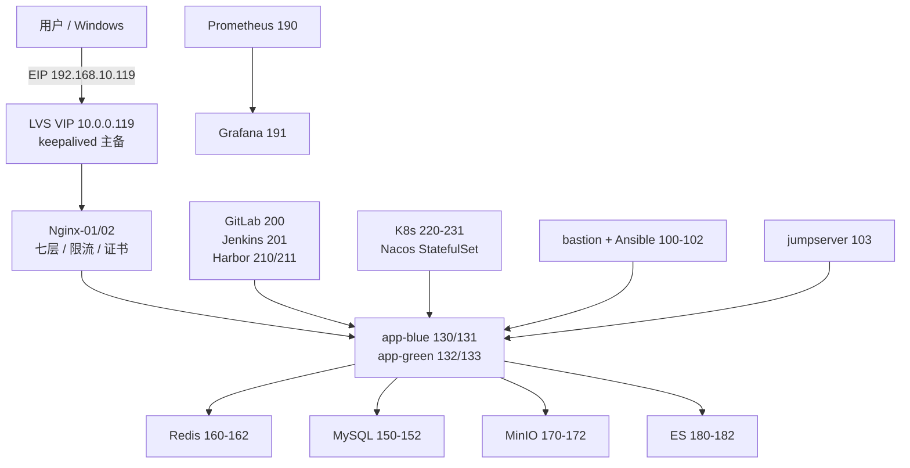

# 项目架构

> 本文只介绍项目整体架构与业务逻辑，不包含 PVE 物理机安装、硬件选型、BIOS、逐步命令。
>
> 逐步部署上线看 [10-实操：部署上线 13 项](/projects/homelab/practice/)；版本、地址和附件看 [资料清单](/projects/homelab/materials)。

## 一、项目一句话

> **一个 VIP 进来，两层代理分流，四组应用蓝绿切换，三类数据托底，一条流水线发布，一套监控盯着；人从堡垒机进、机器从 Ansible 进——全部跑在 37 台虚拟机上。**

项目原型是 100 台混合云在线教育平台，实验环境缩容到一台 PVE 宿主机上的 37 台 VM。目标不是做生产集群，而是把“入口 → 应用 → 数据 → 发布 → 监控 → K8s”整条链路跑通，并能从 Windows 验证完整度。

## 二、业务模型

在线教育平台的业务可以拆成三条线：

| 业务线 | 用户看到什么 | 对应组件 |
|---|---|---|
| 学习端 | 登录、浏览课程/题库、搜索课程、查看课件和视频 | gateway / auth / system / 业务应用；搜索走 ES，文件走 MinIO |
| 管理端 | 课程与题库管理、用户与权限、文件上传、内容发布 | 若依管理后台；MySQL 存业务数据，Redis 做缓存 |
| 交易与商品（P5） | 商品浏览、商品搜索、下单、订单消息 | mall-swarm；ES 做商品搜索，MinIO 存图片，RabbitMQ 承载订单消息 |

运维侧还有两条支撑线：GitLab/Jenkins/Harbor 负责发布，Prometheus/Grafana/ELK 负责观测，JumpServer 负责人的操作审计，Ansible 负责机器批量执行。

## 三、整体拓扑



## 四、六层结构

| 层 | 组成 | 职责 | 关键设计 |
|---|---|---|---|
| ① 接入 / 入口 | lvs-01/02 + VIP、nginx-01/02、jumpserver、bastion | 业务入口 + 运维入口 | LVS-DR、keepalived 主备、Nginx 七层、堡垒机审计 |
| ② 应用 | app-blue-01/02、app-green-01/02、Nacos 3 副本 | 跑业务，蓝绿两套 | 蓝绿 upstream；Nacos 在 K8s StatefulSet |
| ③ 数据 | MySQL ×3、Redis ×3、MinIO ×3、ES ×3 | 关系数据、缓存、对象、搜索 | 主从 + 哨兵 + EC 4+2 + 3 节点集群 |
| ④ CI/CD | GitLab、Jenkins Master、agent ×2、Harbor ×2、Ansible ×3 | 从代码到上线 | 分布式构建、镜像复制、控制节点主备 |
| ⑤ 监控 | Prometheus + Alertmanager、Grafana + Kibana、Logstash | 指标、日志、告警、看板 | 拉指标、推日志、告警分级 |
| ⑥ 基础设施 | PVE 虚拟化底座、37 台 VM、vmbr0/vmbr1、6 条 EIP | 托住上面所有东西 | 私网 `10.0.0.0/24` + 1:1 NAT |

## 五、节点结构

### 5.1 管理 / 接入

| VMID | 主机名 | 角色 | 私网 | EIP |
|---|---|---|---|---|
| 100 | bastion | 应急 SSH、DNS、Ansible 主控 | 10.0.0.100 | 192.168.10.100 |
| 101 | ansible-02 | Ansible 备控 | 10.0.0.101 | — |
| 102 | ansible-03 | Ansible 执行节点 | 10.0.0.102 | — |
| 103 | jumpserver | 堡垒机、会话录像、命令审计 | 10.0.0.103 | 192.168.10.103 |
| 110 | lvs-01 | LVS-DR 主、keepalived MASTER | 10.0.0.110 | — |
| 111 | lvs-02 | LVS-DR 备、keepalived BACKUP | 10.0.0.111 | — |
| 120 | nginx-01 | Nginx 七层、蓝绿 upstream | 10.0.0.120 | — |
| 121 | nginx-02 | Nginx 七层、蓝绿 upstream | 10.0.0.121 | — |

业务 VIP：`10.0.0.119`，对应示例 EIP `192.168.10.119`。

### 5.2 应用 / 数据

| VMID | 主机名 | 角色 | 私网 |
|---|---|---|---|
| 130 | app-blue-01 | blue 组 v1 | 10.0.0.130 |
| 131 | app-blue-02 | blue 组 v1 | 10.0.0.131 |
| 132 | app-green-01 | green 组 v2 | 10.0.0.132 |
| 133 | app-green-02 | green 组 v2 | 10.0.0.133 |
| 150 | mysql-01 | MySQL 主，GTID + 半同步 | 10.0.0.150 |
| 151 | mysql-02 | MySQL 从 | 10.0.0.151 |
| 152 | mysql-03 | MySQL 从 | 10.0.0.152 |
| 160 | redis-01 | Redis 主 + Sentinel | 10.0.0.160 |
| 161 | redis-02 | Redis 从 + Sentinel | 10.0.0.161 |
| 162 | redis-03 | Redis 从 + Sentinel | 10.0.0.162 |

### 5.3 存储 / 搜索 / 监控

| VMID | 主机名 | 角色 | 私网 | EIP |
|---|---|---|---|---|
| 170 | minio-01 | MinIO 节点 1 | 10.0.0.170 | — |
| 171 | minio-02 | MinIO 节点 2 | 10.0.0.171 | — |
| 172 | minio-03 | MinIO 节点 3 | 10.0.0.172 | — |
| 180 | es-01 | Elasticsearch 节点 1 | 10.0.0.180 | — |
| 181 | es-02 | Elasticsearch 节点 2 | 10.0.0.181 | — |
| 182 | es-03 | Elasticsearch 节点 3 + Logstash | 10.0.0.182 | — |
| 190 | prom-01 | Prometheus + Alertmanager | 10.0.0.190 | — |
| 191 | grafana-01 | Grafana + Kibana | 10.0.0.191 | 192.168.10.191 |

### 5.4 CI/CD / 镜像 / K8s

| VMID | 主机名 | 角色 | 私网 | EIP |
|---|---|---|---|---|
| 200 | gitlab-01 | GitLab CE + Runner | 10.0.0.200 | 192.168.10.200 |
| 201 | jenkins-01 | Jenkins Master，只调度 | 10.0.0.201 | — |
| 202 | jenkins-agent-01 | Agent，label `docker` | 10.0.0.202 | — |
| 203 | jenkins-agent-02 | Agent，label `maven` | 10.0.0.203 | — |
| 210 | harbor-01 | Harbor 主站、复制源 | 10.0.0.210 | 192.168.10.210 |
| 211 | harbor-02 | Harbor 灾备站、复制目标 | 10.0.0.211 | — |
| 220 | k8s-m01 | control-plane + etcd | 10.0.0.220 | — |
| 221 | k8s-m02 | control-plane + etcd | 10.0.0.221 | — |
| 222 | k8s-m03 | control-plane + etcd | 10.0.0.222 | — |
| 230 | k8s-w01 | worker，Nacos + 微服务 pod | 10.0.0.230 | — |
| 231 | k8s-w02 | worker，Nacos + 微服务 pod | 10.0.0.231 | — |

## 六、请求链路与业务逻辑

### 6.1 用户请求

```
用户浏览器 → EIP 192.168.10.119 → LVS VIP 10.0.0.119
   → Nginx-01/02（限流 / TLS / 路由）
   → app-blue 或 app-green
   → Redis（先查缓存）
   → MySQL（缓存未命中查库）
   → 返回页面 / 课程 / 题库数据
```

- **登录与权限**：gateway → auth → system，用户身份和菜单权限落在 MySQL。
- **课程与题库**：业务应用读 MySQL；热点数据先读 Redis。
- **文件与视频**：上传/下载走 MinIO，数据库只存对象地址，不把大文件塞进 MySQL。
- **搜索**：课程/商品搜索走 ES，不直接对 MySQL 做全表扫描。
- **P5 交易**：mall-swarm 的商品、订单、消息链路接入后，订单消息走 RabbitMQ，商品图片继续走 MinIO。

### 6.2 蓝绿发布

```
Nginx upstream 指向 blue（v1）
   → 新版本部署到 green（v2）
   → 验收 green
   → 修改 upstream 指向 green
   → reload Nginx
   → 出问题把 upstream 改回 blue
```

蓝绿只解决**版本切换**；节点故障由 keepalived 负责，两者不要混在一起。

### 6.3 运维入口

- **机器入口**：bastion + Ansible，负责免密批量执行、节点初始化、配置下发。
- **人的入口**：JumpServer，负责 Web 终端、资产授权、会话录像和命令审计。
- **应急入口**：bastion 保留 SSH，堡垒机故障时仍能进机器。

## 七、发布链路

```
Git push → GitLab → Jenkins Master（只调度）
   ├─ agent-maven：编译 + 单测
   └─ agent-docker：构建镜像 + 扫描
   → push Harbor（01 → 复制到 02）
   → Ansible 主控读 Git 里的 playbook
   → 改 Nginx upstream → reload → 蓝绿完成
```

- **GitLab**：代码、分支、Runner 的入口。
- **Jenkins Master**：只调度、存凭据、提供 UI，不跑重编译。
- **agent**：`maven` 和 `docker` 两个 label，分别做编译和镜像构建。
- **Harbor**：主站和灾备站异步复制；不做 VIP，因为复制是双写、不是单活。
- **Ansible**：主控、备控、执行三节点；playbook 和 inventory 进 Git，备控定时同步。

## 八、数据与高可用

| 组件 | 结构 | 高可用方式 | 业务影响 |
|---|---|---|---|
| MySQL | 1 主 2 从 | GTID + 半同步 | 主库故障时可切从库；实验里先保证复制链路正确 |
| Redis | 3 台，redis + sentinel 同机 | Sentinel 法定人数 2 | 主库故障自动选主；应用需通过哨兵发现主库 |
| MinIO | 3 节点 × 2 盘 | EC 4+2 | 允许坏一块盘/一个节点，仍能读对象 |
| Elasticsearch | 3 节点 | 副本 + 集群选举 | 搜索和日志共用，索引要区分 |
| Nacos | 3 副本，P4 后跑 K8s | StatefulSet + MySQL 存储 | 注册中心和配置中心，不能单点 |
| LVS / Nginx | 各 2 台 | keepalived + RS 健康检查 | 入口层故障自动摘除或漂移 |
| Harbor | 2 台 | 异步复制 | 镜像源故障时可从另一台拉 |

## 九、观测链路

```
全网主机：node_exporter / Filebeat
   → Prometheus 主动抓取（告警走 Alertmanager）
   → Filebeat → Logstash → Elasticsearch → Kibana
   → Grafana 看板统一展示
```

- **指标**：node_exporter 覆盖主机 CPU、内存、磁盘、网络；Prometheus 抓取，Alertmanager 发告警。
- **日志**：Filebeat 采集，Logstash 汇聚，ES 存储，Kibana 查询。
- **看板**：Grafana 统一展示；Kibana 看日志。
- **审计**：JumpServer 会话录像；和监控指标分开，不混成一个系统。

## 十、关键设计选择

1. **LVS + Nginx 两层**：四层扛连接，七层看 URL、做限流和证书；少一层都会留下单点或失去路由能力。
2. **keepalived 不管蓝绿**：keepalived 管节点故障，蓝绿管版本切换，混在一起会互相干扰。
3. **Harbor 两台不配 VIP**：异步复制是双写，VIP 是单活入口；配 VIP 会掩盖复制事实。
4. **Ansible 三台**：主控、备控、执行；备控接管，执行节点分流大批量任务。
5. **Jenkins Master 不构建**：master 只调度和存凭据，构建跑在 agent 上，避免 UI 被大编译拖死。
6. **bastion 与 JumpServer 分开**：bastion 给机器和 Ansible，JumpServer 给人的审计；一个要免密高并发，一个要录像和授权。
7. **K8s 只迁一部分**：Nacos 和若依服务迁 K8s，MySQL、Redis、MinIO、ES、Nginx 继续留在 VM；这是企业里常见的“部分上云”。

## 十一、部署阶段与 10-实操的对应

| 阶段 | 架构落点 | 对应实操 |
|---|---|---|
| D0 | 虚拟化底座、私网、EIP、模板 | [01-D0-装机与PVE初始化](/projects/homelab/practice/01-D0-装机与PVE初始化) |
| P0 | 管理面：bastion、DNS、Ansible 三节点 | [02-D1-P0管理平面](/projects/homelab/practice/02-D1-P0管理平面) |
| P1 | 最小业务闭环：VIP → Nginx → App → MySQL/Redis | [03-D1-P1最小链路](/projects/homelab/practice/03-D1-P1最小链路) |
| P1.5 | 人的审计入口：JumpServer | [04-D1-P15堡垒机](/projects/homelab/practice/04-D1-P15堡垒机) |
| P2 | 数据层、对象存储、搜索、蓝绿机制 | [05](/projects/homelab/practice/05-D2-P2-1数据层高可用) / [06](/projects/homelab/practice/06-D2-P2-2对象存储与搜索) / [07](/projects/homelab/practice/07-D2-P2-3蓝绿发布) |
| P3 | 中间件、若依业务、文件与搜索、网关蓝绿 | [08](/projects/homelab/practice/08-P3-0中间件Nacos与日志) / [09](/projects/homelab/practice/09-P3-1若依部署与MinIO) / [10](/projects/homelab/practice/10-P3-2若依接入ES) / [11](/projects/homelab/practice/11-P3-3若依蓝绿发布) |
| P4 | 部分业务迁 K8s：Nacos StatefulSet + 若依服务 | [12-P4-K8s迁移](/projects/homelab/practice/12-P4-K8s迁移) |
| P5 | 真实电商业务：mall-swarm 商品、订单、搜索、消息 | [13-P5-mall-swarm](/projects/homelab/practice/13-P5-mall-swarm) |

完整命令、前置检查、验收和失败处理都在 [10-实操总览](/projects/homelab/practice/)。

## 十二、方案边界

- **不是生产环境**：单机 PVE、单电源、无 UPS、无共享存储；不要承载重要数据。
- **不做全部上 K8s**：只迁 Nacos 和若依服务，数据层继续留在 VM，符合“部分上云”的现实形态。
- **不默认做快照**：thin 池空间有限，37 台虚拟磁盘已超配 1.8×；VM 故障优先重建，配置从脚本和 Ansible 恢复。
- **不做独立存储网**：单宿主、单 NVMe 下没有物理隔离收益；除非增加第二块物理网卡或做 Ceph/iSCSI。
- **实验网段与账号**：站点统一用 `10.0.0.0/24`、示例 EIP `192.168.10.0/24` 和主流发行版账号，不展示真实环境信息。
