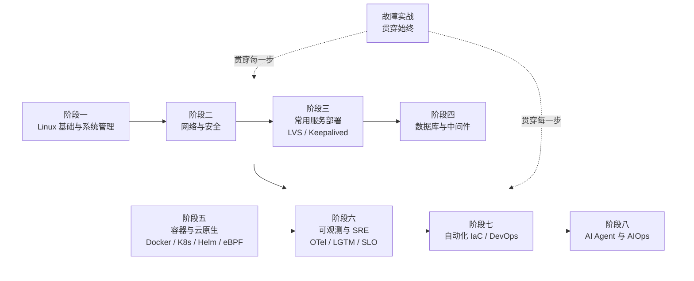

# 学习路线

> 这是一条给"新手期的自己"的推荐学习路径。不用严格按顺序，遇到工作需要可以直接跳到对应板块。
> 每个阶段都配了聚合页和速查手册，建议"边学边动手在虚拟机上敲一遍"。
> 整条路的终点是一名能独立扛业务稳定性的 **Linux SRE**：脚下是 Linux/网络/服务，往上是云原生、可观测性、平台工程，前沿是 AI Agent 辅助运维。

## 路线全景

## 阶段一：Linux 基础与系统管理

**目标：** 能独立装好系统、连上去、熟练操作文件和命令。

- 安装与初始环境、发行版差异（RHEL / Debian）
- 文件目录、文本三剑客（grep / sed / awk）、Shell 脚本
- 用户权限、磁盘存储、进程服务、定时任务
- 配合：[Linux 命令速查](/reference/linux-commands)、[Git 命令速查](/reference/git-commands)（版本管理是所有工程的底座）

👉 进入 [Linux 系统指南](/guide/linux)

## 阶段二：网络与安全

**目标：** 理解网络配置，能做基础安全加固。

- 网络接口 / IP / 端口、防火墙 iptables / firewalld / ufw
- SSH 加固、SELinux、SSL 证书、NTP 时间同步
- 配合：[网络命令速查](/reference/network-commands)

👉 见 [Linux 系统指南 - 安全加固](/guide/linux)

## 阶段三：常用服务部署（含四层高可用）

**目标：** 能独立部署和运维常见服务，并懂四层负载均衡。

- Web：Nginx（反向代理 / 负载均衡）、Apache、Tomcat
- DNS：BIND 域名解析
- 文件共享：NFS、Samba、FTP
- 四层高可用：LVS / Keepalived（DR 模式、健康检查、VIP 漂移）

👉 进入 [服务部署指南](/guide/services)

## 阶段四：数据库与中间件

**目标：** 掌握数据服务的部署、优化、备份和高可用。

- MySQL：基础 → 索引优化 → 备份 → 主从复制 / MHA / MyCat
- Redis：持久化、主从 / 哨兵 / Cluster
- Kafka、Spring Cloud（Nacos / Sentinel / Seata / Gateway）、APISIX

👉 进入 [数据与中间件指南](/guide/data)

## 阶段五：容器与云原生

**目标：** 掌握容器化和容器编排，这是当前运维最"值钱"的方向。

- Docker：镜像、网络、存储、Compose
- Kubernetes：架构 → 工作负载 → Service/Ingress → 存储 → Helm → Operator/CRD → 安全 / 调度 / 运维
- 服务网格 Istio、Gateway API、eBPF（Cilium 网络与可观测）
- 配合：[Docker 命令速查](/reference/docker-commands)、[kubectl 命令速查](/reference/kubectl-commands)、[云原生排障速查](/reference/cloudnative-commands)

👉 进入 [容器与编排指南](/guide/container)

## 阶段六：监控、可观测性与 SRE 稳定性

**目标：** 不仅能搭监控，还能用数据度量稳定性、扛住故障。

- 传统监控：Zabbix（监控项 / 触发器 / 模板 / 自动发现）
- Prometheus + Alertmanager + Grafana、ELK / Filebeat 日志平台、JumpServer 堡垒机
- 统一可观测：OpenTelemetry 埋点、Grafana LGTM（Loki 日志 / Tempo 链路 / Mimir 指标）、Jaeger
- SRE：SLO/SLI 与错误预算、事故管理与无指责复盘、混沌工程、容量规划与灾备

👉 进入 [监控与日志指南](/guide/monitor)

## 阶段七：自动化 IaC、DevOps 与平台工程

**目标：** 把重复工作自动化，用代码管理基础设施，并搭起内部开发平台。

- 配置管理：Ansible
- CI/CD：GitLab CI / Jenkins、ArgoCD（GitOps）、渐进式交付
- 基础设施即代码：Terraform
- 平台工程：内部开发者平台（IDP）、制品库 Harbor/Nexus、DevSecOps 与软件供应链安全、密钥与证书管理、FinOps 云成本治理

👉 进入 [自动化与 IaC 指南](/guide/automation) 、[DevOps 与平台工程指南](/guide/devops)

## 阶段八：AI Agent 与 AIOps 前沿

**目标：** 学会用大模型和 Agent 给自己当"副驾"，同时不丢传统 AIOps 的硬功夫。

- Prompt 工程：把运维任务模板化（解释命令、诊断日志、审配置、写脚本）
- AI Agent 与 LLM 应用基础、MCP 模型上下文协议、Agent 运维实战
- 运维知识库与 RAG、传统 AIOps 与机器学习（异常检测、智能告警）
- 配合：[运维 AI Prompt 与 Agent 指令模板速查](/reference/ai-prompts)

👉 进入 [智能运维与 AI 指南](/guide/aiops)

## 故障实战（贯穿始终）

**目标：** 在真实问题中沉淀经验，而不是只看不动手。

- 日常小问题记到 [排障记录](/cases/troubleshooting)
- 典型故障场景在 [排障训练场](/cases/) 练排查思路；真实踩坑单独复盘、总结根因和预防
- 每解决一个问题，把用到的命令补进对应速查长文档

## 学习建议

1. **动手优先**：每个知识点都在虚拟机或测试环境实操一遍。
2. **记笔记**：解决一个问题就沉淀一篇，命令补进速查长文档。
3. **重搜索**：本站内容用 `Ctrl+K` 快速检索。
4. **不焦虑进度**：按工作需要驱动学习，用到再深挖；阶段之间可以来回跳。
5. **用 AI 当陪练**：学新概念时让 AI 讲给小白听，排障时让它列排查路径，但结论一定要自己验证。
