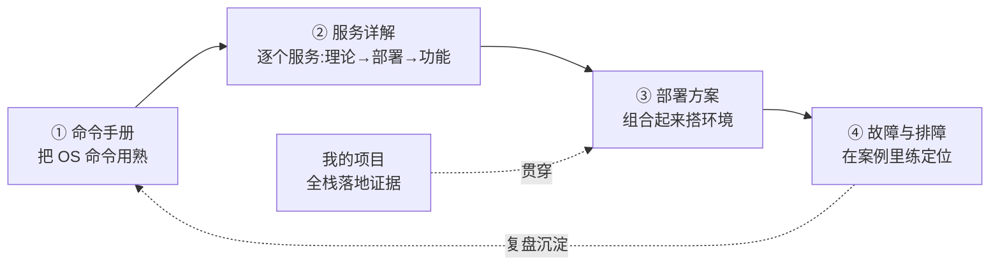

# 学习路线

> 这是一条给"新手期的自己"和刚入行同学的推荐路径。不用严格按顺序，遇到工作需要可以直接跳到对应模块。
> 每个阶段都建议"边学边动手在虚拟机上敲一遍"。整条路的终点是一名能独立扛业务稳定性的 **Linux SRE**。

## 路线全景

## ① 命令手册：先把 OS 命令用熟

**目标：** 能独立装好系统、连上去、熟练操作文件与命令，看得懂 `--help`。

- 文件与文本（grep / sed / awk）、用户与权限、进程与系统、磁盘与存储、网络
- 排障观测、软件包管理、Shell 脚本
- 每个分组按"入门 → 高级"排序，参数全量中文化

👉 进入 [命令手册](/commands/)

## ② 服务详解：逐个服务从原理到实战

**目标：** 能独立部署和运维常见服务，懂它的原理与高可用。

- 接入与网络：Nginx / LVS+Keepalived / HAProxy / DNS
- 数据库与缓存：MySQL / Redis；中间件：Nacos / Kafka
- 容器与编排：Docker / K8s / Helm / Harbor
- 监控与日志：Prometheus / Grafana / ELK；CI/CD：GitLab / Jenkins / Ansible
- 每个服务统一四段：理论 → 部署 → 功能 → 实战

👉 进入 [服务详解](/services/)（先看 [Nginx 样板](/services/web/nginx/01-理论)）

## ③ 部署方案：组合起来搭环境

**目标：** 把单个服务组合成高可用、可发布的完整环境。

- 部署形态矩阵：按"单机 / 主从 / 集群 / 容器 / K8s"快速定位
- 跨服务组合：接入层高可用、MySQL 主从、Redis 哨兵、CI/CD 流水线、监控栈
- 再往下就是全栈落地：[我的项目 · 项目架构](/projects/homelab) + [10-实操](/projects/homelab/practice/)

👉 进入 [部署方案](/deploy/)

## ④ 故障与排障：在案例里练定位

**目标：** 在真实问题中沉淀经验，而不是只看不动手。

- 典型故障场景在 [排障训练场](/cases/) 练排查思路
- 日常小问题记到 [排障记录](/cases/)
- 每解决一个问题，把用到的命令补进 [命令手册](/commands/)，把服务坑补进对应服务页"实战参考"

## 学习建议

1. **动手优先**：每个知识点都在虚拟机或测试环境实操一遍。
2. **记笔记**：解决一个问题就沉淀一篇，命令补进手册、服务坑补进服务页。
3. **重搜索**：本站内容用 `Ctrl+K` 快速检索。
4. **不焦虑进度**：按工作需要驱动学习，用到再深挖；模块之间可以来回跳。
5. **用 AI 当陪练**：学新概念时让 AI 讲给小白听，排障时让它列排查路径，但结论一定要自己验证。