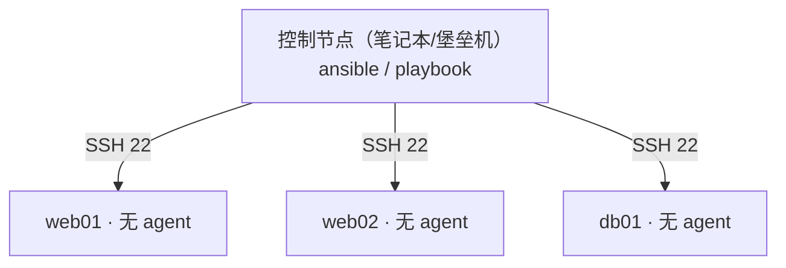
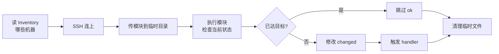

# Ansible · 无 Agent 批量自动化

> 单页四段：理论 → 部署 → 功能 → 实战。返回 [服务详解 · CI/CD 与自动化](/services/cicd/)。
> 多机操作统一在控制节点执行，不在控制节点和目标机之间来回切终端。本篇以 ansible-core 2.21、RHEL/Rocky 9 为主线，Ubuntu/Debian 差异单独标注。

## 01 · 服务理论

### 从一个场景说起

管 50 台服务器，每台装 vim、建 deploy 用户、贴公钥：

- **手动**：一台台 SSH 敲同样命令，重复 50 遍，漏一台错一步就重来。
- **bash 脚本**：循环跑，但全是"假设机器状态正常"的硬编码，遇到"已经装过怎么办""服务名不一样怎么办"就抓瞎。

**Ansible 把"在很多机器上要做的事"写成一份描述，由它通过 SSH 远程执行**。你写"最终想要长什么样"，它负责"现在 → 目标"。

### 无 Agent（最核心特点）

Puppet/Zabbix 要在每台被管机装常驻客户端，Ansible 不用：



- **控制节点**：装 Ansible 的机器。
- **被管节点**：**不装 Ansible**，只要能 SSH 连上、有 Python 3。
- **通信**：控制节点把模块（Python 脚本）经 SSH 临时推到被管机执行，完事就删。

优点：新机器上线不用装客户端、安全面小。代价：上千台时 SSH 并发是瓶颈，要求控制节点直连所有被管机。

### 声明式 + 幂等

- **声明式**：写"nginx.conf 要长这样"，而非"先 cp 再 sed 改三行"。
- **幂等**：同一 playbook 跑 1 次和 10 次结果一样，已达目标的机器跳过（报 `ok` 而非 `changed`）。

执行一条任务时内部做了什么：



这是 Ansible 比 bash 脚本强的根本——脚本假设状态正常，Ansible 自己对比当前与目标。

### Inventory 主机清单

Ansible 靠 Inventory 知道"有哪些机器、用什么用户登录"。默认 `/etc/ansible/hosts`，也可 `-i` 指定。推荐 YAML 风格：

```yaml
# inventory.yml
all:
  children:
    web:
      hosts:
        web01: { ansible_host: 10.0.0.11 }
        web02: { ansible_host: 10.0.0.12 }
    db:
      hosts:
        db01: { ansible_host: 10.0.0.13 }
  vars:
    ansible_user: rocky
```

| 概念 | 含义 |
|---|---|
| 组（group） | 同类主机归组（web/db），便于批量操作一组 |
| 主机别名 | `web01` 是别名，`ansible_host` 才是真实 IP |
| `ansible_user` | SSH 登录用户名 |
| `ansible_port` | SSH 端口，非 22 时写 |
| `ansible_ssh_private_key_file` | 指定私钥路径 |

## 02 · 部署方案

### 控制节点安装（被管机不用装）

::: code-group
```bash [RHEL/Rocky 9]
sudo dnf install -y ansible-core      # AppStream 自带（2.16.x 系列）
ansible --version
```
```bash [Ubuntu 24.04]
sudo apt update && sudo apt install -y ansible   # 仓库版本偏旧
```
```bash [pip（推荐，装最新 2.21）]
python3 -m venv ~/ansible-venv
source ~/ansible-venv/bin/activate
pip install --upgrade pip
pip install ansible-core
ansible --version
```
:::

::: tip ansible-core 与 ansible 的区别
`ansible-core` 只含核心模块；`pip install ansible` 再带一大堆官方集合（community.general 等）。日常装 `ansible-core` + 按需 `ansible-galaxy collection install` 即可。
:::

### SSH 免密

```bash
ssh-keygen -t ed25519 -C "ansible-control"
ssh-copy-id rocky@10.0.0.11           # 逐台分发公钥（输一次密码）
ssh rocky@10.0.0.11 "hostname"        # 验证免密
```

没有 ssh-copy-id 的精简环境手动贴：`cat ~/.ssh/id_ed25519.pub | ssh rocky@10.0.0.11 "mkdir -p ~/.ssh && cat >> ~/.ssh/authorized_keys && chmod 600 ~/.ssh/authorized_keys"`。

### ansible.cfg 配置文件

查找优先级：`ANSIBLE_CONFIG` > `./ansible.cfg` > `~/.ansible.cfg` > `/etc/ansible/ansible.cfg`。推荐项目目录下建一份跟着项目走：

```ini
# ./ansible.cfg
[defaults]
inventory = ./inventory.yml
remote_user = rocky
host_key_checking = False            # 实验环境方便；生产建议 True
forks = 15                           # 并发数，默认 5
timeout = 30
interpreter_python = auto_silent

[privilege_escalation]
become = True
become_method = sudo
become_user = root
become_ask_pass = False
```

::: warning 生产别关 host_key_checking
关闭会失去中间人攻击校验。生产保持 True，首次连接把指纹加入 known_hosts。
:::

### 连通性测试

```bash
ansible-inventory --list -i inventory.yml    # 校验清单解析
ansible all -i inventory.yml -m ping         # 收到 pong = SSH 通 + Python 在
```

报 `Permission denied` 查免密；报 `Failed to connect` 查网络/防火墙。

## 03 · 功能详解

### ad-hoc 临时命令

一次性批量操作。语法 `ansible <主机/组> -m <模块> -a '<参数>' [-b] [-f 并发]`：

```bash
ansible web -i inventory.yml -m shell -a "uptime"            # 批量看负载
ansible web -i inventory.yml -m dnf -a "name=vim state=present" -b   # 批量装包
ansible all -i inventory.yml -m copy -a "src=app.conf dest=/etc/app.conf" -b
ansible all -i inventory.yml -m file -a "path=/data state=directory mode=0755" -b
```

`-m` 模块、`-a` 参数、`-b` 提权、`--limit` 限定某台、`-f 20` 并发 20。

**常用模块速查**：

| 模块 | 作用 |
|---|---|
| `ping` | 连通性 |
| `command` | 执行命令（不经 shell，不支持管道/重定向，更安全） |
| `shell` | 经 shell，支持管道/重定向（小心注入） |
| `copy` / `template` | 拷文件 / 渲染 Jinja2 模板下发 |
| `file` | 建删文件目录、改权限属主 |
| `dnf`/`yum` / `apt` | RHEL / Debian 装包 |
| `service`/`systemd` | 管理服务 |
| `user` / `group` | 建删用户/组 |
| `authorized_key` | 下发 SSH 公钥 |
| `lineinfile` | 按行改配置 |

::: details command 和 shell 的区别
`command` 不经远端 shell，不能用管道 `|`、重定向 `>`、变量 `$HOME`、通配符，更安全；`shell` 经 bash 能用这些但要防注入。能用 command 就别用 shell。两者都不幂等，慎用。
:::

::: details RHEL 系 vs Debian 系装包差异
RHEL 用 `dnf`（旧版 yum），Debian 用 `apt` 且需 `update_cache=yes`。例：`ansible web -m apt -a "name=nginx state=present update_cache=yes" -b`。服务管理都用 systemd。
:::

### playbook

要保存、复用、版本管理就用 playbook（YAML）：

```yaml
# site.yml
- name: 批量初始化 web 服务器
  hosts: web
  become: true
  tasks:
    - name: 装 nginx
      dnf: { name: nginx, state: present }
    - name: 下发配置
      template: { src: nginx.conf.j2, dest: /etc/nginx/nginx.conf }
      notify: reload nginx          # 配置变了才触发
    - name: 起服务
      service: { name: nginx, state: started, enabled: true }
  handlers:
    - name: reload nginx
      service: { name: nginx, state: reloaded }
```

```bash
ansible-playbook -i inventory.yml site.yml --syntax-check   # 查语法
ansible-playbook -i inventory.yml site.yml --check          # 干跑不真改
ansible-playbook -i inventory.yml site.yml --limit web01    # 先一台验证
ansible-playbook -i inventory.yml site.yml                  # 全量
```

**YAML 要点**：缩进用空格不能 Tab；列表 `- `、字典 `key: value`；冒号后留一个空格；变量用双花括号包裹，整行是变量时加引号。

**vars 变量**（一份 playbook 适配多环境）：

```yaml
- hosts: web
  vars: { app_port: 8080, app_user: deploy }
  tasks:
    - user: { name: "{{ app_user }}", shell: /bin/bash }
    - debug: { msg: "将在端口 {{ app_port }} 启动" }
```

优先级：命令行 `-e` > inventory 组/主机变量 > play `vars`。

**handler**：只在被 notify 且任务 changed 时执行，所有 tasks 跑完后统一跑一次——配置没变就不重启服务，正是幂等体现。

**when 条件**（按发行版分支）：

```yaml
- dnf: { name: nginx, state: present }
  when: ansible_os_family == "RedHat"
- apt: { name: nginx, state: present, update_cache: yes }
  when: ansible_os_family == "Debian"
```

常用条件：`ansible_os_family`、`ansible_distribution`、`ansible_memtotal_mb`、`myvar is defined`。

**loop 循环**（批量建用户/装包，别复制任务）：

```yaml
- dnf: { name: "{{ item }}", state: present }
  loop: [vim-enhanced, git, wget, net-tools, bash-completion]
- user: { name: "{{ item.name }}", groups: "{{ item.group }}", shell: /bin/bash }
  loop:
    - { name: deploy, group: ops }
    - { name: monitor, group: ops }
```

### roles 复用

playbook 大了就拆成 role（标准目录），多项目复用：

```bash
ansible-galaxy init roles/nginx        # 生成标准骨架
```

```text
roles/nginx/
├── tasks/main.yml        # 任务入口
├── handlers/main.yml     # handler
├── templates/            # Jinja2 模板（.j2）
├── files/                # 静态文件
├── vars/main.yml         # role 内部变量
├── defaults/main.yml     # 默认变量（优先级最低，可覆盖）
└── meta/main.yml         # 依赖、作者
```

```yaml
- hosts: web
  become: true
  roles:
    - nginx
    - role: common
      vars: { app_port: 8080 }
```

### 进阶：template / vault / galaxy

**template（Jinja2）**：copy 原样拷，template 先渲染变量再下发（如按内存调 worker 数）：

```jinja2
worker_connections {{ worker_connections | default(1024) }};
server { listen {{ app_port }}; server_name {{ ansible_fqdn }}; }
```

**vault 加密敏感信息**（密码密钥别明文进 Git）：

```bash
ansible-vault encrypt vars/secrets.yml     # 加密
ansible-vault edit vars/secrets.yml        # 编辑
ansible-playbook site.yml --ask-vault-pass # 运行传密码
```

**galaxy 角色仓库**（别什么都自己写）：

```bash
ansible-galaxy search nginx
ansible-galaxy install geerlingguy.nginx
ansible-galaxy install -r requirements.yml   # 批量（可提交 Git）
```

## 04 · 实战参考

### 完整实战：批量初始化 Linux 主机

一个能直接用的初始化 playbook：装常用包、建部署用户、贴公钥、配 sudo、调句柄、起时间同步。

```yaml
- name: 批量初始化新 Linux 主机
  hosts: all
  become: true
  gather_facts: true
  vars:
    app_user: deploy
    common_pkgs: [vim-enhanced, git, wget, curl, net-tools, bash-completion, htop, chronyd]
  tasks:
    - name: RHEL 系装常用包
      dnf: { name: "{{ common_pkgs }}", state: present }
      when: ansible_os_family == "RedHat"
    - name: Debian 系装常用包
      apt: { name: "{{ common_pkgs }}", state: present, update_cache: yes }
      when: ansible_os_family == "Debian"
    - name: 建 ops 组
      group: { name: ops, state: present }
    - name: 建部署用户
      user: { name: "{{ app_user }}", group: ops, shell: /bin/bash, append: yes }
    - name: 下发团队公钥
      authorized_key:
        user: "{{ app_user }}"
        state: present
        key: "{{ lookup('file', 'files/id_ed25519.pub') }}"
    - name: 配 deploy sudo 免密
      copy:
        dest: /etc/sudoers.d/deploy
        content: "{{ app_user }} ALL=(ALL) NOPASSWD:ALL\n"
        mode: "0440"
        validate: 'visudo -cf %s'        # 写完先校验语法
    - name: 下发 limits 配置
      template: { src: templates/limits.conf.j2, dest: /etc/security/limits.d/99-custom.conf }
    - name: 起 chronyd
      systemd: { name: chronyd, state: started, enabled: yes }
      when: ansible_os_family == "RedHat"
```

```bash
ansible-playbook --syntax-check site.yml   # 1 查语法
ansible-playbook --check site.yml          # 2 干跑
ansible-playbook --limit web01 site.yml    # 3 单台试
ansible-playbook site.yml                  # 4 全量
ssh deploy@10.0.0.11 "id; sudo whoami"     # 验证：sudo 免密生效
```

### 最佳实践

- 永远先 `--syntax-check` 再 `--check` 干跑，确认无误再真跑。
- `--limit web01` 先单台验证再放量整组。
- 任务要幂等：能用模块就别用 shell 跑一堆 sed。
- 敏感信息全走 Vault；playbook 进 Git 可 review 可回滚。
- 目录推荐：`inventory/`（分环境）、`roles/`、`group_vars/`、`site.yml` 总入口。

### 排错速查

| 报错现象 | 原因 | 修复 |
|---|---|---|
| `Failed to connect ... via ssh` | 网络/端口/免密没配 | 先手动 ssh 通再用 Ansible |
| `Permission denied (publickey)` | 密钥不对/权限错 | authorized_keys 目录 700 文件 600 |
| `Unsupported parameters for (dnf)` | 老系统用了 yum | RHEL8+ 用 dnf，7 用 yum |
| `Could not find python` | 被管机没 Python | 装 python3 |
| 任务卡住 | host_key_checking 弹交互 | 实验环境关 host_key_checking |
| YAML 语法错 | Tab 缩进/冒号后没空格 | 全空格缩进，冒号后留空格 |
| shell 模块每次 changed | shell 不幂等 | 改专用模块或加 creates/removes |

::: warning 生产红线
- 没 `--check`、没 `--limit` 单台验证，别对全量跑高危操作（重启/关服务/改防火墙）。
- 改 sudoers/fstab/防火墙这类"改错起不来"的配置，用 `validate` 参数或保留一个会话再退出，别把自己锁外面。
:::

完整 CI/CD 链路里 Ansible 做部署执行端，见 [CI/CD 流水线](/deploy/stacks/cicd-pipeline) 与 [我的项目](/projects/homelab)。

## 官方文档

- Ansible：<https://docs.ansible.com/ansible/latest/index.html>
- 安装指南：<https://docs.ansible.com/projects/ansible-core/en/latest/installation_guide/>
- 模块索引：<https://docs.ansible.com/ansible/latest/collections/index_module.html>
- playbook：<https://docs.ansible.com/ansible/latest/playbook_guide/index.html>
- Galaxy：<https://galaxy.ansible.com/>

::: details 延伸：Python 运维自动化（批量 SSH / 调 API / 巡检告警）

Shell 写着写着变成几百行难维护的胶水脚本，处理 JSON、并发、重试、异常时尤其痛苦。Python 是 SRE 的第二把刀：批量 SSH、调 API、处理监控数据、定时巡检，比 Shell 工程化得多。Ansible 本质也是 Python 封装的批量 SSH 框架。

**subprocess 安全调外部命令**（用参数数组，别 shell=True）：

```python
import subprocess
def run_cmd(cmd: list[str], timeout: int = 30):
    try:
        p = subprocess.run(cmd, capture_output=True, text=True, timeout=timeout, check=False)
        return p.returncode, p.stdout.strip(), p.stderr.strip()
    except subprocess.TimeoutExpired:
        return 124, "", f"命令超时({timeout}s)"
rc, out, err = run_cmd(["df", "-h", "/"])     # 每个参数一个列表元素，防注入
```

**paramiko 批量 SSH**：

```python
import paramiko
def ssh_exec(host, user, key_path, cmd, port=22, timeout=30):
    client = paramiko.SSHClient()
    client.set_missing_host_key_policy(paramiko.AutoAddPolicy())
    try:
        client.connect(hostname=host, port=port, username=user,
                       key_filename=key_path, timeout=timeout,
                       allow_agent=False, look_for_keys=False)
        _, stdout, stderr = client.exec_command(cmd, timeout=timeout)
        code = stdout.channel.recv_exit_status()
        return code, stdout.read().decode().strip(), stderr.read().decode().strip()
    finally:
        client.close()
```

机器多用 `concurrent.futures.ThreadPoolExecutor` 并发，每台一个线程，几十台几秒跑完——这是 Python 比 Shell 舒服最多的地方。

**requests 带超时重试调 API**：

```python
import requests
from requests.adapters import HTTPAdapter
from urllib3.util.retry import Retry
s = requests.Session()
retry = Retry(total=3, backoff_factor=1, status_forcelist=[429, 500, 502, 503, 504])
s.mount("https://", HTTPAdapter(max_retries=retry))
r = s.get("http://prometheus:9090/api/v1/query",
          params={"query": "up"}, timeout=10)
r.raise_for_status()
print(r.json()["data"]["result"])
```

**Python vs Shell 选型**：一行命令/临时过滤用 Shell；批量 SSH 几十上百台、调 REST API 处理 JSON、定时巡检告警、需要错误处理并发可维护——用 Python。边界模糊时先 Shell 跑通，一旦 if/for/管道套管道超 30 行就迁 Python。

::: warning 生产红线
密码/私钥别硬编码（环境变量或密钥管理，私钥 600）；批量先单台/dry-run 再全量，删除类二次确认；所有外部调用必带超时；依赖版本写死 requirements.txt。
:::

官方文档：[Python](https://docs.python.org/3/) · [requests](https://requests.readthedocs.io/) · [paramiko](https://www.paramiko.org/) · [APScheduler](https://apscheduler.readthedocs.io/)

:::

---

返回 [服务详解 · CI/CD 与自动化](/services/cicd/)。