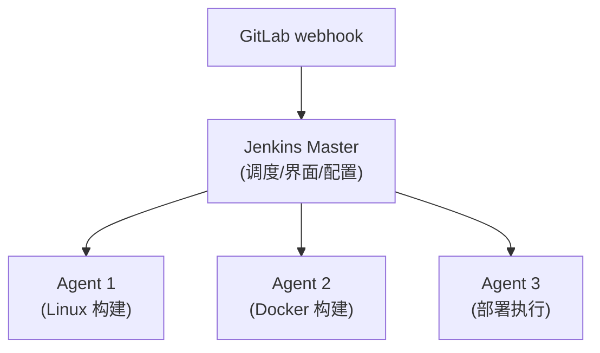

# Jenkins 01 · 服务理论

> 四篇制：[01 理论](./01-理论) · [02 部署](./02-部署) · [03 功能](./03-功能) · [04 实战](./04-实战)
> 本篇讲 Jenkins 的定位与架构。动手装去 [02 部署](./02-部署)。代码托管一体方案见 [GitLab](/services/cicd/gitlab)。

## 一、CI/CD 与 Pipeline as Code

CI/CD 流水线像工厂传送带：代码从一头进，经编译→测试→扫漏洞→打镜像→部署，成品从另一头出。**Pipeline as Code** 就是把这条传送带写成代码（Jenkinsfile）放进 Git，和代码一起评审、版本化——改流水线提个 MR 就行，不用找管理员点界面。

| 阶段 | 干什么 | 失败后果 |
|---|---|---|
| CI 持续集成 | 合并后自动构建/测试/出制品 | 拦住坏代码 |
| CD 持续交付 | 自动部署到类生产，手动上生产 | 随时可发布 |
| CD 持续部署 | 合格全自动上生产 | 要求极高回滚能力 |

## 二、Jenkins 是什么

Jenkins 是**独立的开源自动化服务器**，专注跑流水线与分布式构建。它不托管代码（代码在 GitLab/GitHub），而是被 webhook 触发后执行构建部署。强项是**插件生态极丰富**（1800+ 插件，几乎能集成任何工具）和**高度可定制**。

### master-agent 架构

- **Master（controller）**：管配置、调度 job、提供 Web 界面，**不建议在 master 上跑构建**（影响稳定）。
- **Agent（node）**：真正执行构建的机器，可异构（不同 OS/工具链），master 按 label 分发。

这就是 Jenkins 的分布式构建能力：编译在 Linux agent、打镜像在 Docker agent、部署在专用 agent，互不干扰。

## 三、两种流水线写法

- **声明式（Declarative，推荐）**：`pipeline { agent any; stages { ... } }`，结构固定、易读、有语法校验，绝大多数场景用它。
- **脚本式（Scripted）**：`node { ... }` 纯 Groovy，灵活但难维护，复杂逻辑才用。

声明式把"在哪个 agent、分几个 stage、每步干啥、失败怎么办"写成结构化 YAML 风格的 Groovy，见 [03 功能](./03-功能)。

## 四、Jenkins vs GitLab CI

| | Jenkins | GitLab CI |
|---|---|---|
| 形态 | 独立自动化服务器 | 与代码托管一体 |
| 插件 | 极丰富、高度定制 | 内置功能为主 |
| 维护 | 需自己管插件/升级 | 开箱即用 |
| 适合 | 复杂编排、多系统集成 | 已用 GitLab 的团队 |

现实常组合：GitLab 托管代码 + Jenkins 跑复杂流水线，或全用 GitLab CI。本站项目链路是 GitLab + Jenkins + Harbor + Ansible，见 [我的项目](/projects/homelab)。

## 五、官方文档

- Jenkins：<https://www.jenkins.io/doc/>
- Pipeline：<https://www.jenkins.io/doc/book/pipeline/>
- 架构：<https://www.jenkins.io/doc/book/scaling/architecting-for-scale/>

---

下一篇：[02 · 部署方案](./02-部署)（安装与 agent）。