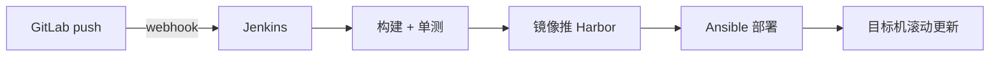

# Jenkins 04 · 实战参考

> 四篇制：[01 理论](./01-理论) · [02 部署](./02-部署) · [03 功能](./03-功能) · [04 实战](./04-实战)
> 本篇是完整链路落地与生产坑。与 [排障训练场](/cases/) 互链。

## 场景一 · 完整 CI/CD 链路

本站项目的真实链路：**GitLab 托管代码 → push 触发 webhook → Jenkins 构建测试 → 打镜像推 Harbor → Ansible 部署到目标机**。



各环节职责：[GitLab](/services/cicd/gitlab) 管代码与触发，Jenkins 编排，[Harbor](/services/container/harbor) 存镜像（tag 用 commit SHA），[Ansible](/services/cicd/ansible) 执行部署。镜像不可变 + 版本可追溯，回滚就是部署上一个 tag。完整落地见 [我的项目](/projects/homelab)。

## 场景二 · 分布式构建调度

构建任务重，按 label 分到专用 agent：编译在 `linux` agent、打镜像在 `docker` agent、部署在 `deploy` agent。master 只调度不构建。agent 不够时构建排队，加 agent 即扩容。

```groovy
stage('Build') { agent { label 'linux' } steps { sh 'mvn package' } }
stage('Image') { agent { label 'docker' } steps { sh 'docker build ...' } }
```

## 场景三 · 渐进式交付

别"一把全量替换"。生产发布升级为：

- **蓝绿**：备一套新版本环境，验证后流量整体切过去，出问题秒切回。
- **金丝雀**：先放 5% 流量到新版本，观察指标正常再逐步放量。

Jenkins 流水线里用参数控制放量比例，配合 [Nginx](/services/web/nginx/03-功能)/[HAProxy](/services/web/haproxy) 调权重，或 K8s 用 Argo Rollouts。回滚要自动化，别靠人手动改。

## 常见坑 FAQ

| 现象 | 原因 | 解法 |
|---|---|---|
| 升级后插件报错 | 插件兼容/依赖冲突 | 升级前备份 jenkins_home、看兼容矩阵 |
| 构建越来越慢 |  workspace 堆积/没缓存 | 定期清理、用依赖缓存 |
| 凭据泄露进日志 | 明文写 sh | withCredentials 注入 |
| master 卡顿 | 在 master 跑构建 | 构建全部分到 agent |
| webhook 不触发 | GitLab 网络/secret 错 | 核对 webhook URL 与 token |
| 磁盘写满 | 构建历史/制品无限留 | 配丢弃旧构建策略 |

**生产红线**：Jenkinsfile 进 Git 评审；凭据走 Credentials；镜像禁 latest；master 不跑构建；定期备份 jenkins_home。

## 官方文档

- Pipeline 示例：<https://www.jenkins.io/doc/pipeline/tour/hello-world/>
- 备份：<https://www.jenkins.io/doc/book/system-administration/backing-up/>
- 渐进式交付：<https://www.jenkins.io/doc/book/pipeline/>

---

上一篇：[03 · 功能详解](./03-功能) ｜ 返回 [服务详解 · CI/CD 与自动化](/services/cicd/)。