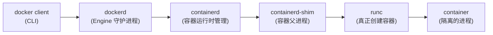

# Docker 01 · 服务理论

> 四篇制：[01 理论](./01-理论) · [02 部署](./02-部署) · [03 功能](./03-功能) · [04 实战](./04-实战)
> 本篇讲"容器到底是什么、为什么比虚拟机轻、镜像为什么分层"。把 Namespace/Cgroups/UnionFS 三大基石想明白，后面的镜像构建、资源限制、网络都不是死记。动手装 Docker 去 [02 部署](./02-部署)。

## 一、它是什么：容器化平台

Docker 是**容器化平台**，一句话：**把应用 + 依赖 + 配置打包成一个轻量、可移植的容器，一处打包，到处运行。** 它解决的核心痛点是"在我电脑能跑，线上不行"——因为容器把运行环境一起打包了，开发、测试、生产完全一致。

### 容器 vs 虚拟机：本质区别

| | 虚拟机 | Docker 容器 |
|---|---|---|
| 隔离方式 | Hypervisor 虚拟出完整硬件，装**完整 OS 内核** | **共享宿主机内核**，只隔离进程视图 |
| 体积 | GB 级 | MB 级 |
| 启动 | 分钟级 | 秒级 |
| 开销 | 每个 VM 一个内核，重 | 没有额外内核，轻 |

关键认知：**容器不是轻量虚拟机，而是"被隔离和限制的进程"**。它和宿主机共用一个内核，所以轻、所以快，但也因此**不能跑和宿主机内核不兼容的系统**（Linux 容器跑不了 Windows 内核）。

## 二、三大基石：容器靠什么实现

容器不是 Docker 发明的魔法，而是 Linux 内核三个能力的组合：

### 2.1 Namespace：隔离"看到什么"

Namespace 让容器以为自己独占系统。Linux 有六种 namespace：PID（进程号）、NET（网络栈）、MNT（挂载点）、UTS（主机名）、IPC（进程通信）、USER（用户）。容器里的进程看到 PID 1 是自己、有自己的网卡和主机名——其实都是宿主机内核"骗"它的视图。**Namespace 管隔离**。

### 2.2 Cgroups：限制"用多少"

光隔离不够，容器不能把宿主机资源吃光。Cgroups（control groups）限制一组进程能用多少 CPU、内存、IO。`docker run --cpus=1 -m 512m` 底层就是写 cgroup 文件。**Cgroups 管限额**。

### 2.3 UnionFS：分层"怎么存"

联合文件系统把多个目录（层）叠加挂载成一个文件系统。Docker 镜像就是一层层只读文件系统叠起来，容器启动时在最顶上加一层可写层。**UnionFS 管镜像分层存储**（详见第四节）。

::: tip 一句话记住
**Namespace 隔离视图、Cgroups 限制资源、UnionFS 分层存储**——三者合起来就是容器。Docker 是把这三件套包装得好用的工具。
:::

## 三、架构：一条 docker run 经过谁

Docker 不是单体，而是一串组件接力：

- **dockerd**：Docker Engine 守护进程，接收 CLI 请求、管镜像/网络/卷。
- **containerd**：从 dockerd 拆出来的容器运行时管理组件，K8s 现在直接对接它（绕过 dockerd）。
- **containerd-shim**：每个容器一个，做容器的父进程，让 containerd 重启不影响容器。
- **runc**：真正调用内核 Namespace/Cgroups 创建容器进程的工具，创完就退出。

理解这条链就知道：K8s 1.24 移除 dockershim 后直接用 containerd，是因为 dockerd 那层对 K8s 是多余的。底层开源项目叫 **Moby**，Docker Engine 基于它打包。

## 四、镜像分层：为什么省空间、构建快

### 镜像与容器的关系

- **镜像（Image）**：只读模板，打包了应用运行所需的一切（代码、运行时、库、配置）。类比"程序安装包"。
- **容器（Container）**：镜像的运行实例，类比"运行中的程序"。

### 分层存储

镜像由一层层只读文件系统叠加：最底层是基础镜像（ubuntu/alpine），往上每层对应一次文件变更（装软件、拷文件），上层覆盖下层同名文件。

- **镜像层**全部只读，每条会改文件系统的 Dockerfile 指令（RUN/COPY/ADD）生成一层；ENV/CMD/EXPOSE 只改元数据，不新增层。
- **容器层**：容器启动时在镜像顶上加**唯一一层可写层**，容器内所有修改都只作用这层，删容器时可写层销毁，镜像不受影响。

分层带来三个好处：

- **省磁盘**：100 个基于 Ubuntu 的镜像，只存 1 份 Ubuntu 基础层。
- **加速构建**：没变的层直接复用缓存。
- **加速传输**：pull/push 只传本地没有的层。

这就是为什么 `docker pull` 输出是一行行 `Pull complete`——每行是一层。也是为什么 Dockerfile 要"把变动少的指令放上面"（见 [03 · 分层缓存](./03-功能)）。

### 镜像命名与标签

格式 `[仓库地址/]仓库名[:标签]`。`nginx` 等价于 `docker.io/library/nginx:latest`。**`latest` 只是默认标签，不代表最新稳定版**，生产必须指定明确版本号，甚至用 Digest（内容哈希）精确锁定，避免标签被覆盖导致不一致。

常见变体：`alpine`（极小，musl libc）、`slim`（精简）、`bookworm`（完整 Debian）。追求轻量选 alpine，兼容性要求高选完整 Debian。

## 五、网络模型：容器怎么通信

| 驱动 | 原理 | 用途 |
|---|---|---|
| **bridge**（默认） | 宿主机虚拟网桥 docker0，容器拿 172.17.x.x，出去靠 NAT | 默认单机网络 |
| host | 容器直接用宿主机网络栈，无隔离 | 性能极高、不需端口隔离 |
| none | 只有 lo 回环 | 安全敏感计算 |
| container | 复用另一容器的网络栈 | K8s Pod 内同 Pod 容器就是这个 |

关键区别：**默认 bridge 里容器只能靠 IP 互访；用户自建的 bridge 自带 DNS，容器名就能互相解析**。所以生产推荐 `docker network create` 自建网络，用容器名通信（见 [03 · 网络](./03-功能)）。端口映射 `-p 宿主:容器` 是把容器端口"转接"到宿主机，`EXPOSE` 只是声明、不真正发布端口。

## 六、官方文档

- Docker Engine 文档：<https://docs.docker.com/engine/>
- 容器底层原理：<https://docs.docker.com/get-started/docker-overview/>
- 存储驱动：<https://docs.docker.com/engine/storage/drivers/>
- 网络：<https://docs.docker.com/engine/network/>

---

下一篇：[02 · 部署方案](./02-部署)（安装 + daemon.json 配置优化）。