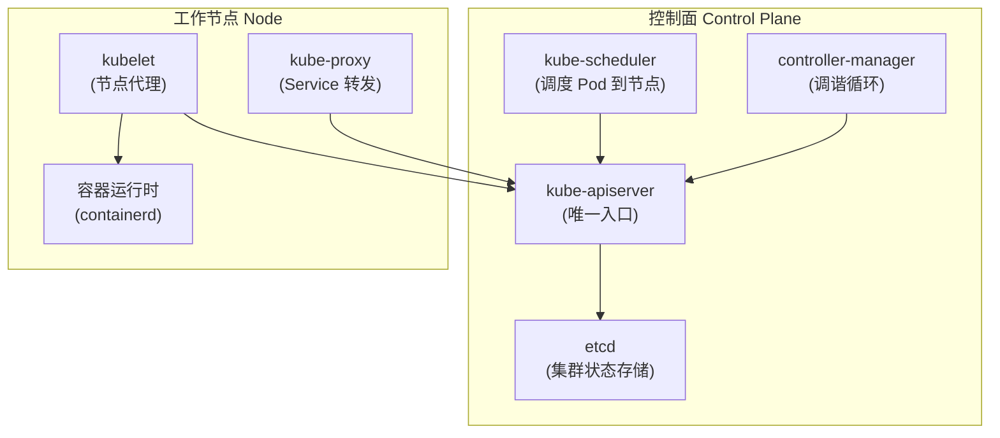

# Kubernetes 01 · 服务理论

> 四篇制：[01 理论](./01-理论) · [02 部署](./02-部署) · [03 功能](./03-功能) · [04 实战](./04-实战)
> 本篇讲 K8s 的架构与核心抽象。把"控制面怎么决策、Pod 怎么跑、Service 怎么找到 Pod"想明白，后面 kubectl 和排障才有依据。搭集群去 [02 部署](./02-部署)。

## 一、它是什么：容器集群编排

Docker 解决了"单机跑容器"，但生产有几十上百台机器、成千上万容器，谁来决定容器跑在哪台、挂了怎么自愈、怎么扩缩容、怎么滚动发布？**Kubernetes（K8s）就是容器集群的编排系统**——你声明"我要 3 个 nginx 副本"，它负责让现实始终等于这个声明。

核心思想是**声明式 + 调谐循环**：你写 YAML 描述期望状态，控制器不断对比"期望 vs 实际"，有差异就动手补齐。Pod 挂了重建、节点挂了迁移，都是调谐循环在干活，不需要人盯着。

## 二、架构：控制面与节点

- **kube-apiserver**：集群唯一入口，所有组件都通过它读写状态，kubectl 也是和它对话。
- **etcd**：分布式 KV 存储，存集群全部状态，**是集群的命根子，必须备份**。
- **kube-scheduler**：决定新 Pod 跑在哪个节点（看资源、亲和性、污点）。
- **controller-manager**：跑各种控制器（Deployment/ReplicaSet/Node 等），执行调谐。
- **kubelet**：每个节点的代理，接收 apiserver 指令、调用运行时起容器、上报状态。
- **kube-proxy**：维护 Service 的转发规则（iptables/ipvs），让 Service IP 能转到后端 Pod。
- **容器运行时**：1.24 后直接用 containerd（移除 dockershim），见 [Docker 架构](/services/container/docker/01-理论)。

## 三、Pod：最小调度单元

K8s 不直接管容器，而是管 **Pod**。把 Pod 想象成**一间合租屋**：

- 屋里住一个或几个**室友（容器）**；
- 全屋共用一个**门牌号（IP）**，室友之间用 `localhost` 串门；
- 有**共用储物柜（Volume）**，所有室友都能放东西；
- 屋子作为整体被调度到某台机器。

为什么多包一层？因为常有"主容器 + 跟班容器"的场景（sidecar 边车）：主容器写日志到共享目录，sidecar（filebeat）挂同一目录把日志采走。放进同一 Pod，共享网络和存储就天然配对。最常见是单容器 Pod。

Pod 是短暂的——重建后 IP 会变，所以**不能直接靠 Pod IP 访问**，要靠 Service（第五节）。

## 四、工作负载控制器

直接建 Pod 没人管它生死，所以用控制器：

| 控制器 | 用途 | 特点 |
|---|---|---|
| Deployment | 无状态应用 | 管 ReplicaSet，支持滚动更新/回滚，最常用 |
| StatefulSet | 有状态应用（数据库） | 稳定网络标识 + 有序部署 + 独立存储 |
| DaemonSet | 每节点一个（日志/监控采集） | 节点加入自动补一个 |
| Job / CronJob | 一次性 / 定时任务 | 跑完即止 |

Deployment → ReplicaSet → Pod 三层：Deployment 管版本与发布策略，ReplicaSet 保证副本数，Pod 真正跑容器。改镜像发版时 Deployment 建新 ReplicaSet 逐步替换旧的，这就是滚动更新。

## 五、Service 与 CoreDNS：怎么找到 Pod

Pod IP 会变，**Service 给一组 Pod 一个稳定的虚拟 IP（ClusterIP）和 DNS 名**。Service 靠 label selector 选中后端 Pod，kube-proxy 把发往 Service 的流量转到这些 Pod。

- **ClusterIP**：集群内访问（默认）。
- **NodePort**：在每个节点开端口，集群外可访问。
- **LoadBalancer**：云厂商挂负载均衡。
- **Headless（clusterIP: None）**：不分配 VIP，DNS 直接返回 Pod IP，StatefulSet 常用。

**CoreDNS** 给 Service 提供 DNS：`服务名.命名空间.svc.cluster.local`。同命名空间内直接用服务名就能解析——这和 [Docker 自建 bridge 的 DNS](/services/container/docker/03-功能) 思路一致，只是集群级。

::: tip Service Endpoints 为空 = 没选中 Pod
Service 靠 label 选 Pod。如果 `kubectl get endpoints` 是空的，说明 selector 和 Pod 的 label 对不上，或 Pod 没 Ready。这是 Service 不通的头号原因，见 [04 实战](./04-实战)。
:::

## 六、官方文档

- K8s 概念：<https://kubernetes.io/zh-cn/docs/concepts/>
- 组件：<https://kubernetes.io/zh-cn/docs/concepts/overview/components/>
- Pod：<https://kubernetes.io/zh-cn/docs/concepts/workloads/pods/>
- Service：<https://kubernetes.io/zh-cn/docs/concepts/services-networking/service/>

---

下一篇：[02 · 部署方案](./02-部署)（kubeadm 搭集群）。