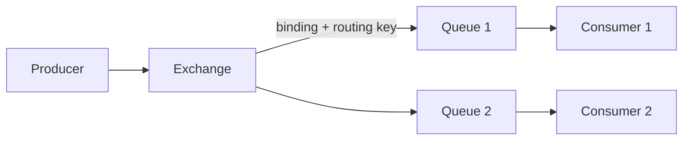

# RabbitMQ · 灵活路由的消息队列

> 单页四段：理论 → 部署 → 功能 → 实战。返回 [服务详解 · 中间件](/services/middleware/)。高吞吐场景对比 [Kafka](/services/middleware/kafka)。

## 01 · 服务理论

RabbitMQ 是实现 **AMQP** 协议的消息队列，强项是**路由灵活、确认完善、延迟低**，适合业务消息和复杂路由（订单、通知、任务分发）。和 Kafka 的分工：Kafka 吞吐极高、可回放，适合日志/大数据；RabbitMQ 路由精细、协议丰富，适合业务消息。

### AMQP 模型

生产者不直接把消息发给队列，而是发给 **Exchange（交换机）**，Exchange 按 **Binding（绑定规则）** 和 **Routing Key** 把消息路由到 **Queue**，消费者从 Queue 取。



### 四种 Exchange

| 类型 | 路由规则 | 场景 |
|---|---|---|
| direct | routing key 精确匹配 | 点对点 |
| topic | routing key 通配（`order.*`/`order.#`） | 按主题订阅 |
| fanout | 广播到所有绑定队列 | 广播通知 |
| headers | 按消息头匹配 | 少用 |

## 02 · 部署方案

```bash
sudo dnf install -y rabbitmq-server
sudo systemctl enable --now rabbitmq-server
sudo rabbitmq-plugins enable rabbitmq_management   # Web 管理 15672
```

管理台 `http://10.0.0.41:15672`（默认 guest/guest 只能本机登录，**生产建专用用户**）：

```bash
sudo rabbitmqctl add_user ops '请替换为强密码'
sudo rabbitmqctl set_user_tags ops administrator
sudo rabbitmqctl set_permissions -p / ops ".*" ".*" ".*"
```

集群：各节点 Erlang cookie 一致，`rabbitmqctl join_cluster rabbit@node1` 加入。

## 03 · 功能详解

### 消息不丢：确认 + 持久化

- **生产端**：开 publisher confirm，broker 落盘后回确认，失败重发。
- **broker**：exchange/queue 设 durable + 消息 delivery_mode=2 持久化。
- **消费端**：手动 ack（处理完再确认），别用 auto ack（取到就确认，崩溃丢消息）。

### 高可用队列

经典镜像队列已弃用，生产用 **Quorum Queue**（基于 Raft，多副本强一致），声明时 `x-queue-type=quorum`。节点挂了副本顶上，不丢消息。

### 死信与延迟

消息被拒绝/过期/队列满进入**死信交换机（DLX）**，可做失败重试或人工处理。延迟队列用 TTL + DLX 或延迟插件实现"下单 30 分钟未支付取消"。

## 04 · 实战参考

**典型用法**：订单服务发 `order.created` 到 topic exchange，库存/积分/通知服务各绑 `order.*` 订阅，互不依赖。失败消息进死信队列重试。

**常见坑**：

| 现象 | 原因 | 解法 |
|---|---|---|
| 消息丢失 | auto ack/没持久化 | 手动 ack + durable + confirm |
| 消息堆积 | 消费慢/消费者少 | 加消费者、prefetch 调优 |
| 内存告警阻塞生产 | 队列堆太多触发内存水位 | 消费提速/懒队列/扩内存 |
| 集群脑裂 | 网络分区 | 配 pause_minority 策略 |

`prefetch`（QoS）控制每个消费者未确认消息上限，避免一个消费者囤太多消息。

## 官方文档

- RabbitMQ：<https://www.rabbitmq.com/docs>
- 教程：<https://www.rabbitmq.com/tutorials>
- Quorum 队列：<https://www.rabbitmq.com/docs/quorum-queues>

---

返回 [服务详解 · 中间件](/services/middleware/)。