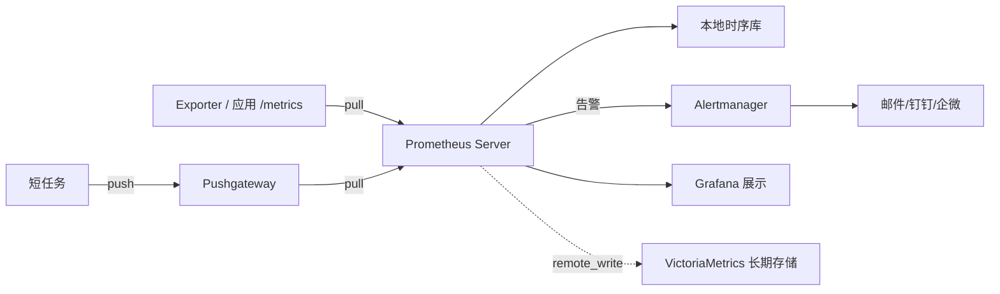

# Prometheus 01 · 服务理论

> 四篇制：[01 理论](./01-理论) · [02 部署](./02-部署) · [03 功能](./03-功能) · [04 实战](./04-实战)
> 本篇讲监控的本质和 Prometheus 的核心设计。把"Pull 模式、指标+标签、时序数据库"想明白，后面 PromQL 和告警才有依据。动手装去 [02 部署](./02-部署)。

## 一、监控系统是什么：六环节闭环

一套监控系统就像小区物业的安保体系，由六个环节组成闭环：

**数据产生 → 数据采集 → 数据存储 → 数据处理 → 数据展示 → 告警**

少任何一环都不完整：只采集不告警，等于装了摄像头没人看；只告警不存数据，报警了也没法回溯。Prometheus 负责采集、存储、查询、**产生**告警，展示靠 [Grafana](/services/observability/grafana)、发送告警靠 [Alertmanager](/services/observability/alertmanager)——职责是拆开的，别指望一个 Prometheus 全包。

### 可观测性三大信号

云原生时代一个应用拆成几十上百个服务，出问题不可能一台台登上去翻。**可观测性**就是"光看系统对外暴露的输出，就能判断内部哪里出了问题"。它有三支柱（用看病记）：

| 信号 | 类比 | 内容 | 工具 |
|---|---|---|---|
| 指标 Metrics | 体温计读数 | 可聚合的数值（CPU、QPS） | **Prometheus** |
| 日志 Logging | 病历本 | 一条条带时间的事件 | [ELK](/services/observability/elk)、Loki |
| 追踪 Tracing | 走廊监控回放 | 一个请求的完整调用链 | Jaeger、SkyWalking |

Prometheus 只管"指标"这一支，别指望它查日志、找调用链。

### 四个黄金指标

Google 总结的衡量在线服务健康的四个指标（用饭店记）：

- **延迟 Latency**：处理一个请求多久（点菜到上菜）。要区分成功和失败请求的延迟。
- **流量 Traffic**：每秒多少请求（饭点进客量），QPS/TPS。
- **错误 Errors**：失败请求比例（上错菜），HTTP 500/超时。
- **饱和度 Saturation**：资源多满（上座率），CPU/内存/磁盘利用率。

::: tip 阈值为什么设 80%
很多资源使用率到 80% 后性能陡降，所以告警阈值常设 80%～90%，而不是等 100% 才报。
:::

## 二、Prometheus 是什么

开源的**时序数据库 + 监控告警框架**，Go 开发，灵感来自 Google 内部 Borgmon。为云原生、容器环境设计，是当前容器监控的事实标准（传统 Zabbix 在动态扩缩容场景逐渐吃力）。

**它擅长**：记录任何纯数字的时间序列，多维标签灵活聚合；每个服务器独立工作、不依赖外部存储，故障时仍能看数据定位问题。

**它不擅长（心里要有数）**：

- 单机版**自身不支持集群**，高可用靠双机 + 远程存储。
- 上万目标时单机有瓶颈，用联邦/分片解决。
- **不保证 100% 精确**，采集可能丢点，**不能做计费账单**。
- 本身只采集+存储+查询+产生告警，展示和发送靠别的组件。

## 三、核心设计一：Pull 拉模式

Prometheus **主动去目标上"拉"数据**，而不是等对方推。像老师上课点名——谁没到（拉不到）当场就知道。

优点：

- **业务无侵入**：应用只要暴露标准 `/metrics` 接口，不用关心 Prometheus 在哪。
- **集中管控**：采集间隔、超时、标签、过滤全写在 Prometheus 配置里。
- **天然健康检查**：拉不到自动生成 `up=0`，直接对"实例存活"告警。
- **容器友好**：新 Pod 启动自动暴露指标。

缺点与补救：必须网络可达目标（放通端口）；短任务可能在两次拉取间就结束（用 **Pushgateway** 主动推）；内网深处拉不到（部署采集代理转发）。

::: warning Pushgateway 别推主机指标
Pushgateway 的数据会一直保留，主机挂了它还在显示旧值，造成"机器死了监控还正常"的假象。主机指标一律用 Node Exporter（拉不到自动 up=0），Pushgateway 只接批处理/定时任务。
:::

## 四、核心设计二：指标名 + 标签

每条时间序列由**指标名 + 一组标签（键值对）**唯一确定：

```text
http_requests_total{method="POST", endpoint="/api/tracks"}
```

`http_requests_total` 是指标名，`method="POST"` 表示只看 POST。**任何标签值的改变（含增删标签）都产生一条新序列**——这是"标签爆炸撑爆内存"的根源。所以标签只放可枚举、用来分组筛选的维度（实例/接口/方法/状态码），**绝不放每次都变的唯一值**（user_id/request_id/时间戳）。

### Job 与 Instance

- **Instance**：一个抓取目标，通常 `IP:端口`，对应一个进程。
- **Job**：一组同类实例的集合。用学校记：Job 是班级，Instance 是学生。

每次抓取自动生成体检指标：`up`（1 健康 0 挂）、`scrape_duration_seconds`（抓取耗时）、`scrape_samples_scraped`（抓到样本数）。

### 四种指标类型

| 类型 | 含义 | 例子 |
|---|---|---|
| Counter | 只增不减的累计值 | 请求总数、CPU 累计秒 |
| Gauge | 可增可减的瞬时值 | 内存使用、在线人数 |
| Histogram | 分桶统计分布 | 请求延迟分桶 |
| Summary | 客户端算分位数 | 延迟 P99 |

Counter 要用 `rate()` 求增速才有意义（见 [03 功能](./03-功能)）。

## 五、全家桶与数据流

| 组件 | 角色 |
|---|---|
| Prometheus Server | 抓取存储、执行规则、产生告警 |
| Exporter | 把 MySQL/Nginx/主机数据翻译成 Prometheus 格式 |
| Pushgateway | 短任务指标的临时快递柜 |
| Alertmanager | 告警去重/分组/静默/路由发送 |
| Grafana | 画仪表盘大屏 |
| 服务发现 | 动态发现监控目标 |



数据流：服务发现找目标 → 周期 pull 指标 → 存本地 TSDB（先内存+WAL，再压缩落盘）→ 记录规则预算/告警规则判断 → 告警推 Alertmanager → 人通过 Grafana 看。

## 六、官方文档

- Prometheus：<https://prometheus.io/docs/>
- 概念：<https://prometheus.io/docs/concepts/data_model/>
- 指标类型：<https://prometheus.io/docs/concepts/metric_types/>
- 最佳实践：<https://prometheus.io/docs/practices/naming/>

---

下一篇：[02 · 部署方案](./02-部署)（装 Prometheus + Node Exporter）。