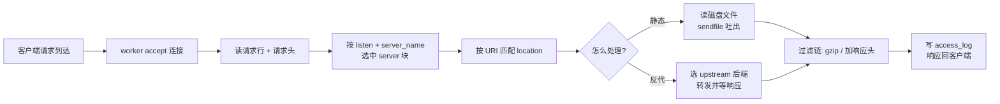

# Nginx 01 · 服务理论

> 四篇制：[01 理论](./01-理论) · [02 部署](./02-部署) · [03 功能](./03-功能) · [04 实战](./04-实战)
> 本篇不堆配置，专门讲"它是什么、为什么这么设计、一个请求是怎么被处理的"。把这些想明白，后面的配置就不是死记硬背，而是顺理成章。动手部署直接去 [02 部署](./02-部署)。

## 一、从 C10K 问题说起：Nginx 为什么诞生

要理解 Nginx，得先理解它要解决的那个老问题——**C10K**：一台服务器如何同时扛住一万个并发连接。

早期的 Apache 用的是 **prefork / 每连接一进程（或线程）** 模型：来一个连接，就 fork 一个进程或开一个线程去专门伺候它，这个进程/线程从头到尾陪着这个连接，哪怕连接大部分时间都在"等客户端把请求发完""等后端把响应算完"。连接少的时候这模型很直观，但连接一多就崩：

- **内存吃紧**：每个进程/线程都要独立的栈和上下文，几千个连接就是几千份开销，内存先撑不住。
- **上下文切换爆炸**：CPU 在几千个线程之间来回切换，真正干活的时间被切换本身吃掉大半，吞吐不升反降。
- **大量时间在空等**：网络 IO 是慢的，一个连接 99% 的时间在等数据，而那个线程却傻等着、占着资源不释放。

问题的本质是：**用"一个执行单元陪一个连接"的方式去应对"连接多但每个都很闲"的场景，是巨大的浪费。**

Nginx（Igor Sysoev 开发，2004 年公开发布）给出的答案是反过来：**不让执行单元陪着连接等，而是让一个执行单元同时照看成千上万个连接，谁的数据到了就处理谁。** 这就是"事件驱动 + 非阻塞 IO"。下面第三节展开讲它为什么快。

## 二、它是什么：HTTP 服务器 + 反向代理

Nginx 首先是两个东西的合体：

1. **HTTP 服务器**：能直接接收 HTTP 请求、读取磁盘上的文件、把 HTML/图片/JS/CSS 吐回给浏览器。静态资源它自己就能服务，而且非常快。
2. **反向代理服务器**：它自己不产生业务内容，而是把请求"转手"发给后面的应用服务器（Tomcat、Node、PHP-FPM、Go 服务……），再把后端的响应转回给客户端。客户端从头到尾只认识 Nginx，不知道后面有几台应用。

这里要分清**正向代理**和**反向代理**，方向正好相反：

- **正向代理**代理的是**客户端**。客户端知道代理的存在，主动把请求交给代理，让代理替自己去访问目标（比如公司出口代理、科学上网）。目标服务器看到的是代理的 IP，不知道真实客户端是谁。
- **反向代理**代理的是**服务端**。客户端不知道代理的存在，以为自己访问的就是目标网站；实际上是 Nginx 在门口接待，再决定把请求交给后面哪台应用。后端服务器被"藏"在代理后面。

```text
正向代理：  客户端 ──> [代理] ──> 目标服务器      （代理替客户端出门）
反向代理：  客户端 ──> [Nginx] ──> 后端应用集群    （代理替服务端看门）
```

想明白这个方向，就理解了 Nginx 在架构里的位置：它是**服务端的统一入口**。正因为所有流量都从它过，它才能顺理成章地做这几件事：

- **静态资源服务**：图片、前端打包产物直接由它吐，不必惊动后端应用。
- **负载均衡**：把请求按策略分给一组后端（upstream），后端扩容缩容客户端无感。
- **统一 TLS**：HTTPS 在 Nginx 这一层卸载，后端之间走明文 HTTP，证书只在一处管理。
- **流量治理**：限流、限连接、缓存、压缩、灰度分流、黑白名单——都在入口统一做。

## 三、为什么快：事件驱动 + epoll + 非阻塞

这是 Nginx 最核心的设计，值得讲透。

### 3.1 非阻塞 IO + IO 多路复用

传统阻塞 IO 里，线程调用 `read()` 读 socket，如果数据还没到，线程就**卡在那里睡死**，直到数据来。一个线程同一时刻只能等一个连接。

Nginx 把 socket 设成**非阻塞**：`read()` 时如果没数据，立刻返回"暂时没有"，线程不等、马上走开去干别的。那它怎么知道哪个连接的数据到了？靠 **IO 多路复用**——在 Linux 上就是 **epoll**。

epoll 的作用是：你把成千上万个 socket 都"登记"给它，然后调用一次 `epoll_wait()`，内核会把**当前已经有事件（可读/可写）的那几个 socket** 返回给你。你只处理这几个，处理完再回去 `epoll_wait()`。没事件的连接根本不占用 CPU。

于是单个 worker 进程的工作循环就是：

```text
while (运行中) {
    events = epoll_wait(所有登记的连接)   // 没事件就睡，有事件立刻醒
    for (每个就绪的连接) {
        非阻塞地读/写一点数据，推进这个连接的状态机
        // 绝不阻塞等待，处理不完下一轮再来
    }
}
```

**一个进程、一个循环，照看上万连接**，内存只占一份，没有线程切换。这就是 Nginx 扛高并发的根本。

### 3.2 master / worker 分工

Nginx 启动后是一组进程，分两类角色：

```text
client ──> Nginx master（root 运行，管理配置与进程）
              ├── worker × CPU 核数（真正处理请求，非阻塞事件循环）
              ├── cache manager / cache loader（管理磁盘缓存）
              └──> upstream 后端应用 / 本地静态文件
```

- **master 进程**以 root 运行，但**不处理任何请求**。它负责：读取并校验配置、绑定监听端口（80/443 是特权端口，需要 root）、fork 并管理 worker、接收信号（reload/quit）。
- **worker 进程**以普通用户（`nginx` 或 `www-data`）运行，**真正处理请求**。每个 worker 内部就是上面那个 epoll 事件循环。worker 之间相互独立，一个 worker 崩溃不影响别的，master 会立刻补一个新的。

**为什么 worker 数一般等于 CPU 核数（`worker_processes auto`）？** 因为每个 worker 是单线程事件循环，一个 worker 就能吃满一个核。开比核数多的 worker 不会更快，反而增加进程间争抢监听连接的开销和上下文切换。这跟"线程越多越快"的直觉相反——事件驱动模型里，**核数才是并行度的上限**。

### 3.3 两个加分项：sendfile 与 keepalive

- **sendfile（零拷贝）**：吐静态文件时，传统做法是"磁盘→内核缓冲→用户态缓冲→socket 缓冲"来回拷贝。开启 `sendfile on` 后，数据直接在内核里从文件描述符送到 socket，少两次拷贝和两次用户态/内核态切换，静态文件吞吐明显更高。
- **keepalive（连接复用）**：HTTP 底层是 TCP，建连要三次握手、TLS 还要额外握手。`keepalive_timeout` 让一个 TCP 连接处理完一个请求后不立刻关，接着处理同一客户端的下一个请求，省掉反复握手。对后端 upstream 同理（见 [03 · upstream](./03-功能)）。

## 四、一个请求的一生

把前面的零件串起来，看一个请求从进来到出去经历了什么。理解这条链路，排障时就知道该在哪一环下手。



用文字再走一遍：

1. **接入**：worker 的 epoll 发现监听 socket 可读，`accept()` 拿到新连接。
2. **读请求**：非阻塞地读请求行（`GET /api/user HTTP/1.1`）和请求头。
3. **选虚拟主机**：根据请求打到哪个 `listen` 端口、`Host` 头匹配哪个 `server_name`，确定用哪个 `server {}` 块。这就是"一台 Nginx 托管多个站点"的原理。
4. **匹配 location**：在选中的 server 里，按 URI 找出最匹配的 `location {}`，决定这个请求归谁管。**匹配有优先级，不是按书写顺序**（详见 [03](./03-功能)）。
5. **处理**：location 里要么 `root`/`try_files` 读静态文件，要么 `proxy_pass` 转给 upstream 后端。
6. **过滤**：响应经过一串过滤模块——gzip 压缩、加响应头、sub_filter 替换等。
7. **记录与返回**：写 access_log，把响应发回客户端。

Nginx 内部把这条链路拆成 11 个标准阶段（post-read、server-rewrite、find-config、rewrite、access、content、log 等），第三方模块就挂在这些阶段上。日常不必背全，但记住"**先选 server、再选 location、再决定静态还是转发**"这个主干，绝大多数配置问题都能定位。

## 五、六个核心概念逐个讲

下面这六个概念是读配置的钥匙。每个先讲清楚，再给一个最小例子。

### 5.1 server：一个虚拟主机

一个 `server {}` 块就是一个站点，由 `listen`（监听哪个端口）+ `server_name`（响应哪个域名）唯一确定。Nginx 收到请求后，用 `Host` 头去匹配 `server_name`：精确名 > 前缀通配（`*.example.com`）> 后缀通配 > 正则。**如果都没匹配上，就用该端口的默认 server**（第一个，或显式标 `default_server` 的那个）。这就是为什么"配了域名却访问到别的站"——多半是 `server_name` 没匹配上，落到了默认 server。

```nginx
server {
    listen 80;
    server_name example.com;   # 只响应 Host: example.com
    ...
}
```

### 5.2 location：按 URI 决定处理方式

`location` 是 server 内部的分流器，按请求的 URI 路径决定"这段请求怎么处理"。它有一套匹配优先级（精确 `=` > 前缀 `^~` > 正则 `~`/`~*` > 最长普通前缀），**和书写顺序无关**。这是 Nginx 最高频的坑，单独在 [03 · location 匹配顺序](./03-功能) 用例子讲透。

### 5.3 upstream：一组后端 + 负载策略

`upstream {}` 定义一组后端服务器和分发策略，`proxy_pass http://名字` 把请求交给它。它让"后端有几台、谁健康、按什么比例分"集中在一处管理。轮询、权重、ip_hash、least_conn 各策略的行为与适用场景见 [03](./03-功能)。

```nginx
upstream backend {
    server 10.0.0.130:8080;
    server 10.0.0.131:8080;
}
```

### 5.4 root 与 alias：静态目录的两种拼法（高频坑）

两者都指定静态文件目录，但**拼接路径的方式不同**，这是新手最常踩的坑：

- `root`：把**完整 URI** 拼到 root 后面。
- `alias`：用 alias 的值**替换掉 location 匹配的那段前缀**，再拼剩余部分。

```nginx
# 请求 /img/a.png
location /img/ { root /var/www; }    # 实际找 /var/www/img/a.png  （URI 原样拼接）
location /img/ { alias /var/www/; }  # 实际找 /var/www/a.png      （/img/ 被替换掉）
```

记忆口诀：**root 是"追加"，alias 是"替换"**。用 alias 时 location 和 alias 的结尾斜杠要配套，否则路径会拼错。

### 5.5 buffer 与 timeout：和后端慢的博弈

反向代理时，Nginx 一边收客户端、一边连后端，两侧速度往往不一致。`proxy_buffering` 让 Nginx 先把后端响应缓冲下来，再按客户端的速度慢慢发——这样后端连接能尽快释放，不被慢客户端拖住。而各种 `timeout` 定义了"等多久算超时"：连后端建连超时、等后端响应超时、给客户端发响应超时。**504 几乎总是 `proxy_read_timeout` 到了而后端还没算完**，502 则是后端根本没给有效响应。两者的区别在 [04 · FAQ](./04-实战) 展开。

### 5.6 配置文件的层级

Nginx 配置是嵌套的块结构，理解层级就知道一个指令该写在哪：

```text
全局块        # worker_processes、error_log、pid 等进程级设置
events { }    # worker_connections、use epoll 等连接级设置
http {        # 整个 HTTP 层的公共设置：日志格式、gzip、upstream
    server {  # 一个虚拟主机
        location { }   # 一段 URI 的处理规则
    }
}
```

指令大多有"作用域"：写在 http 里对所有 server 生效，写在 server 里只对该站生效，写在 location 里只对该段 URI 生效，**内层覆盖外层**。`nginx -t` 校验的就是这套结构合不合法。各发行版的文件组织见 [02 · 目录结构](./02-部署)。

## 六、选型：四层与七层，Nginx / HAProxy / LVS

"负载均衡"这个词容易混，关键看它工作在 OSI 的哪一层：

- **四层（L4，传输层）**：只看 IP + 端口，不解析 HTTP 内容。它不懂 URL、不懂 Host，只是把 TCP/UDP 包转发到后端。代表是 **LVS**，跑在内核态，吞吐极高、抗并发极强，但做不了"按路径分流"这种细活。
- **七层（L7，应用层）**：能解析 HTTP，看得懂 URL、Host、Header、Cookie。因此能做 URI 路由、TLS 卸载、按头分流、缓存、改写。代表是 **Nginx** 和 **HAProxy**。

| | 工作层 | 强项 | 典型位置 |
|---|---|---|---|
| **LVS** | 四层（内核态） | 极高吞吐、抗并发、DR 模式回包不过自身 | 最前置 VIP，把流量分给一排 Nginx |
| **Nginx** | 七层 | 静态资源、URI 路由、TLS、模块生态、配置灵活 | 接入层七层入口 |
| **HAProxy** | 四/七层 | 专业负载、精细健康检查、会话保持、可观测 | 纯负载场景替代 Nginx |

**为什么本站用"LVS 在前 + Nginx 在后"两层？** 因为两者互补：LVS 在内核态扛住最前面的海量连接和 VIP 漂移（配合 Keepalived 做高可用），把流量分给后面的 Nginx；Nginx 再做它擅长的七层细活——静态托管、按路径反代、TLS。让专业的层干专业的事，而不是用一个组件硬扛所有职责。完整组合见 [部署方案 · 接入层高可用](/deploy/stacks/lb-ha)。

**什么时候不选 Nginx？** 如果只需要纯粹的四层高吞吐负载、不需要任何 HTTP 语义，LVS/HAProxy 更专一；如果需要极复杂的动态路由和服务网格，可能上 Envoy/Istio。Nginx 的甜区是"七层入口 + 静态 + 反代 + 适度负载"这个最广的场景。

::: tip 本站就是 Nginx 托管的静态站
你现在看的这个站，就是 Nginx 直接吐 VitePress 构建出的静态文件。部署细节见 [我的项目 · 禾光知寒站点](/projects/site-blog)；LVS + Keepalived 原理见 [LVS + Keepalived 指南](/services/web/lvs-keepalived)。
:::

## 七、版本与官方文档

Nginx 有两条分支：**mainline**（主线，含新特性与实验功能）和 **stable**（稳定，只从主线 cherry-pick 关键修复，不加新功能）。生产环境一般选 stable，图的是"行为可预期"；想尝鲜新特性才用 mainline。注意 stable 不代表"更老更稳"，它和 mainline 共享同一份核心代码，只是更新策略不同。

- 文档总入口：<https://nginx.org/en/docs/>
- 入门指南：<https://nginx.org/en/docs/beginners_guide.html>
- 官方 Linux 软件源：<https://nginx.org/en/linux_packages.html>
- 开发指南（理解模块与阶段）：<https://nginx.org/en/docs/dev/development_guide.html>

---

下一篇：[02 · 部署方案](./02-部署)（包管理单机 / 编译安装 / 容器化，含验证）。